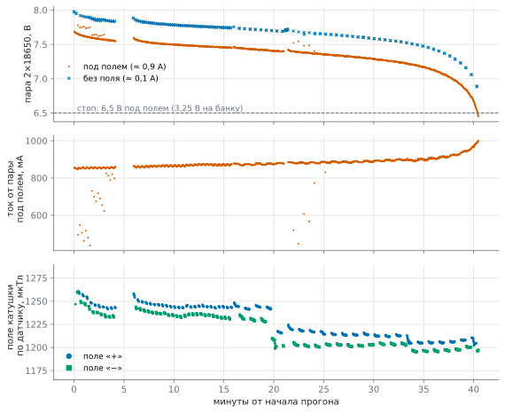

# Катушка колеса 1 на выносливость

Замер 27.10.2026. Вопрос: хватит ли пары 18650 катушки на опыт **20 минут на полном поле**, держится ли поле,
пока садятся аккумуляторы, и сколько на самом деле отдаёт пара с надписью «2600 мА·ч».

## Как мерили

- Контур катушки колеса 1 по [общей схеме](wiring.md#аккумуляторы-ina219): пара 2×18650 («2600 мА·ч» на
  банке) → выключатель → INA219 (0x40) → DC‑DC 5,1 В → мост DRV8871 и агент катушки №13. Катушка — тороид
  около 5 Ом.
- Ток и напряжение пары — INA219 у №13, раз в секунду. Поле — магнитометр MLX90393 агента №20 внутри трубки
  катушки: показания минус фон (секунды без поля рядом по времени).
- `tools/coil_soak.py`: поле по кругу «+ → пауза 2 с → − → пауза 2 с», первые 14 минут — по 10 с, дальше — по
  30 с; стоп, когда пара под полем просядет до 6,5 В (3,25 В на банку). Журналы —
  `data/tests/coil_soak_2026-10-27_*.csv`, график — `tools/coil_soak_plot.py`.
- Перерывы на графике: 4–6 и 21 мин — перезапуски сервера (поле не шло), 16 мин — переход на фазы по 30 с.



## Что получилось

| | |
|---|---|
| всего | 40,5 мин, из них **поле включено 34,3 мин** |
| израсходовано | **511 мА·ч** (и около 25 мА·ч на проверки до начала) |
| ток от пары под полем | 0,85 А в начале → 0,98 А в конце; без поля — 0,1 А (сам №13 и DC‑DC) |
| напряжение под полем | 7,65 → 7,25 В за 30 мин, дальше быстрее: 7,0 В на 37‑й мин, 6,45 В на 40,5‑й — стоп |
| напряжение без нагрузки | 8,02 В в начале, 6,92 В через минуту после конца |
| поле катушки у датчика | 1,20–1,26 мТл, обоими знаками, **до самого конца ровное** |

- **Поле не слабеет, когда пара садится**: DC‑DC держит 5,1 В на мосту до последней минуты, а ток от пары
  растёт (та же мощность при меньшем напряжении: 0,85 → 0,98 А).
- За 30 с включения поле слабеет на 0,1–0,3 %, за первые минуты после паузы — на 1,5 % и дальше держится:
  провод катушки немного греется (сопротивление меди +0,4 % на градус — это около 4 °C).
- Ступенька −2 % на 20‑й минуте при том же токе — сдвинулся датчик в трубке (сама катушка ни при чём).
- «+» и «−» по модулю отличаются на 0,8 % — разница осей датчика или фон посчитан не идеально.
- Поле неидеального тороида внутри и снаружи — расчёт [поле тороида](toroid_field.html).

## Ёмкость пары: не 2600

- В начале без нагрузки — 8,02 В, это 4,01 В на банку: заряжена примерно на **80 %** (полная — 8,4 В,
  4,2 В на банку). В конце без нагрузки — 6,92 В, 3,46 В на банку: осталось около **5 %**.
- За эти ~75 % пара отдала 0,53 А·ч → **полная ёмкость пары — около 0,7 А·ч**, в 3–4 раза меньше надписи.
  Даже если в начале было не 80, а 60 %, — около 0,9 А·ч.
- Внутреннее сопротивление высокое: под 0,75 А напряжение садится на 0,32 В — около 0,4 Ом на пару вместе с
  шунтом (0,1 Ом), выключателем и проводами, то есть 0,1–0,15 Ом на банку. У хороших 18650 — 0,03–0,05.
- Вывод: банки слабые — дешёвые с завышенной надписью или изношенные. Проверить: пустые банки поставить на
  зарядку, которая показывает, сколько мА·ч вошло, — это и есть их ёмкость; или зарядить пару полностью
  (8,4 В) и повторить прогон — сервер сам запишет измеренную ёмкость (`battery.json`).

## Хватит ли на 20 минут

- **Да.** Эта пара с ~80 % дала 34 минуты поля; 20 минут полного поля — около 0,3 А·ч. С полной зарядки
  такие банки дадут около 45 минут поля; хорошие банки на 2,5–3 А·ч — 2,5–3 часа.
- **Шина агентов** берёт больше: шесть агентов под счётом — 1,5–2 А от пары. С такими же банками шина сядет
  через 20–25 минут, раньше катушки. Для опыта на 20 минут — заряжать обе пары перед каждым опытом или
  поставить банки получше ([спецификация](spec.md)).
- Чтобы «≈ мин» и пауза «сели аккумуляторы» были честными, в эксперименте (раздел «аккумуляторы») ёмкость
  пары поставить по замеру — около 700 мА·ч, пока банки эти.

## Как повторить

```
python tools/coil_soak.py --wheel 1 --mag 20 --on 30 --gap 2 --stop-v 6.5
python tools/coil_soak_plot.py docs/img/coil_soak_<дата>.svg data/tests/coil_soak_<дата_время>.csv
```

Раз в секунду в `data/tests/coil_soak_<дата_время>.csv` — что задано, напряжение и ток INA219, израсходованные
мА·ч и поле магнитометра колеса. Остановить раньше — Ctrl+C в окне скрипта или файл `data/tests/coil_soak.stop`;
поле в конце выключается.
