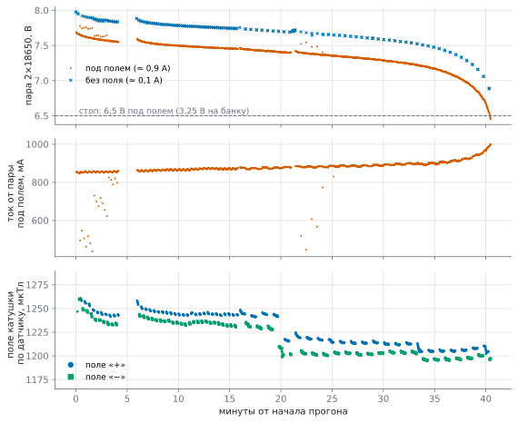

# Wheel 1 coil endurance test

*English translation of [docs/coil_test.md](../coil_test.md) — the Russian original is the source of truth.
Labels inside the diagrams are in Russian.*

Measured on 2026-10-27. The question: is a pair of 18650 cells enough for a **20-minute run at full field**, does
the field hold while the cells run down, and how much does a pair labelled "2600 mAh" really deliver.

## How we measured

- The wheel 1 coil circuit as in the [overall diagram](wiring.md#batteries-ina219): a pair of 2×18650 cells
  ("2600 mAh" on the can) → switch → INA219 (0x40) → 5.1 V DC‑DC → DRV8871 bridge and coil agent №13. The coil is a
  toroid of about 5 Ω.
- Current and voltage of the pair — the INA219 at №13, once a second. Field — the MLX90393 magnetometer of agent
  №20 inside the coil tube: readings minus background (field-off seconds close in time).
- `tools/coil_soak.py`: the field cycles "+ → 2 s pause → − → 2 s pause", 10 s each for the first 14 minutes, then
  30 s each; stop when the pair sags to 6.5 V under field (3.25 V per cell). Logs —
  `data/tests/coil_soak_2026-10-27_*.csv`, plot — `tools/coil_soak_plot.py`.
- Gaps in the plot: 4–6 and 21 min — server restarts (no field), 16 min — switch to 30 s phases.



## What we got

| | |
|---|---|
| total | 40.5 min, of which **field on for 34.3 min** |
| used | **511 mAh** (plus about 25 mAh for checks before the start) |
| current from the pair under field | 0.85 A at the start → 0.98 A at the end; without field — 0.1 A (№13 itself and the DC‑DC) |
| voltage under field | 7.65 → 7.25 V over 30 min, then faster: 7.0 V at minute 37, 6.45 V at minute 40.5 — stop |
| open-circuit voltage | 8.02 V at the start, 6.92 V one minute after the end |
| coil field at the sensor | 1.20–1.26 mT, both signs, **flat right to the end** |

- **The field does not weaken as the pair runs down**: the DC‑DC holds 5.1 V on the bridge until the last minute,
  and the current from the pair rises (the same power at a lower voltage: 0.85 → 0.98 A).
- Over 30 s of field the field drops by 0.1–0.3 %, over the first minutes after a pause by 1.5 %, and then holds:
  the coil wire warms a little (copper resistance +0.4 % per degree — that is about 4 °C).
- A −2 % step at minute 20 at the same current — the sensor moved in the tube (the coil itself is not to blame).
- "+" and "−" differ in magnitude by 0.8 % — a difference between sensor axes, or the background not subtracted
  perfectly.
- The field of a non-ideal toroid inside and outside — the [toroid field](../toroid_field.html) calculator (Russian).

## Capacity of the pair: not 2600

- At the start, open-circuit 8.02 V, that is 4.01 V per cell: charged to roughly **80 %** (full is 8.4 V, 4.2 V
  per cell). At the end, open-circuit 6.92 V, 3.46 V per cell: about **5 %** left.
- Over these ~75 % the pair gave 0.53 Ah → **the full capacity of the pair is about 0.7 Ah**, 3–4 times less than
  the label. Even if it started at 60 % rather than 80 %, it is about 0.9 Ah.
- The internal resistance is high: under 0.75 A the voltage drops by 0.32 V — about 0.4 Ω per pair together with
  the shunt (0.1 Ω), switch and wires, that is 0.1–0.15 Ω per cell. Good 18650 cells have 0.03–0.05.
- Conclusion: the cells are weak — cheap ones with an inflated label, or worn. To check: put empty cells on a
  charger that shows how many mAh went in — that is their capacity; or charge the pair fully (8.4 V) and repeat
  the run — the server records the measured capacity itself (`battery.json`).

## Is it enough for 20 minutes

- **Yes.** This pair at ~80 % gave 34 minutes of field; 20 minutes of full field is about 0.3 Ah. From a full
  charge such cells give about 45 minutes of field; good 2.5–3 Ah cells — 2.5–3 hours.
- **The agent bus** draws more: six agents computing take 1.5–2 A from their pair. With the same cells the bus
  runs down after 20–25 minutes, before the coil. For a 20-minute experiment — charge both pairs before every
  experiment or fit better cells ([bill of materials](spec.md)).
- So that "≈ min" and the pause "batteries ran down" are honest, set the pair capacity in the experiment (section
  "batteries") to the measured value — about 700 mAh, while these cells are in use.

## How to repeat

```
python tools/coil_soak.py --wheel 1 --mag 20 --on 30 --gap 2 --stop-v 6.5
python tools/coil_soak_plot.py docs/img/coil_soak_<date>.svg data/tests/coil_soak_<date_time>.csv
```

Once a second `data/tests/coil_soak_<date_time>.csv` gets what was commanded, the INA219 voltage and current, the
mAh used and the wheel magnetometer field. To stop earlier — Ctrl+C in the script window or the file
`data/tests/coil_soak.stop`; the field is switched off at the end.
