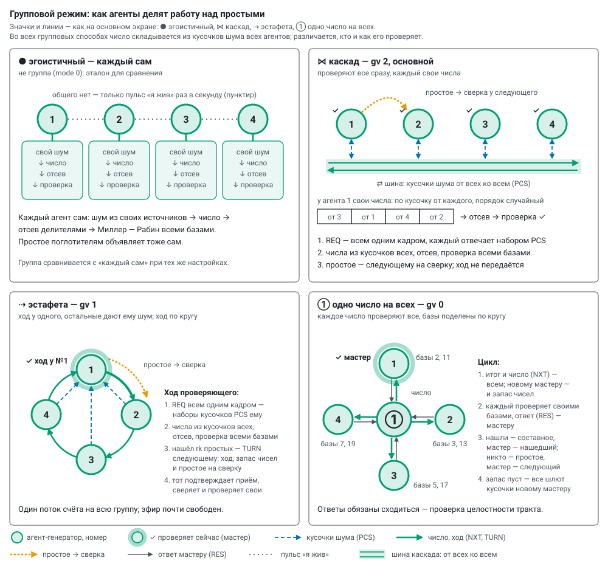

# Group mode: the protocol and what we measure

*English translation of [docs/group_protocol.md](../group_protocol.md) — the Russian original is the source of
truth. Labels inside the diagrams are in Russian.*

The `prime_lab` firmware, module `group.cpp`: the protocol lives in its own task on the radio core, the compute core
works on jobs. A group is a wheel subgroup (letter а–з on the main screen); the server sends the membership and the
participants' addresses together with the settings — a new agent joins without reflashing the others. The way is set
by `gv`, the icons are as on the main screen. When to choose which way — [modes.md](modes.md), "Cooperation"; the
exchange step by step, slowed down, — the window «↻ Как работает» (how it works), section 2.

| icon | way | `gv` | who tests | what goes over the air |
|---|---|---|---|---|
| ● | selfish — not a group (`mode` 0), the reference | — | each its own numbers from its own noise | only the pulse |
| ⋈ | **cascade** — the main one | 2 | everyone at once, each its own numbers | pieces from all to all, primes for cross-checking |
| ⇢ | relay | 1 | one, the turn goes round | pieces to the tester, the turn with a reserve of numbers |
| ① | one number for all | 0 | everyone the same number, the bases divided | the number and the verdict from the master, answers and pieces to it |

## 1. Numbers from everyone's noise pieces

* **A piece** — the length of the number divided by the number of agents, rounded up to 4 bytes (256 bits: two —
  16 bytes, four — 8). Each agent takes the noise from **its own** sources ([randomness.md](randomness.md)).
* **A set** — K pieces in one PCS frame, for K candidates. One number for all — K = `k` (default 24); relay and
  cascade — as many as fit in a frame, up to 64 (256 bits, four — 64).
* **A candidate** — one piece from each in random order (the order — from a fast xorshift128+ generator seeded by
  the RNG for every gathering), the top bit and oddness, sieving by divisors (`td`): with `td` 1000, out of 24
  candidates about four survive on average.
* **Pieces in advance** (`pre`, only with the RNG alone): the set is ready before it is asked for. One number keeps one
  set, relay and cascade — up to four; slow sources (CSI, ADC, jitter) gather on request.
* **Two cores** (`dc` 1, relay and cascade): the noise for the pieces is gathered by a producer on the radio core.
  The relay also assembles and sieves there (16 candidates per pass), the compute core only tests; the cascade sieves
  on the compute core — the radio core is busy with noise for everyone's numbers.

## 2. Cascade and relay (`gv` 2 and 1)

The number is assembled from everyone's pieces, and one agent tests it — with all bases in a row. Splitting the test
of one number does not pay: a composite is rejected by the very first base (≈ 1 ms at 256 bits), while a frame takes
longer.

* **Cascade** — everyone tests at once, each its own numbers, and each also provides pieces for everyone else's
  numbers. A prime found goes to the next in order for cross-checking; the turn is not passed.
* **Relay** — one holds the turn, the others give it noise. Having found `rk` primes, it passes the turn and the rest
  of the reserve of numbers to the next in order (TURN, addressed); that one acknowledges, cross-checks the prime and
  at once tests its own. One computing stream for the whole group.

The tester's turn:

1. **Gathering round.** The request for pieces — to everyone in one broadcast frame (REQ), repeats — addressed to
   those who did not send. Each replies with a set (PCS).
2. **Numbers.** K candidates from everyone's pieces, sieving, the survivors go into the reserve. A new round — while
   the reserve is less than "survivors per round plus two in reserve"; the cascade keeps the reserve one round ahead
   (survivors of two rounds plus two).
3. **Testing.** The compute core takes packets from the reserve (8 numbers at 256 bits) and tests with all bases until
   the first prime: a composite — one base, a prime — all of them.
4. **Cross-check** — instead of the "one number" agreement. The receiver of the prime tests it with one base the
   tester did not use (the next after `nb`: with 8 bases — 23; with 12 there is no cross-check). If it finds a witness,
   the "prime" is composite: `split`.
5. **Waiting for pieces** (`pw`). 0 — wait for everyone, re-asking up to 3 times; if a participant still has not sent,
   it is **silent** (§ 4). A deadline in ms — after it the missing pieces are replaced by sets of its own noise: the
   number is still random, it just has less foreign noise in it. If it does not have enough sets of its own for
   replacement, the agent accumulates them and gives them to its neighbours later. Rounds with replacement and the
   number of replacements — `tr` in the `grp` packet; on the main screen — "pieces from everyone, % of numbers".

## 3. One number for all (`gv` 0)

Every number is tested by everyone; the Miller–Rabin bases are divided round-robin (place in the group, place + N, …):
with 8 bases and two agents the first tests 2, 5, 11, 17, the second — 3, 7, 13, 19. At an agent the test stops at the
first base that says "composite". A cycle is two messages per agent: the verdict with the number, and the answer.

1. **The number comes with the verdict of the previous cycle** (NXT). Everyone at once tests it with their bases and
   answers the master (RES): whether a witness was found, by which base, how much was computed.
2. **Verdict** (NXT). If someone found one — the number is composite, the next master is the finder (if several found
   one — the choice by a seed from the SHA-256 of the number itself). If nobody found one — the number is prime: the
   master records it and hands mastership to the next in order. The same message carries the number of the next cycle,
   and to the new master — also the rest of the reserve (at 256 bits — up to 16 numbers).
3. **Replenishing during testing.** When the reserve runs out, the verdict tells everyone "send pieces to the new
   master" (`want`): each gives a set at once and starts testing, the master assembles and sieves while everyone tests.
4. **Without a number** (start of a session, a break): the master asks for pieces with a request (REQ), sieves and
   sends out the number itself (NUM).

A group also works with one agent: it is its own master, tests with all bases and sends no protocol frames.

**Agreement.** Answers about one number must agree: a random composite gives a witness to almost any base (strong
pseudoprimes to the first bases do not occur among random 256-bit numbers), so in every cycle either everyone found one
or nobody did. The master counts:

* `agr` — cycles where everyone's answers were compared;
* `split` — not everyone found one: a pseudoprime to someone's bases (the server will re-check) or an error in computing
  or transmission;
* `dis` — in agreement mode (`all` 1: all bases at each agent, the same order) the first witness bases differ between
  agents.

The number of the last disagreement and the agents' answers — `gls` in the `grp` packet; on the main screen —
"agreement %" in the group popup. This is an integrity check of the whole path: there should be no disagreements at
all.

## 4. Failures

| what happened | what the protocol does | counter |
|---|---|---|
| one number: no answer about the test | the master repeats the number (NUM) to the silent one, up to 3 times, then a new cycle | re-asks; break: test |
| one number: no pieces | the master repeats the request (REQ), up to 3 times, then gathering again | re-asks; break: gathering |
| one number: the verdict did not reach the new master | answers and pieces are already coming to it — it keeps them and asks for the verdict again (ASK) | re-asks; "before the verdict" |
| one number: the new master is silent for more than 4 cycles (at least 50 ms) | the previous master repeats the verdict to it, up to 3 times | re-asks; break: relay |
| one number: a participant has not heard the master for 1.5 s or more | starts a cycle itself (the first in order — before the others) | mastership taken over |
| one number: two masters at once | the one with the lower cycle number gives way (if equal — the higher agent number) | two masters |
| relay, cascade: no pieces after three requests (`pw` 0) | the participant is silent: its pieces — own noise | break: gathering; `mute` |
| relay, cascade: the `pw` deadline passed | the missing pieces — own noise | `tr` |
| relay: the next one did not acknowledge the turn | TURN up to 3 more times, then the turn goes to the one after it; the one that did not accept is silent | re-asks; break: relay; `mute` |
| relay: the tester has not been heard for 1.5 s or more | the next in order takes the turn, the others later, in turn | turn taken over |
| relay: two testers at once | the one with the lower turn number gives way (if equal — the higher agent number) | two testers |
| the radio does not transmit for 15 s or there is no Wi-Fi for 90 s | the board restarts itself, the server gives it its settings back, the group takes it back | `rbt` |

The board's other watchdogs (Wi-Fi "zombie", beacon silence) — [how_it_works.md](how_it_works.md), "Temperature and
watchdogs".

**Waiting time.** Pieces and answers are waited for twice the usual time of the slowest participant plus 20 ms (usual —
a moving average per participant): an agent throttled by temperature means a delay, not a loss. An answer carries a tag
of the number (the low 4 bytes): an answer about another number is not counted.

**A silent participant** (relay, cascade). Whoever did not send pieces after three requests or did not accept the turn
is silent for this agent: the round is assembled without it (its pieces — own noise), the next rounds do not wait for
it, the turn and cross-checks bypass it. Any frame from it — and it is waited for again. In the `grp` packet — `mute`:
[how many times members went silent, mask of the silent places, how many are silent]; on the main screen — "◇" in the
group popup, the relay arc to it is dashed.

**Rest in turns** (relay, cascade; [thermal.md](thermal.md), "Rest in turns"). The server sends `REST s=…` to the
hottest of those throttled by the regulator. The agent finishes its turn (relay — until the next one has accepted),
tells every participant by address `M_REST` "resting" — they put it among the silent at once — sets 80 MHz and does
not compute; it does not answer group frames, only the pulse goes into the air. After `s` seconds or on `BACK` — the
frequency from the settings and `M_REST` "back in action": cascade — its own turns, relay — it waits for the turn (it
learns the turn and tester numbers from the very first REQ). The settings number does not change. In the `grp` packet —
`rest`: [1 resting / 2 will go once it finishes its turn; seconds left; rests in total].

## 5. Exchange

* ESP-NOW on the router's channel, rate `nr`: 24 Mbit/s — normal; 6 Mbit/s — picks up a signal ~12 dB weaker;
  1 Mbit/s — a frame hangs in the air 20 times longer, the transmitter heats the board, and the group waits for the
  one throttled by the regulator. A protocol frame is up to 600 bytes with the tag `W5`: frames of another version are
  not accepted.
* Group frames are addressed: the radio acknowledges each one and repeats a lost one itself (broadcast frames without
  acknowledgement get lost). To everyone at once go only the first request for pieces in relay and cascade (a loss is
  covered by a repeat or the `pw` deadline), the pulse and absorption frames ([scatter.md](scatter.md)). The
  participants' addresses come from the server's registry; the pulse reports a neighbour's address and signal even
  before the first protocol frame.
* A frame goes out only after the radio has reported on the previous one: a continuous stream of frames jams the
  agent's ordinary Wi-Fi (commands, telemetry).
* The settings number (`cid`) is the session number: frames of foreign settings are not accepted, so several groups at
  once do not disturb each other.

**A bad transmitter slows everyone.** If a group is suddenly slow with many re-asks, look at the pairs (`fail_to`,
`rssi_from` in the `grp` packet; the "pairs" row on the old panel `/old`): the culprit loses frames **from itself** to
any neighbour (2–20 %), frames to it and between the others arrive at 100 %, its telemetry does not go out (`udpf`)
and "not accepted by the radio" grows in `etx`. Such a board should be replaced (looks like the antenna connector).

## 6. What we measure

The counters are in every agent's `grp` packet; the server combines them by group: the group popup on the main screen
(hover over the bus, the ring or the shared number), in detail — the old panel `/old`.

* **Rate:** cycles (turns) and primes per second; the yield of primes against theory — at the testers, as for "each on
  its own".
* **Comparison with "each on its own":** the server remembers how many primes per second each agent gave alone at the
  same length, bases, sources and sieve, and shows how many times slower the group is.
* **Coherence:** the share of numbers from everyone's pieces (`tr`) and the series of consecutive cycles without a
  re-ask, a repeat or a break — current and best, in cycles and in time; all the time spent in clean series. For a
  group — the worst of the participants' series.
* **Cycle time by stage** (at the master): waited for pieces, waited for the sieve, testing and answers, verdict to the
  new master (measured by the previous master: from its verdict to the new one's verdict, minus the length of its
  cycle, halved); for each stage — how much of it is pure computing, the rest is synchronisation. Relay and cascade
  write into the same fields: the compute core waited for numbers, noise and sieving on the compute core, testing,
  passing the turn, the whole turn.
* **Reserve:** gathering rounds per cycle, candidates sieved and surviving, in how many cycles a number was waited for,
  how often the set of pieces was ready in advance.
* **Tests by base:** how much the agent tested with each base and how many times it found a witness.
* **Link:** delivered and not delivered per participant, the signal from each, the send queue.

## 7. Measurements

XIAO ESP32-S3 boards without heatsinks, 256 bits, RNG, 8 bases, sieve up to 1000, 24 Mbit/s, 240 MHz, 30–90 s per
case; `tools/multi_test.py`, reports `data/tests/multi_*.json`. Primes per second for the whole group:

| way | 1 agent | 2 | 3 | 4 | 6 |
|---|---|---|---|---|---|
| selfish · two cores (total) | 25 · 45 | — | — | 103 · 186 | — |
| one number for all | 24.5 | 16–17 | 10.5 | 7.7–10.6 | — |
| relay, two cores | — | — | — | 37 | — |
| cascade, two cores | — | — | — | 80–92 | 118 (`pw` deadline 20 ms) |

* All checks agree: the yield of primes against theory is within |z| ≤ 2, cross-checks of neighbours' primes — not a
  single disagreement, the server confirmed every prime in the log, no breaks and no two testers.
* **The cascade** is limited by the radio core (noise for the pieces is needed for every candidate, and the RNG gives a
  word in ~21 µs) and by heat: in 30 s the hottest boards reach 70 °C, the regulator cuts their work to 18–47 %. Without
  a deadline (`pw` 0) everyone waits for the throttled board's pieces, with a deadline — not.
* **A cascade of six** (90 s): with a 20 ms deadline 60–73 % of the neighbours' pieces are replaced by own noise (for
  three — 18 %, for a relay of six — 2 %), with 50 ms — 9–13 %, ~100 primes/s. Six plus six absorbers — 104 primes/s;
  two groups of three at once — 75.
* **The relay** shares the turns evenly; a turn takes 27 ms, of which waiting is 17.6 %; 1024 bits — 0.55 primes/s. A
  participant restarted over USB in the middle of computing drops out within a second (three — ~20 primes/s instead of
  38–40) and comes back with its settings after 7 s.
* **Two groups at once** do not disturb each other: relays 2 + 2 — 32.9 and 30.3 primes/s; one number 2 + 2 — 216
  cycles/s each and 16–17 primes/s, 1 + 3 — 330 and 161 cycles/s.

**One number for all by group size** (4 boards, 30 s per case):

| in the group | cycles/s | primes/s | cycle, ms | synchronisation | re-asks / breaks per 30 s |
|---|---|---|---|---|---|
| 1 | 330 | 24.5 | 2.95 | 4 % | 0 / 0 |
| 2 | 216 | 16–17 | 4.3 | 58 % | 0–11 / 0 |
| 3 | 161 | 10.5 | 6.2 | 70 % | 2 / 0 |
| 4 | 127 | 7.7 | 8.2 | 78 % | 32 / 0 |

The more agents, the longer the master collects the answers for each number: individually the four boards give
105.8 primes/s, together two are 3.1 times slower, three — 7.4, four — 13.7. Mastership and base witnesses are shared
evenly. With silent telemetry (`tl` 2) four give 136 cycles/s, 8.5 primes/s.

**One number for all, four agents — what each parameter gives** (30–120 s per case, `tools/multi_test.py 30 sweep_*`):

| what was changed | cycles/s | primes/s | cycle, ms | synchronisation |
|---|---|---|---|---|
| normal: 256 bits, RNG, K = 24, pieces in advance, 24 Mbit/s, 20 dBm, 240 MHz | 127 | 7.7 | 8.2 | 78 % |
| 512 bits | 85 | 3.2 | 11.2 | 52 % |
| 1024 bits | 30 | 0.57 | 33 | 18 % |
| CSI noise only (pieces gathered on request — seconds) | 8 | 0.50 | 122 | 40 % |
| ADC noise only | 11 | 0.82 | 92 | 8 % |
| jitter noise only | 8 | 0.65 | 119 | 7 % |
| K = 4 (more gatherings per cycle) | 78 | 5.2 | 13.1 | 86 % |
| no pieces in advance | 87 | 6.2 | 12.0 | 84 % |
| 6 Mbit/s | 71 | 5.1 | 14.8 | 88 % |
| transmitter 2 dBm (boards close — no power needed) | 106 | 7.5 | 9.8 | 81 % |
| CPU 80 MHz | 87 | 5.9 | 11.8 | 69 % |
| no sieving by divisors (everything tested in a row) | 98 | 1.2 | 10.8 | 86 % |

**Large groups — an estimate from the live diagram's model** (window «↻ Как работает»; the model reproduces "one
number" on 1–4 boards and takes the shared air into account — every frame occupies it for its transmission time; there
is no heat in the model). 256 bits, RNG, primes per second per group; "each on its own" — 25 per board, with two cores
45:

| agents | one number | relay | relay, two cores | cascade | cascade, two cores | air (cascade, two cores) |
|---|---|---|---|---|---|---|
| 1 | 24.9 | 25 | 43 | 23 | 42 | 3 % |
| 2 | 14.6 | 28 | 37 | 43 | 82 | 10 % |
| 4 | 8.7 | 32 | 38 | 89 | 160 | 26 % |
| 8 | ~6 | 32 | 33 | falls apart | 260 | 65 % |
| 16 | ~3.7 | 27 | 32 | air overloaded | air overloaded | — |

* The relay keeps the rate of one to one and a half boards at any size and hardly occupies the air (5–20 %).
* In the cascade all the noise of the numbers (32 bytes per candidate at 256 bits) goes through the air. With eight —
  65 % of the air, and without two cores the compute core cannot keep up both gathering noise for seven neighbours and
  testing. With sixteen the air does not let a full cascade through; with a `pw` deadline of 20 ms it works, but 92 % of
  the rounds are assembled without foreign pieces — in effect each on its own.
* There is one air for all the wheels of the rig: the loads of several cascades add up.
