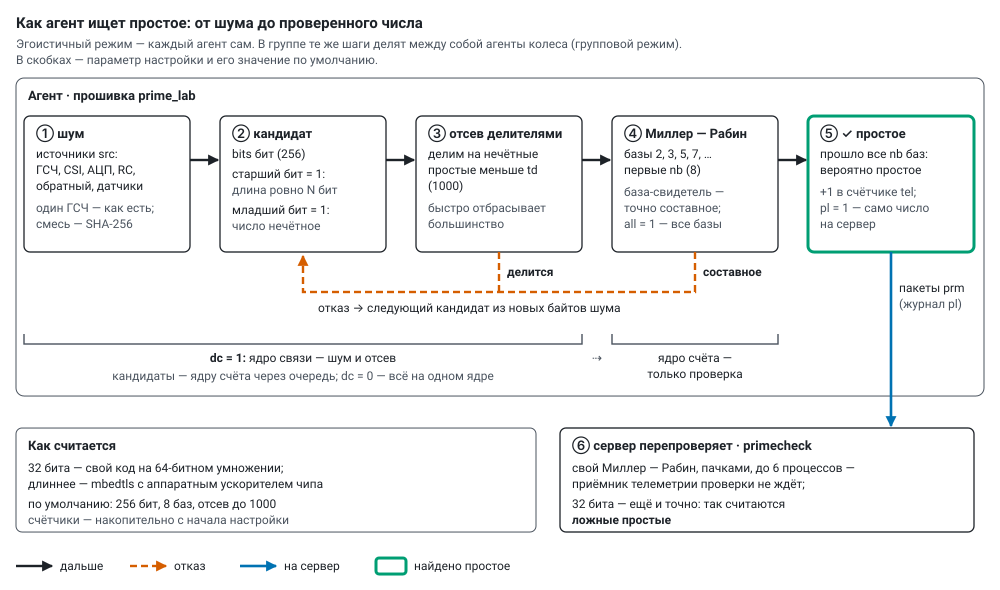
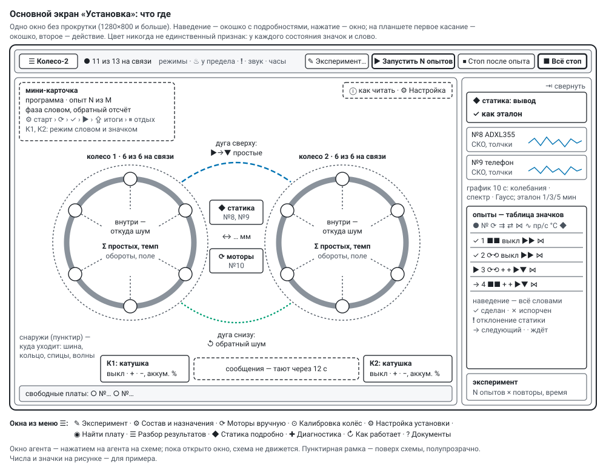

# Wheel-2 ("Колесо-2"): how everything works

*English translation of [docs/how_it_works.md](../how_it_works.md) — the Russian original is the source
of truth. The other documents in `docs/` are in Russian; labels inside the diagrams in `docs/img/` are in
Russian.*

The whole rig: what it consists of, what each agent does, how the server and the main screen work, which
parameters exist. Each topic has its own page (Russian): wiring, sensors/phone/motors/coils, modes,
experiments and programs, static sensors, group mode, absorption, noise, temperature, bill of materials,
coil endurance test, toroid field calculator. Why the rig exists — the [preamble](preamble.md).

---

## 1. The rig

* **Wheels** — two, facing each other. Each rim is a tube wound with a coil; on the rim, six **agents**
  run on a 5.1 V bus from their own batteries. Wheel 1: #3, #5, #6 (rim sensor ICM-42688), #11, #12,
  #20 (magnetometer MLX90393); wheel 2: #14–#19.
* **Coil** of a wheel — its own batteries, a DRV8871 bridge and a **coil agent**: field "+", "−" or off.
  Wheel 1 has #13; wheel 2 has no coil agent yet. The coil agent is not part of the wheel's groups.
* **Frame**: 36GP-555 motors on the wheel axles, two DRV8871 bridges, a 12 V supply and the **motor
  agent** #10.
* **Static sensors** between the wheels: #8 (precision accelerometer ADXL355) at the centre of the axis and
  a **phone** #9 that measures and sends over Wi-Fi on its own.
* **Experiment network** — its own GL.iNet Mango router (2.4 GHz, channel 6): agents and the phone over
  Wi-Fi, the laptop by cable.
* **Server** — `server/monitor.py` on the laptop: receives telemetry, checks primes, analyses the static
  sensors, runs experiments, drives motors and coils, writes everything to disk. Python 3 standard
  library; numpy for the static sensors. Start: `tools/monitor.cmd`.
* **Main screen "Установка" (Installation)** — `http://<server>:8090/` in a browser on a tablet, phone or
  laptop (§ 9).
* **Registry** — `registry/devices.csv`: number, MAC and label of every board.

An agent is a Seeed XIAO ESP32-S3 with the `firmware/prime_lab` firmware. Its role is set by the server:

| role | what it does |
|---|---|
| ▶ generation (A) | searches for primes in physical noise — on its own or in a group |
| ▼ absorption (B) | receives the primes of the other wheel's generators and scatters them into the air, mixed with its own noise |
| ◆ static (S) | only measures acceleration (500 Hz) and sends the axes; the server does the analysis |
| ⚙ motors / coil (M) | turns the wheels through the bridges or switches the coil field on server commands |

Ports: 5005 — telemetry (UDP), 5006 — server beacon (UDP), 5007 — commands (UDP), 8090 — HTTP (screen,
`/api`, phone uplink `/api/ingest`, firmware image `/fw/prime_lab.bin`).

On the server the same picture is **live** (menu "↻ Как работает", `/flow`): who is online, the prime
rate; a silent branch is dashed.

---

## 2. Life of an agent

1. **Power-up.** LED intro: 5 fast blinks, the last 4 hex digits of the MAC in Morse code, 5 fast, the
   registry number, 5 slow.
2. **Wi-Fi.** Network from `secrets/wifi.ini`, 802.11b/g only — so CSI arrives with every packet; radio
   sleep off — receiver noise flows into the generator continuously. There is a **fallback network**
   (`ssid2`/`password2`): if the main one refuses for 40 s, the board moves to the fallback and retries the
   main one after 2 min, then every 10 min while idle; telemetry `net` (0 main, 1 fallback).
3. **Finding the server.** Every 2 s the server broadcasts the beacon `W2SRV 5005` on UDP 5006.
4. **Self-test.** Miller–Rabin on known primes and pseudoprimes (up to 2048 bits).
5. **Idle.** After power-up the agent **stands**: it does not compute, it sends telemetry once a second.
6. **Work.** On a server command it computes; the LED flashes with each telemetry packet.
7. **Stop.** Counting stops, counters freeze — the server collects the totals.
8. **Over-the-air update** (§ 13): image into the free partition, MD5 check, reboot; the new firmware is
   provisional until the agent has been online for a minute; not online within 10 minutes, or a crash —
   the bootloader rolls back.

If an agent reboots, the server gives it its last settings back.

---

## 3. Where the randomness comes from

| noise | what it is | speed |
|---|---|---|
| ⚄ chip RNG | the ESP32-S3 hardware generator (`esp_random`), mixed with Wi-Fi receiver noise | ~45 k words/s — the main one |
| Σ all available | RNG + CSI from heartbeats + ADC + jitter through SHA-256 | as the slowest of them |
| ≋ CSI from heartbeats | the radio-channel "fingerprint" in neighbours' heartbeat frames (ESP-NOW) | slow |
| ↯ CSI from router ping | the same from router replies to a ping | slow, use with care (§ 8) |
| ⏚ ADC D0 | floating pin D0: pick-up and resistor noise, ¼ bit per sample | slow |
| ⧖ RC jitter | internal 136 kHz RC against the 40 MHz crystal, ¼ bit per sample | slow |
| ↺ back noise | the absorbers' frames — a loop through the air (mixed in, or alone) | as much as they scatter |
| ↕ accelerometer, 🧲 magnetometer | low bytes of the rim sensors' axes — alone or added | very slow |

* A single RNG: its words go straight into the number. Any other set: **SHA-256** blocks of 256 bits, each
  enabled source contributes at least 256 credited bits per block — the number is random even if only one
  source is good.
* **Without hashing** (`raw`): low bits of the raw samples go straight into the number — the physics of
  the source shows; with von Neumann debiasing the 0/1 skew is removed.
* Never connect anything to D0 — the ADC noise is taken from it.

---

## 4. How a prime is found

* **Miller–Rabin** with base *a* either proves the number composite (*a* is a "witness") or says "probably
  prime"; more bases, smaller chance of error. Defaults: 256 bits, 8 bases, trial division up to 1000.
* **Two cores** (`dc` = 1) — a pipeline through a queue: the communication core gathers noise and sieves,
  the compute core only tests; faster, but runs hotter.
* The server re-checks reported primes with its own Miller–Rabin (prime log, `pl`); 32-bit ones are also
  checked exactly — that is how **false primes** are counted. Rates — § 14.

---

## 5. Group mode

The agents of a wheel compute together over ESP-NOW (addressed frames, 24 Mbit/s, every frame
acknowledged by the radio). The server sends the group membership and addresses along with the settings —
a new agent joins without reflashing the others. Three variants (`gv`):

* **cascade** (`gv` 2) — the main one: numbers are assembled from noise pieces of all agents, everybody
  tests at once, each its own numbers; the next agent cross-checks a found prime; other agents' pieces are
  awaited for at most `pw` ms, missing ones are replaced by own noise. Six agents on two cores —
  ~100–118 primes/s.
* **relay** (`gv` 1) — a number from everybody's noise, one agent tests, the turn goes round; the rate of
  one to one and a half boards at any size, barely uses the air.
* **one number for all** (`gv` 0) — every number is tested by everybody, bases split round robin, whoever
  finds a witness becomes the next master; slow, but the answers must agree — an integrity check
  (**agreement**).

**Coherence** — the share of rounds assembled from everybody's pieces and runs without faults. A **silent**
participant (no pieces after three requests) does not hold the group up; any frame from it and it is
awaited again.

---

## 6. Absorption

A generator that finds a prime announces it with one frame; the **absorbers** on the other wheel hear it
and scatter it — mix it with their own noise and send it back: all with all (each the whole number), spray
(each its own piece), relay, silence. A **dummy** sends the same traffic without the number (control),
**background** — own noise at a set rate. **Back noise**: generators take the absorbers' frames into their
noise — a loop through the air.

---

## 7. Rotation, field and wheel calibration

* **Motors** (menu "⟳ Моторы вручную…" or a program run): wheels separately, together, towards each other
  or only one; mode — stand, PWM, rpm or **weightlessness**: the rpm at which k = ω²r/g = 1 at the top
  (at r = 450 mm — 44.6 rpm). In rpm and weightlessness modes — PI on the rim sensor's rpm. The server sends
  the motor agent `MOT` once a second; if commands stop arriving, the agent ramps the motors down by itself.
* **Coil field** — off, "+" or "−": buttons on the diagram or a program run; the coil agent gets the same
  `MOT` command, no command for 5 s — the bridge switches off. The wheel's magnetometer shows whether the
  field is there and which way: "✓" — the sensor sees what was set, "◐" — something else.
* **Wheel calibration** (menu "⊙ Калибровка колёс…"). The gyro scale of the rim sensor calibrates itself
  from the gravity phase on steady revolutions. The sensor radius and the accelerometer zero offset come
  from the slope of acceleration against ω² over several speeds (rpm spread at least ±15 %); the radius from
  the slope is used for weightlessness when ticked. An optical tachometer on a reflective mark gives check
  points — a single scale factor, also applied by a tick. The radius of **each agent** is measured with a
  ruler from the axle to the chip and stored with the rig: every agent has its own k = ω²r/g, shown in the
  agent window and recorded in every run.

---

## 8. Temperature and watchdogs

* **Regulator**: once a second picks the compute core's work fraction (5–100 %) to keep the chip one degree
  below the limit (default **73 °C**, 75 at most). At minimum fraction and 3 °C above the limit for 20 s the
  radio sleeps between beacons; 8 °C above for 3 s — emergency stop until 3 °C below. The regulator ignores
  the sensor for the first 12 s after a reboot.
* **Radio watchdog**: ESP-NOW frames go out but the radio reports nothing for 15 s — or no Wi-Fi for 90 s —
  the board reboots; the server restores its settings and the group takes it back.
* **Wi-Fi watchdog ("zombie")**: "connected" but no packet leaves for 10 s — reconnect (`wrst`); or no
  server beacon for 45 s — reconnect; three in a row — reboot (`rbt` 3). Telemetry: `udpe`, `bcn`,
  `heapmin`, `cmd`.
* **Heartbeat**: every agent broadcasts "alive" over ESP-NOW once a second (computing?, °C); each keeps a
  neighbour table (who it hears and how loud), sent to the server every 5 s as `nbr`.
* **Take CSI from heartbeats** (`hb` 5–20, `ping` 0): a frequent router ping overflows the transmit buffers
  and causes "zombies"; the ping is only a separate noise source, at most 20/s, in short runs.

---

## 9. The main screen "Установка"

`http://<server>:8090/` — a single window without scrolling (1280×800 and larger). Colour is never the
only cue: every state has an icon and a word (Okabe–Ito palette); noise sources also differ by glyph, dash
pattern and lane position.

* **Header**: "☰ Колесо-2" — the menu (windows below; at the bottom — **view**: translucent / solid, motion
  as in the system / full / calm / none), link state ("● 11 of 13 online"), chips for modes that change what
  a tap does, "♨ at the limit", ❗ static alarm, 🔔 sound, clock. On the right — "✎ Experiment…",
  "▶ Run N runs · ≈ time" (or "↻ Continue #…"), while running "⏸ Pause" / "▶ Continue", "⏹ Stop after
  run" and always **"■ Stop all"** — program, all counting, motors and coils at once.
* **Mini-card** (over the diagram, top left): the program, "run N of M", the phase in words with a
  countdown, the phase strip (⚙ start › ⟳ preparation › ✓ check › ▶ execution › ⇪ results › ⏸ rest), one
  line per wheel — the mode in words and as a pictogram with noise shares ("live", "step" or "plan"), rpm,
  field, temperatures.
* **Diagram** — live from telemetry. **Inside the rim — where the noise comes from**: source lanes run
  inward to the agents, width — share of credited bits, dots run at the source's pace; a struck glyph — no
  sensor. The wheel centre: Σ primes and the rate, rpm, coil field, |B|. **Outside — where it goes**, by way
  (table below). Agent: number, activity icon, temperature (the arc — from 40 °C to the limit); a flash and
  "+N" — primes found, "▼+N" — an absorber received. With the field on the rim is blue with arrows along the
  field; a running dashed ring — the wheel turns. **The arc on top** — primes from the generators to the
  other wheel's absorbers, **below** — back noise. Between the wheels — static sensors, "↔ … mm" (tap to set
  the distance), the motor agent; bottom corners — coil agents, field buttons and batteries (INA219, %);
  at the bottom — free boards.
* **Hover cards** on everything; hovering "К1", a noise source or a way highlights its agents. On a tablet
  the first tap shows the card, the second acts. Keyboard: Tab through agents, Enter — window, Esc — close.
  "Motion: none" or "reduce motion" in the system — no animation.
* **The right column** (⇥ collapses it): **static** — the verdict large (✓ as reference · ⚠ check ·
  ↻ interference or instrument · ◌ no reference · ○ no data), sensors (static, phone) one under another, each always with three small live
  10 s charts — Gauss, spectrum, oscillations — on the chosen axis, the reference and its recording 1 / 3 / 5 min; **runs** — a table of icons (hover says everything in
  words); the **experiment** line.
* **❗ Static alarm** — verdict "⚠ check": three beeps, a blinking "❗" and a line in the footer at the bottom of
  the screen — time, run, reason, "↻ repeat" and "details". No window pops up by itself: each deviation is a line
  in the list; "details" opens the window with all reasons on a tap.
* **ⓘ** next to important things explains them; "ⓘ как читать" explains the diagram's symbols. Messages pop
  up over the diagram and fade after 12 s.

| way | on the diagram, outside the rim |
|---|---|
| ● selfish | each agent has its own closed cell, a dashed ring "not linked" outside |
| ⋈ cascade | a two-way bus, ✓ at the checker; a found prime goes as a dot to the neighbour for a check |
| ⇢ relay | a ring with chevrons in ID order and a baton — the lap pace, shown slowed down |
| ① one number for all | spokes to the shared number in the centre; agreement % |
| ▼ absorption | waves at the absorber: whole — solid, by pieces — dashed, dummy — dots, relay — a chain, "listen only" — no waves |

**Windows** (menu "☰"; while a window is open the diagram does not move):

| window | contents |
|---|---|
| agent (tap an agent) | activity, rate, noise by source, neighbours, memory; "∿ live" (oscillations, Gaussian, spectrum per axis, up to 15 min), "🧲 field live", sensor noise and accuracy, ruler radius and k, place |
| ✎ Эксперимент… (Experiment) | what varies and in which order → the list of runs, start (§ 10) |
| ⚙ Состав и назначения (boards and roles) | every board by place: link (the server remembers when it was last seen), firmware ("⇪" — flash over Wi-Fi), °C; ✎ move (a role change restarts the board, ≈ 15 s), ⤓ take off, ◉ ×10 blink, ✓ check by role, ✕ remove (role `retired` in the registry; "↺" brings it back), ＋ add a board over USB (§ 13) |
| ⟳ Моторы вручную… (motors by hand) | rotation outside the experiment (§ 7) |
| ⊙ Калибровка колёс… (wheel calibration) | gyro by gravity, radius and offset by slope, tachometer, agent radii by ruler (§ 7) |
| ⚙ Настройка установки (rig setup) | place the boards: tap a board, then a place; on the right — steps "from zero to a run", each with ✓ / ◐ / ✗ / ○ and a button |
| ◉ Найти плату (find a board) | tap an agent — its LED blinks for 20 s |
| ☰ Разбор результатов (results) | what matters other things being equal, pivot, run protocol, CSV (§ 10) |
| ◆ Статика подробно (static in depth) | spectra against the reference corridor, events, reference recording |
| ✚ Диагностика (diagnostics) | each wheel computes as a cascade from the RNG, then a per-agent table: link, who it hears, rate against the group median, temperature, memory, sensors, verdict ✓ / ◐ / ✗ |
| ↻ Как работает (how it works) | the live rig diagram and the group protocol step by step, slowed down |
| ? Документы | this documentation |

"✓ check" by role: a generator computes for 30 s; a coil — off → "+" → off → "−", 4 s each (current by
INA219, field by the magnetometer); motors — each wheel 3 s at 30 % PWM; a measurer — 10 s of samples.

For debugging, by address: `/pult` (console: logical groups and presets, per-agent parameters,
"≋ Quench"), `/watch` (static sensors and the prime stream in large type), `/old` (old panel: all
counters, charts, sessions).

---

## 10. Experiment and program

An **experiment** is a list of runs, gone through "repeats" times; a **run** is one set of parameters:

| parameter | values |
|---|---|
| ⟳ wheel rotation | each wheel stands, forward or backward — a 3 × 3 table (⟳⟲ towards each other, ⟳⟳ together, ⟳■ only one) |
| ⏲ speed | rpm, PWM or weightlessness; not varied for standing wheels |
| ± offset from weightlessness | steps around the computed weightlessness: 0 and ± one step, optionally ± two steps; the step is % of rpm, 3 by default (k changes twice as much: +3 % — k ≈ 1.06); only with speed "weightlessness" |
| ⇉ coil field | each coil off / + / −, also 3 × 3 |
| ⇄ emission / absorption | each wheel stands / generates / absorbs; ⏸⏸ — static only (nobody computes, rotation and field run); ▼▼, ▼⏸, ⏸▼ are not allowed |
| ⋈ cooperation | selfish, cascade, one number for all, relay |
| ▼ absorption | who absorbs whose (all with all · pairs 1:1 · all — one · each — one · half the wheel) and how (whole · by pieces · relay · dummy · listen only) |
| ∿ noise | sources; all together, all but one, one by one — all three give 2N + 1 variants |

The offset from weightlessness is needed because the system is imprecise: the agents on a wheel sit at
different radii, the rim sensor and the regulator err — the steps catch weightlessness for each agent.

* **"✎ Experiment…" window**: parameters on the left, **the order of the cards is the loop nesting** (the top
  one changes least often; rotation on top — fewer spin-ups); the list of runs on the right at once.
  "⚙ Сформировать список" turns the ticks into a list that can be edited by hand (⧉ duplicate, ↑ ↓, ✕).
  Above the list — time, the hottest agent's temperature, whether the batteries last; below — run length
  (**30 s**: settling + measurement), settling (rotation 15 s, role / way / noise 8 s, field only 5 s),
  repeats and order, rest, a pause between repeats. While the plan's program runs or after it, the same
  table shows **what came out**.
* **Control** — wheels standing, field off; every run with rotation or field is compared with its own
  control — the same mode and noise.
* **Program** — the list of runs on "▶ Run": noise reference first, repeats, rest, comparison with control
  under a criterion named in advance, pairwise re-checks of an anomaly, repeats of spoiled runs and runs
  with a static deviation.
* **Pause and continue**: "⏸ Pause" — after the current run everything stands (coils off, wheels stopped,
  agents cool down), "▶ Continue" goes on from the same place. The program pauses by itself when the
  batteries are low (INA219) or the run's agents are silent for more than 30 s. A spoiled run is repeated; a
  stopped or interrupted program can be continued from the first run not done — results go into the same
  record.
* **Results** ("☰ Разбор результатов"): **what matters** — each parameter other things being equal,
  Δ ± error and a verdict ✓ no difference / ◐ possible (2–3 σ) / ❗ difference (over 3 σ); a pivot of any two
  parameters; the run protocol; CSV.
* **Distance between the wheels** is set by hand ("↔ … mm" on the diagram); the server keeps it in
  `data/rig.json` and records it in every run.

---

## 11. Agent parameters

Sent to agents as a `CFG …` line on UDP 5007; the agent confirms them with the config number (`cid`) in
telemetry, the server repeats every 2 s until it matches. The main screen sets them itself from the runs; by
hand — in the console and the old panel. Kinds: **common** (same within a group), **own** per agent, **on the
fly** (change without a new number, counting continues). Main ones:

| parameter | meaning | values | default |
|---|---|---|---|
| `role` | 0 — generation, 1 — absorption, 2 — static, 3 — motors or coil | 0–3 | 0 |
| `mode`, `gv` | 0 — selfish, 1 — group; group variant: 0 — one number, 1 — relay, 2 — cascade | | 0, 0 |
| `rk`, `pw` | relay and cascade: primes per turn; wait for pieces at most, ms (0 — wait for all) | 1–16; 0–5000 | 1; 0 |
| `nr` | ESP-NOW rate: 1 — 24 Mbit/s, 2 — 6 Mbit/s, 0 — 1 Mbit/s | 0–2 | 1 |
| `bits`, `nb`, `all`, `td` | prime length; number of Miller–Rabin bases; all bases for every candidate; trial division bound | 32–2048; 1–12; 0, 1; 0–20000 | 256; 8; 0; 1000 |
| `k`, `pre` | one number for all: candidates per round; group: gather noise pieces in advance | 4–64; 0, 1 | 24; 1 |
| `dc`, `tp` | two cores; telemetry period, ms | 0, 1; 500–5000 | 0; 1000 |
| `src` | noise mask: 1 RNG, 2 CSI, 4 ADC, 8 jitter, 16 back noise, 32 rim accelerometer, 64 rim magnetometer | 1–127 | 1 |
| `raw` | 0 — SHA-256 blocks; 1 — no hash; 2 — no hash with von Neumann | 0–2 | 0 |
| `ping`, `hb`, `cf` | router pings per second for CSI; heartbeat frames per second; where CSI comes from | 0, 10–200; 1–20; 0–3 | 100; 1; 0 |
| `tmax`, `txp`, `cpu`, `led` | chip temperature limit, °C; transmit power, dBm; CPU MHz; LED flash | 40–75; 2–20; 80–240; 0, 1 | 73; 20; 240; 1 |
| `sm`, `ba`, `sh`, `bgr`, `sf` | absorption mode; whose primes to absorb; dummy; absorbers' background frames/s; scattering function | | 1; all; 0; 0; 0 |
| `tl`, `tq` | telemetry: normal / sparse / silence; how long to stay silent, s | 0–2; 0–65535 | 0; 0 |
| `dur`, `ro` | step on the agent: stops by itself after N s and reports; Wi-Fi off for the step | 0–7200; 0, 1 | 0; 0 |
| `pl` | prime log: every prime goes to the server as `prm` packets | 0, 1 | 0 |
| `rmm` | rim sensor radius, mm | 50–2000 | 450 |
| `afs`, `avg` | static sensor: range ±g; averaging over 1000 Hz samples | 2–16; 1–8 | 2; 2 |
| `run` | 1 — compute, 0 — stand | 0, 1 | 0 |

A new config number (anything changed except on-the-fly parameters, a start, a reset) zeroes the counters;
within a group the number is common. Stopping does not zero — the totals freeze.

**Built into the firmware**: the temperature regulator (4 % per second per degree); group protocol timeouts
(twice the usual + 20 ms, 3 retries, turn takeover after 1.5 s); noise estimates (CSI — 32 bits per packet,
ADC and jitter — ¼ bit per sample); Wi-Fi b/g only without radio sleep; ADC pin D0; ports 5005–5007.

---

## 12. Telemetry and data

* Once a second an agent sends `tel` (≤1460 bytes), in a group also `grp`, every 5 s `nbr` (neighbours);
  static sensors — `acc` (sample batches), rim sensors — `imu`, `mag`; the phone posts the same packets as
  lines to `POST /api/ingest`. Counters are cumulative from the start of the config: a lost packet loses
  nothing.
* Every packet is written as is to `data/raw/<date>.jsonl`; on restart the server re-reads the tail of the
  day (last two hours). Static samples — `data/accel/<date>/` (int16 in a row + index).
* Primes from the agents' logs are re-checked by helper processes (`server/primecheck.py`, up to 6) in
  batches: the receiver never waits.
* `data/control.json` — settings and compositions; `data/programs/` — programs with steps and results;
  `data/primes/<date>/<mac>.txt` — prime logs; `data/static/baselines/` — static references;
  `data/rig.json` — wheel distance and agent radii; `data/fleet.json` — when each board was online and with
  which firmware; `data/commands.jsonl` — command log.
* `/api/health` — server self-check: tasks alive, packet age, check queue, disk.

---

## 13. New agent and firmware

A new board is flashed **over USB once** — that puts in prime_lab with over-the-air updates, network data
and the signing key; afterwards it is updated over Wi-Fi with all the others.

1. Connect the board with a data cable to the server computer.
2. Menu "☰" → "⚙ Состав и назначения" → "＋ add a board": the board shows as "★ new", "⇪ flash" (or
   double-click `tools/new_board.cmd`).
3. The board gets the next registry number and comes online in ~40 s among the free boards; ✎ puts it in
   its place.

The server recognises a board by its USB serial number (on the ESP32-S3 it is the MAC). Board not visible —
hold BOOT, replug the cable, release. By hand: `tools/build.sh prime_lab COM<N>`.

**Update installed boards over Wi-Fi**: build (`tools/build.sh prime_lab`) and "flash everyone online over
Wi-Fi" (or `python tools/ota.py all`). The server serves the image (`/fw/prime_lab.bin`) and sends an
`OTA …` command signed with `secrets/ota.key` (HMAC-SHA256, never committed). The agent downloads into the
free partition, checks length and MD5, reboots; not confirmed within 10 minutes — rollback.

---

## 14. Measurements

One board, 256 bits, unless stated otherwise.

| what | result |
|---|---|
| RNG | 2300 candidates/s, ~27 primes/s, 36 ms per prime |
| CSI / ADC / jitter | 12 / 18 / 15 candidates/s |
| 1024 / 2048 bits, RNG | 185 / 30 candidates/s; one base test 25 / 181 ms |
| four boards, selfish | 100–106 primes/s (25–27 each) |
| four boards, selfish, two cores | 179.6 primes/s (41–47 each); at a 70 °C limit the regulator trims to ~155 |
| one number for all, 1 / 2 / 3 / 4 boards | 24.5 / 16.5 / 10.5 / 7.7 primes/s |
| relay, two cores, 4 boards | 37.1 primes/s |
| cascade, two cores: 4 / 6 boards | 80–92 / 118 primes/s |
| two groups at once | do not disturb each other |

---

## 15. Tools

`tools/monitor.cmd` (start the server), `tools/build.sh` (build with the git version, registry, flash),
`tools/new_board.py` (first flashing over USB), `tools/ota.py` (over-the-air update), `tools/build_docs.py`
(HTML documentation; `--static` — a self-contained set), `tools/publish.py` (public copy on GitHub with a
leak check), `tools/multi_test.py`, `tools/anomaly_run.py`, `tools/prime_stats.py`, `tools/nightly.py`,
`tools/soak.py`, `tools/sprint.py`, `tools/coil_soak.py` (coil endurance test), `tools/imu_noise.py`,
simulators `tools/sim_gen.py` and `tools/sim_agents.py`, checks `tools/test_analysis.py` and
`tools/test_static_watch.py`, the toroid field calculator `docs/calc/toroid_field.html` with
`tools/toroid/`, `tools/demo_capture.py` (snapshot for the published demo), `tools/video.py` (videos).

Without boards: `python server/monitor.py --http 8092 --udp 5016 --data data/test/gen --no-beacon` and
`python tools/sim_gen.py 6 --port 5016`, then `http://localhost:8092/`.

---

## 16. Limitations and what next

* In a group several agents test each number — "one number for all" is slower than selfish; a cascade of
  up to six is close to selfish but hits heat and the shared air (one air for all wheels).
* A base test through mbedtls (~1 ms at 256 bits) is the bottleneck of the two-core pipeline; the ceiling
  is set by the RNG: 45,000 words/s — 5600 candidates of 256 bits per second, 4100 reached.
* Temperature sensors of different boards differ by a few degrees.
* Ahead: a coil agent for wheel 2, "identical numbers for all" and one-to-one absorption in the firmware,
  CSI from the whole air; a Geiger counter, camera and microphone as external sources.
