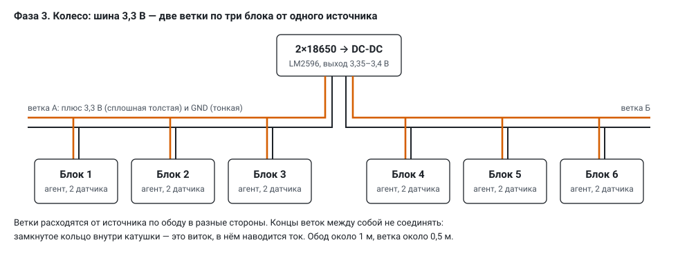
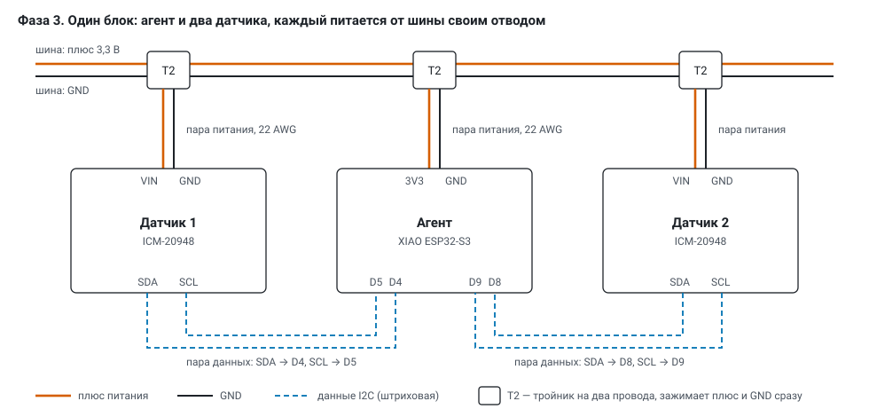
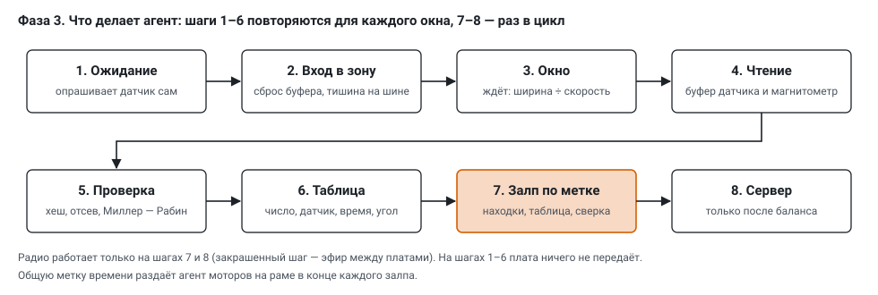
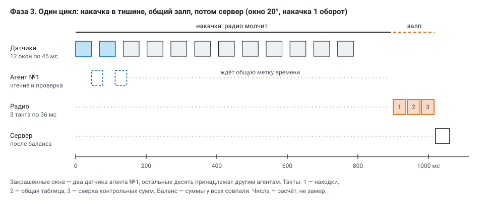

# Phase 3: a sensor at every agent, weightlessness windows, a common volley

*Status on 2026-11-23: a design. Not all parts are ordered, the firmware is in progress. All times and counts below
are calculations, not measurements; what to check on the bench is listed in the last section.*

Phase three joins the first two: a sensor at every computing board, as on the first wheel, and two wheels, as in the
second rig. Three things are new:

* the number tested for primality is made from a sensor reading taken while the sensor passes through
  weightlessness;
* finds are not sent out at once: they accumulate, and all agents release them together, on common time;
* the server reads the result only after the tables of finds on all agents agree.

## 1. What changes from phase 2

| | phase 2 | phase 3 |
|---|---|---|
| rim sensors | on 4 boards of 12 | two on every board, 12 per wheel |
| sensor | ICM-42688 and MLX90393 | ICM-20948: acceleration, rotation and field in one package |
| where the number comes from | chip noise, radio, ADC | the whole sensor reading, then a hash |
| when a reading is taken | all the time | only in the sensor's weightlessness window |
| when a find goes on air | at once | in the common volley after pumping |
| radio during measurement | on | silent |
| wheel power bus | 5.1 V, a diode at every board | 3.3 V, boards and sensors straight from the bus |
| wheel shaft | on the motor shaft | its own shaft on two bearings, motor through a coupling |

## 2. The wheel and its power

The wheel is a Ø300 mm aluminium disc with a rim made of corrugated tube (outer diameter 34.5 mm, inner about
29 mm). At the tube axis the diameter is about 320–330 mm; the exact size has not been measured yet. The rim is
about 1 m long. Inside the tube there are six blocks; a block is an agent and its two sensors. One block takes about
16 cm of rim.

The bus is 3.3 V from the same LM2596 DC-DC. Agents and sensors are fed straight from it, bypassing the board
regulator, which no longer heats the tube. Every agent and every sensor takes power through its own tap, a two-wire
T connector.

| what | with what | count for two wheels |
|---|---|---|
| power taps to agents and sensors | 22 AWG silicone wire, soldered into the board holes | 36 pairs of 10–12 cm |
| T connectors on the bus | T2, two-wire, clamp plus and GND at once | 36 |
| sensor data pair | SDA and SCL, a separate I2C channel per sensor | 24 pairs |
| sensors | ICM-20948 on a board with Qwiic sockets | 24 |
| agents | XIAO ESP32-S3 | 12 |

The two sensors of one agent sit on different I2C channels: the first on D4 (SDA) and D5 (SCL), the second on D8
(SDA) and D9 (SCL). No address jumper is needed on the sensor.

What must not be forgotten:

* **Voltage.** There is no protection between the bus and the boards. Above 3.6 V both boards and sensors die. Set
  3.35–3.4 V under load and seal the DC-DC trimmer with lacquer.
* **USB.** Plug a USB cable only with the bus power removed. Firmware goes over the air.
* **Voltage drop.** Six boards and 12 sensors draw about 0.75 A on average and up to 2 A on transmit peaks. On a
  0.5 m branch of 22 AWG wire the drop is about 0.03 V. A 220–470 µF electrolytic at every board.
* **No ring.** Do not join the branch ends: that would be a closed turn inside the coil.
* **Vibration.** A wire soldered into a board breaks right behind the joint. Fix it to the tube 1–2 cm from the
  joint.
* **T connector.** It is made for roughly 18–24 AWG wire. Strip a thinner wire longer, fold it double and tin it;
  check the first clamp with a multimeter.

### The coil on the corrugated tube

A turn on the corrugated tube is longer than on the former 23 mm tube: about 11 cm against 7.5 cm. At the same
voltage the field depends only on the wire cross-section and the turn length, not on the number of turns.

| | 23 mm tube, 0.67 mm wire | corrugated, 0.67 mm | corrugated, 0.77 mm |
|---|---|---|---|
| turns per wheel | about 1340 | about 1340 | about 1080 from 500 g |
| wire per wheel | 100 m | 149 m | 120 m |
| mass per wheel | 320 g | 470 g | 500 g |
| resistance | 4.9 Ω | 7.3 Ω | 4.4 Ω |
| current at 5.1 V | 1.0 A | 0.70 A | 1.15 A |
| field relative to the former | 100 % | about 67 % | about 90 % |

### The shaft

The wheel sits on its own 8 mm shaft in two pillow-block bearings. The motor stands apart and turns the shaft
through a jaw coupling; it carries none of the wheel's weight. One bearing is not enough: it is self-aligning and
holds the shaft at a point but does not stop it from tilting. The order is motor — coupling — bearing — wheel —
bearing, or both bearings side by side (8–10 cm apart) and the wheel on a short overhang.

## 3. The sensor and its numbers

The ICM-20948 gives nine signed 16-bit numbers: three axes of acceleration, three of rotation, three of field.

| what | rate | range | unit | what it sees on the wheel |
|---|---|---|---|---|
| acceleration | 1125 per second | ±4 g | 1 g = 8192 | in the window all axes near zero, noise about 40 |
| rotation | 1125 per second | ±1000 °/s | 1 °/s = 32.8 | 74 rpm = 445 °/s, about 14 570 on the wheel axis |
| field | 100 per second | ±4.9 mT | 0.15 µT | coil field about 1.7 mT — about 11 000 |

An example of two neighbouring records in a window (the scale is right, the numbers themselves are made up):

| record | acceleration x, y, z | rotation x, y, z | field x, y, z |
|---|---|---|---|
| first | −212, 418, 37 | 14, −22, 14571 | 11204, −310, 96 |
| 0.9 ms later | −187, 455, −8 | 9, −31, 14566 | the same, updates in 10 ms |

## 4. The weightlessness window

The speed is chosen so that at the top the centrifugal acceleration equals gravity: at a 163 mm radius that is
74 rpm, one turn takes 0.81 s. The acceleration a sensor feels grows from zero at the top as it moves away from the
top point. The window is an arc around the top; its width in degrees is a setting.

Windows are counted per sensor, not per agent: the two sensors of one agent have their own windows.

| window width | duration | records | acceleration at the edge | what happens on the wheel |
|---|---|---|---|---|
| 20° | 45 ms | 51 | 0.17 g | separate windows, a third of the time nobody is in the zone |
| 30° | 67 ms | 76 | 0.26 g | windows end to end: always one sensor of 12 in the zone |
| 40° | 90 ms | 101 | 0.35 g | neighbouring windows overlap |

## 5. What the agent does

1. **Waiting.** The agent polls the sensor itself and watches the acceleration. It sees the zone entry directly.
2. **Zone entry.** The acceleration fell below the threshold that corresponds to the window width. The agent resets
   the sensor's internal buffer and stops talking to it. The sensor writes records into itself; the bus is silent.
3. **Window.** The agent waits the computed time: window width divided by rotation speed.
4. **Read.** The agent takes the sensor buffer in one read, then reads the field.
5. **Test.** Every record goes through a hash and gives one candidate; the candidate is tested for primality.
6. **Table.** A find is recorded: the number, the sensor, the time, the angle.

Steps 7 and 8 — the volley and the server read — are described in section 7.

The sensor buffer is useful because records in it follow the sensor's own clock exactly, and the agent is silent
during the window. Sources disagree on the buffer size: 512 bytes or 4 kB. An acceleration-and-rotation record
takes 12 bytes, so 512 bytes hold 42 records (a 16.6° window) and 4 kB hold any of our windows. The agent will
measure the size itself on first start; it decides which window fits without a single access to the sensor.

Board cores: core 1 reads the sensors and tests numbers, core 0 is busy with radio. Of the 810 ms of a turn, the two
windows of one agent take about 100 ms and testing about 40 ms more.

## 6. From a reading to a number

A reading is taken whole: all 16 bits of every axis, no picking of low bits. The record goes through SHA-256 and
gives a 256-bit candidate. Then as in phase 2: trial division and the Miller–Rabin test. The hash evens the numbers
out, so the share of primes is known in advance: one per 88.6 odd candidates.

| with a 20° window | per window from one sensor | per second per wheel | per minute per wheel |
|---|---|---|---|
| candidates | 51 | about 750 | about 45 000 |
| primes | 0.58 | 8.5 | about 510 |

With a 30° window it is one and a half times more. A candidate after the hash costs about 0.26 ms, a found prime
about 8.5 ms (phase 2 measurements, [randomness.md](randomness.md)).

## 7. The "laser" cycle: pumping, volley, balance

| laser | here |
|---|---|
| pumping | sensors pass weightlessness in turn, agents accumulate primes |
| stored population | the table of finds at every agent |
| stimulated emission | takt 1: the common volley of finds |
| round trips between mirrors | takts 2 and 3: re-emission of the common table |
| steady state | balance: the tables on all agents agree |
| output mirror | the server reads only after balance |

**Pumping.** Lasts a set number of turns (a setting). The radio is completely silent: no heartbeat, no telemetry.
In one turn a wheel finds 7 primes on average, so one turn is too few; five is a sensible start.

**Volley.** On common time, three takts of 36 ms:

| takt | what every agent sends |
|---|---|
| 1 | its own finds |
| 2 | the common table as it assembled it from what it heard |
| 3 | the checksum of its table |

Inside a takt the agents of both wheels speak in turn, 3 ms each: two transmitters on one channel at the same
moment jam each other. From outside a takt is one 36 ms pulse. During the volley the sensor windows are skipped, so
that nobody measures under a working radio.

**Balance.** After takt 3 the checksums of all agents agree. If not, takts 2 and 3 repeat.

**Server.** Reads the final tables only after balance.

The volley is not tied to the wheel angle. Wheel vibration runs at the rotation frequency; tied to the angle, it
would enter every volley at the same phase and add up to a false response. With a free volley everything linked to
rotation averages out. The cycle period also varies slightly from one cycle to the next.

The coil field is on all the time to begin with: a current without edges is not felt by the witness, and there is
nothing to subtract. The effect of the field itself is checked by a separate series with the coil off.

## 8. Common time

Every board has its own clock running from power-up. Common time is given by the leader — the motor agent on the
frame: it does not measure in weightlessness, and its radio disturbs nobody.

1. At the end of every volley the leader sends a mark: its time and the moment of the next volley.
2. Every agent remembers the difference between the leader's time and its own and computes the volley moment on
   its own clock.
3. Nobody transmits anything during pumping.

| error source | size |
|---|---|
| packet delay on air and in the board | 0.2–1 ms, varying |
| crystal drift over a 4 s cycle | about 0.1 ms |
| total after averaging several marks | about 0.2–0.3 ms |

If a mark is lost, the agent fires on the old correction. After three misses in a row it skips the volley and waits
for a new mark; the server sees this.

## 9. What we measure and how we check

* **The witness between the wheels** (ADXL355): gravity at volley moments against moments without them.
* **The emission itself:** packet loss, spread of arrival times, signal level.
* **Control:** the same volleys of the same size with composite numbers instead of primes. Radio and current are
  the same; only what was found differs. Which volleys are real is decided by a random sequence; the analysis does
  not see it until the end of the series.
* **An apple on scales** between the wheels — at the very end, as a demonstration. The witness is several orders of
  magnitude more sensitive than scales.

By known physics the expected answer is zero: counting primes on the boards should not change the readings of a
stationary sensor. The experiment checks whether there is anything beyond the known.

## 10. Settings

Changed from the server on the fly:

* window width, degrees;
* shift of the window centre from the top point, degrees;
* how to read the sensor: directly or from its buffer;
* how many turns pumping lasts;
* how many takts a volley has and the spread of the cycle period;
* whether the volley is real or a control.

What the firmware already has (the `CFG` command):

| parameter | what it sets | values |
|---|---|---|
| `p3` | numbers from the sensors' weightlessness windows instead of chip noise | 0, 1 |
| `win` | window width, degrees | 5–120, default 30 |
| `wo` | shift of the window centre from the top point, degrees | −60…60 |
| `fm` | how to read the sensor in the window: 1 — from its buffer, 0 — directly | 0, 1 |
| `vl` | the "laser" cycle: pumping in silence, volley, server after balance | 0, 1 |
| `vm` | this board is the leader and gives common time | 0, 1 |
| `vn` | pumping, wheel turns | 1–200, default 5 |
| `vj` | random addition to the cycle length, ms | 0–500, default 40 |
| `vr` | pairs "common table, check" in a volley | 1–4, default 1 |
| `vs` | server window after the volley, ms | 20–2000, default 80 |
| `vc` | volley: 0 — real, 1 — control, 2 — random every cycle | 0, 1, 2 |

The volley members and their slots are given by the `grp` list: the place in the list is the slot number. The
leader receives the same list.

How it is done in the firmware:

* In takt 1 the numbers go whole, up to 15 finds per agent per cycle. In takt 2 the table goes as short rows: the
  author and the first 8 bytes of the number. An agent that missed a find in takt 1 learns of it from another
  agent's table; the number itself the server takes from the author.
* The pair "takt 2, takt 3" always runs `vr` times, not until the first match: that way every agent has the same
  volley schedule.
* For a control volley an agent keeps, next to every find, a composite number from the same window and sends it
  instead of the prime. The leader decides which volley is real and says so in the mark.
* The leader learns the turn period from the agents' frames; before the first volley it assumes 810 ms.
* The `vl` telemetry packet: whether time is locked, the clock difference, missed marks, the number of volleys and
  balances, how many members were heard in each takt, lateness of others' frames relative to their slot, signal
  level.

The server (`server/monitor.py`) knows these parameters: it validates them, sends them to the agents, builds the
list of volley slots itself (generators in order of their numbers) and makes the motor agent the master if none is
named; it accepts the `p3` and `vl` packets and returns them in the agent state. The simulators
(`tools/sim_agents.py`) send the same packets, and this path has been tested on them.

The firmware compiles but has been tested neither on a sensor nor on air: the sensors have not arrived.

## 11. What to check on the bench before assembly

1. The ICM-20948 buffer size and the record rate in it.
2. The time of one sensor read over I2C at 400 kHz and of a whole-buffer read.
3. The accuracy of common time: the spread of volley moments across six boards.
4. The 3.3 V bus drop on transmit peaks and board behaviour at 3.1 V.
5. Clamping of 22 AWG wire and of a sensor wire in the T connector: resistance below 0.1 Ω.
6. The coil field on the corrugated tube: does it match the calculation.
7. The share of primes in control mode: it must be one per 88.6 candidates.

## 12. Through the gateway

During an experiment the rim boards can work without the router: all their traffic to the server goes through one
gateway — the motor agent, which is also the time master. Near the wheels only our own protocol remains on air, on
the volley schedule, and the server gets one agreed picture instead of a separate story from every board.

| Setting | Meaning | Values |
|---|---|---|
| `gw` | a generator in the volley leaves the router while it hears the master | 0, 1 |
| `gt` | seconds without a master mark after which the board returns to the router by itself | 5–120, default 20 |

How it works:

* **Leaving and returning.** A board leaves the router only after hearing a master mark and stays on the router's
  channel. No marks for `gt` seconds, an over-the-air update, or a setting that clears `gw` — and it returns by
  itself. To bring the whole wheel back it is enough to stop the volley on the motor agent.
* **Board status.** In the last takt of the volley each board appends its status to the table checksum: applied
  setting, temperature, counts of primes and candidates, windows, sensor errors, memory. After the volley the master
  sends the server a `vp` packet with these rows.
* **Finds.** The master hears the numbers of takt 1 along with everyone and passes them to the server in `vp` packets
  (key `f`: author, sensor, time, number). The server puts them into the same prime log under the author's name and
  verifies them as usual. Finds of a control volley (composites) are only counted. A board with `gw` does not write
  them to its own log.
* **Settings.** For a board without the router the server sends its setting to the master as `RLY to=<number> CFG …`.
  After the time mark the master transmits it in 480-byte pieces, three cycles in a row. The board reassembles the
  line and applies it like any other; the server sees the outcome in the board status (setting number). A wrong
  number — the server repeats.
* **Volley tag.** Volley frames are tagged not with the setting number but with the list of participants, so a
  setting change that reaches the master and the boards at different times does not break the volley.

What the gateway does not carry: over-the-air updates (the board returns to the router for that) and detailed
telemetry (a board without the router sends no `tel`, `p3`, `vl` packets). If the master hangs, the boards return by
themselves after `gt` seconds.

Tested on simulators (`tools/sim_agents.py`): a setting arrives through the gateway, finds land in the log under the
authors' names. Not tested on boards.

### Emission takt

Setting `ve` (0, 1), only together with `gw`. Before takt 1 the boards without the router spread for 12 ms over
channels 1, 6 and 11 (by slot number) and transmit their finds at the same instant; at that instant they do not hear
each other. Then everyone returns to the common channel and the volley goes on as usual: table reconciliation,
balance, server. A board that is on the router skips the takt (the channel cannot be changed). There are three
channels, so with six boards on a wheel two share a channel and their frames may collide. Counters are in the `vl`
packet (`em`: done, frame late, skipped) and in the board status at the gateway.

### One volley for the whole composition

Groups of the composition and experiment steps are set per wheel, but the volley is common. The server itself builds
the slots from all generators with the volley, adds the motor agent as the master (it is not in generator groups) and
sends the new slot list to participants already running. The master takes the volley parameters (`vn`, `vj`, `vr`,
`vs`, `vc`, `ve`) from the group applied last. When no generators with the volley remain, the master falls silent
and the boards return to the router.

### Where to switch it on

* Main screen, "Experiment" window: wheel mode "phase 3 · windows and volley".
* Console: group preset "Phase 3: windows and volley" and the group's own parameters under "Phase 3".
* Old panel (`/old`): the "Phase 3" block in the common settings and a line about the last volley.

Board battery voltage (if the board has a circuit sensor) is part of the status at the gateway.
