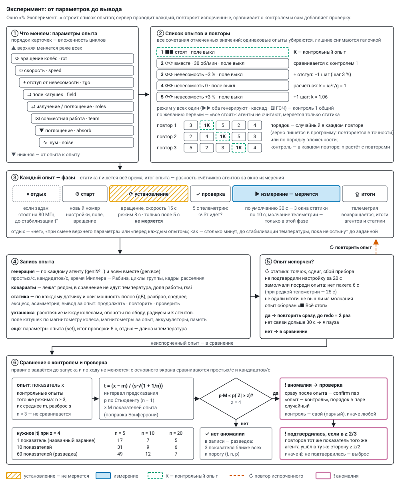

# Experiment and program

*English translation of [docs/program.md](../program.md) — the Russian original is the source of truth. Labels
inside the diagrams are in Russian; key names in code (`gen:все` and the like) are real identifiers and stay as
they are.*

An **experiment** is a list of runs gone through a given number of repeats; a **run** is one set of parameters. The
experiment is put together in the window «✎ Эксперимент…» (experiment) on the main screen and on «▶ Запустить»
(start) goes to the server as a **program** (`POST /api/program/start`). The server (`server/program.py`) carries out
the runs in turn, repeats the spoiled ones, compares runs with the controls and, on an anomaly, adds a check by
itself. How the static sensors decide "continue / repeat / check" — [static_watch.md](static_watch.md); what each mode
means — [modes.md](modes.md).



## Run parameters

In the window, values are ticked for each parameter. The order of the cards is the nesting of the loops: the top one
changes least often, the bottom one from run to run (drag by ⠿ or ▲ ▼). Rotation is the most expensive to switch (the
wheels need to speed up) — it makes sense to keep it at the top. One value — the parameter is constant.

| parameter | key `set` | values |
|---|---|---|
| ⟳ wheel rotation | `rot` | two characters — wheel 1 and 2: `0` standing, `r` forward ⟳, `l` backward ⟲ (`rl` — towards each other, `rr` — together, `r0` — wheel 1 only); a 3 × 3 grid |
| ⏲ speed | `speed` | `rpm:30` — rpm, `pwm:30` — PWM %, `zerog` — weightlessness at the top of the wheel; by default the list has 15, 30, 45, 60 rpm and weightlessness, your own can be added |
| ± offset from weightlessness | `zgo` | 0, ±1, ±2 steps of `zgStep` % of rpm (the step is settable, default 3 %); in `set` — percent (`-3`, `0`, `3` …), in the step — `mot.zg`; only with `zerog`, otherwise `null` |
| ⇉ coil field | `field` | two characters — coil 1 and 2: `0` off, `p` +, `m` − (`p0` — coil 1 only, +); a 3 × 3 grid |
| ⇄ emission / absorption | `roles` | two characters — wheel 1 and 2: `g` generates, `a` absorbs, `0` standing: `gg`, `g0`, `0g`, `ga`, `ag`, `00` (static sensors only); `aa`, `a0`, `0a` are not allowed — there is nothing to absorb |
| ⋈ cooperation | `team` | `solo`, `cascade`, `one`, `relay`; if nobody generates — `null` |
| ▼ absorption | `absorb` | `who/how`: who — `all`, `pair`, `one`, `split`, `half`; how — `mix`, `pieces`, `chain`, `sham`, `silent` (`pieces` and `chain` — always `all`); if nobody absorbs — `null` |
| ∿ noise | `noise` | a mixture of sources `m:rng+csi+adc` …; variation — all together, all but one, one at a time |

The values in words — [modes.md](modes.md). Weightlessness is the rpm at which, at the top of the wheel,
k = ω²r/g = 1 (r — the radius from the rim sensor, with no measurement — from the settings; at 450 mm — 44.6 rpm). The
whole system is imprecise, so a run puts steps around the computed value: +3 % rpm — k ≈ 1.06 (k changes twice as
much as the rpm).

## The list of runs

* **All combinations** of the ticked values, no duplicates: for standing wheels speed and offset are not varied; the
  offset — only with weightlessness; if nobody generates — the way and noise do not matter; if nobody absorbs —
  absorption does not matter; reverse noise — only when the other wheel absorbs. An unwanted run is removed by
  unticking it; the generated list can be edited (⧉ copy, ↑ ↓, ✕).
* **Control** — a run without influence (wheels standing, field off), if rotation or field change in the experiment.
  The other runs have `control_for` — the control of the same mode (roles, way, absorption, noise).
* **"All standing"** — optionally first (yes by default): the agents do not compute, only the static sensors measure.
* **Order** — by nesting or random in every repeat (`shuffle`; the seed `seed` is written into the program, and with it
  the order repeats exactly).

## Window settings

| setting | default | what |
|---|---|---|
| duration | 30 s | the measurement of a run. The static sensors give a verdict over 10 s windows, "⚠ check" — from 2 windows in a row: 30 s gives 3 windows, shorter than 20 s is too little for the static sensors. Primes per run N ≈ rate × duration, the rate is known to ±1/√N |
| settling | 15 / 8 / 5 s | after a change of rotation, speed or offset · role, way, absorption, noise · field only; not measured |
| between the wheels | — | rim-to-rim distance, mm; set by hand, see below |
| repeats | 2 | how many times to go through the list; order — by nesting or random |
| rest | none | none · on a change of the top parameter · before every run. How: this many minutes · until the temperature stabilises (default) · until they cool to … °C; no longer than 6 min |
| heat up to | 73 °C | the agents' limit; the regulator holds 1 °C below ([thermal.md](thermal.md)) |
| batteries | 2 × 18650, 2500 mAh | capacity for the summary; "pause between repeats" — replace them and «▶ Продолжить» (continue) |
| controls and checks | — | "all standing" first; static noise baseline before the start (0 min — take the recorded one); check pairs on an anomaly (0); ❗ static deviation — repeat the run (no); alarm sound; link lost for more than 30 s — pause (yes) |
| run fine points | off, silence — on | both wheels as one group; run on the agent (it stops by itself and hands in its totals); Wi-Fi off during the run (only with the run on the agent); telemetry silence during the measurement (on by default) |

Anomaly threshold `z` = 4, repeats of a spoiled run `redo` = 2, anomaly metrics `metrics` = primes/s and
candidates/s — the main screen sets them itself.

**The distance between the wheels** is a rig setting, not a parameter: «↔ … см» between the wheels on the diagram, the
"between the wheels" field in the window, `POST /api/rig {gap_cm}`. It is stored in `rig.json` with history and
written into the program (`rig`), into every run (`runs[].rig`) and into the results (the run layer, a CSV column).

**Summary before the start:** runs (controls, removed), repeats, total time and by parts (measurement · settling ·
rest · baseline), when it will end; per pass — wheel spin-ups, field changes, rests.

* **Heat** of the hottest agent from the measurement in the tube with heatsinks: the "floor" at 80 MHz ≈ 57 °C, under
  computing — floor + heating of the mode (selfish and cascade +10 °C, the others +8), heating with a time constant of
  ≈ 85 s, cooling ≈ 30 s. The summary shows how many degrees it will reach and the margin to the limit; it warns where
  the regulator will cut work (the rate will be distorted there) or where a rest "down to … °C" below the floor will
  never finish.
* **Batteries** per circuit: the wheel bus (an agent computing ≈ 1.3 W, standing ≈ 0.5 W) and the coil (field ≈ 4.5 W +
  agent 0.5 W); DC-DC and diode ≈ 80 %, an 18650 pair gives ≈ 85 % of its rating. How many passes one pair can last and
  how many replacements are needed — then switch on the pause between repeats.

The coefficients are `THERM` and `POWER` in `server/static/plan.html`.

## How a run goes

Every run has a **new settings number**, so the agents' counters count exactly that run; the totals are the difference
of the counters over the measurement window, settling does not enter the rate. The basis of the runs is the agents'
common and own parameters at the moment of the start; after the program the agents go back to them but stand
(run = 0), the coil field is switched off, and the wheels, if the program was turning them, stop.

**Phases** (`now.phase`; `ph_t` — start of the phase, `ph_dur` — its length, `phases` — when each one began):

| phase | what |
|---|---|
| `rest` | rest before the run, if set: generators at 80 MHz, coils off ([thermal.md](thermal.md) § 4.5) |
| `start` | settings to the agents, coil field, rotation |
| `prep` | settling (`settle_s`): the wheels speed up, the field comes up; not measured |
| `test` | 10 s with telemetry: is computing going? (`test`: `pr_s`, `idle` — who did not compute, `ok`); a run on the agent and "all standing" have no test |
| `run` | the measurement; telemetry silence — only here, the static sensors always measure and send. The bus sensors (rim, magnetometer) are silent too: the regulator holds the last PWM (in "weightlessness" — also the last rim radius), the rpm and field in the run record come from the test and the totals (`sense_win`) |
| `upload` | telemetry returns, the totals of the agents and the static sensors are collected |
| `pause` | a pause (below) |

**The run record** (`runs[]`):

* `gen` — generation for each agent (`gen:№…`) and all together (`gen:все`): primes/s (`pr_s`), candidates/s
  (`cand_s`), Miller–Rabin time per candidate (`mr_us`), group cycles (`cycles_s`), scattering frames (`stx_s`);
  temperature and work share are **covariates**: they lie alongside and are not counted as anomalies (the modes
  obviously heat differently);
* `static` — for each static sensor over the measurement window, for the vertical and the horizontal
  ([axes by gravity](static_watch.md)): octave power (`p0_v`, `p0_h` …, dB), spread (`sd_v`, `sd_h`), kurtosis,
  skewness; the mean — `mean_v`, `mean_h1`, `mean_h2`, µg; `watch` — the static verdict for the run;
* `field` — the magnetometers over the run (x, y, z, |B|); `coil_sense` — the coil field from the wheel magnetometer;
* `rpm` — the mean wheel rpm from the rim sensor, `radius` and `k` — the agents' radii and k at this rpm; `rig` — the
  distance between the wheels; `bat` — the circuit batteries at the end of the run; `mem` — the agents' free memory;
* `set`, `mot`, `coil`, `layers` — the run parameters; `test`, `rest` — the test and the rest.

**A spoiled run** does not go into the comparison and is repeated at once (up to `redo` times; one cut short by a stop —
always). The reason is in `spoiled_why`:

* static sensors: "↻ repeat" — a knock, a shift, an instrument fault;
* someone did not confirm the settings within 20 s — the run is marked at once, without waiting for its duration;
* went silent in the middle of the run — no packet for more than 6 s with normal telemetry, 25 s with sparse (the
  batteries ran down, power was lost);
* run on the agent: did not hand in its totals within the time + 60 s; silence: did not come back on air within 15 s
  after the run (the "talk" setting is repeated every 2 s);
* the run was cut short by «■ Всё стоп» (all stop).

If an agent has not come back on air within 30 s, the program pauses with «нет связи с №…: проверьте питание» (no link
with №…: check the power; `pause_lost`), and after «▶ Продолжить» the spoiled run is repeated. The program's
participants are the agents that were on air at its start. A program and a session of the old panel do not run at the
same time: both control the same agents.

## Anomaly and check

An **anomaly** is when a run's metric differs from its control runs by more than the spread of the controls can
explain. The metrics are the generation of each agent and of all together and the static readings of each sensor; from
the main screen primes/s and candidates/s are checked (`metrics`), the static sensors are guarded by their own verdict
(below, "Static alarm").

The criterion. There are few control runs, so a deviation in units of their spread follows Student's distribution, not
the normal one: with three controls |z| ≥ 4 happens in 7 % of cases, not in 0.006 %. There are from two to dozens of
metrics per run, and a random outlier would almost always turn up somewhere. Therefore for each metric:

* t = (x − m) / (s · √(1 + 1/n)) — x is the run's value, m and s the mean and spread of n controls (the prediction
  interval of a new observation);
* p — by Student with n − 1 degrees of freedom, multiplied by the number of metrics of the run M (Bonferroni
  correction);
* an anomaly — if p · M is no greater than the probability of |Z| ≥ z for a normal variable; z = 4 — a false alarm less
  often than 1 in 16,000 runs.

n ≥ 3 controls of the same mode are needed (`control_for`; without it — all control runs): with one control per
repeat — at least three repeats. The required |t| is in the table in the figure: few controls — little sensitivity,
that is honest. That is why the main metrics are named **before the start** (`metrics`: exact names or prefixes —
`pr_s`, `band`): only they are checked, and the correction is milder; without `metrics` everything is checked — that is
exploration. Every non-control run gets a `scan` — the three metrics with the smallest probability (t, n, p): one can
see what is close to the threshold. The rule is set before the start and does not change along the way.

**Check.** When an anomaly is found, right after this run `confirm` pairs "the same run — control" are added (the
control — its `control_for`, otherwise a random control run), the order in each pair is random. A run is checked once;
an anomaly inside a check does not trigger a new check.

**Verdict.** **❗ Confirmed** — if in at least two thirds of the check repeats the same metric of the same agent
deviated from the same controls in the same direction by at least z/2. Otherwise — **◐ not confirmed**, a random
outlier.

**▣ The placebo wheel — a check of the detector itself.** Two boards without sensors lie next to the wheels, with their
own power from a USB supply (not from the bus). In the composition this is "wheel 3" without a motor and coil: on the
main screen diagram, in the settings, to the right of the "free" ones there is a place «▣ колесо‑пустышка» (placebo
wheel). In the program its agents are listed in `dummy`. In every run the placebo wheel works as its own group in the
same mode as the wheels: cascade, the same noise, "each on its own". In runs with absorption the two boards work as a
pair with each other: one generates, the other absorbs in the same way (mix or placebo), with reverse noise it absorbs
and returns frames; this is a motionless reference for absorption. Its generation (`gen:№…` for each board and
`gen:колесо-пустышка` as a sum) is checked with the same criterion and in the same family of comparisons as the wheels,
but it is not part of `gen:все`. A board counts as placebo only in a run where its group consists solely of placebo
wheel boards. If it is put into a wheel's group, it becomes a participant, and its deviation may be real. Two runs of
the first program are built this way (`tools/first_program.py`, block 5):

* **eavesdroppers** — both wheels as one group compute only from the frames of the placebo wheel boards (reverse
  noise, `src 16`), and those absorb the primes of both wheels; the control is a placebo absorber (`sh 1`). Switched
  off with `--no-listen`;
* **bridge** — the first board joins the wheel 1 cascade as a link, motionless among the rotating ones, the second
  computes alone (it remains the placebo); the wheels turn towards each other, the control is the same standing.
  Switched off with `--no-bridge`.

The placebo wheel has no rotation and no field, so any "anomaly" of it is a false alarm of the detector: drift, the
air, temperature or an error in the analysis itself. Such findings go not into `anomalies` but into `placebo`:
`anomalies`, `verdicts` (their check by the same pairs), `tested` (how many runs were compared), `hits`, `confirmed` and
`shared` (runs where a wheel anomaly coincided with a placebo wheel alarm — so it is not from rotation). In the report,
in the run list and on the main screen — the line «▣ колесо‑пустышка: ложных тревог нет» (placebo wheel: no false
alarms) or their number. If a false alarm is **confirmed**, the detector is wrong, and the wheel anomalies of that
program cannot be trusted until the cause is found.

**❗ Static alarm.** The static verdict for a run is "⚠ check" — a deviation from the baseline persists for at least
2 windows in a row or is visible over the whole run and is not explained by known sources. The program records an
alarm (`alerts`, `alert` on the run; «❗» in the run list and the report) and, with `again` > 0, at once schedules the
same run again (`why: "отклонение статики"`), up to `again` times in a row. The main screen rings (three short beeps;
the browser allows sound after the first click on the page), «❗ отклонение статики» (static deviation) blinks in the
header, the window shows the reason by sensor, «↻ повторить опыт N ещё раз» (repeat run N once more;
`POST /api/program/again {n}`) and «повторять сам: нет / 1 / 2 / 3» (repeat by itself: no / 1 / 2 / 3; `{auto}`).
Outside a program it rings on the live verdict (no more than once a minute) and offers to repeat the last run with the
same settings. A knock does not hide a persistent deviation: if it persists at a sensor for 2 windows in a row
(`held`), the alarm rings even if the run is spoiled. An instrument fault and a sensor shift do not raise an alarm: the
deviation then comes from the instrument or from the new position — a new baseline is needed.

## Pause, stop, continue

* **Pause** — before the next run: coils off, wheels standing, agents resting (80 MHz); it waits for «▶ Продолжить»
  (`POST /api/program/resume`) as long as needed. It is set by the «⏸ Пауза» button (`POST /api/program/pause`; while a
  run is going the request can be withdrawn) and by itself: before a repeat (`pause_repeat`), batteries ran down
  (INA219 below 6.5 V), no link for more than 30 s (`pause_lost`). The reason is in the "now" badge and in `pauses`
  (when, how long, why).
* **Stop after the run** (`POST /api/program/stop`) — the run finishes, then the program stops; the request can be
  withdrawn (`{cancel: true}`). **All stop** (`{now: true}`) — at once: the run is cut short, marked "interrupted" and
  goes first on continuing.
* **Continue** a stopped, interrupted or crashed program (`POST /api/program/continue {id}`) — from the first unfinished
  run: the same plan and seed, the baseline is not recorded again, the totals go into the same record (`continued`). A
  program that was running when the server restarted is marked "interrupted" — it can be continued too. On the main
  screen — «↻ Продолжить №… · ещё N опытов» (continue №… · N more runs).

## Results

«☰ результаты» (results, `/report`):

* **What matters, all else being equal.** For a parameter P and a value v each run with P = v is compared with the runs
  where P is the reference (the first value: wheels standing, field off, the first ticked option) and the other
  parameters are the same. Rates — as a ratio to the mean of the references, temperature, |B| and the share of runs with
  a static deviation — as a difference. Δ is the mean over pairs, ± its error; the verdict by Student with the number of
  pairs: ❗ different (p ≤ 0.0027, like 3 σ), ◐ possibly (p ≤ 0.05), ✓ no difference; fewer than three pairs — "repeats
  needed". There are many comparisons — one or two "◐" happen by chance, they are checked by a repeat.
* **Pivot** — the mean of a metric over two parameters (rows × columns) or the difference from the first column.
* **Run log** — for each run: parameters (name, time, duration, distance between the wheels), outcome (✗ spoiled — why
  · ❗ anomaly confirmed · ◐ not confirmed or being checked · ⚠ static deviation · ✓ control · ✓ like the control), the
  static readings of each sensor (noise over the run, mg; difference from its controls, %; max z; verdict), anomaly
  (metric, t) or the largest exploratory |t|; primes, rate, temperature, |B|; per agent — in a separate table.
* **CSV** — all of this, with the run parameters as separate columns in words.

## A program by hand (JSON)

An experiment from the main screen is a special case; a program can also be handed over by hand:

```json
{
 "name": "scattering against placebo and silence",
 "baseline_min": 5, "repeat": 4, "shuffle": true, "settle_s": 10, "rest": "stable", "z": 4, "confirm": 3, "redo": 2,
 "targets": "all",
 "steps": [
  {"name": "scattering: each on its own", "minutes": 3, "cfg": {"sm": 1, "sh": 0}, "control_for": "placebo"},
  {"name": "placebo", "minutes": 3, "cfg": {"sm": 1, "sh": 1}, "control": true},
  {"name": "silence", "minutes": 3, "cfg": {"sm": 0}, "control": true}
 ]
}
```

| program field | default | what |
|---|---|---|
| `baseline_min` | 0 | first record the static noise baseline, min (the main groups stand); 0 — take the recorded one |
| `repeat`, `shuffle`, `seed` | 1, yes, random | repeats; random order in every repeat; the order seed |
| `settle_s` | 10 | default settling, s |
| `rest` | 0 | rest before a run: `"stable"` — until over `rest_window_s` (90 s) the temperature dropped by no more than `rest_tol` (0.5 °C), from `rest_min_s` (60 s) to `rest_max_s` (360 s); `"below"` — until everyone cools to `rest_below` (20–80 °C); a number — seconds; 0 — no rest |
| `z`, `metrics` | 4, all | the anomaly threshold; the metrics named before the start (names or prefixes) |
| `confirm` | 3 | check pairs on an anomaly; at least one control step is needed |
| `redo`, `again` | 2, 0 | repeats of a spoiled run; repeats on a static alarm |
| `pause_repeat`, `pause_lost` | no, yes | a pause before every repeat; a pause if the link is lost |
| `targets`, `axes` | `"all"`, — | who takes part (`"all"` or a list of MACs); a dictionary of the experiment's parameters for the report |
| `dummy` | — | the placebo wheel agents (MACs, from `targets`): their findings are false alarms (`placebo`), not part of `gen:все` |

| step field | what |
|---|---|
| `name`, `minutes` | the name (by it a run finds its control) and the length of the measurement |
| `cfg`, `own`, `groups` | common parameters (keys — as in the parameter table), the agents' own (none — as on the panel); or several groups, each with its own `targets`, `cfg`, `own` (those not engaged in the step stand) |
| `control`, `control_for` | a control step; the name of the control to compare this one with (without it — with all) |
| `settle_s`, `rest` | its own settling; `false` — no rest before the step |
| `quiet` | telemetry silence of the generators during the measurement; not set — they are silent (`false` — they send all the time) |
| `agent` | a step on the agent: the duration goes to the agents (`dur` = step + settling), each stops by itself and hands in its totals; only here may `cfg` have `ro: 1` — Wi-Fi off during the step |
| `mot` | rotation `{pair: free/same/opposite/only1/only2, mode: off/pwm/rpm/zerog, dir, rpm, pwm, zg}`; the wheels speed up during settling |
| `coil` | the coil field: `{"1": "+", "2": "выкл"}` ("выкл" — off) |
| `set`, `layers` | the run parameters as keys (used by "what matters"); the layers in words for the run list |

## Where it is stored

`data/programs/<number>.json` — the program, the plan (with the added checks and repeats), every run with its totals,
the anomalies (`anomalies`), the check verdicts (`verdicts`), the placebo wheel false alarms (`placebo`), alarms,
pauses. API: `GET /api/programs`, `GET /api/program?id=`, `POST /api/program/start {"program": …}`, `/stop`, `/pause`,
`/resume`, `/continue`, `/again`; `POST /api/rig`.
