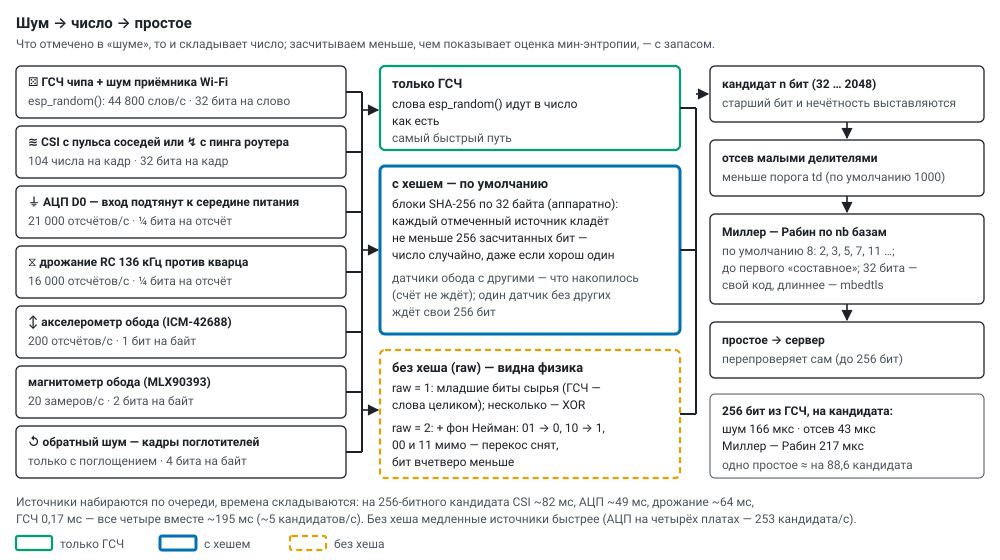

# Where the randomness comes from

*English translation of [docs/randomness.md](../randomness.md) — the Russian original is the source of truth.
Labels inside the diagrams are in Russian.*

The noises from which the agents build numbers: how they are taken, how much we credit, how they are mixed, at what
speed. On the main screen each noise has its own icon: ⚄ chip RNG, Σ all available, ≋ pulse CSI, ↯ router ping CSI,
⏚ ADC D0, ⧖ RC jitter, ↺ reverse noise, ↕ accelerometer, 🧲 magnetometer. How noise is chosen in an experiment —
[modes.md](modes.md).

Board XIAO ESP32-S3, Arduino-ESP32 core 3.3.7 (ESP-IDF 5.5). Raw measurement logs — `logs/probe*.log`, analysis —
`tools/probe_report.py`, measurement firmware — `firmware/entropy_probe`.

## 1. esp_random() and Wi-Fi noise

According to Espressif's documentation, `esp_random()` returns true random numbers while Wi-Fi is on: the thermal
noise of the radio receiver's ADC is continuously mixed into the hardware generator (2 bits per 80 MHz bus clock).
In the compiled library (`libesp_hw_support.a`, examined with a disassembler):

* the function reads the generator register `0x6003507C` (`WDEV_RND_REG`);
* between words it waits **1778 bus clocks** (22.2 µs) and XORs together all reads during the wait;
  hence the limit of **~45,000 words/s** (measured: 44,800), the same in any Wi-Fi state;
* the register itself, without waiting, reads at 10.5 million words/s.

To keep radio noise going into the generator all the time, the firmware keeps Wi-Fi on and **without sleep**
(`WiFi.setSleep(false)`); the telemetry reports this with the field `rf=1`.

**What cannot be checked.** The numbers themselves do not show whether radio noise is in them: the generator has a
second source — jitter of the internal RC_FAST oscillator (the `DIG_CLK8M_EN` bit is set, checked by reading the
register). The generator output in four states (Wi-Fi off/on × RC_FAST off/on) was tested for linear complexity
(Berlekamp–Massey, 4096 words): in all four it is n/2, as for a random sequence — there is no linear structure, but
"with radio noise" cannot be told from "without" by the output. We accept the radio's participation from the
documentation and the function code; Wi-Fi noise can be observed directly through CSI.

## 2. Sources

| source | how we take it | raw per second | estimate (min-entropy) | we credit |
|---|---|---|---|---|
| ⚄ chip RNG + radio noise | `esp_random()` | 44,800 words | per Espressif — full 32 bits | 32 bits per word |
| ≋ ↯ Wi-Fi CSI | the channel state (LLTF, 64 subcarriers) from pulse frames of neighbouring agents (ESP-NOW, 10 per second from each) or from the router's ping replies: 104 numbers per frame | with a 100 Hz ping ~95 frames | ~1.5 bits per number, ~150 per frame | 32 bits per frame |
| ⏚ ADC | pin D0 (GPIO1) with pull-up and pull-down — the middle of the supply; connect nothing to D0 | 21,000 samples | 2.9 bits per sample, but neighbours are correlated (pickup) | ¼ bit per sample |
| ⧖ RC jitter | crystal clocks over 8 periods of the internal 136 kHz RC (`rtc_clk_cal_ratio`) | 16,000 samples | ~1 bit per sample, slow drift | ¼ bit per sample |
| ↕ rim accelerometer | low bytes of the ICM-42688 acceleration and gyro axes | 200 samples | — | 1 bit per byte |
| 🧲 rim magnetometer | low bytes of the MLX90393 axes | 20 measurements | — | 2 bits per byte |
| ↺ reverse noise | contents of the frames of the other wheel's absorbers (their noise with our primes mixed in) — a loop through the air; only with absorption | — | — | 4 bits per byte |

An agent without a rim sensor uses the RNG instead of the sensor.

Rejected: the **temperature sensor** (two values in 1 °C steps over 4096 reads), Wi-Fi **`noise_floor`** (−97 dBm for
all packets), **CSI without ping and pulse** (almost no packets addressed to us; in promiscuous mode — 16 packets/s
from dozens of different devices).

**CSI and 802.11n.** When the agent is allowed 802.11n, the router replies with 802.11n packets, and the chip builds
CSI only for some of them: 3–82 packets/s for ~95 ping replies (`tools/csi_watch.py`). With 802.11g CSI comes for
every reply — 97–99 per second. That is why `prime_lab` allows only 802.11b/g (`esp_wifi_set_protocol`); 54 Mbit/s is
more than enough for telemetry. The noise is the same: the low bit is one in 51 % of cases and matches the previous
packet in 50 %.

## 3. How they are mixed

* **RNG only** — the `esp_random()` words go into the number as they are.
* **Any other set** — SHA-256 blocks (the chip's hardware block) of 32 bytes. Into each block **every** ticked source
  puts at least 256 credited bits — except the rim sensors: together with others they mix in whatever has
  accumulated since the previous block (computing does not wait for a slow sensor), and only a sensor alone, without
  others, waits for its 256 bits. The number stays random even if all sources but one are bad. The sources are
  gathered in turn and the times add up: for a 256-bit candidate CSI takes ~82 ms, ADC ~49 ms, jitter ~64 ms, RNG
  0.17 ms — all four together ~195 ms (~5 candidates/s), 2.4 times slower than CSI alone.

**Noise without hashing (`raw`).** The hash gathers the scattered randomness of the raw data into a dense 256 bits,
but at the same time it stirs away the structure of the source: biases, correlation of neighbouring samples, rhythms.
Without the hash one can see whether the physics of the source shows through in the numbers:

* `raw` = 1 — the low bits of the raw data go into the number as they are: CSI — the low bit of each data-subcarrier
  measurement (2–26 and 38–63, 102 bits per packet; the zero, guard and first subcarriers, which the chip sometimes
  corrupts, are skipped); ADC and jitter — the low bit of a sample; rim sensors — the credited low bits of a byte; RNG
  — whole words; set B air — whole bytes;
* `raw` = 2 — the same with von Neumann debiasing: the pair 01 → 0, 10 → 1, 00 and 11 are dropped. It removes the
  bias between zeros and ones, but not the correlation of neighbouring samples; four times fewer bits;
* several ticked sources are combined bitwise (XOR) — the structure of a source is visible when it is ticked alone.

Without the hash the slow sources are faster: on four boards the ADC gives 253 candidates/s (with the hash ~70), CSI
about three times more, jitter four times more. The yield of primes without the hash may differ from theory simply
because of the bias of the raw data — that is exactly what the mode shows; compare it with the same source with the
hash (`tools/anomaly_run.py`).

## 4. What is seen in the primes

The run `tools/anomaly_run.py 3` (four boards, 256 bits, 3 min per step, report
`data/tests/anomaly_20261005_174844.json`), ~77 thousand primes in total:

| step | primes | sieve, z | yield on tested, z | ones in the bits |
|---|---|---|---|---|
| each on its own, two cores, RNG with hash (reference) | 25,644 | +0.7 | +0.7 | 50.03 % |
| relay, two cores | 6,744 | −0.4 | +1.1 | 50.02 % |
| cascade, two cores, 20 ms deadline | 11,546 | −1.8 | +0.3 | 49.97 % |
| ADC without hash | 584 | +1.2 | +1.1 | **54.43 % (+34 σ)** |
| ADC without hash, von Neumann | 141 | −2.2 | −0.3 | 50.37 % |
| jitter without hash | 481 | −0.2 | +0.5 | 49.64 % |
| CSI without hash | 243 | −0.3 | −0.5 | 50.39 % |
| ADC with hash | 144 | −0.2 | +0.4 | 49.90 % |
| RNG without hash, von Neumann | 7,720 | −0.1 | 0.0 | 49.91 % |
| reference again | 24,351 | −0.6 | +0.6 | 49.97 % |

* Not a single composite (the server checked each one), not a single repeat; the yield of primes in all modes is as
  theory predicts (|z| ≤ 1.1), there is no difference between modes.
* The only real structure is **ADC without hash**: the low bit of a sample is 1 more often, and it shows directly in
  the primes (54 % ones, +34 σ). Von Neumann removes it; CSI and jitter without hash have almost no bias. A one-sided
  bias hardly affects the sieve and the yield.
* Residues modulo 3, 5, 7, 11 are uniform; individual p ≈ 0.02–0.04 on hundreds of primes are the expected share for
  ~40 tests.
* Gaps between primes in the two-core modes: the spread is smaller than Poisson (coefficient of variation ~0.8 — a
  prime needs at least one full test) and neighbouring gaps are correlated on the hottest boards (z 5–8) — the trace
  of the temperature regulator, which works in periods; on cool boards and with slow noise it is absent.
* In the relay ~9 % of the candidates that survive the sieve go untested when the turn is handed over, so the yield
  is computed on the tested ones (on the survivors there would be an apparent "shortfall", z −6.8).

## 5. The primality test

A candidate of the required length (the top bit and oddness are set) → sieve by small divisors below the threshold
`td` (default 1000) → Miller–Rabin on the first `nb` prime bases (default 8: 2, 3, 5, 7, 11 …). 32 bits — our own
code, longer — `mbedtls_mpi` with the hardware accelerator. For 32 bits every prime found is also checked exactly
(bases 2, 7, 61) — this is how "false primes" are counted. The server re-checks the primes it receives (up to
256 bits) with its own Miller–Rabin.

Residues by small divisors are computed with our own code: `mbedtls_mpi_mod_int` gives a correct residue only for
divisors below 2^16 (it divides by half-words); on products of primes up to 2^31 it would lose 84 % of the primes.

## 6. Speed

One board (`tools/gen_sweep.py`); sieve by divisors below 1000, 8 bases, testing until the first "composite" unless
stated otherwise.

| setting | candidates/s | primes/s | time per prime | one test with a base |
|---|---|---|---|---|
| RNG, 32 bits, 1 base | 32,000 | 3,000 | 0.3 ms | 18 µs |
| RNG, 32 bits, all 8 bases for each | 19,400 | 1,770 | 0.6 ms | 18 µs |
| RNG, 256 bits | 2,300 | 28 | 36 ms | 1.05 ms |
| RNG, 256 bits, all 8 bases for each | 950 | 11 | 89 ms | 1.06 ms |
| CSI, 256 bits | 9–10 | 0.07 | 7–8 s | — |
| ADC, 256 bits | 18 | 0.2 | 4.3 s | — |
| jitter, 256 bits | 15 | 0.3 | 3.4 s | — |
| all four sources, 256 bits | 1.9 | — | ~45 s (estimate) | — |
| RNG, 1024 bits | 185 | 0.4 | 2.4 s | 25 ms |
| RNG, 2048 bits | 30 | 0.1 | 9 s (little data) | 181 ms |

One prime falls on roughly ln(2^n)/2 odd candidates: for 256 bits — 88.57, taking into account that the numbers lie
in [2²⁵⁵, 2²⁵⁶); the runs give 88.2–88.7. At 256 bits the time per candidate splits as: noise 166 µs (8 words of
22 µs), sieve 43 µs, Miller–Rabin 217 µs. A base test through mbedtls is noticeably slower than the accelerator's
pure computation: each call spends time on locking, preparing R² and an interrupt; working with the accelerator
directly is a speed reserve.
