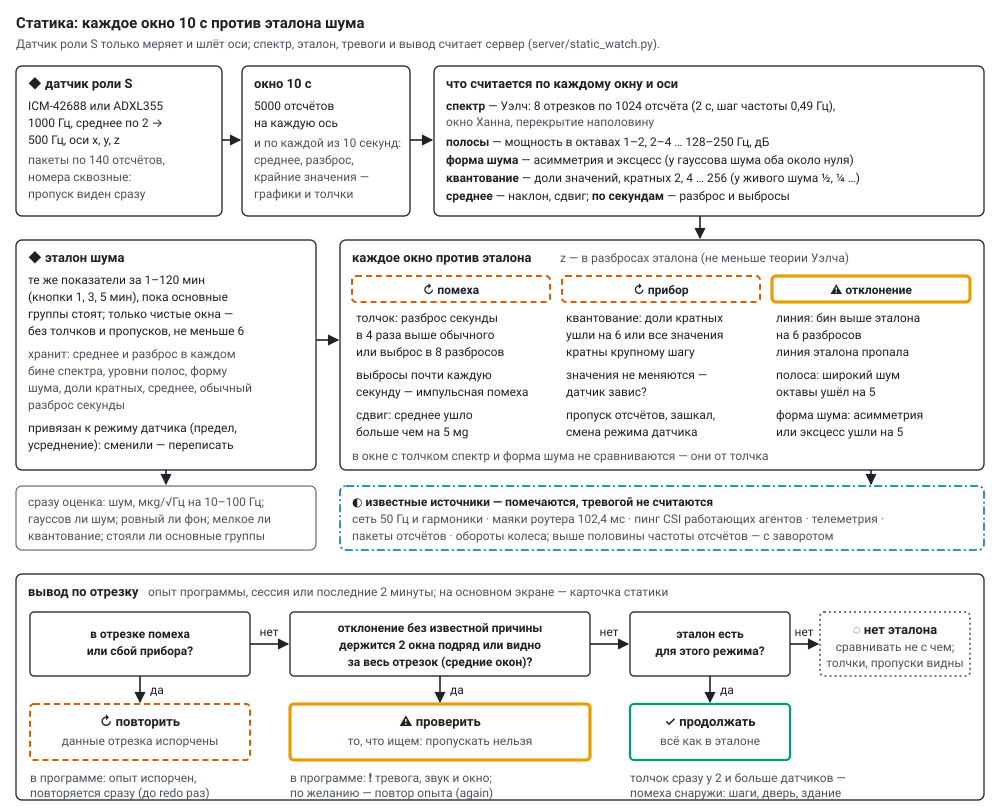

# Static sensors: noise baseline and watching

*English translation of [docs/static_watch.md](../static_watch.md) — the Russian original is the source of truth.
Labels inside the diagrams are in Russian.*

A static sensor is an agent with role **S** in the common firmware: it only measures and sends its axes, generates
nothing, takes no part in groups, does not talk over ESP-NOW and does not ping for CSI. The spectrum, the baseline,
alarms and the verdict "continue / repeat / check" are computed by the server (`server/static_watch.py`, numpy is
needed — without it the server runs but does not process the static sensors). There can be any number of static
sensors; the phone sends the same packets and is also a static sensor for the server. Sensors —
[sensors.md](sensors.md), wiring — [wiring.md](wiring.md).

## What comes from the sensor

* **500 samples a second** on three axes: ICM-42688 — 1000 Hz, low-noise mode, acceleration only, averaged over
  `avg` samples (1, 2, 4, 8; default 2), the sensor's filter below half the output rate so the spectrum does not fold;
  ADXL355 — directly 1000/avg Hz with its own filter. Range ±2 g (4, 8, 16 possible): for the ICM-42688 one unit is
  61 µg against a noise of about 1.1 mg — quantisation is far below the noise.
* **No losses:** the sensor FIFO holds 256 samples, the agent collects them every 10 ms; overflow is counted and
  visible. `acc` packets of 140 samples (x y z, int16, base64) with the number of the first sample and a timestamp;
  the numbers are continuous — the server sees a gap at once.
* **Silence** (`tl` = 2): samples accumulate in a ring buffer (about 25 s at 500 Hz) and are sent afterwards; longer —
  the old ones are overwritten, the server sees a gap. In runs with silence the static sensors are not silent — the
  generators are.
* The sensor registers (mode, FIFO, filter) are read back and go into the telemetry.
* **Role S** — in the agent window on the main screen («→ в измерители (статика)», to measurers (static)); the agent
  remembers it (NVS), restarts and starts measuring at once, even without the server. Back — «→ в генераторы» (to
  generators). If an agent started as static and the server has no role set for it, the server accepts role S.

The samples are stored as they are: `data/accel/<date>/<mac>.bin` (int16 x y z in a row) and `<mac>.idx.jsonl` (a
line per packet: number of the first sample, count, rate, timestamp); they are not written into the common log.

## Axes by gravity — the sensor's orientation does not matter

The server computes not along the sensor's axes but along gravity: **vertical** — along the mean acceleration,
**horizontal** — the two axes across it together (power — the mean of the two, noise shape — over both). So the
sensor can be placed any way: the baseline is valid in any orientation, floor vibration stays on the vertical
wherever the z axis is. The orientation is set from the first window. If gravity turned by more than **2°**
(`PLACE_DEG`), the sensor was placed differently: one window «⤾ новое положение» (new position — interference, the run
will be repeated), then new axes and the same baseline. How the sensor lies (which of its axes looks up, and the
tilt) is on the card in «◆ статика подробно» (static sensors in depth). Quantisation, clipping and freezing are
checked along the sensor's own axes x, y, z: these are properties of the instrument. "Live" shows v, h1, h2 and |a|.

## The window: what is computed

A window is **10 s** (`WIN_S`). For each window, for the vertical and the horizontal:

| metric | how |
|---|---|
| spectrum | Welch: segments of 1024 samples (2 s, frequency step 0.49 Hz), Hann window, half overlap — 8 segments per window |
| bands | power in octaves 1–2, 2–4 … 128–250 Hz (up to half the sample rate), dB |
| noise shape | skewness and kurtosis after subtracting the mean of each second; for Gaussian noise both are near zero |
| quantisation | along the sensor axes: the shares of values divisible by 2, 4 … 256: for live noise ½, ¼ …; a "comb" — all values divisible by one step |
| mean | along the vertical and the two horizontal axes (the horizontal is the tilt); clipping; gaps |
| per second | mean, spread, extreme values — plots and knocks |

## The baseline

The **baseline** is the same metrics over 1–120 minutes **while the main groups are standing**. Recording —
«◆ эталон 1 / 3 / 5 мин» (baseline 1 / 3 / 5 min) on the static card of the main screen, in the window «◆ статика
подробно» or at the start of a program (`baseline_min`). Only clean windows are taken, without knocks and gaps, at
least 6 (a minute). The recording runs one window (10 s) longer than ordered: windows follow a grid, and the first one
after the start is incomplete — this way "1 min" also collects 6 whole windows. Stored: the mean and spread over
windows **in every bin** of the spectrum (and the spread smoothed over neighbouring bins), the baseline lines (bins
6 dB above their neighbours), band levels and spreads, noise shape, shares of multiples, the mean, the usual spread
of a second.

The server rates the baseline at once: noise in µg/√Hz over 10–100 Hz (per datasheet ICM-42688 — 70, ADXL355 — 25);
whether the noise is Gaussian (|kurtosis| < 0.2, |skewness| < 0.1); whether the background is steady (bands from
4 Hz in the two halves of the recording differ by no more than 1 dB or 4 of their spreads — whichever is larger);
whether the quantisation is fine; whether the main groups were standing — if anyone was computing, the baseline is
"not clean".

The baseline is tied to the sensor mode (range, averaging): if the mode is changed, the baseline must be rewritten,
and the card says so. The baseline does not depend on the sensor's orientation. Baselines recorded along the sensor
axes (before axes by gravity) do not fit — the card asks to rewrite them once. Stored in
`data/static/baselines/<mac>.json` (and a dated copy).

## Watching: each window against the baseline

| kind | when | class |
|---|---|---|
| ⚠ **line** | a spectrum bin is more than **6** spreads above the baseline (`Z_LINE`); not searched below 1 Hz | deviation |
| ◐ line gone | a baseline line is 6 spreads below itself | deviation |
| ⚠ **band** | broadband noise of an octave moved by **5** spreads (`Z_BAND`); frequencies of known and found lines (±2 bins) are not counted — one line does not alarm twice | deviation |
| ⚠ **noise shape** | kurtosis or skewness moved by **5** (`Z_GAUSS`) | deviation |
| ⚠ quantisation | shares of multiples moved by 6 (`Z_QUANT`), all values are multiples of a coarse step, or do not change | instrument |
| ⚠ gap, clipping, change of sensor mode | — | instrument |
| ↻ **knock** | the spread of a second is **4** times above usual (`KNOCK_X`) or an outlier of 8 usual spreads (`KNOCK_PEAK`) | interference |
| ↻ outliers | knocks almost every second — impulse interference (pickup, spark, motor) | interference |
| ↻ **shift** | the mean moved from the median of the three previous windows by more than **5 mg** (`MOVED_UG`; heat gives less); then — from the new mean | interference |
| ↻ new position | gravity turned by more than 2° — the sensor was placed differently; one window | interference |

The spread of each frequency is taken from the baseline, smoothed over neighbouring frequencies and is never below
0.9 of the theoretical value for Welch (4.34/√8 dB): with few windows the spread of an individual frequency may be
small by chance. In a window with a knock, the spectrum and noise shape are not compared — they come from the knock.

**Known sources.** A line near a known frequency is marked and does not count as an alarm: mains 50 Hz and
harmonics, router beacons (102.4 ms), the CSI ping of working agents, telemetry, sample packets, wheel rpm.
Frequencies above half the sample rate are taken into account with folding.

**Over the whole segment.** Besides windows, the whole segment (a run, a session) is compared with the baseline using
the window means: a weak line invisible in one window is √n times better visible over n windows. On synthetic data a
120 µg line (+1.3 dB above the noise) is almost invisible in single windows, over 3 minutes — z 8.6.

## The verdict: continue, repeat, check

For a segment — a program run, a session or the last 2 minutes:

* **↻ repeat** — interference or an instrument fault in the segment: the data are spoiled. In a program the run is
  marked spoiled, does not go into the comparison and is repeated at once (up to `redo` times).
* **⚠ check** — a deviation without a known cause persists for **2 windows in a row** (`PERSIST`) or is visible over the
  whole segment. In a program — ❗ alarm and, optionally, a repeat of the run ([program.md](program.md)).
* **✓ continue** — everything is as in the baseline.
* **◌ no baseline** — nothing to compare with; knocks, gaps and quantisation are visible even without a baseline.

A knock at two or more sensors at once (within 1.5 s) is interference from outside: footsteps, a door, the building;
this is written into the verdict note. The largest deviation without a known cause over the segment is `zmax`.

**Live sensor state:** ✓ as the baseline · ◐ one-off deviation — we look at the next window · ◐ as the baseline,
except known sources · ⚠ deviation (persists) · ↻ interference · ↻ instrument · ◌ no baseline or a baseline for
another mode · ✗ sensor silent. Deviations are written to `data/static/events.jsonl`.

## Where to look

* **The static card** on the main screen: the verdict in large type and over which segment, each sensor with its
  reasons; live Gaussian, spectrum and oscillations of the selected sensor and axis over 10 s (every 3 s,
  `/api/static/live`) — a histogram of deviations against a Gaussian of the same spread, the shape in words
  (Gaussian / tails — knocks, outliers / stepped), RMS, skewness, kurtosis; baseline recording. Clicking the plots
  opens the window «∿ вживую» (live): all axes and the magnitude, windows of 10 s, 1, 5, 15 min, «⟲ сброс» (reset),
  oscillations by second.
* **«◆ статика подробно»** (`/acc`): the baseline and its quality; for each sensor the spectrum of the last minute
  against the baseline corridor (±3 spreads), the lines found, spread, mean, shape, quantisation, the band farthest
  from the baseline, the sensor registers; plots over time; the deviation log.
* **Watch view** (`/watch`) — the static sensors in large type, readable from a distance.

## Testing without boards

* `python tools/test_static_watch.py` — synthetic data: a baseline, clean noise (not a single alarm), a 37 Hz line,
  a weak 23 Hz line, 50 Hz mains (known), a knock, values divisible by 256, outliers, a gap, a sensor without a
  baseline.
* `python tools/sim_agents.py 900 --port 5015` with a separate server
  `python server/monitor.py --http 8091 --udp 5015 --data data/test/sim --no-beacon` — three static sensors on a
  schedule: the first 3 minutes are clean (record the baseline), from second 180 a knock at all of them every 75 s,
  300–420 s a 37 Hz line at the first, 480–540 s the third's values are divisible by 256; the second always has 50 Hz
  mains.
