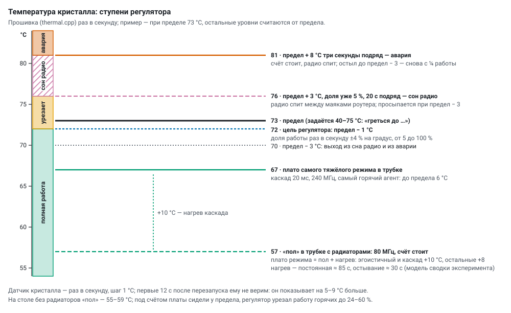
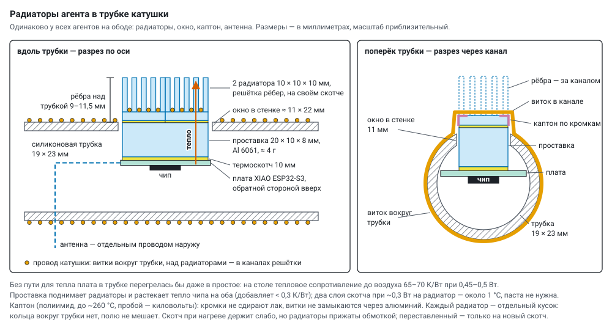

# Agent temperature: regulator, rest, heatsinks

*English translation of [docs/thermal.md](../thermal.md) — the Russian original is the source of truth. Labels
inside the diagrams are in Russian.*

The goal is the **largest total coherent work** of a group: more primes from everyone's noise without overheating
(die limit 73 °C, settable up to 75) and without failures that break the group. The agents sit in the tube under the
coil winding, each with heatsinks (§ 4.2).

## 1. How it works

* **Die sensor** — once a second, 1 °C step. For the first 12 s after a restart we do not trust it: it reads 5–9 °C
  high.
* **Work-share regulator** (`thermal.cpp`): once a second the work share changes by 4 % for every degree of deviation
  from the target (limit − 1 °C), from 5 to 100 %. For the rest of the time the computation sleeps in chunks of 2 ms
  and more. Both computations are throttled: the test on the compute core and noise with sieving on the radio core
  (in "two cores" mode), each core has its own sleep debt.
* **Radio sleep** — only when the share is already 5 % and the die has been 3 °C above the limit for 20 s in a row:
  the radio sleeps between router beacons and wakes at limit − 3 °C.
* **Emergency** — 8 °C above the limit for three seconds in a row: computing stops, the radio sleeps until the die
  cools to limit − 3 °C; then work resumes at ¼.
* **CPU frequency** — set by hand only (80 / 160 / 240 MHz, usually 240), the regulator does not touch it; "Stop"
  sets 80 MHz. **Transmit power** — by hand (`txp`, 2–20 dBm, usually 20). The router ping runs only with ping CSI
  noise.

## 2. Measurements

**In the tube with heatsinks** (wheel 1, 240 MHz, the hottest agent): the "floor" at 80 MHz without computing
≈ 57 °C; under computing — a plateau of "floor + heating of the mode": the heaviest mode (cascade 20 ms, two cores) —
67 °C, 6 °C below the limit, the regulator does not intervene. Heating to the plateau has a time constant of ≈ 85 s,
cooling ≈ 30 s. From these figures the experiment summary estimates the heat of runs (selfish and cascade +10 °C,
the others +8; `THERM` in `server/static/plan.html`, [program.md](program.md)).

**On the table without heatsinks** (four boards, 15 min or longer in one state, median, °C):

| standing | №3 | №4 | №5 | №6 |
|---|---|---|---|---|
| 80 MHz, LED off ("Stop") | 56.3 | 54.8 | 58.5 | 57.7 |
| 240 MHz | 59.3 | 59.8 | 61.5 | 56.7 ¹ |
| cold start, first seconds | 44.3 | 41.8 | 44.5 | 44.7 |

¹ a different time of day — the room was cooler.

Under computing (240 MHz, limit 70 °C) the boards sat at the limit: each on its own, two cores — 141–170 primes/s for
the four at a work share of 48–100 %; cascade — 63 at 24–89 %; relay (33–37) and one number for all (8) — at 100 %;
even slow noise (ADC, CSI, jitter: 1–3 primes/s) — 62–69 °C. Heating from idle: +4…5 °C in 10 s, +7…9 °C in a
minute, at the limit after 3–5 minutes. Cooling in "Stop": −2…3 °C in 30 s, −4 in a minute, the "floor" after
~5 minutes. Two time constants: the die (seconds) and the board (minutes).

**The main point:** between the idle "floor" and the limit there are only 10–14 °C, and most of the heat comes not from
computing but from what is always running.

## 3. Where the heat comes from

1. **The radio is always receiving** — without sleep, otherwise ESP-NOW loses frames, and CSI and radio noise
   disappear. This is the main "floor".
2. **240 MHz clock** — +3…5 °C even at idle (clock tree, idle cycles).
3. **RNG noise spins the core idle.** `esp_random()` waits ~22 µs per word actively, in a loop
   ([randomness.md](randomness.md)); in "two cores" mode this is ~70 % of the noise core's time — heat without
   computing.
4. **The transmitter at 20 dBm.** In a cascade — hundreds of frames per second, each at the amplifier's full power.
   The boards are close (signal −45 dBm): four "all on one number" at 2 dBm gave 7.5 primes/s against 7.7 at 20 dBm.
5. **The computing itself**: Miller–Rabin (accelerator) and the sieve.
6. **The 5 → 3.3 V regulator** on the board next to the die.
7. **The sensors differ**: №4 reads about 3 °C lower than the others (cold start 41.8 against 44.3–44.7); one limit for
   all cuts harder those whose sensor reads "hotter".

## 4. What to do about it

### 4.1 CPU frequency — less benefit than it seems

The flash runs at 80 MHz, and then the core is powered at the **same** 1.25 V at 80, 160 and 240 MHz (`soc/rtc.h` in
ESP-IDF: `DIG_DBIAS_80M_160M` = `DIG_DBIAS_240M` with `CONFIG_ESPTOOLPY_FLASHFREQ_80M`). Work per degree at 160 MHz is
almost the same as at 240 with regulator pauses. The gain is only on idle cycles (+3…5 °C at idle) and on active
waiting for noise (§ 3, item 3). More would come from RNG noise without active waiting: read the register when a
word is ready, and sieve candidates in between.

### 4.2 Heatsinks and the "floor"

The agents sit inside a silicone tube (19 × 23 mm) under the coil winding (a toroid along a Ø900 mm rim). Without a
heat path a board in the tube would overheat even at idle (on the table the thermal resistance to air is 65–70 K/W
at 0.45–0.5 W), so every agent has the same arrangement:

* on the back of the board — an aluminium **spacer** 20 × 10 × 8 mm (cut from a 6061 strip with an 8 × 20 mm cross
  section, ≈ 4 g) on 10 mm thermal tape, with **two heatsinks** 10 × 10 × 10 mm with a grid of fins in a row on it,
  on their factory tape; the spacer spreads the chip's heat to both (< 0.3 K/W), two layers of tape — about 1 °C,
  no thermal paste needed. The fins come out through a **window** ≈ 11 × 22 mm, 9–11.5 mm above the tube;
* **the coil wire** lies in the channels of the fin grid (the winding is not broken, the copper itself carries heat
  away); along the fin edges under the wire — **kapton**: the edges do not scrape the enamel, the turns do not short
  through the aluminium. Each heatsink is a separate piece, there is no ring around the tube, it does not disturb the
  field. The tape holds weakly when hot, but the heatsinks are pressed by the winding; one that has been moved goes
  only onto new tape. **The antenna** — a separate wire to the outside.

The "floor" would go even lower with: **transmit power by signal margin** (start at 11 dBm instead of 20, check losses
per pair with `fail_to`, then follow the worst pair) and **sensor calibration** (the offset of each board from its cold
start, the limit applied to the corrected temperature). Neither has been done yet.

### 4.3 Rest in turns

A board that the regulator has throttled slows the whole group in relay and cascade: its pieces and turns are waited
for, rounds are assembled without it. An announced rest does not slow the group — the resting one is not waited for.
A dispatcher on the server (`rest_tick()` in `server/monitor.py`, settings `REST_ROT` and `REST_GROUP`) looks at
everyone's temperatures every 2 s; a button on the old panel switches **off → in turns → whole group** (default off).

* **In turns:** a candidate is at the limit (≥ limit − 2 °C) and throttled (work < 85 %); the hottest one rests, no more
  than a quarter of the group at a time (one of four), groups of three and more. Rest lasts until it cools by 5 °C,
  from 60 to 150 s; between rests of the same agent — at least 3 min.
* **Whole group:** everyone works at full power until the regulator starts cutting the hottest (≥ limit − 2 °C,
  work < 95 %); then everyone rests until it cools by 6 °C (40–90 s), and they return together — while they work,
  rounds are assembled from everyone's pieces.
* The rest command **does not change the settings** (the `cid` number stays the same): the agent stops computing and
  transmitting, sets 80 MHz and tells the group "resting" (`REST s=…` / `BACK`, frame `M_REST` —
  [group_protocol.md](group_protocol.md)); on return — "back in action". It comes back by itself after `s` seconds
  (180), even if the server disappears. Each rest is a line in the agent's history ("rest in turns: 68.5 → 63.5 °C in
  75 s"); a resting agent's silence is not counted as an error. One number for all — no rest (the bases are divided
  between everyone: the resting one would have to be replaced).

**What the experiment showed** (cascade for 10 minutes starting from rest, four boards without heatsinks, limit 70 °C,
`tools/rest_ab.py`):

| rest | primes/s | second half | rounds from everyone's pieces | coherent primes/s |
|---|---|---|---|---|
| none | 85.7 | 82.3 | 42.5 % | ~36 |
| in turns (7 rests of 60 s) | 89.6 | 82.5 | 26.2 % | ~23 |
| whole group (40 s rest) | ~47 over the first 6 min | — | — | — |

Without rest the regulator held the boards from 24–28 % work (the hottest) to 100 % (the coolest): on average the
group worked at ~62 % power (82–86 primes/s instead of 124 in a sprint). In turns the mechanics work (exactly one
rests, it cools by 6–11 °C in a minute, the group does not stall), but in steady state there is no gain: after 40–60 s
of work the die is at the limit again, and the others replace the resting one's pieces with their own noise. Whole
group — after 40 s of rest the hottest is back at the limit in 20–30 s. **Rest does not cancel heat, it redistributes
it:** the limit is the average power the board can dissipate. The total is raised by less heat per prime and better
dissipation — heatsinks, RNG noise without active waiting, a quieter transmitter.

### 4.4 Sprint: full performance

Everyone rests down to the "floor" → the mode runs at full power for 60–90 s (from a cold state the regulator does not
have time to throttle) → totals → rest again. This shows the full performance of each mode; long runs show the
sustained one. `tools/sprint.py 75` (four boards without heatsinks, 256 bits, 240 MHz, limit 70 °C, measured from
second 15 to second 75):

| mode | primes/s | per agent | work (lowest) |
|---|---|---|---|
| each on its own | 103.6 | 25.9 | 100 % |
| each on its own, two cores | 183.6 | 45.9 | 62 % — by the end one at the limit |
| all on one number | 10.8 | 2.7 | 100 % |
| relay, two cores | 36.8 | 9.2 | 100 % |
| cascade, two cores, 20 ms deadline | **123.9** | 31.0 | 32 % — the hottest at the limit within a minute |

### 4.5 Rest between runs

Before a program run the generators stand at 80 MHz with the coils off until the temperature settles (dropped by no
more than 0.5 °C over 90 s, from 60 s to 6 min), until they cool to a set value, or for a set time. Every mode starts
from the same state, and the initial temperature is written into the run's totals as a covariate. When to rest —
[program.md](program.md).

## 5. Agent rating: the error history

The server keeps a history of events for every agent (`data/agents/events.jsonl`, `server/agent_rating.py`) and
computes a rating: 100 minus the weights of events over a day, a weight halves every 6 h; the same event three times
in a day is marked "systematic". The agent tile shows the rating and the latest events, the number gets a badge.
Reliable ones go into groups and sprints; an unreliable one should be checked or removed.

| event | where it is seen | weight |
|---|---|---|
| a prime failed the server's check | prime log | 50 |
| the firmware self-test failed | `st` | 40 |
| a neighbour found a witness: the "prime" is composite | `split` at the neighbour | 30 |
| restart after a fault: firmware, watchdog, brown-out or power fault, core hang | `rbt` | 25 |
| the radio watchdog restarted it: the radio was not transmitting | `rbt` | 20 |
| the watchdog restarted it: no Wi-Fi for 90 s; "zombie" even after three reconnects | `rbt` | 15 |
| the Wi-Fi firmware update did not load | OTA | 10 |
| Wi-Fi "zombie" — the watchdog reconnected | `wrst` | 8 |
| frames from it get lost | `fail_to` per pair | 5 |
| self-cleaning: low memory — restart between runs | `rbt` | 5 |
| the group did not hear it ("silent") | `mute` at the neighbours | 3 |
| thermal emergency: computing stopped | `ts` | 2 |
| a normal restart (power, USB, firmware), rest in turns | — | 0 |

## 6. What else to check

* Sprint and steady state at 240 / 160 / 80 MHz in the tube; cascade at 20 / 11 / 5 dBm.
* RNG noise without active waiting, transmit power by signal margin.
* Calibration of the board temperature sensors (they differ by several degrees).
