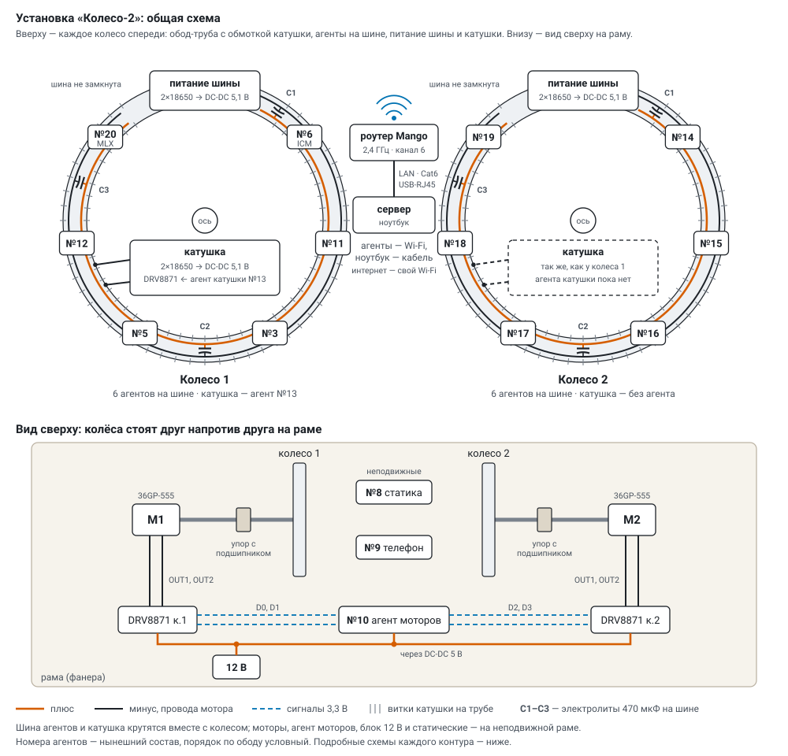
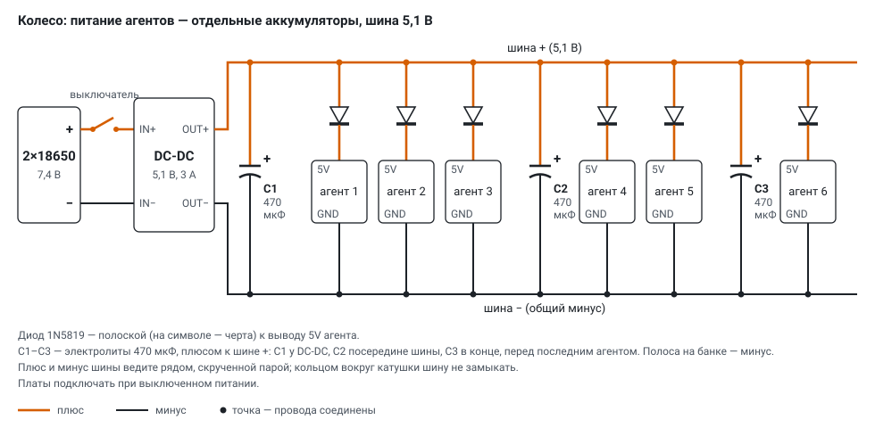
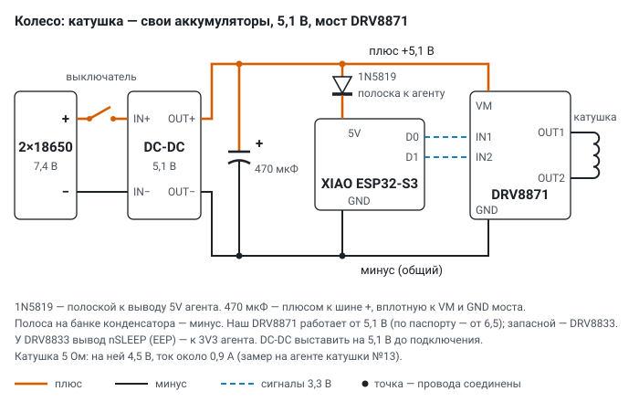
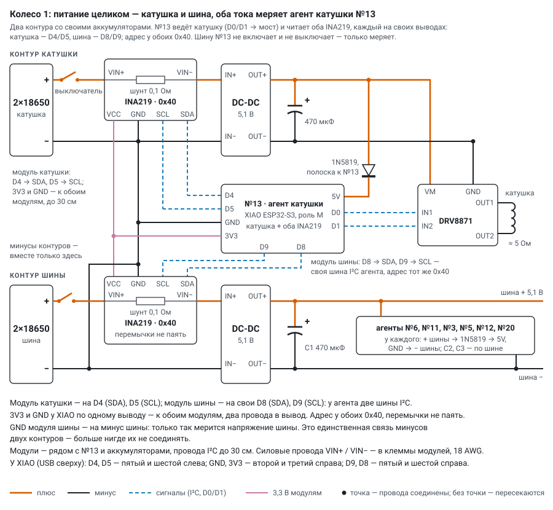
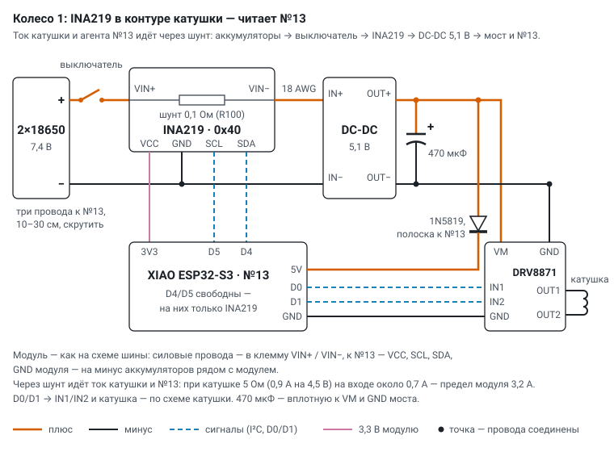
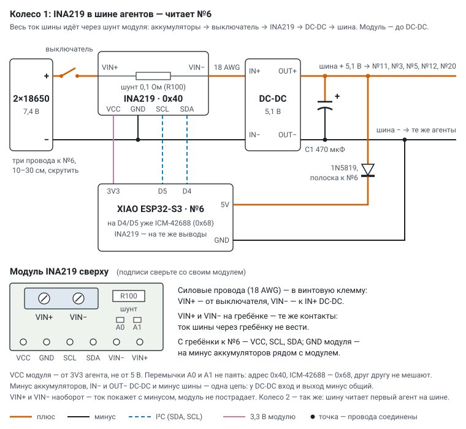
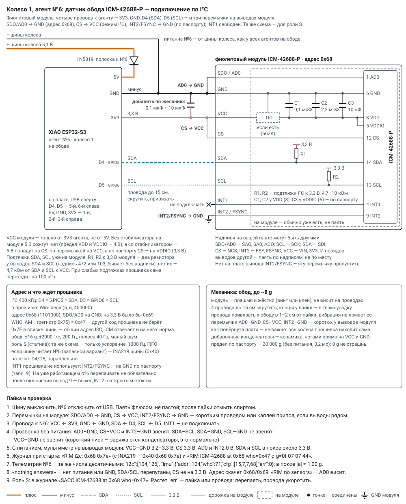
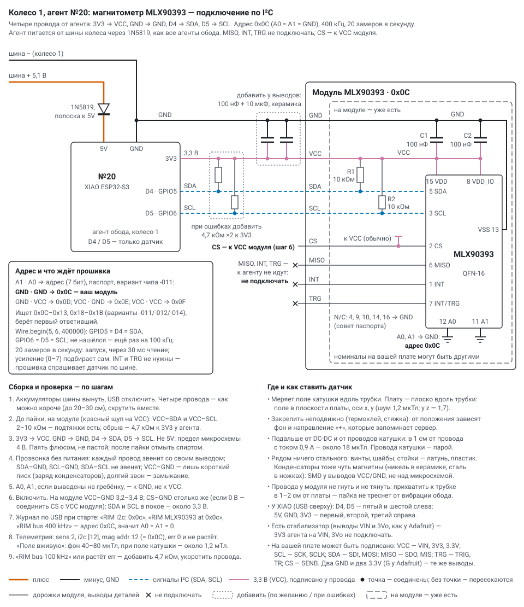
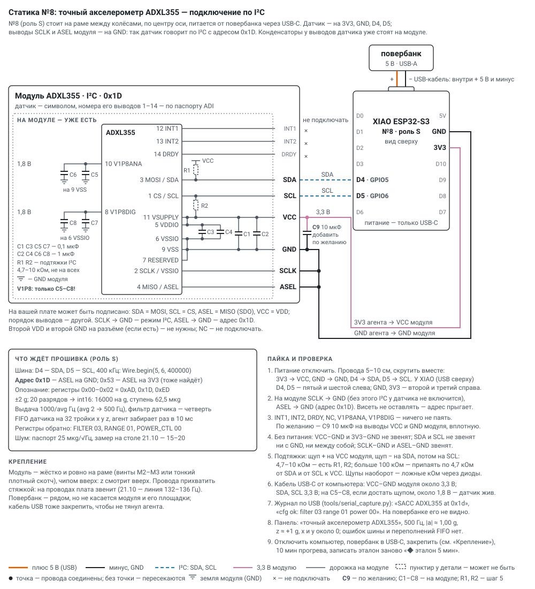
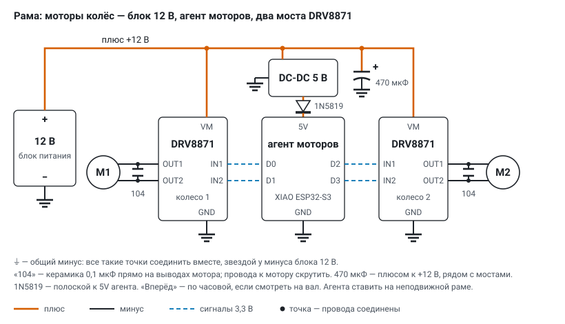

# Wiring diagrams: wheel, sensors, motors and network

*English translation of [docs/wiring.md](../wiring.md) — the Russian original is the source of truth. Labels
inside the diagrams are in Russian.*

The rig has three power circuits that are not connected to each other by wires: the agents talk to the server over
Wi‑Fi, a common ground between the circuits is not needed.

| circuit | where | power | who controls it |
|---|---|---|---|
| agent bus | on the wheel | its own 2×18650 → 5.1 V DC‑DC | nobody: batteries and a switch |
| coil | on the wheel | its own 2×18650 → 5.1 V DC‑DC | the coil agent (role M) through a DRV8871 bridge |
| motors | on the frame | 12 V supply; for the agent — 5 V DC‑DC | motor agent №10 (role M) through two DRV8871 |

## Overall diagram of the rig

- The wheels face each other, each has its own axle on a stop with a bearing and its own motor (M1, M2). Between the
  wheels, on the fixed frame, are the static sensors: №8 and the phone №9.
- Each wheel has two independent circuits: the agent bus (6 boards) and the coil with its own power. The bus along the
  rim is not closed into a ring.
- Wheel 1: №3, №5, №6 (rim sensor ICM-42688), №11, №12, №20 (magnetometer MLX90393), coil agent №13. Wheel 2: №14–№19,
  no coil agent.
- The motors are controlled from the frame: agent №10, two DRV8871 bridges, 12 V supply.
- There are no wires between the wheels, the frame and the server: the agents use Wi‑Fi through the experiment router,
  the laptop server is connected to the router by cable (["Experiment network"](#experiment-network-wi-fi)).

**Symbols on the diagrams.** A thick orange line is plus, a dark one is minus, blue dashes are 3.3 V signals from the
agent, a dot means the wires are connected (without a dot the lines simply cross). + and − labels stand at every power
terminal.

**Polarity of parts.**

- **1N5819 diode**: the bar on the symbol = **the stripe on the body** = the cathode. Stripe towards the agent's 5V pin,
  the other end to the supply plus. The other way round the agent will not turn on (the diode blocks), but it will not
  burn either.
- **470 µF electrolytic**: the stripe with minus signs on the can is **minus**, the long leg is plus. Plus to the supply
  plus. The other way round the electrolytic heats up and may swell.
- **Ceramic 104** (0.1 µF) has no polarity.

The diode in front of the agent is needed so that USB power during flashing by cable does not flow into the bus, and a
swapped plus does not burn the board. The drop across a 1N5819 is about 0.3 V: about 4.8 V reaches the agent's 5V,
which is enough for the XIAO ESP32‑S3.

## Wheel: powering the agents over the bus

- Two 18650 in series (7.4 V, charged — 8.4 V) → switch → step-down DC‑DC to 5.1 V → bus along the rim: plus and minus.
- Each agent: bus plus → 1N5819 (stripe towards the agent) → 5V pin; the agent's GND goes straight to the bus minus.
- Current: a working agent takes up to 0.3 A, with short spikes when Wi‑Fi starts. Six agents — 1.5–2 A, a 3 A DC‑DC
  has margin.
- Electrolytics — three of 470 µF, plus to bus +: **C1** at the DC‑DC output, **C2** in the middle of the bus (after the
  third agent), **C3** at the end, before the last agent. A board's current spike is drawn from the nearest capacitor,
  and the voltage at the far boards sags less.
- Run the bus plus and minus side by side, as a twisted pair. **Do not close the bus into a ring around the coil**: a
  closed turn along the toroid picks up the coil field.
- Order: set the DC‑DC to 5.1 V without load (multimeter on OUT+ / OUT−) → switch off → connect the bus → switch on.

> **A bus short burns out USB — flash a board right away, before the bus.** On 31.10, while connecting the sensors
> (contacts in self-clamping terminals, without diodes), the wheel 2 bus was shorted for a moment. After that the bus
> boards no longer connect over USB: the computer does not see the device at all (checked on №14, №17, №18). But they
> take power from USB and from the bus, the firmware works, the sensors and Wi‑Fi are fine — they can only be updated
> over Wi‑Fi. So flash a new board over USB **right away** (prime_lab, "flash over USB" on the panel) and make sure it
> has come on air over Wi‑Fi — and only then put it on the bus: a board with a burnt-out USB that does not yet have
> prime_lab can no longer be flashed. Before switching the bus on for the first time, beep out 5 V–GND and 3V3–GND (a
> long beep is a short); USB and the bus together — only through a 1N5819.

## Wheel: the coil

- Its own 2×18650 pack and its own 5.1 V DC‑DC, separate from the agent bus: the coil's current spikes do not get into
  the power of the sensors on the rim.
- From one DC‑DC — both the bridge (VM pin) and the coil agent (through a 1N5819, stripe towards the agent). Common
  minus: DC‑DC, electrolytic, bridge GND, agent GND. The 470 µF electrolytic goes right at the bridge's VM and GND.
- Agent: D0 → IN1, D1 → IN2; the bridge outputs OUT1 / OUT2 go to the ends of the coil. The DRV8871 has no other control
  pins.
- The **DRV8871** works from 6.5 V according to the TI datasheet (below 6.1–6.4 V it turns off its switches); our modules
  work from 5.1 V as well — that is outside the datasheet. If the field starts dropping out when the batteries run down,
  fit a **DRV8833** (2.7–10.8 V, up to 1.5 A per channel): the inputs and the truth table are the same, the firmware does
  not change; its nSLEEP pin (EEP on some modules) goes to the agent's 3V3 if the module does not pull it up itself,
  otherwise the bridge stays silent.
- A single-layer toroid (about 5 Ω): ±4.5 V on the coil, current about 0.9 A, the field at the magnetometer in the tube
  1.20–1.26 mT ([coil_test.md](coil_test.md)). Two layers (about 11 Ω) — about 0.45 A. How an uneven tube and winding
  distort the field — the [toroid field](../toroid_field.html) calculator (Russian).
- How the server switches the field on — [sensors.md](sensors.md), section "Wheel coils"; how long a pair of 18650 lasts —
  [coil_test.md](coil_test.md).

## Batteries: INA219

Each circuit on the wheel (agent bus and coil) has its own INA219: the voltage of the 18650 pair and the current once a
second. From them the server shows the charge and how much is left, and the program pauses if a pair has run down
(`server/battery.py`, firmware `battery.h`).

**Wheel 1: both modules are read by coil agent №13**, each on its own I²C bus: the coil module — D4/D5, the bus module —
D8/D9 (the ESP32‑S3 has two I²C buses). Both have address 0x40, do not solder jumpers; the agent's 3V3 and GND go to both
modules. №13 only measures the bus, it does not switch it on or off. The bus module's GND goes to the bus minus: this is
the only connection between the minuses of the two circuits. Separate pins — no address jumper, the wires do not run in
a chain, and a fault of one module or its wires (a short, pickup from the coil) does not silence the other.

**Wheel 2** (no coil agent): the bus INA219 is read by any agent on the bus (№14–№19) on its D4/D5, as in the diagram
below. On wheel 1 №6 can read it the same way — a fallback option: its D4/D5 already have an ICM-42688 (0x68), the
INA219 (0x40) goes on the same pins.

| INA219 pin | where to |
|---|---|
| VIN+ | from the switch — battery plus |
| VIN− | to IN+ of the DC‑DC |
| GND | common minus (battery minus = IN− of the DC‑DC: on the LM2596 input and output minus are common) |
| VCC | the agent's 3V3 (not 5 V: the I²C pull-ups on the module go to VCC, the ESP32 is 3.3 V) |
| SDA / SCL | the agent's D4 / D5 (the bus module at №13 — D8 / D9) |

- All the circuit current goes through the shunt (0.1 Ω on the module): VIN+ and VIN− with wire of the same gauge as the
  main one (18 AWG). At 1.4 A there is about 0.14 V across the shunt. The module's limit is 3.2 A and 26 V.
- Place it before the DC‑DC, not after: the charge shows the battery voltage, not the 5.1 V of the bus.
- The agent looks for an INA219 first on D4/D5, then on D8/D9, up to two: the second goes in the `bat2` packet, a module
  on D8/D9 — with the tag `"w":1`. At the coil agent the wheel bus is taken to be the module on D8/D9 or with address
  0x41 (both modules on D4/D5, A0 soldered on the bus module), the others — the coil; at an agent on the bus — the bus.
- On the main screen, in the wheel header: 🔋 bus 7.62 V · 64 % · ≈ 52 min; 🪫 "time to replace" — 6.8 V or less than
  15 min; "run down" — 6.5 V (3.25 V per cell under load): the program pauses before the next step, «▶ Продолжить»
  (continue) — after replacing. The pair capacity is the set one (2500 mAh) or the measured one: when a pair has
  discharged from full to "time to replace", what was used is recorded as its capacity.

**Assembly step by step** (the same for the bus and the coil):

1. Take the batteries out. Cut the plus wire between the switch and IN+ of the DC‑DC: the end from the switch goes into
   the **VIN+** screw terminal, the end to the DC‑DC into **VIN−**.
2. The module's **GND** — with a short wire to the battery minus next to the module (the same minus as IN− and OUT− of
   the DC‑DC and the bus). For the bus module read by №13, the minuses of the two circuits are joined through this GND —
   there are no other connections between them.
3. Wires to the agent, 10–30 cm, twisted together: **VCC ← 3V3**, **SCL ← D5**, **SDA ← D4**. On the XIAO (USB
   connector at the top) D4 and D5 are the fifth and sixth pins on the left, 3V3 is the third on the right (below 5V and
   GND). The bus module at №13 — **SCL ← D9**, **SDA ← D8** (fifth and sixth on the right, below 3V3 and D10), VCC and
   GND — to the same 3V3 and GND as the coil module (two wires into one pin).
4. Do not solder the address jumpers A0 and A1 (0x40).
5. Beep test without batteries: VIN+ — VIN− beeps (0.1 Ω shunt); the module's VCC — GND, the agent's 3V3 — GND and
   5V — GND **do not beep** (a short chirp on 5V is the bus capacitor charging, that is normal); SDA and SCL do not beep
   with each other or with GND. Solder with flux, not paste; wash with alcohol after soldering.
6. Put the batteries in, switch on: the DC‑DC output is still 5.1 V.
7. At start the agent writes `BAT INA219 at 0x40` to the log (and `BAT INA219 at 0x40 (D8/D9)`); on the main screen in
   the wheel header — 🔋 «шина К1 … В» (bus W1 … V), under the wheel — «катушка К1 … В» (coil W1 … V). Update the firmware
   over Wi‑Fi: `python tools/ota.py all`.

## Sensors: accelerometers and magnetometer

All sensors are on the agent's I²C: **D4 (GPIO5) — SDA, D5 (GPIO6) — SCL**, 400 kHz, power from the agent's 3V3 and GND
(not 5V). At start the firmware itself looks for what is connected and reports the address, the sensor ID and the modes
read back from the registers ([sensors.md](sensors.md)). The mode and address select pins (CS, SCLK, AD0, ASEL, A0/A1)
**must not be left floating**: a floating address pin gives a jumping address and "no sensors". The diagrams show the
pins on both sides, the wires, what is already on the module (capacitors at the chip pins, pull-ups), what to add, the
unused pins and the check step by step. Values and labels on your boards may differ — solder by the labels.

### Rim sensor: ICM-42688

Agent №6 of wheel 1 is on the rim, powered from the wheel bus through its own 1N5819. The purple ICM-42688-P module:
address **0x68**, WHO_AM_I code **0x47**; on the rim ±16 g, ±2000 °/s, 200 Hz. The same module with the same wiring
serves as a static accelerometer (role S: acceleration only, 1000 Hz, FIFO).

| module pin | where to | why |
|---|---|---|
| VCC (sometimes VIN, 3V3) | the agent's 3V3 | only 3.3 V, not 5V: without a regulator on the module 5 V would burn the chip (VDD, VDDIO limit — 4 V), and with a regulator 5 V would reach CS — it is jumpered to VCC, while per datasheet CS goes to VDDIO |
| GND | the agent's GND | common minus (also the wheel bus minus) |
| SDA (sometimes SDI) | the agent's D4 (GPIO5) | I²C data |
| SCL (sometimes SCK) | the agent's D5 (GPIO6) | I²C clock, 400 kHz |
| SDO / AD0 (sometimes SAO, SA0, ADO) | jumper to the module GND | address 0x68 (chip pin 1). A floating AD0 — the address jumps 0x68/0x69 and "no sensors" |
| CS (sometimes NCS) | jumper to the module VCC | I²C mode: per datasheet pin 12 — to VDDIO. A floating CS — the chip may not answer over I²C |
| INT1 | do not connect | the firmware does not use it |
| INT2 / FSYNC (sometimes FSY) | jumper to the module GND | per datasheet (pin 9): FSYNC is not used — to GND. After power-up it is an open-drain INT2 output, the firmware does not touch it; on the working №6 it does not have to be resoldered. If the board has no such pin — skip it |

Usually already on the module (no soldering needed): C1 0.1 µF and C2 2.2 µF at VDD (pin 8), C3 10 nF at VDDIO (pin 5),
SDA and SCL pull-ups of 4.7–10 kΩ to the module's 3.3 V, sometimes a 3.3 V regulator (662K). The pull-ups are visible on
the board — two resistors at the SDA and SCL pins (marked 472 or 103, sometimes unmarked); if there are none —
4.7 kΩ from SDA and from SCL to VCC. Optionally — ceramic 0.1 µF + 10 µF right at the module's VCC and GND.

Mechanics: the module lies flat and rigid (a screw or glue), it does not hang on its wires; 4 wires up to 15 cm,
twisted and tied to the rim 1–2 cm from the solder joints (up to ~8 g on the rim). How the board is turned does not
matter: the firmware finds the wheel axis from the gyro. The radius from the axis to the chip — with a ruler, into the
window «⊙ Калибровка колёс…» (wheel calibration; [sensors.md](sensors.md)).

**Soldering and check:**

1. Switch the bus off, disconnect №6 from USB. Solder with flux, not paste; wash with alcohol after soldering.
2. Jumpers on the module: SDO/AD0 → GND, CS → VCC, INT2/FSYNC → GND — with a short wire or a drop of solder if the pins
   are adjacent.
3. Wires to №6: VCC ← 3V3, GND ← GND, SDA ← D4, SCL ← D5. INT1 — do not connect. On the XIAO (USB at the top) D4, D5 are
   the fifth and sixth on the left; 5V, GND, 3V3 — the first, second and third on the right.
4. Beep test without power: AD0–GND, CS–VCC and INT2–GND beep; SDA–SCL, SDA–GND, SCL–GND do not beep; VCC–GND does not
   beep (a short chirp — the capacitors charging, that is normal).
5. With power, multimeter at the module pins: VCC–GND 3.2–3.3 V; CS 3.3 V; AD0 and INT2 0 V; SDA and SCL at rest about
   3.3 V.
6. Log at start: `RIM i2c: 0x68 0x7e` (with an INA219 — `0x40 0x68 0x7e`), then
   `RIM ICM-42688 at 0x68 who=0x47 cfg=0f 07 07 44`. The answer at 0x7e is the I3C broadcast address, that is normal.
7. №6 telemetry — the same numbers in decimal: `"i2c":[104,126]`,
   `"imu":{"addr":104,"who":71,"cfg":[15,7,7,68],"err":0}`; at rest the acceleration magnitude is ≈ 1.00 g.
8. `nothing answers` — no power or GND, SDA/SCL swapped, CS not at 3.3 V. The address jumps 0x68/0x69 or
   `RIM no sensors` — AD0 is floating, solder it to GND. With weak pull-ups the firmware switches to 100 kHz by itself
   (`RIM bus 100 kHz`).
9. Role S: the log shows `SACC ICM-42688 at 0x68 who=0x47`. If `err` grows — soldering or wires: resolder, shorten the
   wires.

### Magnetometer: MLX90393

Agent №20 of wheel 1 sits in the coil tube and measures the coil field along the tube; it is powered from the wheel bus
through a 1N5819, like all rim agents. Four wires go to the sensor. Address 0x0C (A0 = A1 = GND), 400 kHz, 20
measurements a second, the gain is chosen automatically. The chip pin numbers (QFN-16) are per the Melexis datasheet
(rev. 012, table 3), the module circuit is the typical one (datasheet, fig. 24).

| module pin | where to | why |
|---|---|---|
| VCC (sometimes VIN, 3V3, 3.3V) | 3V3 of agent №20 | powers VDD (pin 15) and VDD_IO (pin 8), 2.2–3.6 V. **Not 5V**: the chip's limit is 4 V |
| GND | the agent's GND | minus, VSS (pin 13); the same GND pin where the bus minus arrives |
| SDA (sometimes SDI, MOSI) | D4 · GPIO5 | I²C data (pin 5) |
| SCL (sometimes SCK, SCLK) | D5 · GPIO6 | I²C clock (pin 3), 400 kHz |
| CS (sometimes SENB) | to the module VCC; usually already connected on the board, does not go to the agent | a high level on CS (pin 2) enables I²C; with power it is ≈ 3.3 V, if 0 V — jumper CS→VCC |
| MISO (sometimes SDO, MIS) | do not connect | SPI output (pin 6), free in I²C per datasheet |
| INT | do not connect | "measurement ready" (pin 1); the firmware polls the sensor over the bus itself |
| TRG (sometimes TRIG, TR) | do not connect | external trigger or a second interrupt (pin 7); the external trigger is off in the firmware |
| A0, A1 | usually already to GND on the module; if brought out to the header — to GND, **not to VCC** | the low address bits (pins 12, 11): both 0 → 0x0C |

A board may have two GND and two 3.3V pins (on Adafruit the extra GND is labelled G) — they are the same pins.

- **Already on the module:** C1 and C2 of 100 nF — at VDD and at VDD_IO, SDA and SCL pull-ups to VCC (usually
  2.2–10 kΩ), CS to VCC, A0 and A1 to GND. The datasheet advises connecting the chip's N/C pins (4, 9, 10, 14, 16) to
  GND — that is the board's business.
- **Optionally add:** ceramic 100 nF + 10 µF between VCC and GND right at the module pins (the wires are long, the rim
  shakes). SMD ceramics at the VCC/GND pins, not above the chip: capacitors are slightly magnetic too (nickel), and
  motionless iron is subtracted by the server as background.
- **Add if there are errors:** 4.7 kΩ from SDA and from SCL to 3V3 at the agent — if the log shows `RIM bus 100 kHz` or
  `err` grows in the telemetry.
- A module with a regulator (pins VIN and 3Vo, as on Adafruit) — the agent's 3V3 to VIN, do not connect 3Vo.
- The firmware looks for the sensor at 0x0C–0x13 and 0x18–0x1B (chip variants -011, -012, -014 per datasheet,
  table 14).

**Where to put it.** The board lies flat along the tube: the coil field falls into the plane of the board, on the x, y
axes (noise 1.2 µT, z has 1.7). Fix it rigidly (hot glue, a cable tie): the background and the "+" direction that the
server remembers depend on its position. Away from the DC-DC and the coil wires: 1 cm from a wire with 0.9 A — about
18 µT; the coil wires as a pair. Nothing made of steel nearby: screws, washers, standoffs — brass or plastic. Do not bend
or pull the wires at the module: tack them to the tube 1–2 cm from the board so the solder joints do not crack from
vibration.

**Assembly and check step by step:**

1. Take out the bus batteries, disconnect USB. Four wires — as short as possible (up to 20–30 cm), twisted together.
2. Before soldering, on the module (red probe on VCC): VCC–SDA and VCC–SCL 2–10 kΩ — the pull-ups are there. Open
   circuit — add 4.7 kΩ from SDA and from SCL to 3V3 at the agent. Do not measure this way after soldering: the diodes on
   the agent's pins get in the way.
3. Soldering: **3V3 → VCC, GND → GND, D4 → SDA, D5 → SCL** (on the XIAO, USB at the top: D4, D5 — the fifth and sixth on
   the left; GND, 3V3 — the second and third on the right). Solder with flux, not paste; wash with alcohol after
   soldering.
4. Beep test without power: each wire beeps with its own pin; SDA–GND, SCL–GND and SDA–SCL **do not beep**; VCC–GND —
   only a short chirp (the capacitors charging), a long beep is a short.
5. A0, A1, if brought out to the header — to GND, not to VCC.
6. Switch on. At the module VCC–GND 3.2–3.4 V; CS–GND the same (if 0 V — connect CS to the module's VCC); SDA and SCL at
   rest about 3.3 V.
7. The USB log at start: `RIM i2c: 0x0c`, `RIM MLX90393 at 0x0c`, `RIM bus 400 kHz` — address 0x0C, so A0 = A1 = 0.
8. The agent's telemetry: `sens` 2, `i2c` [12], `mag` with `addr` 12 (= 0x0C), `err` 0 and not growing. On the main
   screen — «поле вживую» (field live): background 40–80 µT (the Earth and iron nearby), with the coil field —
   1.20–1.26 mT ([coil_test.md](coil_test.md)), the sign changes together with the field.
9. `RIM bus 100 kHz` or `err` grows — add 4.7 kΩ pull-ups and shorten the wires.

### Static sensor: ADXL355

Agent №8 (role S) stands on the frame between the wheels, at the centre of the axis, and runs from a power bank with a
USB-A → USB-C cable; the agent's 5V pin is free. It is checked before installation from a computer's USB cable: the
board's log is visible only over USB.

The sensor talks over I²C at address 0x1D: the module's SCLK pin goes to GND (sensor pin 2 SCLK/VSSIO, per the ADI
datasheet "to VSSIO for I2C"), the ASEL pin also to GND. The capacitors at the sensor are already on the module (ADI
datasheet, fig. 59), pairs of 0.1 µF + 1 µF: at 11 VSUPPLY — C1, C2 to 9 VSS; at 5 VDDIO — C3, C4 to 6 VSSIO; at
10 V1P8ANA — C5, C6 to 9 VSS; at 8 V1P8DIG — C7, C8 to 6 VSSIO. The labels on your board may differ: SDA = MOSI,
SCL = CS, ASEL = MISO (SDO), VCC = VDD.

| module pin | where to | why |
|---|---|---|
| VCC (VDD) | the agent's 3V3 | 3.3 V power; on the module — to pins 11 VSUPPLY and 5 VDDIO. Not 5 V: the sensor's limit is 3.6 V |
| GND | the agent's GND | minus; on the module — 9 VSS, 6 VSSIO (and 7 RESERVED — per datasheet it may be left unconnected) |
| SDA (MOSI) | D4 · GPIO5 | I²C data — pin 3 MOSI/SDA |
| SCL (CS) | D5 · GPIO6 | I²C clock — pin 1 CS/SCL |
| SCLK | the module GND | pin 2 SCLK/VSSIO to ground — enables I²C |
| ASEL (MISO, SDO) | the module GND | pin 4: address 0x1D (at 3V3 — 0x53, the firmware finds it anyway); do not leave it floating |
| INT1, INT2, DRDY | nowhere | pins 12, 13, 14 — the firmware does not use them |
| NC; a second VDD and a second GND (if present) | nowhere | NC is connected to nothing; the second VDD and GND are already connected on the board to the first ones |
| V1P8ANA, V1P8DIG (if brought out) | nowhere | pins 10, 8 — outputs of the 1.8 V regulators inside the sensor, only their own capacitors go there; to 3V3 — it will burn |
| C9 10 µF, ceramic (106) — optional | between VCC and GND right at the module | damps the agent's Wi‑Fi current spikes on 3V3; useful if the wires are longer than 10 cm |

How the firmware configures the sensor (range, rate, FIFO) — [sensors.md](sensors.md).

1. Disconnect power. Wires 5–10 cm, twisted together: 3V3 → VCC, GND → GND, D4 → SDA, D5 → SCL. On the XIAO (USB at the
   top) D4, D5 are the fifth and sixth pins on the left; GND, 3V3 — the second and third on the right.
2. On the module SCLK → GND (without this the sensor's I²C does not turn on), ASEL → GND (address 0x1D). Do not leave
   them floating — the address will jump.
3. INT1, INT2, DRDY, NC, V1P8ANA, V1P8DIG — solder nothing. Optionally — C9 10 µF right on the module's VCC and GND pins.
4. Beep test without power: the module's VCC–GND and the agent's 3V3–GND do not beep; SDA and SCL do not beep with GND or
   with each other; SCLK–GND and ASEL–GND beep. Solder with flux, not paste; wash with alcohol after soldering.
5. Pull-ups, multimeter on resistance: the + probe (red) on the module's VCC, the − probe on SDA, then on SCL.
   4.7–10 kΩ — the module has pull-ups; more than 100 kΩ — solder 4.7 kΩ from SDA and from SCL to the module's VCC. Do
   not put the probes the other way round: the current will go through the protection diodes of the sensor and the
   ESP32 to VCC, and the multimeter will show false kilohms.
6. USB-C cable from the computer: the module's VCC–GND about 3.3 V; SDA and SCL at rest about 3.3 V; on the V1P8ANA /
   V1P8DIG capacitors (if a probe can reach) about 1.8 V — the sensor's regulators are alive.
7. The USB log (`tools/serial_capture.py`): `SACC ADXL355 at 0x1d` and
   `SACC ADXL355 cfg ok: filter 03 range 01 power 00 …, ±2 g, 500 Hz`. On a power bank the log is not visible.
8. On the main screen: №8 shows «точный акселерометр ADXL355» (precision accelerometer ADXL355), 500 Hz, |a| ≈ 1.00 g;
   the module lies chip up — z ≈ +1 g, x and y about 0; no bus errors and no FIFO overflows.
9. Disconnect the computer, the power bank into USB-C. Fix it rigidly and level on the frame (M2–M3 screws or thin dense
   tape, not foam), z — up. Tie the wires down with a cable tie: a board hanging on its wires rings (a 132–136 Hz line in
   the spectrum). The power bank — nearby, but not touching the module and its pad; fix the USB cable so it does not
   pull the agent.
10. Let it warm up for 10 min and record the baseline again («◆ эталон 5 мин», baseline 5 min;
    [static_watch.md](static_watch.md)).

Sources:
- [ADXL354/ADXL355 datasheet Rev. A (DESY copy), Figure 59, p. 21](https://www.zeuthen.desy.de/~sulanke/Projects/ICECUBE/mDOM/mainboard/datasheets/sensor_inclino_accelero_adxl354_355.pdf)
- [ADI wiki, EVAL-ADXL355-PMDZ (P1 pinout)](https://wiki.analog.com/resources/eval/user-guides/eval-adicup360/hardware/adxl355)

## Frame: the wheel motors

- 12 V supply: plus to VM of both DRV8871 bridges (6.5–45 V, up to 3.6 A, the current limit is set by a resistor on the
  module) and to the input of the motor agent's 5 V DC‑DC. A 470 µF electrolytic on +12 V next to the bridges.
- Motor agent №10 stands **on the fixed frame**: D0 → IN1, D1 → IN2 of the wheel 1 bridge; D2 → IN1, D3 → IN2 of the
  wheel 2 bridge. Agent power — 5 V DC‑DC → 1N5819 (stripe towards the agent) → 5V.
- The 36GP‑555 motors (12 V, 112 rpm gearbox) — to OUT1 / OUT2 of their bridges. A ceramic 104 right on the motor
  terminals damps the brush noise; twist the motor wires.
- All minuses (⏚ on the diagram) — supply, bridges, DC‑DC, agent — join them **as a star at the minus of the 12 V
  supply**, not in a chain from bridge to bridge.
- "Forward ▶" is clockwise when looking at the shaft from the front. If the motors are mounted mirrored and "together"
  turns the wheels in different directions — swap the OUT1 / OUT2 wires of the second one.
- A faulty DRV8871 module is recognised like this: 3.2 / 2.7 V on IN, 12 V on VM, zero on OUT.
- Modes, ramp, watchdog and rpm feedback — [sensors.md](sensors.md), section "Wheel motors".

## Experiment network (Wi‑Fi)

A network of its own just for the rig: the agents, the phone and the laptop server are in it, no foreign devices. The
air is also part of the experiment (CSI, neighbours' frames, reverse noise), so the network is set up to keep it steady
and predictable.

| what | how it is set up | why |
|---|---|---|
| router | GL.iNet **GL‑MT300N‑V2 "Mango"**, micro‑USB 5 V power | small, 2.4 GHz only — which is what the ESP32 can do |
| network name and password | **our own**, not the factory ones (the factory password is the same on every Mango); WPA2‑PSK | foreign boards and phones do not get into the experiment network |
| where they are stored | only in `secrets/wifi.ini` on the laptop (outside git) → `tools/gen_secrets.py` → firmware | they are not in the repository, the documents or on GitHub |
| channel | **6, fixed** (not "auto") | neighbouring networks are on 1 and 9–11 — channel six is between them; the router does not hop channels in the middle of a run |
| standard at the agents | only **802.11 b/g**, radio sleep off | CSI comes for every packet; receiver noise goes into the generator continuously |
| laptop | the router's **LAN** port ↔ 3 m Cat6 cable ↔ UGREEN USB 3.0 → RJ45 adapter (AX88179) | the server does not occupy the agents' air; the cable does not drop out when the air is full of frames |
| WAN port | empty | the experiment network has no internet; the laptop goes to the internet over its own Wi‑Fi |
| fallback network | a second router; its name and password are in the same `wifi.ini` | if the main one refuses for 40 s, the agent goes to the fallback; it tries the main one after 2 min, then every 10 min while standing; in the telemetry `net` 0 / 1 |

**Ports** (server `server/monitor.py`): UDP 5005 — telemetry reception (`--udp`), UDP 5006 — beacon, UDP 5007 — commands
to the agents, TCP 8090 — HTTP (`--http`): the screen, `/api`, reception from the phone, the firmware image for OTA.

**How an agent finds the server.** There is no address in the firmware: every 2 s the server broadcasts the beacon
`W2SRV 5005` on UDP 5006 into all its networks, and the agent takes the sender's address. So an agent on the fallback
network also finds the server if the laptop is in it. Commands (`CFG`, `MOT`, roles) arrive on UDP 5007, the agent
acknowledges them with the `cid` number in the telemetry; the `OTA` command is signed with the key `secrets/ota.key`, and
the agent downloads the image over HTTP from port 8090.

**One air for everyone.** ESP‑NOW (the neighbours' pulse, group mode and scattering frames) goes on the same channel 6 as
Wi‑Fi: the agents do not retune the radio. That is why CSI is taken from the neighbours' pulse, and the router ping only
as a separate noise and in short runs ([how_it_works.md](how_it_works.md), "Temperature and watchdogs"). The server and
the phone do not occupy the air more than needed: the laptop is on a cable, the phone sends in batches, 4 times a
second.

**The phone** is in the same network: the app's service finds the server by the beacon and sends packets over HTTP to
port 8090 (`POST /api/ingest`). Without Wi‑Fi — over a USB cable: every 15 s the server runs `adb reverse tcp:8090`, and
the packets go over the cable ([sensors.md](sensors.md), "The phone").

**If the network changes.** A new name or password goes into `secrets/wifi.ini`, then `python tools/gen_secrets.py` and
flashing over the air (`python tools/ota.py all`): boards that do not know the new network yet hold on to the fallback,
so a typo in the password does not require reflashing over USB. Change the channel on the router together with a check
of the neighbours (a Wi‑Fi analyser on the phone): channel six was chosen by measurement.
