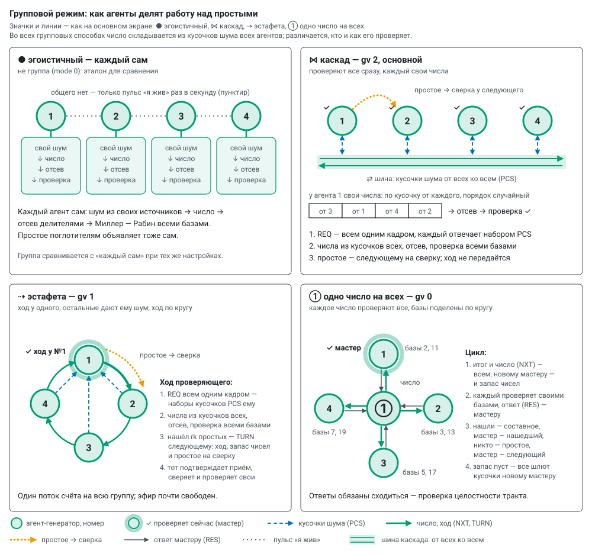

# Групповой режим: протокол и что мерим

Прошивка `prime_lab`, модуль `group.cpp`: протокол живёт в своей задаче на ядре связи, считает ядро счёта по
заданиям. Группа — подгруппа колеса (буква а–з на основном экране); состав и адреса участников сервер присылает
вместе с настройкой — новый агент входит без перепрошивки остальных. Способ задаёт `gv`, значки — как на основном
экране. Когда какой способ выбирать — [modes.md](modes.md), «Совместная работа»; обмен по шагам, замедленно, —
окно «↻ Как работает», раздел 2.

| значок | способ | `gv` | кто проверяет | что идёт по эфиру |
|---|---|---|---|---|
| ● | эгоистичный — не группа (`mode` 0), эталон | — | каждый свои числа из своего шума | только пульс |
| ⋈ | **каскад** — основной | 2 | все сразу, каждый свои числа | кусочки от всех ко всем, простые на сверку |
| ⇢ | эстафета | 1 | один, ход по кругу | кусочки к проверяющему, ход с запасом чисел |
| ① | одно число на всех | 0 | все одно число, базы поделены | число и итог от мастера, ответы и кусочки к нему |

## 1. Числа из кусочков шума всех

* **Кусочек** — длина числа, делённая на число агентов, с округлением вверх до 4 байт (256 бит: двое — 16 байт,
  четверо — 8). Шум каждый агент берёт из **своих** источников ([randomness.md](randomness.md)).
* **Набор** — K кусочков одним кадром PCS, на K кандидатов. Одно число на всех — K = `k` (по умолчанию 24);
  эстафета и каскад — сколько влезает в кадр, до 64 (256 бит, четверо — 64).
* **Кандидат** — по кусочку от каждого в случайном порядке (порядок — быстрым генератором xorshift128+,
  заправленным ГСЧ на каждый сбор), старший бит и нечётность, отсев делителями (`td`): при `td` 1000 из 24
  кандидатов уцелевают в среднем около четырёх.
* **Кусочки заранее** (`pre`, только при одном ГСЧ): набор готов до просьбы. Одно число держит один набор,
  эстафета и каскад — до четырёх; медленные источники (CSI, АЦП, дрожание) набирают по просьбе.
* **Два ядра** (`dc` 1, эстафета и каскад): шум кусочков набирает производитель на ядре связи. Эстафета там же
  складывает и отсеивает (по 16 кандидатов за проход), ядро счёта только проверяет; каскад отсеивает на ядре
  счёта — ядро связи занято шумом для чисел всех.

## 2. Каскад и эстафета (`gv` 2 и 1)

Число складывается из кусочков всех, а проверяет его один — всеми базами подряд. Делить проверку одного числа
невыгодно: составное отбраковывает первая же база (≈ 1 мс при 256 битах), а кадр идёт дольше.

* **Каскад** — проверяют все сразу, каждый свои числа, и каждый же даёт кусочки для чисел всех остальных.
  Найденное простое уходит следующему по порядку на сверку; ход не передаётся.
* **Эстафета** — ход у одного, остальные дают ему шум. Нашёл `rk` простых — ход и остаток запаса чисел
  следующему по порядку (TURN, адресно); тот подтверждает приём, сверяет простое и сразу проверяет свои.
  Один поток счёта на всю группу.

Ход проверяющего:

1. **Круг сбора.** Просьба о кусочках — всем одним широковещательным кадром (REQ), повторы — адресно тем, кто
   не прислал. Каждый отвечает набором (PCS).
2. **Числа.** K кандидатов из кусочков всех, отсев, уцелевшие — в запас. Новый круг — пока запас меньше
   «уцелевших за круг и двух про запас»; каскад держит запас на круг вперёд (уцелевших за два круга и два).
3. **Проверка.** Ядро счёта берёт из запаса пакеты (8 чисел при 256 битах) и проверяет всеми базами до первого
   простого: составное — одна база, простое — все.
4. **Сверка** — вместо согласия «одного числа». Получатель простого проверяет его одной базой, которой
   проверяющий не проверял (следующей после `nb`: при 8 базах — 23; при 12 сверки нет). Нашла свидетеля —
   «простое» составное: `split`.
5. **Ждать кусочки** (`pw`). 0 — ждать всех, переспрашивая до 3 раз; не прислал и после этого — участник
   **молчит** (§ 4). Срок в мс — потом недостающие кусочки заменяются наборами своего шума: число всё равно
   случайное, в нём просто меньше чужого шума. Своих наборов на замену не хватает — агент копит их, а соседям
   отдаёт потом. Круги с заменой и число замен — `tr` в пакете `grp`; на основном экране — «кусочки от всех,
   % чисел».

## 3. Одно число на всех (`gv` 0)

Каждое число проверяют все; базы Миллера — Рабина поделены по кругу (место в группе, место + N, …): при 8 базах
и двух агентах первый проверяет 2, 5, 11, 17, второй — 3, 7, 13, 19. У агента проверка обрывается на первой
базе, сказавшей «составное». Цикл — два сообщения на агента: итог с числом и ответ.

1. **Число приходит с итогом прошлого цикла** (NXT). Все сразу проверяют его своими базами и отвечают мастеру
   (RES): нашёл ли свидетеля, какой базой, сколько считал.
2. **Итог** (NXT). Нашёл кто-то — число составное, следующий мастер — нашедший (нашли несколько — выбор по
   зерну из SHA-256 самого числа). Не нашёл никто — число простое: мастер записывает его и передаёт мастерство
   следующему по порядку. В том же сообщении — число следующего цикла, а новому мастеру — ещё и остаток запаса
   (при 256 битах — до 16 чисел).
3. **Пополнение во время проверки.** Запас кончился — итог говорит всем «шлите кусочки новому мастеру»
   (`want`): каждый сразу отдаёт набор и садится проверять, мастер складывает и отсеивает, пока все проверяют.
4. **Без числа** (начало сессии, разрыв): мастер просит кусочки запросом (REQ), отсеивает и сам рассылает
   число (NUM).

Одним агентом группа тоже работает: он сам себе мастер, проверяет всеми базами и кадров протокола не шлёт.

**Согласие.** Ответы про одно число обязаны сходиться: случайное составное выдаёт свидетеля почти любой базе
(сильные псевдопростые к первым базам среди случайных 256-битных чисел не встречаются), так что в каждом цикле
нашли либо все, либо никто. Мастер считает:

* `agr` — циклов, где ответы всех сравнивались;
* `split` — нашли не все: псевдопростое к чьим-то базам (сервер перепроверит) или ошибка счёта и передачи;
* `dis` — в режиме согласия (`all` 1: все базы у каждого, порядок один) первые базы-свидетели у агентов разные.

Число последнего расхождения и ответы агентов — `gls` в пакете `grp`; на основном экране — «согласие %» в
окошке группы. Это проверка целостности всего тракта: расхождений быть не должно вовсе.

## 4. Сбои

| что случилось | что делает протокол | счётчик |
|---|---|---|
| одно число: нет ответа о проверке | мастер повторяет число (NUM) молчащему, до 3 раз, потом новый цикл | переспросы; разрыв: проверка |
| одно число: нет кусочков | мастер повторяет запрос (REQ), до 3 раз, потом сбор заново | переспросы; разрыв: сбор |
| одно число: итог не дошёл до нового мастера | к нему уже идут ответы и кусочки — он их сохраняет и просит итог повторить (ASK) | переспросы; «раньше итога» |
| одно число: новый мастер молчит дольше 4 циклов (не меньше 50 мс) | прошлый мастер повторяет ему итог, до 3 раз | переспросы; разрыв: эстафета |
| одно число: участник не слышит мастера 1,5 с и больше | начинает цикл сам (первый по порядку — раньше других) | перехват мастерства |
| одно число: два мастера сразу | уступает тот, у кого номер цикла меньше (при равных — больший номер агента) | два мастера |
| эстафета, каскад: нет кусочков после трёх просьб (`pw` 0) | участник молчит: его кусочки — свой шум | разрыв: сбор; `mute` |
| эстафета, каскад: вышел срок `pw` | недостающие кусочки — свой шум | `tr` |
| эстафета: следующий не подтвердил ход | TURN ещё до 3 раз, потом ход тому, кто за ним; не принявший молчит | переспросы; разрыв: эстафета; `mute` |
| эстафета: проверяющего не слышно 1,5 с и больше | ход берёт следующий по порядку, остальные — позже, по очереди | перехват хода |
| эстафета: два проверяющих сразу | уступает тот, у кого номер хода меньше (при равных — больший номер агента) | два проверяющих |
| радио не передаёт 15 с или Wi-Fi нет 90 с | плата перезапускается сама, сервер возвращает ей настройку, группа принимает обратно | `rbt` |

Остальные сторожа платы (Wi-Fi «зомби», тишина маяка) — [how_it_works.md](how_it_works.md), «Температура и
сторожа».

**Время ожидания.** Кусочки и ответы ждут вдвое дольше обычного времени самого медленного участника плюс 20 мс
(обычное — скользящее среднее по каждому): урезанный по температуре агент — задержка, а не потеря. Ответ несёт
метку числа (младшие 4 байта): ответ про другое число не засчитывается.

**Молчащий участник** (эстафета, каскад). Кто не прислал кусочки после трёх просьб или не принял ход, тот для
этого агента молчит: круг собирается без него (его кусочки — свой шум), следующие круги его не ждут, ход и
сверка идут мимо. Любой кадр от него — и его снова ждут. В пакете `grp` — `mute`: [сколько раз замолкали,
маска мест молчащих, сколько молчат]; на основном экране — «◇» в окошке группы, дуга эстафеты к нему —
пунктиром.

**Отдых по очереди** (эстафета, каскад; [thermal.md](thermal.md), «Отдых по очереди»). Сервер шлёт самому горячему из
урезанных регулятором `REST s=…`. Агент доводит свой ход (эстафета — пока следующий не принял), говорит каждому
участнику адресно `M_REST` «отдыхаю» — его сразу ставят в молчащие, — ставит 80 МГц и не считает; на кадры
группы не отвечает, в эфир — только пульс. Через `s` секунд или по `BACK` — частота из настройки и `M_REST`
«снова в деле»: каскад — свои ходы, эстафета — ждёт хода (номер хода и проверяющего узнаёт из первой же
просьбы REQ). Номер настройки не меняется. В пакете `grp` — `rest`: [1 отдыхает / 2 уйдёт, как доведёт ход;
секунд осталось; отдыхов всего].

## 5. Обмен

* ESP-NOW на канале роутера, скорость `nr`: 24 Мбит/с — обычная; 6 Мбит/с — берёт сигнал на ~12 дБ слабее;
  1 Мбит/с — кадр висит в эфире в 20 раз дольше, передатчик греет плату, и группа ждёт урезанную регулятором.
  Кадр протокола — до 600 байт с меткой `W5`: кадры другой версии не принимаются.
* Кадры группы — адресные: радио подтверждает каждый и само повторяет потерянный (широковещательные без
  подтверждения теряются). Всем сразу — только первая просьба о кусочках в эстафете и каскаде (потерю покроет
  повтор или срок `pw`), пульс и кадры поглощения ([scatter.md](scatter.md)). Адреса участников — из реестра
  сервера; пульс сообщает адрес и сигнал соседа ещё до первого кадра протокола.
* Кадр уходит только после отчёта радио о предыдущем: сплошной поток кадров глушит обычный Wi-Fi агента
  (команды, телеметрию).
* Номер настройки (`cid`) — номер сессии: кадры чужой настройки не принимаются, поэтому несколько групп сразу
  друг другу не мешают.

**Плохой передатчик тормозит всех.** Группа вдруг медленная и много переспросов — смотреть пары (`fail_to`,
`rssi_from` в пакете `grp`; строка «пары» на прежней панели `/old`): у виновника теряются кадры **от него** к
любому соседу (2–20 %), кадры к нему и между остальными доходят на 100 %, у него же не уходит телеметрия
(`udpf`) и растёт «не принято радио» в `etx`. Такую плату — заменить (похоже на разъём антенны).

## 6. Что мерим

Счётчики — в пакете `grp` каждого агента; сервер сводит их по группе: окошко группы на основном экране
(наведите на шину, кольцо или общее число), подробно — прежняя панель `/old`.

* **Темп:** циклы (ходы) и простые в секунду; выход простых против теории — у проверяющих, как у «каждый сам».
* **Сравнение с «каждый сам»:** сервер помнит, сколько простых в секунду давал каждый агент один при тех же
  длине, базах, источниках и отсеве, и показывает, во сколько раз группа медленнее.
* **Когерентность:** доля чисел из кусочков всех (`tr`) и серия циклов подряд без переспроса, повтора и разрыва —
  текущая и лучшая, в циклах и во времени; всё время в чистых сериях. Для группы — худшая из серий участников.
* **Время цикла по этапам** (у мастера): ждали кусочки, ждали отсев, проверка и ответы, итог до нового мастера
  (его мерит прошлый мастер: от своего итога до итога нового, минус длина его цикла, пополам); у каждого этапа —
  сколько из него чистый счёт, остальное — синхронизация. Эстафета и каскад пишут в те же поля: ядро счёта
  ждало чисел, шум и отсев на ядре счёта, проверка, передача хода, весь ход.
* **Запас:** кругов сбора на цикл, кандидатов отсеяно и уцелело, в скольких циклах ждали число, как часто
  набор кусочков был готов заранее.
* **Проверки по базам:** сколько проверил агент каждой базой и сколько раз она нашла свидетеля.
* **Связь:** доставлено и не доставлено по каждому участнику, сигнал от каждого, очередь отправки.

## 7. Замеры

Платы XIAO ESP32-S3 без радиаторов, 256 бит, ГСЧ, 8 баз, отсев до 1000, 24 Мбит/с, 240 МГц, 30–90 с на случай;
`tools/multi_test.py`, отчёты `data/tests/multi_*.json`. Простых в секунду на всю группу:

| способ | 1 агент | 2 | 3 | 4 | 6 |
|---|---|---|---|---|---|
| эгоистичный · два ядра (сумма) | 25 · 45 | — | — | 103 · 186 | — |
| одно число на всех | 24,5 | 16–17 | 10,5 | 7,7–10,6 | — |
| эстафета, два ядра | — | — | — | 37 | — |
| каскад, два ядра | — | — | — | 80–92 | 118 (срок `pw` 20 мс) |

* Все проверки сходятся: выход простых против теории в пределах |z| ≤ 2, сверка простых соседей — ни одного
  расхождения, сервер подтвердил каждое простое журнала, разрывов и двух проверяющих нет.
* **Каскад** упирается в ядро связи (шум кусочков нужен на каждого кандидата, а ГСЧ отдаёт слово за ~21 мкс) и
  в тепло: за 30 с самые горячие платы доходят до 70 °C, регулятор режет им работу до 18–47 %. Без срока
  (`pw` 0) кусочков урезанной платы ждут все, со сроком — нет.
* **Каскад из шести** (90 с): со сроком 20 мс своим шумом заменяется 60–73 % кусочков соседей (у тройки — 18 %,
  у эстафеты из шести — 2 %), со сроком 50 мс — 9–13 %, ~100 простых/с. Шестеро и шесть поглотителей —
  104 простых/с; две тройки сразу — 75.
* **Эстафета** делит ходы поровну; ход 27 мс, из них ожидание 17,6 %; 1024 бита — 0,55 простых/с. Участник,
  перезапущенный по USB посреди счёта, через секунду выпадает (трое — ~20 простых/с вместо 38–40), через 7 с
  возвращается со своей настройкой.
* **Две группы сразу** друг другу не мешают: эстафеты 2 + 2 — 32,9 и 30,3 простых/с; одно число 2 + 2 — по
  216 циклов/с и 16–17 простых/с, 1 + 3 — 330 и 161 цикл/с.

**Одно число на всех по составу** (4 платы, 30 с на случай):

| в группе | циклов/с | простых/с | цикл, мс | синхронизация | переспросов / разрывов за 30 с |
|---|---|---|---|---|---|
| 1 | 330 | 24,5 | 2,95 | 4 % | 0 / 0 |
| 2 | 216 | 16–17 | 4,3 | 58 % | 0–11 / 0 |
| 3 | 161 | 10,5 | 6,2 | 70 % | 2 / 0 |
| 4 | 127 | 7,7 | 8,2 | 78 % | 32 / 0 |

Чем больше агентов, тем дольше мастер собирает ответы на каждое число: поодиночке четыре платы дают
105,8 простых/с, сообща двое медленнее в 3,1 раза, трое — в 7,4, четверо — в 13,7. Мастерство и свидетели баз
делятся поровну. С молчащей телеметрией (`tl` 2) четверо — 136 циклов/с, 8,5 простых/с.

**Одно число на всех, четверо — что даёт каждый параметр** (30–120 с на случай, `tools/multi_test.py 30 sweep_*`):

| что меняли | циклов/с | простых/с | цикл, мс | синхронизация |
|---|---|---|---|---|
| обычно: 256 бит, ГСЧ, K = 24, кусочки заранее, 24 Мбит/с, 20 дБм, 240 МГц | 127 | 7,7 | 8,2 | 78 % |
| 512 бит | 85 | 3,2 | 11,2 | 52 % |
| 1024 бита | 30 | 0,57 | 33 | 18 % |
| шум только CSI (сбор кусочков по просьбе — секунды) | 8 | 0,50 | 122 | 40 % |
| шум только АЦП | 11 | 0,82 | 92 | 8 % |
| шум только дрожание | 8 | 0,65 | 119 | 7 % |
| K = 4 (сборов на цикл больше) | 78 | 5,2 | 13,1 | 86 % |
| без кусочков заранее | 87 | 6,2 | 12,0 | 84 % |
| 6 Мбит/с | 71 | 5,1 | 14,8 | 88 % |
| передатчик 2 дБм (платы рядом — мощность не нужна) | 106 | 7,5 | 9,8 | 81 % |
| процессор 80 МГц | 87 | 5,9 | 11,8 | 69 % |
| без отсева делителями (проверяется всё подряд) | 98 | 1,2 | 10,8 | 86 % |

**Большие группы — оценка по модели живой схемы** (окно «↻ Как работает»; модель повторяет «одно число» на
1–4 платах и учитывает общий эфир — каждый кадр занимает его на время передачи; тепла в модели нет). 256 бит,
ГСЧ, простых в секунду на группу; «каждый сам» — 25 на плату, с двумя ядрами 45:

| агентов | одно число | эстафета | эстафета, два ядра | каскад | каскад, два ядра | эфир (каскад, два ядра) |
|---|---|---|---|---|---|---|
| 1 | 24,9 | 25 | 43 | 23 | 42 | 3 % |
| 2 | 14,6 | 28 | 37 | 43 | 82 | 10 % |
| 4 | 8,7 | 32 | 38 | 89 | 160 | 26 % |
| 8 | ~6 | 32 | 33 | разваливается | 260 | 65 % |
| 16 | ~3,7 | 27 | 32 | эфир переполнен | эфир переполнен | — |

* Эстафета держит темп одной-полутора плат при любом размере и почти не занимает эфир (5–20 %).
* В каскаде весь шум чисел (32 байта на кандидата при 256 битах) проходит через эфир. На восьми — 65 % эфира, а
  без двух ядер ядро счёта не успевает и набирать шум для семи соседей, и проверять. На шестнадцати полный
  каскад эфир не пропускает; со сроком `pw` 20 мс он работает, но 92 % кругов собираются без чужих кусочков —
  по сути каждый сам.
* Эфир один на все колёса установки: нагрузки нескольких каскадов складываются.
