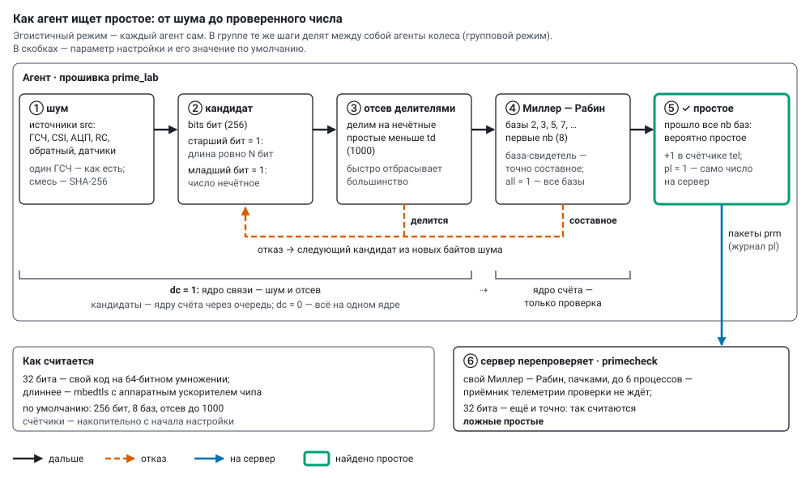
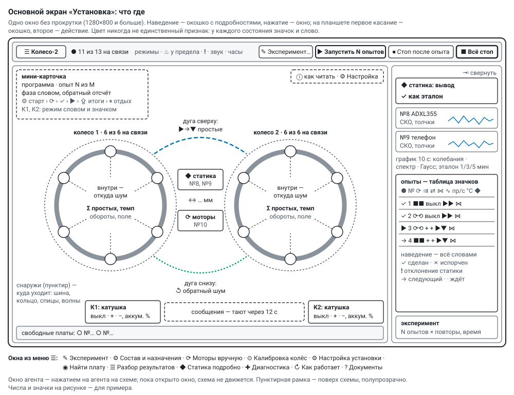

# «Колесо-2»: как всё работает

Установка целиком: из чего состоит, что делает каждый агент, как устроены сервер и основной экран, какие
есть параметры. По каждой теме — своя страница: [схемы подключения](wiring.md),
[датчики, телефон, моторы, катушки](sensors.md), [режимы](modes.md), [эксперимент и программа](program.md),
[статика](static_watch.md), [групповой режим](group_protocol.md), [поглощение](scatter.md),
[шум](randomness.md), [температура](thermal.md), [смета](spec.md),
[катушка на выносливость](coil_test.md), [поле тороида](toroid_field.html). Зачем установка —
[преамбула](preamble.md).

---

## 1. Установка

* **Колёса** — два, друг напротив друга. Обод — труба с обмоткой катушки; на ободе по шесть **агентов**
  на шине 5,1 В от своих аккумуляторов. Колесо 1: №3, №5, №6 (датчик обода ICM-42688), №11, №12,
  №20 (магнитометр MLX90393); колесо 2: №14–№19.
* **Катушка** колеса — свои аккумуляторы, мост DRV8871 и **агент катушки**: поле «+», «−» или выкл.
  У колеса 1 это №13, у колеса 2 агента катушки пока нет. В группы колеса агент катушки не входит.
* **Рама**: моторы 36GP-555 на осях колёс, два моста DRV8871, блок 12 В и **агент моторов** №10.
* **Статика** — неподвижные датчики между колёсами: №8 (точный акселерометр ADXL355) по центру оси и
  **телефон** №9 — сам меряет и шлёт по Wi-Fi.
* **Сеть опыта** — свой роутер GL.iNet Mango (2,4 ГГц, канал 6): агенты и телефон — по Wi-Fi, ноутбук —
  кабелем; настройки — [«Сеть опыта»](wiring.md).
* **Сервер** — `server/monitor.py` на ноутбуке: принимает телеметрию, проверяет простые, считает
  статику, ведёт эксперименты, управляет моторами и катушками, пишет всё на диск. Python 3 без сторонних
  библиотек, для статики — numpy. Запуск — `tools/monitor.cmd`.
* **Основной экран «Установка»** — `http://<сервер>:8090/` в браузере планшета, телефона или ноутбука (§ 9).
* **Реестр** — `registry/devices.csv`: номер, MAC и метка каждой платы.

Провода и питание — [схемы подключения](wiring.md), детали и цены — [смета](spec.md).

Агент — плата Seeed XIAO ESP32-S3 с прошивкой `firmware/prime_lab`. Роль задаёт сервер:

| роль | что делает |
|---|---|
| ▶ генерация (A) | ищет простые числа из физического шума — сам или в группе |
| ▼ поглощение (B) | получает простые генераторов другого колеса и рассеивает их в эфир, смешав со своим шумом |
| ◆ статика (S) | только меряет ускорение (500 Гц) и шлёт оси; всё считает сервер |
| ⚙ моторы / катушка (M) | крутит колёса через мосты или включает поле катушки по командам сервера |

Порты: 5005 — телеметрия (UDP), 5006 — маяк сервера (UDP), 5007 — команды (UDP), 8090 — HTTP (экран,
`/api`, приём от телефона `/api/ingest`, образ прошивки `/fw/prime_lab.bin`).

На сервере та же картина — **живая схема** (меню «↻ Как работает»): кто на связи, темп простых,
молчащая ветка — пунктиром.

<!-- живая схема -->

---

## 2. Жизнь агента

1. **Включение.** Заставка светодиодом: 5 быстрых вспышек, последние 4 знака MAC азбукой Морзе,
   5 быстрых, номер платы из реестра, 5 медленных.
2. **Wi-Fi.** Сеть из `secrets/wifi.ini`, только 802.11b/g — так CSI приходит на каждый пакет; сон радио
   выключен — шум приёмника идёт в генератор непрерывно. Есть **запасная сеть** (`ssid2`/`password2`):
   основная 40 с не пускает — плата уходит на запасную и через 2 мин, потом раз в 10 мин, когда стоит,
   пробует основную; в телеметрии `net` (0 — основная, 1 — запасная).
3. **Поиск сервера.** Сервер раз в 2 с рассылает всем маяк `W2SRV 5005` на UDP 5006 — агент сам находит
   его адрес.
4. **Самопроверка.** Миллер — Рабин на известных простых и «обманщиках» (до 2048 бит).
5. **Ожидание.** После включения агент **стоит**: не считает, раз в секунду шлёт телеметрию.
6. **Работа.** По команде сервера считает; светодиод вспыхивает на каждом пакете телеметрии.
7. **Остановка.** Счёт встаёт, счётчики замирают — сервер забирает итоги.
8. **Прошивка по Wi-Fi** (§ 13): образ — в свободный раздел, проверка MD5, перезапуск; новая прошивка
   пробная, пока агент не пробудет минуту на связи; не вышел за 10 минут или вылетел — загрузчик
   возвращает прежнюю.

Перезагрузился агент — сервер сам вернёт ему последние настройки.

---

## 3. Откуда берётся случайность

| шум | что это | быстрота |
|---|---|---|
| ⚄ ГСЧ чипа | аппаратный генератор ESP32-S3 (`esp_random`), в него подмешан шум приёмника Wi-Fi | ~45 тыс. слов/с — основной |
| Σ все доступные | ГСЧ + CSI с пульса + АЦП + дрожание через SHA-256 | как самый медленный |
| ≋ CSI с пульса | «отпечаток» радиоканала в кадрах пульса соседей (ESP-NOW) | медленно |
| ↯ CSI с пинга роутера | то же по ответам роутера на пинг | медленно, осторожно (§ 8) |
| ⏚ АЦП D0 | свободная ножка D0: наводки и шум резисторов, ¼ бита на отсчёт | медленно |
| ⧖ дрожание RC | внутренний RC 136 кГц против кварца 40 МГц, ¼ бита на отсчёт | медленно |
| ↺ обратный шум | кадры поглотителей — петля через эфир (подмешать или только он) | сколько рассеют |
| ↕ акселерометр, 🧲 магнитометр | младшие байты осей датчиков обода — только он или добавкой | очень медленно |

* Один ГСЧ — его слова идут в число как есть. Любой другой набор — блоки **SHA-256** по 256 бит, в каждый
  каждый отмеченный источник кладёт не меньше 256 засчитанных бит: число случайно, даже если хорош только
  один источник.
* **Без хеша** (`raw`): младшие биты сырья прямо в число — видна физика источника; с выравниванием
  фон Неймана — снят перекос 0 и 1.
* К ножке D0 ничего не подключать — с неё берётся шум АЦП. Подробно — [шум](randomness.md).

---

## 4. Как ищется простое

* **Миллер — Рабин** с базой *a* либо доказывает, что число составное (*a* — «свидетель»), либо говорит
  «вероятно простое»; чем больше баз, тем меньше шанс ошибки. По умолчанию 256 бит, 8 баз, отсев
  делителями до 1000.
* **Два ядра** (`dc` = 1) — конвейер через очередь: ядро связи набирает шум и отсеивает, ядро счёта только
  проверяет; быстрее, но греет сильнее.
* Сервер перепроверяет присланные простые своим Миллером — Рабином (журнал простых, `pl`); 32-битные —
  ещё и точно, так считаются **ложные простые**. Темп — § 14.

---

## 5. Групповой режим

Агенты колеса считают вместе по ESP-NOW (адресные кадры, 24 Мбит/с, радио подтверждает каждый кадр).
Состав группы и адреса участников присылает сервер вместе с настройкой — новый агент входит в группу без
перепрошивки остальных. Три варианта (`gv`), подробно — [групповой режим](group_protocol.md):

* **каскад** (`gv` 2) — основной: числа складываются из кусочков шума всех, проверяют все сразу, каждый
  свои; найденное простое сверяет следующий; чужие кусочки ждут не дольше `pw` мс, недостающие — своим
  шумом. Шестеро на двух ядрах — ~100–118 простых/с.
* **эстафета** (`gv` 1) — число из шума всех, проверяет один, ход по кругу; темп одной-полутора плат при
  любом размере, почти не занимает эфир.
* **одно число на всех** (`gv` 0) — каждое число проверяют все, базы поделены по кругу, нашедший
  свидетеля — следующий мастер; медленно, но ответы обязаны совпадать — проверка целостности (**согласие**).

**Когерентность** — доля кругов, собранных из кусочков всех, и серии без сбоев. **Молчащий** участник (не
прислал кусочки после трёх просьб) группу не задерживает; любой кадр от него — его снова ждут.

---

## 6. Поглощение

Генератор, найдя простое, объявляет его в эфир одним кадром; **поглотители** другого колеса его слышат
и рассеивают — смешивают со своим шумом и выпускают обратно: все со всеми (каждый — всё число), россыпь
(каждый — свой кусок), эстафета, тишина. **Пустышка** — тот же трафик без числа (контроль), **фон** —
свой шум с заданной частотой. **Обратный шум** — генераторы берут в шум кадры поглотителей: петля через
эфир. Подробно — [поглощение](scatter.md).

---

## 7. Вращение, поле и калибровка колёс

* **Моторы** (меню «⟳ Моторы вручную…» или опыт программы): колёса по отдельности, вместе, навстречу или
  крутится одно; режим — стоит, ШИМ, обороты или **невесомость**: обороты, при которых наверху
  k = ω²r/g = 1 (при r = 450 мм — 44,6 об/мин). В «оборотах» и «невесомости» — ПИ по оборотам с датчика
  обода. Сервер раз в секунду шлёт агенту моторов `MOT`; команды перестали приходить — агент сам плавно
  останавливает моторы.
* **Поле катушки** — выкл, «+» или «−»: кнопками на схеме или опытом программы; агенту катушки уходит та же
  команда `MOT`, нет команд 5 с — мост выключается. Магнитометр колеса показывает, есть ли поле и куда
  оно: на схеме «✓» — датчик видит то, что задано, «◐» — другое.
* **Калибровка колёс** (меню «⊙ Калибровка колёс…»). Масштаб гироскопа датчика обода подстраивается сам —
  по фазе тяжести на ровных оборотах. Радиус датчика и смещение нуля его акселерометра — по наклону
  ускорения от ω² на нескольких скоростях (разброс оборотов не меньше ±15 %); радиус по наклону для
  невесомости включается галочкой. Оптический тахометр на отражающую метку даёт точки сверки — поправка
  одним множителем, тоже галочкой. Радиус **каждого агента** меряется линейкой от оси до чипа и хранится
  в установке: у каждого агента своё k = ω²r/g — оно видно в окне агента и записывается в каждый опыт.
  Подробно — [датчики](sensors.md).

---

## 8. Температура и сторожа

* **Регулятор** раз в секунду подбирает долю работы ядра счёта (5–100 %), чтобы кристалл держался на
  градус ниже предела (по умолчанию **73 °C**, выше 75 нельзя). Доля минимальна, а кристалл 20 с выше
  предела на 3 °C — радио засыпает между маяками; выше на 8 °C три секунды — авария: счёт стоит, пока не
  остынет на 3 °C ниже предела. Первые 12 с после перезапуска регулятор датчику не верит. Отдых, спринт,
  рейтинг агентов — [температура](thermal.md).
* **Сторож радио**: кадры ESP-NOW уходят, а отчётов радио о них нет 15 с — или Wi-Fi нет 90 с — плата
  перезапускается сама; сервер вернёт ей настройку, группа примет обратно.
* **Сторож Wi-Fi («зомби»)**: плата «подключена», а пакеты не уходят 10 с — переподключение (`wrst`); или
  45 с нет маяка сервера — переподключение; три подряд — перезапуск (`rbt` 3). В телеметрии `udpe`, `bcn`,
  `heapmin`, `cmd`.
* **Пульс**: каждый агент раз в секунду шлёт всем кадр ESP-NOW «я жив» (считает ли, °C); у каждого —
  таблица соседей (кого слышит, с каким сигналом), раз в 5 с — на сервер пакетом `nbr`.
* **CSI брать с пульса** (`hb` 5–20, `ping` 0): частый пинг роутера переполняет буферы передачи и даёт
  «зомби»; пинг — только как отдельный шум, не выше 20/с и короткими опытами.

---

## 9. Основной экран «Установка»

`http://<сервер>:8090/` — одно окно без прокрутки (1280×800 и больше). Цвет никогда не единственный
признак: у каждого состояния значок и слово (палитра Okabe — Ito), у источников шума — значок, штрих и
место дорожки.

* **Шапка**: «☰ Колесо-2» — меню (окна ниже; внизу — **вид**: прозрачно / сплошь, движение как в системе /
  полное / спокойное / нет), связь («● 11 из 13 на связи»), значки режимов, которые меняют смысл нажатия
  («⚙ настройка», «◉ найти плату: ВКЛ»), «♨ у предела: №…», ❗ тревога статики, 🔔 звук, часы. Справа —
  «✎ Эксперимент…», «▶ Запустить N опытов · ≈ время» (или «↻ Продолжить №…»), во время программы
  «⏸ Пауза» / «▶ Продолжить», «⏹ Стоп после опыта» и всегда **«■ Всё стоп»** — сразу программа, счёт у
  всех, моторы и катушки.
* **Мини-карточка** (поверх схемы, слева сверху): программа, «опыт N из M», фаза словом и обратный отсчёт,
  полоска фаз (⚙ старт › ⟳ подготовка › ✓ проверка › ▶ исполнение › ⇪ итоги › ⏸ отдых), по строке на
  колесо — режим словом и значком и доли шума («вживую», «шаг» или «план»), обороты, поле, температуры.
* **Схема** — вживую по телеметрии. **Внутри обода — откуда шум**: от агентов внутрь идут дорожки
  источников, толщина — доля засчитанных бит, точки бегут с темпом; без датчика значок зачёркнут. В
  середине колеса — Σ простых и темп, обороты, поле катушки, |B|. **Снаружи — куда уходит**, по способу
  (таблица ниже). Агент: номер, значок дела, температура (дуга — от 40 °C до предела); вспышка и «+N» —
  найдены простые, «▼+N» — поглотитель принял. Обод при поле — синий со стрелками по ходу поля; пунктир
  снаружи бежит — колесо крутится. **Дуга сверху** — простые генераторов к поглотителям другого колеса,
  **снизу** — обратный шум. Между колёсами — статика, «↔ … мм» (нажать — задать расстояние), агент моторов;
  в нижних углах — агенты катушек, кнопки поля и аккумуляторы (INA219, остаток %); внизу — свободные платы.
* **Окошки при наведении** — на всё: агент, колесо, группа, дуги, аккумуляторы, фазы, датчики, опыты.
  Наведение на «К1», источник шума или способ подсвечивает своих агентов. На планшете первое касание —
  окошко, второе — действие. С клавиатуры: Tab по агентам, Enter — окно, Esc — закрыть. «Движение: нет»
  или «уменьшить движение» в системе — без анимации.
* **Колонка справа** (⇥ — свернуть в полоску): **статика** — вывод крупно (✓ как эталон · ⚠ проверить ·
  ↻ помеха или прибор · ◌ нет эталона · ○ нет данных), датчики (статический, телефон) друг под другом, у каждого
  всегда три маленьких живых графика за 10 с — Гаусс, спектр, колебания — по выбранной оси, эталон и его запись 1 / 3 / 5 мин; **опыты** — таблица значков (● состояние,
  №, ⟳ вращение, ⇉ поле, ⇄ роли, ⋈ способ, ∿ шум, пр/с, °C, ◆ статика; наведение — всё словами); строка
  **эксперимента**.
* **❗ Тревога статики** — вывод «⚠ проверить»: три сигнала, мигающее «❗» в шапке и строка в подвале внизу
  экрана — время, опыт, причина, «↻ повторить» и «подробно». Окна сами не открываются: каждое отклонение —
  строкой в списке, «подробно» — окно с причинами по нажатию — [статика](static_watch.md).
* **ⓘ** у важного — что это и зачем; «ⓘ как читать» над схемой — условные знаки схемы. Сообщения
  всплывают над схемой и тают через 12 с.

| способ | на схеме, снаружи обода |
|---|---|
| ● эгоистичный | у каждого агента своя замкнутая ячейка, снаружи пунктир «не связаны» |
| ⋈ каскад | двусторонняя шина, ✓ у проверяющего; простое точкой уходит соседу на проверку |
| ⇢ эстафета | кольцо со стрелками по номерам и палочка — темп кругов, показан медленнее |
| ① одно число на всех | спицы к общему числу в середине; согласие, % |
| ▼ поглощение | волны у поглотителя: целиком — сплошные, по кускам — пунктир, пустышка — точки, эстафетой — цепочка, «только слушают» — без волн |

**Окна** (меню «☰»; пока открыто окно, схема не движется):

| окно | что в нём |
|---|---|
| агент (нажать на агента) | дело, темп, шум по источникам, соседи, память; «∿ вживую» (колебания, Гаусс, спектр по осям, до 15 мин), «🧲 поле вживую», шум и точность датчика, радиус линейкой и k, место |
| ✎ Эксперимент… | что меняем и в каком порядке → список опытов, запуск (§ 10) |
| ⚙ Состав и назначения | все платы по местам: связь (сервер помнит, когда была последний раз), прошивка («⇪» — прошить по Wi-Fi), °C; ✎ переставить (смена роли — перезапуск ≈ 15 с), ⤓ снять, ◉ ×10 — мигнуть, ✓ проверить по роли, ✕ убрать (в реестре `retired`; вернуть — «↺»), ＋ добавить плату по USB (§ 13) |
| ⟳ Моторы вручную… | вращение вне эксперимента (§ 7) |
| ⊙ Калибровка колёс… | гироскоп по тяжести, радиус и смещение по наклону, тахометр, радиусы агентов линейкой (§ 7) |
| ⚙ Настройка установки | расставить платы: нажать плату, потом место; справа — шаги «с нуля до запуска», у каждого ✓ / ◐ / ✗ / ○ и кнопка |
| ◉ Найти плату | нажатие на агента — его светодиод мигает 20 с |
| ☰ Разбор результатов | что влияет при прочих равных, сводная, протокол опытов, CSV (§ 10) |
| ◆ Статика подробно | спектры против коридора эталона, события, запись эталона |
| ✚ Диагностика | каждое колесо считает каскадом из ГСЧ, потом таблица по агентам: связь, кого слышит, темп против медианы группы, температура, память, датчики, итог ✓ / ◐ / ✗ |
| ↻ Как работает | живая схема установки и протокол группы по шагам, замедленно |
| ? Документы | эта документация |

«✓ проверить» по роли: генератор считает сам 30 с; катушка — выкл → «+» → выкл → «−» по 4 с (ток по
INA219, поле по магнитометру); моторы — каждое колесо 3 с на ШИМ 30 %; измеритель — 10 с отсчётов.

Для отладки — по адресам: `/pult` (пульт: логические группы и наборы, свои параметры агентов, «≋ Тушение»),
`/watch` (статика и поток простых крупно), `/old` (прежняя панель: все счётчики, графики, сессии).

---

## 10. Эксперимент и программа

**Эксперимент** — список опытов, пройденный «повторов» раз; **опыт** — один набор параметров. Подробно —
[эксперимент и программа](program.md), что значит каждый режим — [режимы](modes.md).

| параметр | значения |
|---|---|
| ⟳ вращение колёс | каждое колесо стоит, вперёд или назад — таблица 3 × 3 (⟳⟲ навстречу, ⟳⟳ вместе, ⟳■ крутится одно) |
| ⏲ скорость | обороты, ШИМ или невесомость; у стоящих колёс не перебирается |
| ± отступ от невесомости | ступени около расчётной невесомости: 0 и ± шаг, по желанию ± два шага; шаг — % оборотов, по умолчанию 3 (k меняется вдвое сильнее: +3 % — k ≈ 1,06); только при скорости «невесомость» |
| ⇉ поле катушек | каждая выкл / + / −, тоже 3 × 3 |
| ⇄ излучение / поглощение | каждое колесо стоит / генерирует / поглощает; ⏸⏸ — только статика (никто не считает, вращение и поле идут); ▼▼, ▼⏸, ⏸▼ нельзя |
| ⋈ совместная работа | эгоистичный, каскад, одно число на всех, эстафета |
| ▼ поглощение | кто чьё (все со всеми · пары 1:1 · все — одного · каждое — одному · половина колеса) и как (целиком · по кускам · эстафетой · пустышка · только слушают) |
| ∿ шум | источники; все вместе, без одного, по одному — все три дают 2N + 1 вариант |

Отступ от невесомости нужен, потому что система неточна: радиусы агентов на колесе разные, датчик обода и
регулятор ошибаются — ступени ловят невесомость каждого агента.

* **Окно «✎ Эксперимент…»**: слева параметры, **порядок карточек — вложенность циклов** (верхняя
  меняется реже всех; вращение выше — меньше разгонов); справа сразу список опытов. «⚙ Сформировать
  список» превращает отметки в список, который правится руками (⧉ дублировать, ↑ ↓, ✕). Над списком —
  время, тепло самого горячего агента, хватит ли аккумуляторов; ниже — длительность опыта (**30 с**:
  установление + измерение), установление (вращение 15 с, роль / способ / шум 8 с, только поле 5 с),
  повторы и порядок, отдых, пауза между повторами. Когда программа плана идёт или прошла, в той же таблице —
  **что вышло**.
* **Контроль** — колёса стоят, поле выкл; каждый опыт с вращением или полем сравнивается со своим
  контролем — тем же режимом и шумом.
* **▣ Колесо‑пустышка** — две платы без мотора и поля («колесо 3» в составе) в каждом опыте работают тем же
  режимом, что колёса, при поглощении — парой между собой. Проверяются тем же критерием; их «аномалия» —
  ложная тревога детектора, а аномалия колёс, совпавшая с ней, — не от вращения. В опытах «подслушивающие»
  (колёса считают из кадров этих плат) и «мост» (плата звеном в каскаде колеса) платы — участники, не
  пустышка.
* **Программа** — список опытов по «▶ Запустить»: эталон шума перед началом, повторы, отдых, сравнение
  опыта с контролем по заранее названному критерию, проверка аномалии парами, повтор испорченного опыта и
  опыта с отклонением статики.
* **Пауза и продолжение**: «⏸ Пауза» — после текущего опыта всё встаёт (катушки выкл, колёса стоят,
  агенты остывают), «▶ Продолжить» — с того же места. Сама программа встаёт на паузу, когда сели
  аккумуляторы (INA219) или агенты опыта молчат дольше 30 с. Испорченный опыт повторяется; остановленную
  или прерванную программу можно продолжить с первого невыполненного опыта — итоги в ту же запись.
* **Результаты** («☰ Разбор результатов»): **что влияет** — каждый параметр при прочих равных, Δ ± ошибка
  и вывод ✓ не отличается / ◐ возможно (2–3 σ) / ❗ отличие (больше 3 σ); сводная любых двух параметров;
  протокол опытов; CSV.
* **Расстояние между колёсами** ставится руками («↔ … мм» на схеме); сервер хранит его в `data/rig.json` и
  записывает в каждый опыт.

---

## 11. Параметры агентов

Уходят агентам строкой `CFG …` на UDP 5007; агент подтверждает их номером настройки (`cid`) в телеметрии,
пока не совпало — сервер повторяет раз в 2 с. Основной экран ставит их сам из опытов; вручную — на пульте
и в прежней панели. Виды: **общие** (одинаковые в группе), **свои** у агента, **на ходу** (меняются без
нового номера, счёт продолжается).

| параметр | что это | значения | по умолчанию | вид |
|---|---|---|---|---|
| `role` | роль: 0 — генерация, 1 — поглощение, 2 — статика, 3 — моторы или катушка (агент запоминает роль и перезапускается) | 0–3 | 0 | свой |
| `mode` | 0 — эгоистичный, 1 — групповой | 0, 1 | 0 | общий |
| `gv` | вариант группы: 0 — одно число на всех, 1 — эстафета, 2 — каскад | 0, 1, 2 | 0 | общий |
| `rk` | эстафета и каскад: простых за ход | 1–16 | 1 | общий |
| `pw` | эстафета и каскад: ждать кусочки не дольше, мс; потом недостающие — своим шумом; 0 — ждать всех | 0–5000 | 0 | общий |
| `grp`, `gm` | номера и MAC участников группы (сервер подставляет сам) | | | общий |
| `nr` | скорость ESP-NOW: 1 — 24 Мбит/с, 2 — 6 Мбит/с, 0 — 1 Мбит/с (медленно, греет) | 0, 1, 2 | 1 | общий |
| `bits` | длина простого | 32 … 2048 | 256 | общий |
| `nb` | число баз Миллера — Рабина (первые из 2, 3, 5, 7, 11, 13, 17, 19, 23, 29, 31, 37) | 1–12 | 8 | общий |
| `all` | 1 — каждого кандидата проверяют все базы; 0 — до первой «составное» | 0, 1 | 0 | общий |
| `td` | отсев делителями меньше этого числа; 0 — без отсева | 0 … 20 000 | 1000 | общий |
| `k` | одно число на всех: кандидатов за один сбор | 4–64 | 24 | общий |
| `pre` | группа: кусочки шума набирать заранее (только при одном ГСЧ) | 0, 1 | 1 | общий |
| `dc` | два ядра: ядро связи набирает шум и отсеивает, ядро счёта только проверяет | 0, 1 | 0 | общий |
| `tp` | период телеметрии, мс | 500–5000 | 1000 | общий |
| `src` | шум (маска): 1 — ГСЧ, 2 — CSI, 4 — АЦП, 8 — дрожание, 16 — обратный шум, 32 — акселерометр обода, 64 — магнитометр обода | 1–127 | 1 | свой |
| `raw` | 0 — блоки SHA-256; 1 — без хеша; 2 — без хеша с фон Нейманом | 0, 1, 2 | 0 | свой |
| `cf` | CSI: 0 — с любых кадров, 1 — только ответы роутера, 2 — только кадры поглотителей; 3 — опыт: пинг без CSI | 0–3 | 0 | общий |
| `ping` | пингов роутера в секунду для CSI; 0 — без пинга | 0, 10–200 | 100 | свой |
| `hb` | пульс: кадров «я жив» в секунду всем; соседям каждый такой кадр — замер CSI | 1–20 | 1 | на ходу |
| `tmax` | предел температуры кристалла, °C | 40–75 | 73 | свой, на ходу |
| `txp` | мощность передатчика, дБм | 2–20 | 20 | свой, на ходу |
| `cpu` | частота процессора, МГц | 80, 160, 240 | 240 | свой |
| `led` | вспышка светодиода на пакетах телеметрии | 0, 1 | 1 | на ходу |
| `sm` | как поглотители рассеивают: 1 — все со всеми, 2 — россыпь, 3 — эстафета, 0 — тишина | 0–4 | 1 | общий |
| `ba` | чьи простые поглощать: номера генераторов через запятую; пусто — всех | 1–63 | — | свой |
| `sh` | пустышка: тот же трафик, вместо числа — шум | 0, 1 | 0 | общий |
| `bgr` | фон поглотителей: кадров своего шума в секунду | 0–200 | 0 | общий |
| `sf` | функция рассеяния у поглотителя: хеш, XOR, умножение, перестановка бит | 0–3 | 0 | свой |
| `bg`, `bm` | номера и MAC поглотителей (сервер подставляет сам) | | | общий |
| `tl`, `tq` | телеметрия: 0 — обычная, 1 — редкая, 2 — молчание; молчать `tq` с (0 — пока не отменят) | 0–2; 0–65535 | 0; 0 | свой, на ходу |
| `dur` | шаг на агенте: через столько секунд агент сам останавливается и сдаёт итоги (`done`) | 0–7200 | 0 | на ходу |
| `ro` | только с `dur`: Wi-Fi выкл на время шага, если эфир не нужен | 0, 1 | 0 | на ходу |
| `pl` | журнал простых: каждое найденное простое — на сервер пакетами `prm` | 0, 1 | 0 | общий |
| `rmm` | радиус датчика обода, мм | 50–2000 | 450 | свой, на ходу |
| `afs`, `avg` | статике: предел ±g; среднее по стольким отсчётам 1000 Гц | 2–16; 1–8 | 2; 2 | свой, на ходу |
| `run` | 1 — считать, 0 — стоять | 0, 1 | 0 | |

**Что обнуляет счётчики**: новый номер настройки (сменилось что-то кроме параметров «на ходу»), старт или
сброс. В группе номер один на всех. Остановка не обнуляет — итоги замирают.

**Зашито в прошивке**: регулятор температуры (4 % в секунду на градус); сроки протокола группы (вдвое
дольше обычного + 20 мс, 3 повтора, перехват хода через 1,5 с); оценки шума (CSI — 32 бита на пакет, АЦП и
дрожание — ¼ бита на отсчёт); Wi-Fi только b/g без сна радио; ножка АЦП D0; порты 5005–5007.

---

## 12. Телеметрия и данные

* Агент раз в секунду шлёт `tel` (≤1460 байт), в группе ещё `grp`, раз в 5 с — `nbr` (соседи); статика —
  `acc` (отсчёты пачками), датчики обода — `imu`, `mag`; телефон шлёт те же пакеты строками в
  `POST /api/ingest`. Счётчики накопительные с начала настройки: потеря пакета ничего не теряет.
* Каждый пакет как есть пишется в `data/raw/<дата>.jsonl`; при перезапуске сервер перечитывает хвост дня
  (последние два часа). Отсчёты статики — `data/accel/<дата>/` (int16 подряд + индекс).
* Простые из журналов агентов перепроверяют процессы-помощники (`server/primecheck.py`, до 6 по ядрам)
  пачками: приёмник проверки не ждёт.
* `data/control.json` — настройки и составы; `data/programs/` — программы с шагами и итогами;
  `data/primes/<дата>/<mac>.txt` — журнал простых; `data/static/baselines/` — эталоны статики;
  `data/rig.json` — расстояние между колёсами и радиусы агентов; `data/fleet.json` — когда каждая плата
  была на связи и с какой прошивкой; `data/commands.jsonl` — журнал команд.
* `/api/health` — самопроверка сервера: живы ли задачи, давность пакета, очередь проверки, диск.

---

## 13. Новый агент и прошивка

Новая плата прошивается **по USB один раз** — так в неё попадают prime_lab с прошивкой по Wi-Fi, данные
сети и ключ подписи; дальше её обновляют по Wi-Fi вместе со всеми.

1. Подключить плату кабелем с передачей данных к компьютеру с сервером.
2. Меню «☰» → «⚙ Состав и назначения» → «＋ добавить плату»: плата видна как «★ новая», «⇪ прошить»
   (или двойной щелчок по `tools/new_board.cmd`).
3. Плата записывается в реестр следующим номером и через ~40 с выходит на связь — в «свободных»;
   ✎ — поставить её на место.

Сервер узнаёт плату по серийному номеру USB (у ESP32-S3 это MAC). Плату не видно — зажать BOOT,
переподключить кабель, отпустить. Вручную: `tools/build.sh prime_lab COM<N>`.

**Обновить установленные платы — по Wi-Fi**: собрать (`tools/build.sh prime_lab`) и «прошить всех на связи
по Wi-Fi» (или `python tools/ota.py all`). Сервер отдаёт образ (`/fw/prime_lab.bin`) и шлёт команду
`OTA …`, подписанную ключом `secrets/ota.key` (HMAC-SHA256, в git не попадает). Агент скачивает образ в
свободный раздел, сверяет длину и MD5, перезапускается; не подтвердилась за 10 минут — откат к прежней.

---

## 14. Замеры

Одна плата, 256 бит, если не сказано иначе.

| что | результат |
|---|---|
| ГСЧ | 2300 кандидатов/с, ~27 простых/с, 36 мс на простое |
| CSI / АЦП / дрожание | 12 / 18 / 15 кандидатов/с |
| 1024 / 2048 бит, ГСЧ | 185 / 30 кандидатов/с; проверка базой 25 / 181 мс |
| четыре платы, эгоистичный | 100–106 простых/с (по 25–27) |
| четыре платы, эгоистичный, два ядра | 179,6 простых/с (по 41–47); у предела 70 °C регулятор режет до ~155 |
| одно число на всех, 1 / 2 / 3 / 4 платы | 24,5 / 16,5 / 10,5 / 7,7 простых/с |
| эстафета, два ядра, 4 платы | 37,1 простых/с |
| каскад, два ядра: 4 / 6 плат | 80–92 / 118 простых/с |
| две группы сразу | друг другу не мешают |

Подробно — [групповой режим](group_protocol.md), [шум](randomness.md), [температура](thermal.md).

---

## 15. Инструменты

| файл | что делает |
|---|---|
| `tools/monitor.cmd` | запустить сервер |
| `tools/build.sh <скетч> [порт]` | сборка с версией из git, запись платы в реестр, прошивка |
| `tools/new_board.py`, `tools/new_board.cmd` | первая прошивка новых плат по USB |
| `tools/ota.py [all \| номера] [--force]` | прошить агентов по Wi-Fi и дождаться новой версии |
| `tools/build_docs.py [--static]` | документация в HTML (`docs/html/`; сервер делает это сам при старте); `--static` — комплект для показа вне сети в `build/site/` |
| `tools/publish.py [--push]` | открытая копия на GitHub одним коммитом с проверкой на утечки |
| `tools/multi_test.py [секунд] [случаи]` | прогон агентов по составам и режимам с проверкой счётчиков |
| `tools/anomaly_run.py`, `tools/anomaly_summary.py` | прогоны по шагам с журналом простых — поиск аномалий; сводка |
| `tools/prime_stats.py [дата]` | статистика журнала простых: проверка, повторы, остатки, биты, промежутки |
| `tools/nightly.py` | ежевечерняя «зарядка»: короткие прогоны, сравнение с медианой прошлых вечеров, матрица «кто кого слышит» |
| `tools/soak.py`, `tools/sprint.py`, `tools/rest_ab.py` | долгий прогон одной настройки; спринт; отдых по очереди «без» и «с» |
| `tools/coil_soak.py`, `tools/coil_soak_plot.py` | катушка на выносливость и её график — [катушка на выносливость](coil_test.md) |
| `tools/imu_noise.py <агент> [минут]` | шум и точность акселерометра: СКО, гистограмма с гауссом, спектр, Аллан |
| `tools/sim_gen.py`, `tools/sim_agents.py` | имитация агентов-генераторов и агентов с датчиками — проверить экран без плат |
| `tools/test_analysis.py`, `tools/test_static_watch.py` | проверка расчётов колеса и статики на синтетике |
| `docs/calc/toroid_field.html`, `tools/toroid/` | расчёт поля тороида ([поле тороида](toroid_field.html)); проверка ядра `node tools/toroid/test.js`: идеальный тор b = 1 до 2·10⁻⁵, волна плотности ±10 % → 7,8 % на оси, как в теории |
| `tools/demo_capture.py` | снимок данных тестового сервера для демонстрации основного экрана в опубликованной копии |
| `tools/runs_from_raw.py [дата]` | восстановить журнал опытов за день из сырья |
| `tools/serial_capture.py`, `tools/count_boards.ps1`, `tools/register.py` | журнал платы по USB; какие платы видит Windows; запись в реестр |
| `tools/video.py` | ролики: кадры, расшифровка речи, озвучка, субтитры ru/en |
| `firmware/entropy_probe` + `tools/probe_report.py` | замер источников шума |

Без плат: `python server/monitor.py --http 8092 --udp 5016 --data data/test/gen --no-beacon` и
`python tools/sim_gen.py 6 --port 5016`, затем `http://localhost:8092/`.

---

## 16. Ограничения и что дальше

* В группе каждое число проверяют несколько агентов — «одно число на всех» медленнее эгоистичного;
  каскад до шести агентов почти равен эгоистичному, но упирается в тепло и общий эфир (эфир один на все
  колёса).
* Проверка базой через mbedtls (~1 мс на 256 бит) — узкое место конвейера на двух ядрах; потолок задаёт
  ГСЧ: 45 000 слов/с — 5600 кандидатов по 256 бит в секунду, достигнуто 4100.
* Датчики температуры разных плат расходятся на несколько градусов.
* Впереди: агент катушки колеса 2, «одинаковые числа у всех» и поглощение «один к одному» в прошивке,
  CSI со всего эфира; счётчик Гейгера, камера и микрофон как внешние источники.
