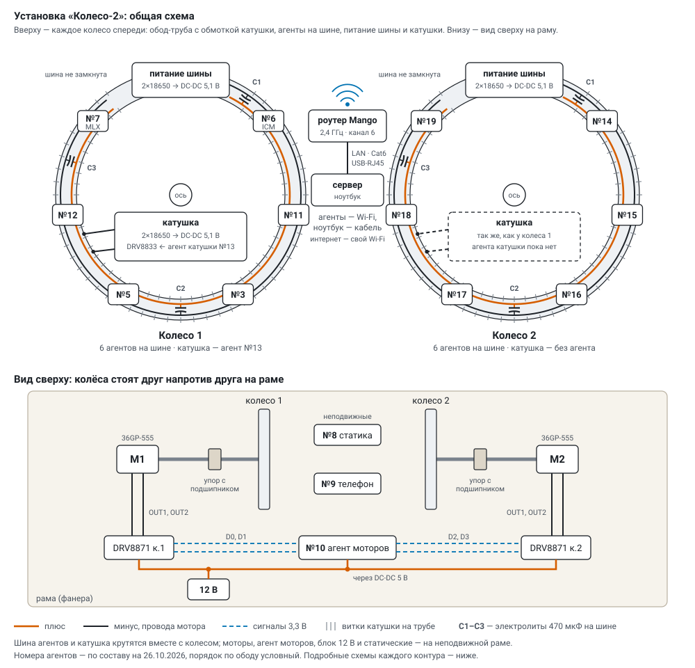

# «Колесо-2»: как всё работает

Установка целиком, как она устроена сейчас (26.10.2026): из чего состоит, что делает каждый агент,
как устроены сервер и основной экран, какие есть параметры. Подробности по темам — в отдельных
документах: [режимы](modes.md), [схемы подключения](wiring.md), [групповой режим](group_protocol.md),
[поглощение](scatter.md), [случайность](randomness.md), [статика](static_watch.md),
[датчики, телефон, моторы](sensors.md), [эксперимент и программа](program.md), [температура](thermal.md),
[спецификация и смета](spec.md).
Как установка пришла к нынешнему виду — [приложение А: история изменений](history.md). Зачем она —
[преамбула](preamble.md).

---

## 1. Установка



* **Колёса** — два, стоят друг напротив друга. Обод — труба с обмоткой катушки; внутри — по шесть
  **агентов** на шине 5,1 В от своих аккумуляторов. Колесо 1: №3, №5, №6 (датчик обода ICM-42688),
  №7 (магнитометр MLX90393), №11, №12; колесо 2: №14–№19.
* **Катушка** каждого колеса — свои аккумуляторы, мост DRV8871 и **агент катушки** (колесо 1 — №13):
  поле «+», «−» или выкл. В группы колеса он не входит.
* **Рама**: моторы 36GP-555 на осях колёс, два моста DRV8871, блок 12 В и **агент моторов** №10.
* **Статика** — неподвижные датчики между колёсами: акселерометр №8 по центру оси, **телефон** №9
  рядом (сам меряет и шлёт по Wi-Fi).
* **Сеть опыта** — свой роутер GL.iNet Mango (2,4 ГГц, канал 6): агенты и телефон — по Wi-Fi, ноутбук —
  кабелем; настройки — [схемы, «Сеть опыта»](wiring.md).
* **Сервер** — `server/monitor.py` на ноутбуке в сети опыта: принимает телеметрию, проверяет простые,
  считает статику, ведёт эксперименты (программы), управляет моторами и катушками, пишет всё на диск.
  Python 3 без сторонних библиотек; для статики — numpy. Запуск — `tools/monitor.cmd`.
* **Экран «Установка»** — `http://<сервер>:8090/` в браузере, на планшете или в телефоне.
* **Реестр** — `registry/devices.csv`: номер, MAC, метка каждой платы.

Агент — плата Seeed XIAO ESP32-S3 с прошивкой `firmware/prime_lab`. Роль задаётся с сервера:

| роль | что делает |
|---|---|
| ▶ генерация (A) | ищет простые числа из физического шума — сам или в группе |
| ▼ поглощение (B) | получает простые своей группы и рассеивает их в эфир, смешав со своим шумом |
| ◆ статика (S) | только меряет ускорение (500 Гц) и шлёт оси; всё считает сервер |
| ⚙ моторы / катушка (M) | крутит колёса через мосты или включает поле катушки по командам сервера |

Порты: 5005 — телеметрия (UDP), 5006 — маяк сервера, 5007 — команды, 8090 — HTTP (экран, `/api`,
приём от телефона, образ прошивки).

**Кто кому что шлёт** — живая схема (на сервере — с живым состоянием: кто на связи, темп простых;
молчащая ветка — пунктиром):

<!-- живая схема -->

---

## 2. Жизнь агента

1. **Включение.** Заставка светодиодом: 5 быстрых вспышек, последние 4 знака MAC азбукой Морзе,
   5 быстрых, номер платы из реестра, 5 медленных.
2. **Wi-Fi.** Сеть из `secrets/wifi.ini` (только 802.11b/g — так CSI приходит на каждый пакет), сон
   радио выключен: шум приёмника идёт в генератор непрерывно. Основная сеть — роутер GL.iNet Mango
   (компьютер подключён к нему кабелем через USB-адаптер), **запасная** (`ssid2`/`password2`) —
   прежний роутер: основная 40 с не пускает — плата уходит на запасную и на ней через 2 мин, потом
   раз в 10 мин, когда стоит, пробует основную; в телеметрии `net` (0 — основная, 1 — запасная).
3. **Поиск сервера.** Сервер раз в 2 с рассылает маяк `W2SRV 5005` на UDP 5006; агент сам находит
   адрес сервера.
4. **Самопроверка.** Миллер — Рабин на известных простых и «обманщиках» (до 2048 бит).
5. **Ожидание.** После включения агент **стоит**: не считает, раз в секунду шлёт телеметрию.
6. **Работа.** По команде сервера считает; светодиод вспыхивает на каждом пакете телеметрии.
7. **Остановка.** Счёт встаёт, счётчики замирают — сервер забирает итоги.
8. **Прошивка по Wi-Fi** (§ 13): образ — в свободный раздел, проверка MD5, перезапуск; новая прошивка
   пробная, пока агент не пробудет минуту на связи; не вышел за 10 минут или вылетел — загрузчик
   возвращает прежнюю.

Перезагрузился агент — сервер сам вернёт ему последние настройки.

---

## 3. Откуда берётся случайность

| шум | что это | быстрота |
|---|---|---|
| ⚄ ГСЧ чипа | аппаратный генератор ESP32-S3 (`esp_random`), в него подмешивается шум приёмника Wi-Fi | ~45 тыс. слов/с — основной |
| Σ все доступные | ГСЧ + CSI с пульса + АЦП + дрожание через SHA-256 | как самый медленный из них |
| ≋ CSI с пульса | «отпечаток» радиоканала в кадрах пульса соседей (ESP-NOW, 10/с от каждого) | медленно |
| ↯ CSI с пинга роутера | то же по ответам роутера на пинг 20/с | медленно, осторожно (§ 7) |
| ⏚ АЦП D0 | свободная ножка D0: наводки и шум резисторов, ¼ бита на отсчёт | медленно |
| ⧖ дрожание RC | внутренний RC 136 кГц против кварца 40 МГц, ¼ бита на отсчёт | медленно |
| ↺ обратный шум | содержимое кадров поглотителей — петля через эфир (подмешать или только он) | сколько рассеют |
| ↕ акселерометр, 🧲 магнитометр | младшие байты осей датчиков обода — только он или добавкой к любому шуму | очень медленно |

* Один ГСЧ — его слова идут в число как есть. Любой другой набор — блоки **SHA-256** по 256 бит; в
  каждый блок каждый отмеченный источник кладёт не меньше 256 засчитанных бит: число случайно, даже
  если хорош только один источник.
* Шум **без хеша** (`raw`): младшие биты сырья прямо в число — видна физика источника; с выравниванием
  фон Неймана — снят перекос 0 и 1.
* К ножке D0 ничего не подключать — с неё берётся шум АЦП. Подробно — [randomness.md](randomness.md).

---

## 4. Как ищется простое (эгоистичный: каждый сам)

```
шум → кандидат (длина ровно N бит, нечётный)
    → отсев делителями (простые меньше порога)      ── делится → следующий
    → Миллер — Рабин по базам 2, 3, 5, 7, …         ── «составное» → следующий
    → прошёл все базы → вероятно простое
```

* **Миллер — Рабин** с базой *a* либо доказывает, что число составное («свидетель»), либо говорит
  «вероятно простое»; чем больше баз, тем меньше шанс ошибки. По умолчанию 8 баз, 256 бит, отсев
  делителями до 1000.
* **Два ядра** (`dc`): ядро связи набирает шум и отсеивает, ядро счёта только проверяет — конвейер
  через очередь; греет сильнее.
* Сервер перепроверяет присланные простые своим Миллером — Рабином (журнал простых, `pl`); для 32 бит
  простое проверяется ещё и точно — так считаются **ложные простые**.
* 32 бита — свой код; длиннее — mbedtls с аппаратным ускорителем.

---

## 5. Групповой режим

Агенты подгруппы колеса считают вместе по ESP-NOW (адресные кадры, 24 Мбит/с, радио подтверждает каждый
кадр). Состав группы и адреса участников присылает сервер вместе с настройкой — новый агент входит в
группу без перепрошивки остальных. Три варианта (`gv`), подробно — [group_protocol.md](group_protocol.md):

* **групповой (каскад)** (`gv` 2) — основной: числа складываются из кусочков шума всех, проверяют все
  сразу, каждый свои; найденное простое сверяет следующий; чужие кусочки ждут не дольше `pw` мс,
  недостающие — своим шумом. Шестеро на двух ядрах — ~100–118 простых/с.
* **эстафета** (`gv` 1) — число из шума всех, проверяет один, ход по кругу; темп одной-полутора плат
  при любом размере, почти не занимает эфир.
* **одно число на всех** (`gv` 0, протокол третьей версии) — каждое число проверяют все, базы поделены
  по кругу, нашедший свидетеля — следующий мастер; медленно, но ответы обязаны совпадать — проверка
  целостности (**согласие**).

**Когерентность** — доля кругов, собранных из кусочков всех, и серии без сбоев; **молчащий**
участник (не прислал кусочки после трёх просьб) не задерживает группу, любой кадр от него — его снова ждут.

---

## 6. Поглощение

Агент-генератор, найдя простое, объявляет его в эфир одним кадром; **поглотители** другого колеса его
слышат и рассеивают — смешивают со своим шумом и выпускают обратно: все со всеми (каждый — всё
число), россыпь (каждый — свой кусок), эстафета, тишина; **пустышка** — тот же трафик без числа
(контроль), **фон** — свой шум с заданной частотой. **Обратный шум** — генераторы берут в шум кадры
поглотителей: петля через эфир. Подробно — [scatter.md](scatter.md).

---

## 7. Температура и сторожа

* **Регулятор** раз в секунду подбирает долю работы ядра счёта (5–100 %), чтобы кристалл держался на
  градус ниже предела (по умолчанию **73 °C**, выше 75 нельзя). Доля минимальна, а кристалл 20 с выше
  предела на 3 °C — радио засыпает между маяками; выше на 8 °C три секунды — авария: счёт стоит,
  пока не остынет на 3 °C ниже предела. Первые 12 с после перезапуска регулятор датчику не верит.
  Подробно — отдых, спринт, рейтинг агентов — [thermal.md](thermal.md).
* **Сторож радио**: кадры ESP-NOW уходят, а отчётов радио о них нет 15 с — или Wi-Fi нет 90 с —
  плата перезапускается сама; сервер вернёт ей настройку, группа примет обратно.
* **Сторож Wi-Fi («зомби»)**: плата «подключена», а пакеты не уходят 10 с — переподключение (`wrst`);
  или 45 с нет маяка сервера (точка доступа плату забыла) — переподключение; три подряд — перезапуск
  (`rbt` 3). В телеметрии `udpe`, `bcn`, `heapmin`, `cmd`.
* **Пульс**: каждый агент раз в секунду шлёт всем кадр ESP-NOW «я жив» (считает ли, °C); у каждого —
  таблица соседей (кого слышит, с каким сигналом), раз в 5 с — на сервер пакетом `nbr`.
* **CSI брать с пульса** (`hb` 5–20, `ping` 0): пинг роутера 100/с переполнял буферы передачи и
  давал «зомби»; пинг — только как отдельный шум, не выше 20/с и короткими опытами.

---

## 8. Основной экран «Установка»

`http://<сервер>:8090/` — одно окно на весь экран без прокрутки (1366×768 и больше), меню из двух
пунктов: **▦ Установка** и **? Документы**. Цвет никогда не единственный признак: у каждого состояния
значок и слово (палитра Okabe — Ito).

* **Шапка**: связь («● 11 из 13 на связи» / «✗ сервер не слышит плат»), идущая программа, ❗ тревога
  статики, 🔔 звук; кнопки «◉ найти плату», «✎ Эксперимент…», «⟳ моторы вручную…», «◆ статика»,
  «☰ результаты», «⋯ ещё»; «▶ Запустить N опытов · ≈ время» (или «↻ Продолжить №… · ещё N опытов» —
  остановленную или прерванную программу), во время программы — «⏸ Пауза» / «▶ Продолжить», «⏹ Стоп после
  опыта» (ещё раз — отменить), «■ Всё стоп» (сразу: программа, счёт у всех, моторы, катушки).
* **Схема установки** — слева, крупно, всё вживую. Два колеса, агенты по ободу подгруппами: номер,
  значок дела (▶ считает, ▼ поглощает, ⏸ не считает, ✗ нет связи) и температура; дуга вокруг агента —
  температура от 40 °C до предела (пунктир — у предела); снаружи — простых в секунду или слово.
  **Вспышка «+N»** — агент нашёл простые с прошлого опроса; **волны** — поглотитель выпускает кадры в
  эфир. Дуга подгруппы с буквой и счётом «▶ 4/6»; **бегущая зелёная** — подгруппа считает сообща.
  Внутри колеса — что делают агенты и сколько нашли (Σ и темп), **обороты по датчику обода** с k и
  сколько нужно для невесомости, **поле катушки и |B|** с магнитометра на колесе. Пунктир вокруг колеса
  бежит с настоящей скоростью, стрелка над ним — направление (⟳ вперёд, ⟲ назад); при поле обод синий,
  пунктир и стрелки бегут по ходу поля. Над колесом — **аккумулятор шины** (INA219: напряжение, остаток,
  сколько минут), под колесом — агент катушки, кнопки поля вручную (выкл / + / −) и **аккумулятор
  катушки**. Между колёсами — измерители статики, «↔ … см» (нажать — задать расстояние), агент моторов,
  «⚙ состав…»; дуга сверху — простые идут к поглотителям другого колеса, снизу — обратный шум. Анимация
  идёт с фазой от часов (перерисовка раз в 2 с её не дёргает); при «уменьшить движение» в системе — без
  неё. Внизу — **свободные платы**: выходили на связь, но ни на каком колесе (новые прошитые, снятые с колёс).
* **⚙ Настройка** (над схемой) — расставить платы и пройти путь с нуля до запуска. Нажатие на плату выбирает её
  (синее кольцо), места подсвечиваются: «＋ на колесо 1 / 2» (генератор), «＋ катушка К1 / К2» и «＋ моторы»
  (агент роли M), «＋ в измерители» (статика), «○ снять сюда» (свободна); нажатие на место ставит плату туда, на
  плату на колесе — в её подгруппу. Если роль меняется (генератор · моторы и катушки · измеритель), плата
  перезапускается ≈ 15 с — с вопросом; «◉ мигнуть» — найти выбранную плату по светодиоду. Справа вместо плашки —
  **«С нуля до запуска»**: платы на связи (и «⇪ прошить по USB» для новых), свободные платы, колёса и подгруппы,
  моторы, катушки К1 и К2, измерители, датчики колёс (обод, магнитометр, аккумуляторы), прошивка, расстояние,
  эталон шума, диагностика, эксперимент — у каждого состояние (✓ / ◐ / ✗ / ○) и кнопка. В окне агента то же —
  строкой «место»: колесо 1 / 2, катушка К1 / К2, моторы, измеритель, свободна (↻ — с перезапуском).
* **Справа**: плашка «сейчас» — часы, что идёт (опыт N из M с обратным отсчётом и полосой хода, пуск
  или тушение с пульта, «стоит»), итоги опыта и программы или последняя программа, температура;
  **статика** — вердикт крупно (✓ как эталон — продолжать · ⚠ отклонение — проверить · ↻ помеха или
  прибор — повторить · ◌ нет эталона · ○ нет данных) и за какой отрезок, каждый датчик с причинами
  словами, **живые Гаусс, спектр и колебания** за 10 с выбранного датчика и оси (форма словами: гаусс /
  хвосты / ступенчатый; СКО, асимметрия, эксцесс, толчки), эталон и его запись 1 / 3 / 5 мин; строка
  **эксперимента** — сколько опытов × повторов, время, что меняется, «✎ изменить…».
* **Лента опытов** внизу: «план» (опыты эксперимента — что уйдёт по «▶ Запустить») или «программа №…» —
  опыты по порядку, контрольные штриховкой, текущий рамкой, у выполненных — простые, темп и вывод
  статики словом.
* **Окна** поверх экрана: агент (нажать на кружок; «∿ вживую» — колебания, Гаусс, спектр по всем осям,
  окна до 15 мин; «🧲 поле вживую»; «шум и точность датчика»; место, найти), «состав…» (колесо и подгруппа
  каждого агента, агенты моторов и катушек — отдельной строкой), «✎ Эксперимент…» (§ 9), «⟳ моторы
  вручную…» (§ 9), «◆ статика подробно», «☰ результаты» (§ 9), «⋯ ещё»: ↻ как работает (живая схема),
  диагностика, прошивка, пульт, наблюдение, прежняя панель, документы.
* **❗ Тревога статики**: вывод «⚠ проверить» — три сигнала, мигающее «❗» в шапке и окно с причиной и
  кнопкой «↻ повторить шаг ещё раз»; программа может повторять такой шаг сама (§ 9).
* **ⓘ** у важного — что это и зачем (на планшете подсказки при наведении не видны).

**Диагностика установки** — одношаговая программа (каждая подгруппа считает каскадом из ГСЧ), потом
таблица по агентам: связь, кого из своей группы слышит, темп против медианы группы, температура,
память, датчики, итог ✓ / ◐ / ✗. **Найти плату** — нажатие на агента мигает его светодиодом 20 с.

---

## 9. Эксперимент: опыты, программа, результаты, вращение

* **Эксперимент** — список опытов, пройденный «повторов» раз. **Опыт** — один набор параметров:
  * ⟳ **вращение колёс** — каждое колесо стоит, вперёд или назад: таблица 3 × 3 (строка — колесо 1,
    столбец — колесо 2; ⟳⟲ навстречу, ⟳⟳ вместе, ⟳■ крутится одно); «только: стоят · вместе ·
    навстречу · одно колесо · все 9» — группа одной кнопкой;
  * ⏲ **скорость** — обороты, ШИМ или невесомость (несколько — ещё один цикл; у стоящих колёс скорость
    не перебирается — такой опыт один);
  * ⇉ **поле катушек** — каждая катушка выкл / + / −, тоже таблица 3 × 3 (одного знака, разных знаков,
    одна катушка);
  * ⇄ **излучение / поглощение** — что делает каждое колесо (К1 ▶ · К2 ▼ и др.);
  * ⋈ **совместная работа** — эгоистичный, каскад, одно число на всех, эстафета;
  * ∿ **шум** — источники значками; как перебирать: все вместе (одна смесь), без одного (исключение),
    по одному (включение); все три — 2N + 1 вариант.
* **Окно «✎ Эксперимент…»**: слева параметры — у каждого отмечаются значения, **порядок карточек —
  вложенность циклов** (верхняя меняется реже всех; тащить за ⠿ или ▲ ▼; вращение выше — меньше
  разгонов). Справа сразу **список опытов**: меняющиеся параметры столбцами (жирным — что сменилось),
  постоянные строкой над ним, у каждого опыта — начало от старта и что перед ним (разгон, установление,
  отдых, контроль); галочкой лишний опыт снимается. Над списком — сколько опытов × повторов, время и
  когда закончится, тепло самого горячего агента, хватит ли аккумуляторов, разметка по времени. Ниже —
  длительность опыта (**30 с рекомендуется**: статика успевает 3 окна по 10 с, а вывод — от двух подряд),
  установление по тому, что сменилось (вращение 15 с, роль / способ / шум 8 с, только поле 5 с),
  расстояние между колёсами, повторы и порядок (по вложенности или случайно в каждом повторе), отдых
  (нет / при смене верхнего параметра / перед каждым опытом), предел температуры, аккумуляторы и пауза
  между повторами; «⑤ контроль и проверки», «⑥ тонкости опыта». «▶ Запустить» — из окна или в шапке.
  Эксперимент хранится в планшетке; прежняя серия перешла в него с теми же отметками.
* **Контроль** — опыт без воздействия: колёса стоят и поле выкл. Каждый опыт с вращением или полем
  сравнивается со своим контролем — тем же режимом и шумом. По желанию первым — опыт «все стоят»
  (агенты не считают, меряется только статика).
* **Расстояние между колёсами** ставится руками; на схеме — «↔ … см», нажать — изменить. Сервер хранит
  его (`rig.json`, история изменений) и записывает в каждый опыт программы, в сессию и в результаты.
* **Программа** — список опытов по «▶ Запустить»: эталон шума перед началом, повторы, отдых, вращение и
  поле на каждом опыте, сравнение опыта с контролем по заранее названному критерию, проверка найденной
  аномалии парами, повтор испорченного опыта и опыта с отклонением статики — [program.md](program.md).
  Параметры каждого опыта сервер хранит в программе (`set` у шага, словарь `axes`).
* **Пауза и продолжение**: «⏸ Пауза» — после текущего опыта всё встаёт (катушки выкл, колёса стоят, агенты
  остывают), «▶ Продолжить» — дальше с того же места. Программа встаёт на паузу и сама: сели аккумуляторы
  (INA219), пропала связь с агентами опыта дольше 30 с (сели аккумуляторы без INA219, выключили питание),
  перед повтором, если так задано; причина — в плашке. Опыт, где агенты замолчали или который оборвал
  «■ Всё стоп», испорчен и повторяется. Остановленную, упавшую или прерванную перезапуском сервера программу
  можно продолжить с первого невыполненного опыта — итоги в ту же запись.
* **Результаты** («☰ результаты»): **что влияет** — каждый параметр **при прочих равных**: опыт со
  значением сравнивается с опытами, где параметр — опора (первое значение: колёса стоят, поле выкл …), а
  остальные параметры те же; Δ ± ошибка и вывод — ✓ не отличается / ◐ возможно (2–3 σ) / ❗ отличие
  (больше 3 σ). Показатель на выбор: простых в секунду, кандидатов в секунду, температура агентов, |B|
  магнитометров, доля опытов с отклонением статики. **Сводная** — строки × столбцы любых двух
  параметров: среднее или отличие от первого столбца, яркость от меньшего к большему, число всегда
  рядом. Ниже — **протокол опытов**: у каждого опыта параметры, итог (испорчен · аномалия · отклонение
  статики · как контроль), главное статики (шум за опыт, отличие от своего контроля, max z против эталона,
  вывод датчика) и аномалия да/нет; простые и температура по агентам — отдельной таблицей; CSV (параметры
  опыта и главное статики — отдельными столбцами). Порог вывода — по Стьюденту с числом пар.
* **Моторы вручную** («⟳ моторы вручную…», вне эксперимента): колёса по отдельности / вместе / навстречу / только одно; режим —
  стоит, ШИМ, обороты или **невесомость** (обороты подбираются, пока датчик обода не покажет
  k = ω²r/g = 1; при r = 450 мм — 44,6 об/мин), смена направления по таймеру. В режимах «обороты» и
  «невесомость» — ПИ по оборотам с обода. Подробно — [sensors.md](sensors.md).

---

## 10. Пульт и прежняя панель

* **Пульт** (окно «⋯ ещё → ⚙ пульт») — логические группы 1–4 и **наборы**: каждая группа работает
  своим набором (каждый сам, два ядра, одно число, эстафета, каскад, с поглощением, пустышка, петля),
  «▶ Пуск» применяет все группы сразу, «⏹ Стоп» — все генераторы стоят и остывают (80 МГц),
  «≋ Тушение» — генераторы только рассеивают свой шум (шум в шум, ни одного простого); свои
  параметры агентов; журнал опытов. Составы хранятся в `data/control.json` (`compose`).
* **Наблюдение** (окно «◉ наблюдение») — статика и поток простых крупно, читается издалека.
* **Прежняя панель** (`/old`) — все счётчики, графики и параметры агентов, сессии, журнал опытов
  (`data/runs/`) — для отладки.

---

## 11. Параметры агентов

Уходят агентам строкой `CFG …` на UDP 5007; агент подтверждает их номером настройки (`cid`) в
телеметрии, пока не совпало — сервер повторяет раз в 2 с. Основной экран ставит их сам из слоёв и
серий; вручную — на пульте и в прежней панели. Виды: **общие** (одинаковые в группе), **свои** у
агента, **на ходу** (меняются без нового номера, счёт продолжается).

| параметр | что это | значения | по умолчанию | вид |
|---|---|---|---|---|
| `role` | роль: 0 — генерация, 1 — поглощение, 2 — статика, 3 — моторы или катушка (агент запоминает роль и перезапускается) | 0–3 | 0 | свой |
| `mode` | 0 — эгоистичный, 1 — групповой | 0, 1 | 0 | общий |
| `gv` | вариант группы: 0 — одно число на всех, 1 — эстафета, 2 — каскад | 0, 1, 2 | 0 | общий |
| `rk` | эстафета и каскад: простых за ход | 1–16 | 1 | общий |
| `pw` | эстафета и каскад: ждать кусочки не дольше, мс; потом недостающие — своим шумом; 0 — ждать всех | 0–5000 | 0 | общий |
| `grp`, `gm` | номера и MAC участников группы (сервер подставляет сам) | | | общий |
| `nr` | скорость ESP-NOW: 1 — 24 Мбит/с, 2 — 6 Мбит/с, 0 — 1 Мбит/с (медленно, греет) | 0, 1, 2 | 1 | общий |
| `bits` | длина простого | 32 … 2048 | 256 | общий |
| `nb` | число баз Миллера — Рабина (первые из 2, 3, 5, 7, 11, 13, 17, 19, 23, 29, 31, 37) | 1–12 | 8 | общий |
| `all` | 1 — каждого кандидата проверяют все базы; 0 — до первой «составное» | 0, 1 | 0 | общий |
| `td` | отсев делителями меньше этого числа; 0 — без отсева | 0 … 20 000 | 1000 | общий |
| `k` | одно число на всех: кандидатов за один сбор | 4–64 | 24 | общий |
| `pre` | группа: кусочки шума набирать заранее (только при одном ГСЧ) | 0, 1 | 1 | общий |
| `dc` | два ядра: ядро связи набирает шум и отсеивает, ядро счёта только проверяет | 0, 1 | 0 | общий |
| `tp` | период телеметрии, мс | 500–5000 | 1000 | общий |
| `src` | шум (маска): 1 — ГСЧ, 2 — CSI, 4 — АЦП, 8 — дрожание, 16 — обратный шум (эфир поглотителей), 32 — акселерометр обода, 64 — магнитометр обода | 1–127 | 1 | свой |
| `raw` | 0 — блоки SHA-256; 1 — без хеша; 2 — без хеша с фон Нейманом | 0, 1, 2 | 0 | свой |
| `cf` | CSI: 0 — с любых кадров, 1 — только ответы роутера, 2 — только кадры поглотителей; 3 — опыт: пинг без CSI | 0–3 | 0 | общий |
| `ping` | пингов роутера в секунду для CSI; 0 — без пинга | 0, 10–200 | 100 | свой |
| `hb` | пульс: кадров «я жив» в секунду всем; соседям каждый такой кадр — замер CSI | 1–20 | 1 | на ходу |
| `tmax` | предел температуры кристалла, °C | 40–75 | 73 | свой, на ходу |
| `txp` | мощность передатчика, дБм | 2–20 | 20 | свой, на ходу |
| `cpu` | частота процессора, МГц | 80, 160, 240 | 240 | свой |
| `led` | вспышка светодиода на пакетах телеметрии | 0, 1 | 1 | на ходу |
| `sm` | как поглотители рассеивают: 1 — все со всеми, 2 — россыпь, 3 — эстафета, 0 — тишина | 0–4 | 1 | общий |
| `sh` | пустышка: тот же трафик, вместо числа — шум | 0, 1 | 0 | общий |
| `bgr` | фон поглотителей: кадров своего шума в секунду | 0–200 | 0 | общий |
| `sf` | функция рассеяния у поглотителя: хеш, XOR, умножение, перестановка бит | 0–3 | 0 | свой |
| `bg`, `bm` | номера и MAC поглотителей (сервер подставляет сам) | | | общий |
| `tl`, `tq` | телеметрия: 0 — обычная, 1 — редкая, 2 — молчание; молчать `tq` с (0 — пока не отменят) | 0–2; 0–65535 | 0; 0 | свой, на ходу |
| `dur` | шаг на агенте: через столько секунд агент сам останавливается и сдаёт итоги (`done`) | 0–7200 | 0 | на ходу |
| `ro` | только с `dur`: Wi-Fi выкл на время шага, если эфир не нужен | 0, 1 | 0 | на ходу |
| `pl` | журнал простых: каждое найденное простое — на сервер пакетами `prm` | 0, 1 | 0 | общий |
| `rmm` | радиус датчика обода, мм | 50–2000 | 450 | свой, на ходу |
| `afs`, `avg` | статике: предел ±g; среднее по стольким отсчётам 1000 Гц | 2–16; 1–8 | 2; 2 | свой, на ходу |
| `run` | 1 — считать, 0 — стоять | 0, 1 | 0 | |

**Что обнуляет счётчики**: новый номер настройки — сменилось что-то кроме параметров «на ходу», старт
или сброс. В группе номер один на всех. Остановка не обнуляет — итоги замирают.

**Зашито в прошивке**: регулятор температуры (4 % в секунду на градус); сроки протокола группы (вдвое
дольше обычного + 20 мс, 3 повтора, перехват хода через 1,5 с); оценки шума (CSI — 32 бита на пакет,
АЦП и дрожание — ¼ бита на отсчёт); Wi-Fi только b/g без сна радио; ножка АЦП D0; порты 5005–5007.

---

## 12. Телеметрия и данные

* Агент раз в секунду шлёт `tel` (≤1460 байт), в группе ещё `grp`, раз в 5 с — `nbr` (соседи); статика
  — `acc` (отсчёты пачками), датчики обода — `imu`, `mag`; телефон шлёт те же пакеты строками в
  `POST /api/ingest`. Счётчики накопительные с начала настройки: потеря пакета ничего не теряет.
* Каждый пакет как есть пишется в `data/raw/<дата>.jsonl`; при перезапуске сервер перечитывает хвост
  дня (последние два часа). Отсчёты статики — `data/accel/<дата>/` (int16 подряд + индекс).
* Простые из журналов агентов перепроверяют процессы-помощники (`server/primecheck.py`, до 6 по
  ядрам) пачками: приёмник не ждёт проверки, «последний пакет» агента назад не сдвигается.
* `data/control.json` — настройки и составы; `data/programs/` — программы с шагами и итогами;
  `data/primes/<дата>/<mac>.txt` — журнал простых; `data/static/baselines/` — эталоны статики;
  `data/commands.jsonl` — журнал команд.
* `/api/health` — самопроверка сервера (живы ли задачи, давность пакета, очередь проверки, диск).

---

## 13. Новый агент и прошивка

Новая плата прошивается **по USB один раз** — так в неё попадают prime_lab с прошивкой по Wi-Fi, данные
сети и ключ подписи; дальше её обновляют по Wi-Fi вместе со всеми.

1. Подключить плату кабелем с передачей данных.
2. «⋯ ещё → ⇪ прошивка» на основном экране: плата видна как «★ новая — в реестре нет», «прошить по
   USB» (или двойной щелчок по `tools/new_board.cmd`).
3. Плата записывается в реестр следующим номером и через ~10 с выходит на связь; в «состав…» —
   поставить ей колесо и подгруппу.

Сервер узнаёт плату по серийному номеру USB (у ESP32-S3 это MAC). Плату не видно — зажать BOOT,
переподключить кабель, отпустить. Вручную: `tools/build.sh prime_lab COM<N>`.

**Обновить установленные платы — по Wi-Fi**: собрать (`tools/build.sh prime_lab`) и «прошить всех на
связи по Wi-Fi» (или `python tools/ota.py all`). Сервер отдаёт образ (`/fw/prime_lab.bin`) и шлёт
команду `OTA …`, подписанную ключом `secrets/ota.key` (HMAC-SHA256, в git не попадает). Агент
скачивает образ в свободный раздел, сверяет длину и MD5, перезапускается; не подтвердилась за 10
минут — откат к прежней.

---

## 14. Замеры (справочно)

Одна плата, 256 бит, если не сказано иначе.

| что | результат |
|---|---|
| ГСЧ | 2300 кандидатов/с, ~27 простых/с, 36 мс на простое |
| CSI / АЦП / дрожание | 12 / 18 / 15 кандидатов/с |
| 1024 / 2048 бит, ГСЧ | 185 / 30 кандидатов/с; проверка базой 25 / 181 мс |
| четыре платы, эгоистичный | 100–106 простых/с (по 25–27) |
| четыре платы, эгоистичный, два ядра | 179,6 простых/с (по 41–47); у предела 70 °C регулятор режет до ~155 |
| одно число на всех, 1 / 2 / 3 / 4 платы | 24,5 / 16,5 / 10,5 / 7,7 простых/с |
| эстафета, два ядра, 4 платы | 37,1 простых/с |
| каскад, два ядра: 4 / 6 плат | 80–92 / 118 простых/с |
| две группы сразу | друг другу не мешают |

Подробно — [group_protocol.md](group_protocol.md), [randomness.md](randomness.md), [thermal.md](thermal.md).

---

## 15. Инструменты

| файл | что делает |
|---|---|
| `tools/monitor.cmd` | запустить сервер |
| `tools/build.sh <скетч> [порт]` | сборка с версией из git, запись платы в реестр, прошивка |
| `tools/new_board.py`, `tools/new_board.cmd` | первая прошивка новых плат по USB |
| `tools/ota.py [all \| номера] [--force]` | прошить агентов по Wi-Fi и дождаться новой версии |
| `tools/build_docs.py [--static]` | документация в HTML (`docs/html/`; сервер делает это сам при старте); `--static` — комплект для показа вне сети в `build/site/` |
| `tools/publish.py [--push]` | открытая копия на GitHub одним коммитом с проверкой на утечки |
| `tools/multi_test.py [секунд] [случаи]` | прогон агентов по составам и режимам с проверкой счётчиков |
| `tools/anomaly_run.py`, `tools/anomaly_summary.py` | прогоны по шагам с журналом простых — поиск аномалий; сводка |
| `tools/prime_stats.py [дата]` | статистика журнала простых: проверка, повторы, остатки, биты, промежутки |
| `tools/nightly.py` | ежевечерняя «зарядка»: короткие прогоны, сравнение с медианой прошлых вечеров, матрица «кто кого слышит» |
| `tools/soak.py`, `tools/sprint.py`, `tools/rest_ab.py` | долгий прогон одной настройки; спринт; отдых по очереди «без» и «с» |
| `tools/imu_noise.py <агент> [минут]` | шум и точность акселерометра: СКО, гистограмма с гауссом, спектр, Аллан |
| `tools/sim_gen.py`, `tools/sim_agents.py` | имитация агентов-генераторов и агентов с датчиками — проверить экран без плат |
| `tools/test_analysis.py`, `tools/test_static_watch.py` | проверка расчётов колеса и статики на синтетике |
| `tools/demo_capture.py` | снимок данных тестового сервера для демонстрации основного экрана в опубликованной копии |
| `tools/runs_from_raw.py [дата]` | восстановить журнал опытов за день из сырья |
| `tools/serial_capture.py`, `tools/count_boards.ps1`, `tools/register.py` | журнал платы по USB; какие платы видит Windows; запись в реестр |
| `tools/video.py` | ролики: кадры, расшифровка речи, озвучка, субтитры ru/en |
| `firmware/entropy_probe` + `tools/probe_report.py` | замер источников шума |

Без плат: `python server/monitor.py --http 8092 --udp 5016 --data data/test/gen --no-beacon` и
`python tools/sim_gen.py 6 --port 5016`, затем `http://localhost:8092/`.

---

## 16. Ограничения и что дальше

* В группе каждое число проверяют несколько агентов — «одно число на всех» медленнее эгоистичного;
  каскад до шести агентов почти равен эгоистичному, но упирается в тепло и общий эфир (эфир один на все
  колёса).
* Проверка базой через mbedtls (~1 мс на 256 бит) — узкое место конвейера на двух ядрах; потолок задаёт
  ГСЧ: 45 000 слов/с — 5600 кандидатов по 256 бит в секунду, сейчас 4100.
* Датчики температуры разных плат расходятся на несколько градусов.
* Впереди: агент катушки колеса 2, «одинаковые числа у всех» и поглощение «один к одному» в прошивке,
  CSI со всего эфира; счётчик Гейгера, камера и микрофон как внешние источники.
