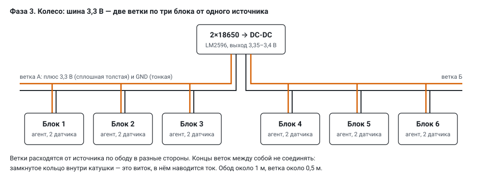
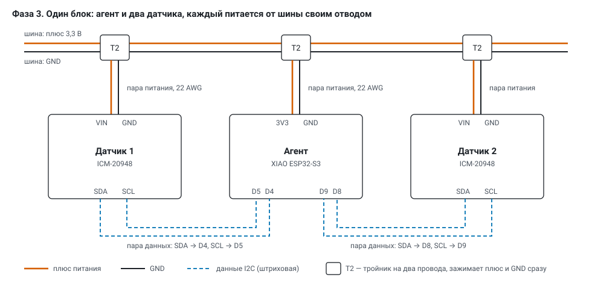
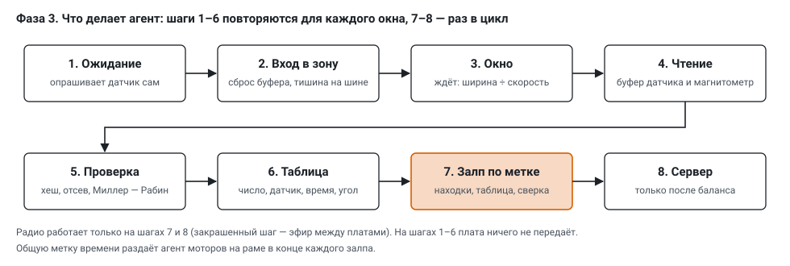
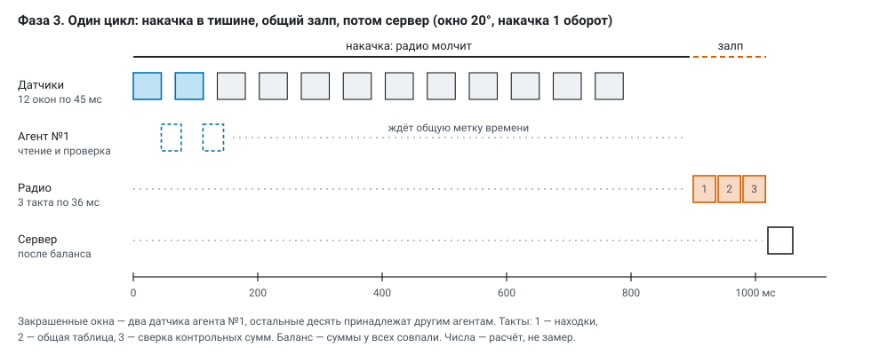

# Фаза 3: датчик у каждого агента, окна невесомости, общий залп

*Состояние на 23.11.2026: проект. Детали заказаны не все, прошивка в работе. Все времена и количества ниже —
расчёт, а не замер; что проверить на столе, собрано в последнем разделе.*

Третья фаза соединяет первые две: датчик у каждого вычислителя, как в первом колесе, и два колеса, как во втором.
Новое в ней — три вещи:

* число для проверки на простоту делается из показания датчика в тот момент, когда датчик проходит невесомость;
* находки не уходят в эфир сразу, а копятся, и все агенты отдают их разом, по общему времени;
* сервер читает итог только после того, как таблицы находок у всех агентов сошлись.

## 1. Что меняется против фазы 2

| | фаза 2 | фаза 3 |
|---|---|---|
| датчики на ободе | у 4 плат из 12 | у каждой платы по два, 12 на колесо |
| датчик | ICM-42688 и MLX90393 | ICM-20948: ускорение, вращение и поле в одном корпусе |
| откуда число | шум чипа, радио, АЦП | показание датчика целиком, потом хеш |
| когда берём показание | всё время | только в окне невесомости датчика |
| когда находка уходит в эфир | сразу | в общий залп после накачки |
| радио при измерении | работает | молчит |
| шина питания на колесе | 5,1 В, диод на каждой плате | 3,3 В, платы и датчики прямо от шины |
| вал колеса | на валу мотора | свой вал на двух опорах, мотор через муфту |

## 2. Колесо и питание

Колесо — алюминиевый диск Ø300 мм, на нём обод из гофрированной трубки (наружный диаметр 34,5 мм, внутренний около
29 мм). По оси трубки диаметр получается около 320–330 мм, точный размер ещё не измерен. Длина обода около 1 м.
Внутри трубки шесть блоков, блок — агент и два его датчика. На блок приходится около 16 см обода.

Шина — 3,3 В от того же DC-DC LM2596. Агенты и датчики питаются прямо от неё, мимо стабилизатора платы: он больше
не греет трубку. Каждый агент и каждый датчик берёт питание своим отводом через двухпроводный тройник.

| что | чем | сколько на два колеса |
|---|---|---|
| отводы питания к агентам и датчикам | силиконовый провод 22 AWG, паяется в отверстия плат | 36 пар по 10–12 см |
| тройники на шину | T2, двухпроводные, зажимают плюс и GND сразу | 36 |
| пара данных датчика | SDA и SCL, свой канал I2C на каждый датчик | 24 пары |
| датчики | ICM-20948 на плате с розетками Qwiic | 24 |
| агенты | XIAO ESP32-S3 | 12 |

Датчики одного агента сидят на разных каналах I2C: первый на D4 (SDA) и D5 (SCL), второй на D8 (SDA) и D9 (SCL).
Перемычка адреса на датчике поэтому не нужна.

Что важно не забыть:

* **Напряжение.** Защиты между шиной и платами нет. Выше 3,6 В гибнут и платы, и датчики. Выставить 3,35–3,4 В
  под нагрузкой и залить подстроечник DC-DC лаком.
* **USB.** Кабель USB подключать только при снятом питании шины. Прошивка — по воздуху.
* **Просадка.** Шесть плат и 12 датчиков берут в среднем около 0,75 А, на пиках передачи до 2 А. На ветке 0,5 м
  проводом 22 AWG просадка около 0,03 В. Электролит 220–470 мкФ у каждой платы.
* **Кольцо.** Концы веток между собой не соединять: замкнутый виток внутри катушки.
* **Вибрация.** Провод, впаянный в плату, ломается сразу за пайкой. Прихватить к трубке в 1–2 см от пайки.
* **Тройник.** Рассчитан на провод примерно 18–24 AWG. Провод тоньше зачистить длиннее, сложить вдвое и залудить;
  первый зажим проверить мультиметром.

### Катушка на гофре

Виток на гофре длиннее, чем на прежней трубке 23 мм: около 11 см против 7,5 см. При том же напряжении поле зависит
только от сечения провода и длины витка, а не от числа витков.

| | трубка 23 мм, провод 0,67 мм | гофра, 0,67 мм | гофра, 0,77 мм |
|---|---|---|---|
| витков на колесо | около 1340 | около 1340 | около 1080 из 500 г |
| провода на колесо | 100 м | 149 м | 120 м |
| масса на колесо | 320 г | 470 г | 500 г |
| сопротивление | 4,9 Ом | 7,3 Ом | 4,4 Ом |
| ток при 5,1 В | 1,0 А | 0,70 А | 1,15 А |
| поле относительно прежнего | 100 % | около 67 % | около 90 % |

### Вал

Колесо сидит на своём валу 8 мм в двух опорах с подшипниками. Мотор стоит отдельно и крутит вал через кулачковую
муфту, веса колеса он не несёт. Одной опоры мало: подшипник в ней самоустанавливающийся и держит вал в точке, но не
мешает ему наклоняться. Порядок: мотор — муфта — опора — колесо — опора, либо обе опоры рядом (в 8–10 см друг от
друга) и колесо на коротком вылете.

## 3. Датчик и его числа

ICM-20948 даёт девять 16-битных чисел со знаком: три оси ускорения, три оси вращения, три оси поля.

| что | частота | диапазон | цена единицы | что видит на колесе |
|---|---|---|---|---|
| ускорение | 1125 в секунду | ±4 g | 1 g = 8192 | в окне все оси около нуля, шум около 40 |
| вращение | 1125 в секунду | ±1000 °/с | 1 °/с = 32,8 | 74 об/мин = 445 °/с, около 14 570 по оси колеса |
| поле | 100 в секунду | ±4,9 мТл | 0,15 мкТл | поле катушки около 1,7 мТл — около 11 000 |

Пример двух соседних записей в окне (масштаб верный, сами числа выдуманы):

| запись | ускорение x, y, z | вращение x, y, z | поле x, y, z |
|---|---|---|---|
| первая | −212, 418, 37 | 14, −22, 14571 | 11204, −310, 96 |
| через 0,9 мс | −187, 455, −8 | 9, −31, 14566 | то же, обновится через 10 мс |

## 4. Окно невесомости

Скорость подобрана так, что в верхней точке центробежное ускорение равно тяжести: при радиусе 163 мм это 74 об/мин,
оборот длится 0,81 с. Ускорение, которое чувствует датчик, растёт от нуля наверху по мере ухода от верхней точки.
Окно — дуга вокруг верха, её ширина в градусах задаётся настройкой.

Окна считаются по датчикам, а не по агентам: у двух датчиков одного агента окна свои.

| ширина окна | длительность | записей | ускорение на краю | что на колесе |
|---|---|---|---|---|
| 20° | 45 мс | 51 | 0,17 g | окна раздельные, треть времени в зоне никого |
| 30° | 67 мс | 76 | 0,26 g | окна встык: в зоне всегда один датчик из 12 |
| 40° | 90 мс | 101 | 0,35 g | соседние окна перекрываются |

## 5. Что делает агент

1. **Ожидание.** Агент сам опрашивает датчик и следит за ускорением. Вход в зону он видит напрямую.
2. **Вход в зону.** Ускорение упало ниже порога, который соответствует ширине окна. Агент сбрасывает внутренний
   буфер датчика и перестаёт к нему обращаться. Датчик пишет записи сам в себя, на шине тишина.
3. **Окно.** Агент ждёт рассчитанное время: ширина окна, делённая на скорость вращения.
4. **Чтение.** Агент забирает буфер датчика одним чтением, затем читает поле.
5. **Проверка.** Каждая запись идёт в хеш и даёт одного кандидата, кандидат проверяется на простоту.
6. **Таблица.** Находка записывается: число, номер датчика, время, угол.

Шаги 7 и 8 — залп и чтение сервером — описаны в разделе 7.

Буфер датчика удобен тем, что записи в нём идут строго по часам самого датчика, а агент во время окна молчит.
Размер буфера в разных источниках указан по-разному: 512 байт или 4 кБ. Запись ускорения и вращения занимает
12 байт, поэтому в 512 байт входит 42 записи (окно 16,6°), а в 4 кБ — любое наше окно. Агент измерит размер сам при
первом запуске; от него зависит, какое окно помещается без единого обращения к датчику.

Ядра платы: ядро 1 читает датчики и проверяет числа, ядро 0 занято радио. Из 810 мс оборота два окна одного агента
занимают около 100 мс, проверка — ещё около 40 мс.

## 6. Из показания в число

Показание берётся целиком: все 16 бит каждой оси, без отбора младших битов. Запись проходит через хеш SHA-256 и
даёт 256-битного кандидата. Дальше как в фазе 2: отсев малыми делителями и проверка Миллера — Рабина. Хеш
выравнивает числа, поэтому доля простых известна заранее: одно на 88,6 нечётных кандидатов.

| при окне 20° | за окно с одного датчика | в секунду на колесо | в минуту на колесо |
|---|---|---|---|
| кандидатов | 51 | около 750 | около 45 000 |
| простых | 0,58 | 8,5 | около 510 |

При окне 30° — в полтора раза больше. Кандидат после хеша стоит около 0,26 мс, найденное простое — около 8,5 мс
(замеры фазы 2, [randomness.md](randomness.md)).

## 7. Цикл «лазер»: накачка, залп, баланс

| лазер | у нас |
|---|---|
| накачка | датчики по очереди проходят невесомость, агенты копят простые |
| запас в среде | таблица находок у каждого агента |
| вынужденное излучение | такт 1: общий залп находок |
| проходы между зеркалами | такты 2 и 3: переизлучение общей таблицы |
| установившийся режим | баланс: таблицы у всех агентов совпали |
| выходное зеркало | сервер читает только после баланса |

**Накачка.** Длится заданное число оборотов (настройка). Радио молчит совсем: ни пульса, ни телеметрии. За оборот
колесо находит в среднем 7 простых, поэтому один оборот — мало; разумное начало — пять.

**Залп.** По общему времени, три такта по 36 мс:

| такт | что отдаёт каждый агент |
|---|---|
| 1 | свои находки |
| 2 | общую таблицу, как он её собрал из услышанного |
| 3 | контрольную сумму своей таблицы |

Внутри такта агенты двух колёс говорят по очереди, по 3 мс на каждого: два передатчика на одном канале
одновременно глушат друг друга. Снаружи такт — один импульс длиной 36 мс. Во время залпа окна датчиков
пропускаются, чтобы никто не мерил под работающим радио.

**Баланс.** После такта 3 суммы у всех совпали. Если нет — такты 2 и 3 повторяются.

**Сервер.** Читает итоговые таблицы только после баланса.

Залп не привязан к углу колеса. Вибрация колеса идёт на частоте вращения; при привязке она попадала бы в каждый
залп в одной фазе и складывалась в ложный отклик. Со свободным залпом всё, что связано с вращением, при усреднении
уходит. Период цикла к тому же немного меняется от раза к разу.

Поле катушек для начала включено постоянно: тока без фронтов свидетель не чувствует, и вычитать нечего. Влияние
самого поля проверяется отдельной серией с выключенной катушкой.

## 8. Общее время

У каждой платы свои часы, идущие от момента включения. Общее время раздаёт ведущий — агент моторов на раме: он не
меряет в невесомости, и его радио никому не мешает.

1. В конце каждого залпа ведущий даёт метку: своё время и момент следующего залпа.
2. Каждый агент запоминает разницу между временем ведущего и своим и считает момент залпа по своим часам.
3. Во время накачки никто ничего не передаёт.

| источник ошибки | величина |
|---|---|
| задержка пакета в эфире и в плате | 0,2–1 мс, плавает |
| уход кварца за цикл 4 с | около 0,1 мс |
| итог после усреднения по нескольким меткам | около 0,2–0,3 мс |

Метка потерялась — агент стреляет по старой поправке. После трёх пропусков подряд он пропускает залп и ждёт
новую метку; сервер это видит.

## 9. Что меряем и чем проверяем

* **Свидетель между колёсами** (ADXL355): тяжесть в моменты залпов против моментов без них.
* **Само излучение:** потери пакетов, разброс времени прихода, уровень сигнала.
* **Контроль:** такие же залпы того же размера с составными числами вместо простых. Радио и ток одинаковые,
  отличается только найденное. Какие залпы настоящие, решает случайная последовательность; разбор её не видит
  до конца серии.
* **Яблоко на весах** между колёсами — в самом конце, как показ. Свидетель чувствительнее весов на несколько
  порядков.

По известной физике ожидаемый ответ — ноль: счёт простых на платах не должен менять показания неподвижного
датчика. Опыт проверяет, нет ли чего-то сверх известного.

## 10. Настройки

Меняются с сервера на ходу:

* ширина окна, градусы;
* сдвиг центра окна от верхней точки, градусы;
* как читать датчик: прямо или из его буфера;
* сколько оборотов длится накачка;
* сколько тактов в залпе и разброс периода цикла;
* залп настоящий или контрольный.

Что уже есть в прошивке (команда `CFG`):

| параметр | что задаёт | значения |
|---|---|---|
| `p3` | числа из окон невесомости датчиков вместо шума чипа | 0, 1 |
| `win` | ширина окна, градусы | 5–120, по умолчанию 30 |
| `wo` | сдвиг центра окна от верхней точки, градусы | −60…60 |
| `fm` | как читать датчик в окне: 1 — из его буфера, 0 — напрямую | 0, 1 |
| `vl` | цикл «лазер»: накачка в тишине, залп, сервер после баланса | 0, 1 |
| `vm` | эта плата — ведущий, раздаёт общее время | 0, 1 |
| `vn` | накачка, оборотов колеса | 1–200, по умолчанию 5 |
| `vj` | случайная добавка к длине цикла, мс | 0–500, по умолчанию 40 |
| `vr` | пар «общая таблица, сверка» в залпе | 1–4, по умолчанию 1 |
| `vs` | окно сервера после залпа, мс | 20–2000, по умолчанию 80 |
| `vc` | залп: 0 — настоящий, 1 — контрольный, 2 — случайно каждый цикл | 0, 1, 2 |

Участники залпа и их слоты задаёт список `grp`: место в списке — номер слота. Ведущему шлётся тот же список.

Как это сделано в прошивке:

* В такте 1 числа идут целиком, до 15 находок на агента за цикл. В такте 2 таблица идёт короткими строками: автор и
  первые 8 байт числа. Агент, не услышавший чью-то находку в такте 1, узнаёт о ней из чужой таблицы; само число
  сервер берёт у автора.
* Пара «такт 2, такт 3» выполняется `vr` раз всегда, а не до первого совпадения: так расписание залпа у всех одно.
* Для контрольного залпа агент хранит рядом с каждой находкой составное число из того же окна и отдаёт его вместо
  простого. Какой залп настоящий, решает ведущий и сообщает в метке.
* Период оборота ведущий узнаёт из кадров агентов; до первого залпа считает оборот равным 810 мс.
* Пакет телеметрии `vl`: поймано ли время, разница часов, пропуски меток, число залпов и балансов, сколько
  участников услышано в каждом такте, опоздание чужих кадров относительно их слота, уровень сигнала.

Сервер (`server/monitor.py`) эти параметры знает: проверяет их, шлёт агентам, сам составляет список слотов залпа
(генераторы по порядку номеров) и назначает ведущим агента моторов, если ведущий не указан; пакеты `p3` и `vl`
принимает и отдаёт в состоянии агента. Имитаторы (`tools/sim_agents.py`) шлют такие же пакеты, на них это проверено.

Прошивка собрана, но не проверена ни на датчике, ни в эфире: датчиков ещё нет.

## 11. Что проверить на столе до сборки

1. Размер буфера ICM-20948 и частоту записей в нём.
2. Время одного чтения датчика по I2C на 400 кГц и чтения буфера целиком.
3. Точность общего времени: разброс моментов залпа у шести плат.
4. Просадку шины 3,3 В на пиках передачи и поведение плат при 3,1 В.
5. Зажим провода 22 AWG и провода датчика в тройнике: сопротивление меньше 0,1 Ом.
6. Поле катушки на гофре: совпадает ли с расчётом.
7. Долю простых в контрольном режиме: должна быть одна на 88,6 кандидата.

## 12. Через посредника

Платы обода в опыте могут работать без роутера: вся их связь с сервером идёт через одного посредника — агента
моторов, он же ведущий времени. У колёс в эфире остаётся только наш протокол по расписанию залпа, а сервер получает
одну согласованную картину вместо отдельных рассказов каждой платы.

| Настройка | Что значит | Значения |
|---|---|---|
| `gw` | генератор в залпе уходит с роутера, пока слышит ведущего | 0, 1 |
| `gt` | сколько секунд без метки ведущего — и плата сама возвращается на роутер | 5–120, по умолчанию 20 |

Как это устроено:

* **Уход и возврат.** Плата уходит с роутера, только услышав метку ведущего, и остаётся на канале роутера. Нет меток
  `gt` секунд, началась прошивка по Wi‑Fi или настройка сняла `gw` — она сама возвращается. Чтобы вернуть всё
  колесо, достаточно остановить залп у агента моторов.
* **Состояние плат.** В последнем такте залпа каждая плата прикладывает к сумме таблицы своё состояние: применённую
  настройку, температуру, счёт простых и кандидатов, окна, ошибки датчиков, память. Ведущий после залпа шлёт серверу
  пакет `vp` с этими строками.
* **Находки.** Числа из такта 1 ведущий слышит вместе со всеми и отдаёт серверу в пакетах `vp` (ключ `f`: автор,
  датчик, время, число). Сервер кладёт их в тот же журнал простых под именем автора и проверяет, как обычно.
  Находки контрольного залпа (составные) только считаются. Плата с `gw` в свой журнал их не пишет.
* **Настройки.** Плате без роутера сервер шлёт настройку ведущему командой `RLY to=<номер> CFG …`. Ведущий после
  метки времени передаёт её кусками по 480 байт, три цикла подряд. Плата собирает строку и применяет как обычную;
  итог виден серверу в её состоянии (номер настройки). Не тот номер — сервер повторяет.
* **Метка залпа.** Кадры залпа помечены не номером настройки, а составом участников, поэтому смена настройки у
  ведущего и у плат в разное время залп не рвёт.

Чего через посредника нет: прошивки по Wi‑Fi (плата для этого возвращается на роутер) и подробной телеметрии
(пакеты `tel`, `p3`, `vl` плата без роутера не шлёт). Если ведущий зависнет, платы вернутся сами через `gt` секунд.

Проверено на имитаторах (`tools/sim_agents.py`): настройка доходит через посредника, находки ложатся в журнал под
именами авторов. На платах не проверено.

### Такт излучения

Настройка `ve` (0, 1), только вместе с `gw`. Перед тактом 1 платы без роутера на 12 мс расходятся по каналам 1, 6 и 11
(по номеру слота) и в один миг передают свои находки; друг друга в этот миг они не слышат. Потом все возвращаются на
общий канал, и залп идёт как обычно: сверка таблиц, баланс, сервер. Плата на связи с роутером такт пропускает
(канал менять нельзя). Каналов три, поэтому на шести платах колеса на канале оказывается по две: их кадры могут
столкнуться. Счётчики — в пакете `vl` (`em`: сделано, не успел кадр, пропущено) и в состоянии платы у посредника.

### Залп один на весь состав

Группы состава и шаги опыта задаются отдельно для каждого колеса, а залп общий. Сервер сам собирает слоты из всех
генераторов с залпом, добавляет ведущим агента моторов (в группы генераторов он не входит) и рассылает новый список
слотов уже работающим участникам. Параметры залпа (`vn`, `vj`, `vr`, `vs`, `vc`, `ve`) ведущий берёт у группы,
применённой последней. Когда генераторов с залпом не остаётся, ведущий замолкает, и платы возвращаются на роутер.

### Где это включается

* Главный экран, окно «Эксперимент»: вид работы колеса «фаза 3 · окна и залп».
* Пульт: набор группы «Фаза 3: окна и залп» и свои параметры группы в разделе «Фаза 3: окна, залп, посредник».
* Прежняя панель (`/old`): блок «Фаза 3» в общих настройках и строка о последнем залпе.

Напряжение батареи платы (если на ней есть датчик контура) идёт в состоянии у посредника.
