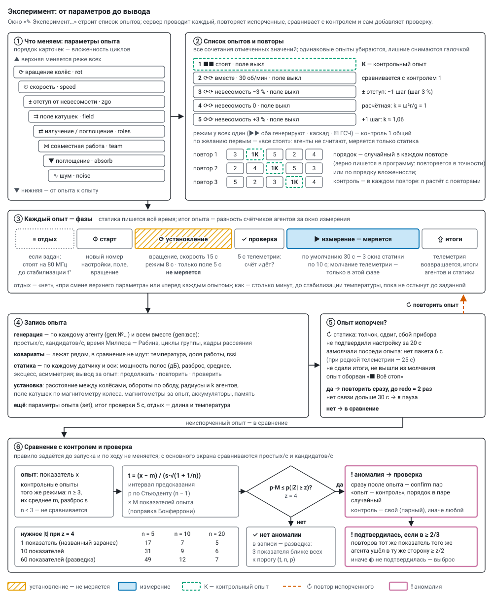

# Эксперимент и программа

**Эксперимент** — список опытов, пройденный заданное число повторов; **опыт** — один набор параметров.
Эксперимент собирается в окне «✎ Эксперимент…» основного экрана и по «▶ Запустить» уходит серверу
**программой** (`POST /api/program/start`). Сервер (`server/program.py`) проводит опыты по очереди,
повторяет испорченные, сравнивает опыты с контрольными, при аномалии сам добавляет проверку. Как
статика решает «продолжать / повторить / проверить» — [static_watch.md](static_watch.md); что значит
каждый режим — [modes.md](modes.md).



## Параметры опыта

У каждого параметра в окне отмечаются значения. Порядок карточек — вложенность циклов: верхняя меняется
реже всех, нижняя — от опыта к опыту (тащить за ⠿ или ▲ ▼). Вращение переключать дороже всего (колёсам
нужен разгон) — его разумно держать наверху. Одно значение — параметр постоянный.

| параметр | ключ `set` | значения |
|---|---|---|
| ⟳ вращение колёс | `rot` | два знака — колесо 1 и 2: `0` стоит, `r` вперёд ⟳, `l` назад ⟲ (`rl` — навстречу, `rr` — вместе, `r0` — только колесо 1); сетка 3 × 3 |
| ⏲ скорость | `speed` | `rpm:30` — обороты, `pwm:30` — ШИМ %, `zerog` — невесомость наверху колеса; по умолчанию в списке 15, 30, 45, 60 об/мин и невесомость, свои добавляются |
| ± отступ от невесомости | `zgo` | 0, ±1, ±2 шага по `zgStep` % оборотов (шаг задаётся, по умолчанию 3 %); в `set` — проценты (`-3`, `0`, `3` …), в шаге — `mot.zg`; только при `zerog`, иначе `null` |
| ⇉ поле катушек | `field` | два знака — катушка 1 и 2: `0` выкл, `p` +, `m` − (`p0` — только катушка 1, +); сетка 3 × 3 |
| ⇄ излучение / поглощение | `roles` | два знака — колесо 1 и 2: `g` генерирует, `a` поглощает, `0` стоит: `gg`, `g0`, `0g`, `ga`, `ag`, `00` (только статика); `aa`, `a0`, `0a` нельзя — поглощать нечего |
| ⋈ совместная работа | `team` | `solo`, `cascade`, `one`, `relay`; никто не генерирует — `null` |
| ▼ поглощение | `absorb` | `кто/как`: кто — `all`, `pair`, `one`, `split`, `half`; как — `mix`, `pieces`, `chain`, `sham`, `silent` (`pieces` и `chain` — всегда `all`); никто не поглощает — `null` |
| ∿ шум | `noise` | смесь источников `m:rng+csi+adc` …; перебор — все вместе, без одного, по одному |

Значения словами — [modes.md](modes.md). Невесомость — обороты, при которых наверху колеса
k = ω²r/g = 1 (r — радиус по датчику обода, нет замера — из настроек; при 450 мм — 44,6 об/мин).
Вся система неточна, поэтому опыт ставит ступени около расчётной: +3 % оборотов — k ≈ 1,06 (k меняется
вдвое сильнее оборотов).

## Список опытов

* **Все сочетания** отмеченных значений, одинаковых нет: у стоящих колёс скорость и отступ не
  перебираются; отступ — только при невесомости; никто не генерирует — способ и шум не важны; никто не
  поглощает — поглощение не важно; обратный шум — только когда другое колесо поглощает. Лишний опыт
  снимается галочкой; сформированный список правится (⧉ копия, ↑ ↓, ✕).
* **Контроль** — опыт без воздействия (колёса стоят, поле выкл), если в эксперименте меняются вращение
  или поле. У остальных опытов `control_for` — контроль того же режима (роли, способ, поглощение, шум).
* **«Все стоят»** — по желанию первым (по умолчанию да): агенты не считают, меряется только статика.
* **Порядок** — по вложенности или случайно в каждом повторе (`shuffle`; зерно `seed` пишется в
  программу, с ним порядок повторяется в точности).

## Настройки окна

| настройка | по умолчанию | что |
|---|---|---|
| длительность | 30 с | измерение опыта. Статика даёт вывод по окнам 10 с, «⚠ проверить» — от 2 окон подряд: за 30 с — 3 окна, короче 20 с статике мало. Простых за опыт N ≈ темп × длительность, темп известен с точностью ±1/√N |
| установление | 15 / 8 / 5 с | после смены вращения, скорости или отступа · роли, способа, поглощения, шума · только поля; не меряется |
| между колёсами | — | расстояние от обода до обода, мм; ставится руками, см. ниже |
| повторов | 2 | сколько раз пройти список; порядок — по вложенности или случайно |
| отдых | нет | нет · при смене верхнего параметра · перед каждым опытом. Как: столько минут · до стабилизации температуры (по умолчанию) · пока не остынут до … °C; не дольше 6 мин |
| греться до | 73 °C | предел агентам; регулятор держит на 1 °C ниже ([thermal.md](thermal.md)) |
| аккумуляторы | 2 × 18650, 2500 мА·ч | ёмкость для сводки; «пауза между повторами» — заменить и «▶ Продолжить» |
| контроль и проверки | — | первым «все стоят»; эталон шума статики перед началом (0 мин — взять записанный); проверочных пар при аномалии (0); ❗ отклонение статики — повторить опыт (нет); звук тревоги; пропала связь дольше 30 с — пауза (да) |
| тонкости опыта | выкл, молчание — вкл | оба колеса одной группой; опыт на агенте (сам останавливается и сдаёт итоги); Wi-Fi выкл на опыте (только с опытом на агенте); молчание телеметрии во время измерения (по умолчанию вкл) |

Порог аномалии `z` = 4, повтор испорченного `redo` = 2, показатели аномалии `metrics` = простых/с и
кандидатов/с — основной экран задаёт их сам.

**Расстояние между колёсами** — настройка установки, а не параметр: «↔ … см» между колёсами на схеме,
поле «между колёсами» в окне, `POST /api/rig {gap_cm}`. Хранится в `rig.json` с историей и пишется в
программу (`rig`), в каждый опыт (`runs[].rig`) и в результаты (слой опыта, столбец CSV).

**Сводка до запуска:** опыты (контрольных, снятых), повторы, время всего и по частям (измерение ·
установление · отдых · эталон), когда закончится; за проход — разгоны колёс, смены поля, отдыхи.

* **Тепло** самого горячего агента по замеру в трубке с радиаторами: «пол» на 80 МГц ≈ 57 °C, под
  счётом — пол + нагрев режима (эгоистичный и каскад +10 °C, остальные +8), нагрев с постоянной ≈ 85 с,
  остывание ≈ 30 с. Сводка показывает, до скольких градусов дойдёт и запас до предела; где регулятор
  урежет работу (темп там исказится) или отдых «до … °C» ниже пола не дождётся — предупреждает.
* **Аккумуляторы** по контурам: шина колеса (агент под счётом ≈ 1,3 Вт, стоит ≈ 0,5 Вт) и катушка
  (поле ≈ 4,5 Вт + агент 0,5 Вт); DC-DC и диод ≈ 80 %, пара 18650 отдаёт ≈ 85 % паспорта. Сколько
  проходов выдержит одна пара, сколько нужно замен — тогда включить паузу между повторами.

Коэффициенты — `THERM` и `POWER` в `server/static/plan.html`.

## Как идёт опыт

Каждый опыт — с **новым номером настройки**, поэтому счётчики агентов считают ровно его; итог —
разность счётчиков за окно измерения, установление в темп не попадает. Основа опытов — общие и свои
параметры агентов на момент старта; после программы агенты возвращаются к ним, но стоят (run = 0),
поле катушек выключается, колёса, если их крутила программа, останавливаются.

**Фазы** (`now.phase`; `ph_t` — начало фазы, `ph_dur` — длина, `phases` — когда началась каждая):

| фаза | что |
|---|---|
| `rest` | отдых перед опытом, если задан: генераторы на 80 МГц, катушки выкл ([thermal.md](thermal.md) § 4.5) |
| `start` | настройка агентам, поле катушек, вращение |
| `prep` | установление (`settle_s`): колёса разгоняются, поле встаёт; не меряется |
| `test` | 10 с с телеметрией: счёт идёт? (`test`: `pr_s`, `idle` — кто не считал, `ok`); у опыта на агенте и «все стоят» её нет |
| `run` | измерение; молчание телеметрии — только здесь, статика меряет и шлёт всегда. Молчат и датчики шины (обод, магнитометр): регулятор держит последний ШИМ (в «невесомости» — и последний радиус обода), обороты и поле в записи опыта — за проверку и итоги (`sense_win`) |
| `upload` | телеметрия возвращается, итоги агентов и статики собираются |
| `pause` | пауза (ниже) |

**Запись опыта** (`runs[]`):

* `gen` — генерация по каждому агенту (`gen:№…`) и всем вместе (`gen:все`): простых/с (`pr_s`),
  кандидатов/с (`cand_s`), время Миллера — Рабина на кандидата (`mr_us`), циклы группы (`cycles_s`),
  кадры рассеяния (`stx_s`); температура и доля работы — **ковариаты**: лежат рядом, аномалией не
  считаются (режимы заведомо греют по-разному);
* `static` — по каждому статическому датчику за окно измерения, по вертикали и горизонтали
  ([оси по тяжести](static_watch.md)): мощность октав (`p0_v`, `p0_h` …, дБ), разброс (`sd_v`, `sd_h`), эксцесс,
  асимметрия; среднее — `mean_v`, `mean_h1`, `mean_h2`, мкg; `watch` — вывод статики за опыт;
* `field` — магнитометры за опыт (x, y, z, |B|); `coil_sense` — поле катушек по магнитометру колеса;
* `rpm` — средние обороты колёс по датчику обода, `radius` и `k` — радиусы агентов и k при этих
  оборотах; `rig` — расстояние между колёсами; `bat` — аккумуляторы контуров в конце опыта; `mem` —
  свободная память агентов;
* `set`, `mot`, `coil`, `layers` — параметры опыта; `test`, `rest` — проверка и отдых.

**Испорченный опыт** в сравнение не идёт и сразу повторяется (до `redo` раз; оборванный стопом —
всегда). Причина — в `spoiled_why`:

* статика: «↻ повторить» — толчок, сдвиг, сбой прибора;
* кто-то не подтвердил настройку за 20 с — опыт помечается сразу, без ожидания его длительности;
* замолчал посреди опыта — нет пакета дольше 6 с при обычной телеметрии, 25 с при редкой (сели
  аккумуляторы, пропало питание);
* опыт на агенте: не сдал итоги за срок + 60 с; молчание: не вышел на связь за 15 с после опыта
  (настройка «говорить» повторяется раз в 2 с);
* опыт оборван «■ Всё стоп».

Не вернулся на связь за 30 с — программа встаёт на паузу «нет связи с №…: проверьте питание»
(`pause_lost`), после «▶ Продолжить» испорченный опыт повторяется. Участники программы — агенты, которые
были на связи при её старте. Программа и сессия прежней панели одновременно не идут: обе управляют
одними агентами.

## Аномалия и проверка

**Аномалия** — показатель опыта отличается от его контрольных опытов так, что разбросом контролей это
не объяснить. Показатели — генерация по каждому агенту и всем вместе и статика по каждому датчику;
с основного экрана проверяются простых/с и кандидатов/с (`metrics`), статику стережёт свой вывод
(ниже, «Тревога статики»).

Критерий. Контрольных опытов мало, поэтому отклонение в их разбросах — распределение Стьюдента, а не
нормальное: при трёх контролях |z| ≥ 4 случается в 7 % случаев, а не в 0,006 %. Показателей на опыт —
от двух до десятков, и случайный выброс где-нибудь нашёлся бы почти всегда. Поэтому для каждого
показателя:

* t = (x − m) / (s · √(1 + 1/n)) — x значение опыта, m и s среднее и разброс n контролей (интервал
  предсказания нового наблюдения);
* p — по Стьюденту с n − 1 степенями свободы, умножается на число показателей опыта M (поправка
  Бонферрони);
* аномалия — если p · M не больше вероятности |Z| ≥ z у нормального; z = 4 — ложная тревога реже
  1 на 16 000 опытов.

Нужно n ≥ 3 контролей того же режима (`control_for`; без него — все контрольные): при одном контроле на
повтор — не меньше трёх повторов. Нужное |t| — в таблице на рисунке: мало контролей — мало
чувствительности, это честно. Поэтому главные показатели называют **до запуска** (`metrics`: точные
имена или начала — `pr_s`, `band`): проверяются только они, поправка мягче; без `metrics` проверяется
всё — это разведка. У каждого неконтрольного опыта пишется `scan` — три показателя с наименьшей
вероятностью (t, n, p): видно, что близко к порогу. Правило задаётся до запуска и по ходу не меняется.

**Проверка.** Найдена аномалия — сразу после этого опыта добавляются `confirm` пар «тот же опыт —
контроль» (контроль — его `control_for`, иначе случайный из контрольных), порядок в каждой паре
случайный. Опыт проверяется один раз; аномалия внутри проверки новой проверки не вызывает.

**Вывод.** **❗ Подтвердилась** — если хотя бы в двух третях проверочных повторов тот же показатель того
же агента отклонился от тех же контролей в ту же сторону хотя бы на z/2. Иначе — **◐ не подтвердилась**,
случайный выброс.

**▣ Колесо‑пустышка — проверка самого детектора.** Две платы без датчиков лежат рядом с колёсами, со
своим питанием от повербанка через модуль‑триггер USB‑C → 5 В (не от шины). В составе это «колесо 3» без мотора и катушки: на схеме
основного экрана, в настройке, справа от «свободных» есть место «▣ колесо‑пустышка». В программе его агенты
перечислены в `dummy`. В каждом опыте колесо‑пустышка работает своей группой и тем же режимом, что колёса:
каскад, тот же шум, «каждый сам». В опытах с поглощением две платы работают парой между собой: одна
генерирует, другая поглощает тем же способом (смешать или пустышка), в обратном шуме поглощает и возвращает
кадры; это неподвижный эталон для поглощения. Его генерация (`gen:№…` по каждой плате и
`gen:колесо-пустышка` суммой) проверяется тем же критерием и в той же семье сравнений, что колёса, но в
`gen:все` не входит. Пустышкой плата считается только в опыте, где её группа состоит из одних плат
колеса‑пустышки. Если её поставить в группу колеса, она становится участником, и её отклонение может быть
настоящим. Так устроены два опыта первой программы (`tools/first_program.py`, блок 5):

* **подслушивающие** — оба колеса одной группой считают только из кадров плат колеса‑пустышки (обратный шум,
  `src 16`), а те поглощают простые обоих колёс; контроль — поглотитель‑пустышка (`sh 1`). Выключается ключом
  `--no-listen`;
* **мост** — первая плата встаёт звеном в каскад колеса 1, неподвижным среди вращающихся, вторая считает одна
  (она и остаётся пустышкой); колёса навстречу, контроль — то же стоя. Выключается ключом `--no-bridge`.

Вращения и поля у колеса‑пустышки нет, поэтому любая его «аномалия» — ложная тревога детектора: дрейф,
эфир, температура или ошибка самого анализа. Такие находки идут не в `anomalies`, а в `placebo`:
`anomalies`, `verdicts` (их проверка теми же парами), `tested` (сколько опытов сравнено), `hits`, `confirmed`
и `shared` (опыты, где аномалия колёс совпала с тревогой колеса‑пустышки — значит, не от вращения). В отчёте,
в ленте и на основном экране — строка «▣ колесо‑пустышка: ложных тревог нет» или их число. Если ложная
тревога **подтвердилась**, детектор ошибается, и аномалиям колёс той программы верить нельзя, пока
причина не найдена.

**Опорная поправка — колесо‑пустышка как опора.** Пустышка работает тем же режимом в то же время, что
колёса, поэтому в каждом опыте считается ещё канал `gen:все/опора`: простых (и кандидатов) в секунду на
агента у колёс, делённые на то же у колеса‑пустышки. Общее у колёс и опоры — загрузка эфира, температура
комнаты, время суток — в отношении сокращается, а контрольный опыт идёт в другое время, поэтому `gen:все`
против контроля такой дрейф видит, а `gen:все/опора` нет. Канал проверяется тем же критерием в той же семье
сравнений (`metrics: ["pr_s"]` его включает: имя показателя то же), на одно‑два сравнения строже поправка.
Отклонилось `gen:все/опора` вместе с тревогой самой пустышки — причина в опоре, не в колёсах (`shared`).
Опора из двух плат шумит сама: при ~40 простых/с на плату за 3 мин — около 0,9 % на отношение. Нулевая
программа покажет, ровнее ли отношение, чем `gen:все`. В отчёте — показатель «колёса к опоре» в «что влияет».
Платы пустышки без радиаторов, частота та же, что у колёс (сравнивать — на одной частоте), а потолок
температуры свой — `dummy_tmax`, по умолчанию 75 °C (у колёс 73): программа ставит его им своим в каждом
опыте, чтобы регулятор их не притормаживал.

**❗ Тревога статики.** Вывод статики за опыт «⚠ проверить» — отклонение от эталона держится не меньше
2 окон подряд или видно за весь опыт и не объясняется известными источниками. Программа пишет тревогу
(`alerts`, у опыта `alert`; в ленте и отчёте «❗») и при `again` > 0 сразу ставит тот же опыт ещё раз
(`why: "отклонение статики"`), до `again` раз подряд. Основной экран звенит (три коротких сигнала;
браузер даёт звук после первого нажатия на страницу), в шапке мигает «❗ отклонение статики», окно
показывает причину по датчикам, «↻ повторить опыт N ещё раз» (`POST /api/program/again {n}`) и
«повторять сам: нет / 1 / 2 / 3» (`{auto}`). Вне программы звенит на живом выводе (не чаще раза в
минуту) и предлагает повторить последний опыт с теми же настройками. Толчок держащееся отклонение не
прячет: держится у датчика 2 окна подряд (`held`) — тревога звенит, даже если опыт испорчен. Сбой
прибора и сдвиг датчика тревоги не дают: отклонение тогда от прибора или от нового положения — нужен
новый эталон.

## Пауза, стоп, продолжение

* **Пауза** — перед следующим опытом: катушки выкл, колёса стоят, агенты на отдыхе (80 МГц); ждёт
  «▶ Продолжить» (`POST /api/program/resume`) сколько угодно. Встаёт по кнопке «⏸ Пауза»
  (`POST /api/program/pause`; пока опыт идёт, просьбу можно снять) и сама: перед повтором
  (`pause_repeat`), сели аккумуляторы (INA219 ниже 6,5 В), нет связи дольше 30 с (`pause_lost`).
  Причина — в плашке «сейчас» и в `pauses` (когда, сколько, почему).
* **Стоп после опыта** (`POST /api/program/stop`) — опыт доработает, дальше программа встанет; просьбу
  можно снять (`{cancel: true}`). **Всё стоп** (`{now: true}`) — сразу: опыт обрывается, помечается
  «прерван» и при продолжении идёт первым.
* **Продолжить** остановленную, прерванную или упавшую программу (`POST /api/program/continue {id}`) —
  с первого невыполненного опыта: тот же план и зерно, эталон заново не пишется, итоги — в ту же запись
  (`continued`). Программа, шедшая при перезапуске сервера, помечается «прервана» — её тоже можно
  продолжить. На основном экране — «↻ Продолжить №… · ещё N опытов».

## Результаты

«☰ результаты» (`/report`):

* **Что влияет при прочих равных.** Для параметра P и значения v каждый опыт с P = v сравнивается с
  опытами, где P — опора (первое значение: колёса стоят, поле выкл, первый отмеченный вариант), а
  остальные параметры те же. Темпы — отношением к среднему опор, температура, |B| и доля опытов с
  отклонением статики — разностью. Δ — среднее по парам, ± — его ошибка; вывод по Стьюденту с числом
  пар: ❗ отличие (p ≤ 0,0027, как 3 σ), ◐ возможно (p ≤ 0,05), ✓ не отличается; меньше трёх пар —
  «нужны повторы». Сравнений много — одно-два «◐» бывают случайно, их проверяют повтором.
* **Сводная** — среднее показателя по двум параметрам (строки × столбцы) или отличие от первого столбца.
* **Протокол опытов** — по каждому: параметры (имя, время, длительность, расстояние между колёсами),
  итог (✗ испорчен — почему · ❗ аномалия подтвердилась · ◐ не подтвердилась или проверяется · ⚠
  отклонение статики · ✓ контроль · ✓ как контроль), статика по каждому датчику (шум за опыт, мg;
  отличие от своих контролей, %; max z; вывод), аномалия (показатель, t) или самый большой |t|
  разведки; простые, темп, температура, |B|; по агентам — отдельной таблицей.
* **CSV** — всё это, параметры опыта отдельными столбцами словами.

## Программа вручную (JSON)

Эксперимент с основного экрана — частный случай; программу можно отдать и руками:

```json
{
 "name": "рассеяние против пустышки и тишины",
 "baseline_min": 5, "repeat": 4, "shuffle": true, "settle_s": 10, "rest": "stable", "z": 4, "confirm": 3, "redo": 2,
 "targets": "all",
 "steps": [
  {"name": "рассеяние: каждый сам", "minutes": 3, "cfg": {"sm": 1, "sh": 0}, "control_for": "пустышка"},
  {"name": "пустышка", "minutes": 3, "cfg": {"sm": 1, "sh": 1}, "control": true},
  {"name": "тишина", "minutes": 3, "cfg": {"sm": 0}, "control": true}
 ]
}
```

| поле программы | по умолчанию | что |
|---|---|---|
| `baseline_min` | 0 | сначала записать эталон шума статики, мин (основные группы стоят); 0 — взять записанный |
| `repeat`, `shuffle`, `seed` | 1, да, случайное | повторов; случайный порядок в каждом повторе; зерно порядка |
| `settle_s` | 10 | установление по умолчанию, с |
| `rest` | 0 | отдых перед опытом: `"stable"` — пока за `rest_window_s` (90 с) температура упала не больше чем на `rest_tol` (0,5 °C), от `rest_min_s` (60 с) до `rest_max_s` (360 с); `"below"` — пока все не остынут до `rest_below` (20–80 °C); число — секунд; 0 — без отдыха |
| `z`, `metrics` | 4, все | порог аномалии; показатели, названные до запуска (имена или начала) |
| `confirm` | 3 | проверочных пар при аномалии; нужен хотя бы один контрольный шаг |
| `redo`, `again` | 2, 0 | повторов испорченного; повторов при тревоге статики |
| `pause_repeat`, `pause_lost` | нет, да | пауза перед каждым повтором; пауза, если пропала связь |
| `targets`, `axes` | `"all"`, — | кто участвует (`"all"` или список MAC); словарь параметров эксперимента для отчёта |
| `dummy` | — | агенты колеса‑пустышки (MAC, из `targets`): их находки — ложные тревоги (`placebo`), в `gen:все` не входят; колёса к ним — `gen:все/опора` |
| `dummy_tmax` | 75 | потолок температуры плат колеса‑пустышки в каждом опыте, °C (40–75; 0 — как у всех) |

| поле шага | что |
|---|---|
| `name`, `minutes` | имя (по нему опыт находит свой контроль) и длина измерения |
| `cfg`, `own`, `groups` | общие параметры (ключи — как в таблице параметров), свои у агентов (нет — как на панели); или несколько групп, у каждой свои `targets`, `cfg`, `own` (не занятые на шаге стоят) |
| `control`, `control_for` | контрольный шаг; имя контроля, с которым сравнивать этот (без него — со всеми) |
| `settle_s`, `rest` | своё установление; `false` — без отдыха перед шагом |
| `quiet` | молчание телеметрии генераторов на измерении; не указано — молчат (`false` — шлют всё время) |
| `agent` | шаг на агенте: длительность уходит агентам (`dur` = шаг + установление), каждый сам останавливается и сдаёт итоги; только здесь в `cfg` можно `ro: 1` — Wi-Fi выкл на шаге |
| `mot` | вращение `{pair: free/same/opposite/only1/only2, mode: off/pwm/rpm/zerog, dir, rpm, pwm, zg}`; колёса разгоняются за установление |
| `coil` | поле катушек: `{"1": "+", "2": "выкл"}` |
| `set`, `layers` | параметры опыта ключами (по ним «что влияет»); слои словами для ленты |

## Где лежит

`data/programs/<номер>.json` — программа, план (с добавленными проверками и повторами), каждый опыт с
итогами, аномалии (`anomalies`), выводы проверок (`verdicts`), ложные тревоги колеса‑пустышки (`placebo`),
тревоги, паузы. API: `GET /api/programs`,
`GET /api/program?id=`, `POST /api/program/start {"program": …}`, `/stop`, `/pause`, `/resume`,
`/continue`, `/again`; `POST /api/rig`.
