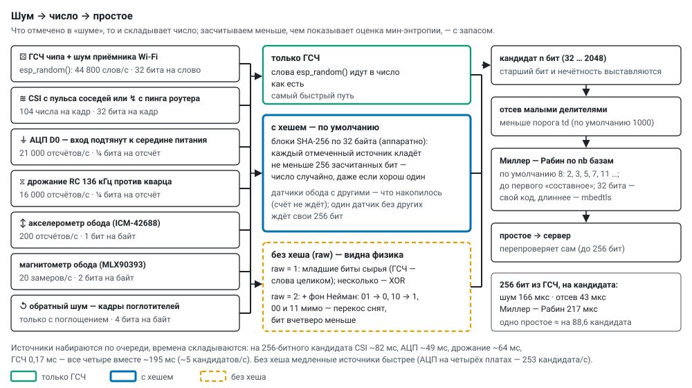

# Откуда берётся случайность

Шумы, из которых агенты складывают числа: как берутся, сколько засчитываем, как смешиваются, с какой
скоростью. На основном экране у каждого шума свой значок: ⚄ ГСЧ чипа, Σ все доступные, ≋ CSI с пульса,
↯ CSI с пинга роутера, ⏚ АЦП D0, ⧖ дрожание RC, ↺ обратный шум, ↕ акселерометр, 🧲 магнитометр. Как
шум выбирается в эксперименте — [modes.md](modes.md).

Плата XIAO ESP32-S3, ядро Arduino-ESP32 3.3.7 (ESP-IDF 5.5). Сырые журналы замеров — `logs/probe*.log`,
разбор — `tools/probe_report.py`, прошивка замеров — `firmware/entropy_probe`.

## 1. esp_random() и шум Wi-Fi

По документации Espressif `esp_random()` при включённом Wi-Fi выдаёт истинно случайные числа: в
аппаратный генератор непрерывно подмешивается тепловой шум АЦП радиоприёмника (2 бита за такт шины
80 МГц). В скомпилированной библиотеке (`libesp_hw_support.a`, разбор дизассемблером):

* функция читает регистр генератора `0x6003507C` (`WDEV_RND_REG`);
* между словами ждёт **1778 тактов шины** (22,2 мкс), все чтения за ожидание складывает исключающим ИЛИ;
  отсюда предел **~45 000 слов/с** (замер: 44 800), одинаковый при любом состоянии Wi-Fi;
* сам регистр без ожидания читается со скоростью 10,5 млн слов/с.

Чтобы шум радио шёл в генератор всё время, прошивка держит Wi-Fi включённым и **без сна**
(`WiFi.setSleep(false)`); телеметрия сообщает это полем `rf=1`.

**Чего проверить нельзя.** По самим числам не видно, есть ли в них шум радио: у генератора есть второй
источник — дрожание внутреннего генератора RC_FAST (бит `DIG_CLK8M_EN` включён, проверено чтением
регистра). Выход генератора в четырёх состояниях (Wi-Fi выкл/вкл × RC_FAST выкл/вкл) проверен на
линейную сложность (Берлекэмп — Мэсси, 4096 слов): во всех четырёх она n/2, как у случайной
последовательности, — линейной структуры нет, но отличить «с шумом радио» от «без» по выходу нельзя.
Участие радио принимаем по документации и коду функции; наблюдать шум Wi-Fi напрямую — через CSI.

## 2. Источники

| источник | как берём | сырья в секунду | оценка (мин-энтропия) | засчитываем |
|---|---|---|---|---|
| ⚄ ГСЧ чипа + шум радио | `esp_random()` | 44 800 слов | по Espressif — полные 32 бита | 32 бита на слово |
| ≋ ↯ CSI Wi-Fi | состояние канала (LLTF, 64 поднесущие) по кадрам пульса соседних агентов (ESP-NOW, 10 в секунду от каждого) или по ответам роутера на пинг: 104 числа на кадр | при пинге 100 Гц ~95 кадров | ~1,5 бита на число, ~150 на кадр | 32 бита на кадр |
| ⏚ АЦП | ножка D0 (GPIO1) с подтяжками вверх и вниз — середина питания; к D0 ничего не подключать | 21 000 отсчётов | 2,9 бита на отсчёт, но соседние связаны (наводка) | ¼ бита на отсчёт |
| ⧖ дрожание RC | такты кварца за 8 периодов внутреннего RC 136 кГц (`rtc_clk_cal_ratio`) | 16 000 отсчётов | ~1 бит на отсчёт, медленный дрейф | ¼ бита на отсчёт |
| ↕ акселерометр обода | младшие байты осей ускорения и гироскопа ICM-42688 | 200 отсчётов | — | 1 бит на байт |
| 🧲 магнитометр обода | младшие байты осей MLX90393 | 20 замеров | — | 2 бита на байт |
| ↺ обратный шум | содержимое кадров поглотителей другого колеса (их шум со смешанными нашими простыми) — петля через эфир; только с поглощением | — | — | 4 бита на байт |

У агента без датчика обода вместо датчика идёт ГСЧ.

Отвергнуты: **датчик температуры** (за 4096 чтений два значения с шагом 1 °C), **`noise_floor` Wi-Fi**
(у всех пакетов −97 дБм), **CSI без пинга и пульса** (пакетов для нас почти нет; в режиме прослушки
эфира — 16 пакетов/с от десятков разных устройств).

**CSI и 802.11n.** Когда агенту разрешён 802.11n, роутер отвечает пакетами 802.11n, и чип строит CSI
лишь для части из них: 3–82 пакета/с при ~95 ответах на пинг (`tools/csi_watch.py`). С 802.11g CSI
приходит на каждый ответ — 97–99 в секунду. Поэтому `prime_lab` разрешает только 802.11b/g
(`esp_wifi_set_protocol`); телеметрии 54 Мбит/с с избытком. Шум тот же: младший бит — единица в 51 %,
совпадает с прошлым пакетом в 50 %.

## 3. Как смешиваются

* **Только ГСЧ** — слова `esp_random()` идут в число как есть.
* **Любой другой набор** — блоки SHA-256 (аппаратный блок чипа) по 32 байта. В каждый блок **каждый**
  отмеченный источник кладёт не меньше 256 засчитанных бит — кроме датчиков обода: вместе с другими они
  подмешивают то, что накопилось с прошлого блока (счёт не ждёт медленный датчик), и только один датчик
  без других ждёт свои 256 бит. Число остаётся случайным, даже если все источники, кроме одного, плохие.
  Источники набираются по очереди, времена складываются: на 256-битного кандидата CSI ~82 мс, АЦП
  ~49 мс, дрожание ~64 мс, ГСЧ 0,17 мс — все четыре вместе ~195 мс (~5 кандидатов/с), в 2,4 раза
  медленнее одного CSI.

**Шум без хеша (`raw`).** Хеш собирает рассеянную случайность сырья в плотные 256 бит, но заодно
размешивает структуру источника: перекосы, связь соседних отсчётов, ритмы. Без хеша видно, не
проступает ли в числах физика источника:

* `raw` = 1 — в число идут младшие биты сырья как есть: CSI — младший бит каждого замера поднесущих с
  данными (2–26 и 38–63, 102 бита на пакет; нулевая, защитные и первая, которую чип иногда портит, —
  мимо); АЦП и дрожание — младший бит отсчёта; датчики обода — засчитанные младшие биты байта; ГСЧ —
  слова целиком; эфир сета B — байты целиком;
* `raw` = 2 — то же с выравниванием фон Неймана: пара 01 → 0, 10 → 1, 00 и 11 отбрасываются. Снимает
  перекос нулей и единиц, но не связь соседних отсчётов; бит вчетверо меньше;
* несколько отмеченных источников складываются побитно (XOR) — структура источника видна, когда он
  отмечен один.

Без хеша медленные источники быстрее: на четырёх платах АЦП — 253 кандидата/с (с хешем ~70), CSI
примерно втрое, дрожание вчетверо. Выход простых без хеша может отличаться от теории просто из-за
перекоса сырья — это и есть то, что режим показывает; сравнивать с тем же источником с хешем
(`tools/anomaly_run.py`).

## 4. Что видно в простых

Прогон `tools/anomaly_run.py 3` (четыре платы, 256 бит, по 3 мин на шаг, отчёт
`data/tests/anomaly_20261005_174844.json`), всего ~77 тыс. простых:

| шаг | простых | отсев, z | выход на проверенных, z | единиц в разрядах |
|---|---|---|---|---|
| каждый сам, два ядра, ГСЧ с хешем (эталон) | 25 644 | +0,7 | +0,7 | 50,03 % |
| эстафета, два ядра | 6 744 | −0,4 | +1,1 | 50,02 % |
| каскад, два ядра, срок 20 мс | 11 546 | −1,8 | +0,3 | 49,97 % |
| АЦП без хеша | 584 | +1,2 | +1,1 | **54,43 % (+34 σ)** |
| АЦП без хеша, фон Нейман | 141 | −2,2 | −0,3 | 50,37 % |
| дрожание без хеша | 481 | −0,2 | +0,5 | 49,64 % |
| CSI без хеша | 243 | −0,3 | −0,5 | 50,39 % |
| АЦП с хешем | 144 | −0,2 | +0,4 | 49,90 % |
| ГСЧ без хеша, фон Нейман | 7 720 | −0,1 | 0,0 | 49,91 % |
| эталон ещё раз | 24 351 | −0,6 | +0,6 | 49,97 % |

* Ни одного составного (сервер проверил каждое), ни одного повтора; выход простых во всех режимах — как
  у теории (|z| ≤ 1,1), разницы между режимами нет.
* Единственная настоящая структура — **АЦП без хеша**: младший бит отсчёта чаще 1, и это прямо видно в
  простых (54 % единиц, +34 σ). Фон Нейман её снимает; CSI и дрожание без хеша почти без перекоса. На
  отсев и выход перекос в одну сторону почти не влияет.
* Остатки по 3, 5, 7, 11 равномерны; отдельные p ≈ 0,02–0,04 на сотнях простых — ожидаемая доля при
  ~40 проверках.
* Промежутки между простыми в режимах с двумя ядрами: разброс меньше пуассоновского (коэффициент
  вариации ~0,8 — на простое нужна хотя бы одна полная проверка) и связь соседних промежутков у самых
  горячих плат (z 5–8) — след регулятора температуры, который работает периодами; на холодных платах и
  медленном шуме её нет.
* В эстафете ~9 % уцелевших после отсева уходят непроверенными при передаче хода, поэтому выход
  считается на проверенных (на уцелевших вышла бы кажущаяся «нехватка», z −6,8).

## 5. Проверка простоты

Кандидат нужной длины (старший бит и нечётность выставляются) → отсев малыми делителями меньше порога
`td` (по умолчанию 1000) → Миллер — Рабин по первым `nb` простым базам (по умолчанию 8: 2, 3, 5, 7, 11 …).
32 бита — свой код, длиннее — `mbedtls_mpi` с аппаратным ускорителем. Для 32 бит каждое найденное
простое дополнительно проверяется точно (базы 2, 7, 61) — так считаются «ложные простые». Сервер
перепроверяет присланные простые (до 256 бит) своим Миллером — Рабином.

Остатки по малым делителям считаются своим кодом: `mbedtls_mpi_mod_int` даёт верный остаток только
для делителей меньше 2^16 (делит по полслова), на произведениях простых до 2^31 она теряла бы 84 %
простых.

## 6. Скорость

Одна плата (`tools/gen_sweep.py`); отсев делителями меньше 1000, 8 баз, проверка до первого
«составное», если не сказано иначе.

| настройка | кандидатов/с | простых/с | время на простое | одна проверка базой |
|---|---|---|---|---|
| ГСЧ, 32 бита, 1 база | 32 000 | 3 000 | 0,3 мс | 18 мкс |
| ГСЧ, 32 бита, все 8 баз на каждого | 19 400 | 1 770 | 0,6 мс | 18 мкс |
| ГСЧ, 256 бит | 2 300 | 28 | 36 мс | 1,05 мс |
| ГСЧ, 256 бит, все 8 баз на каждого | 950 | 11 | 89 мс | 1,06 мс |
| CSI, 256 бит | 9–10 | 0,07 | 7–8 с | — |
| АЦП, 256 бит | 18 | 0,2 | 4,3 с | — |
| дрожание, 256 бит | 15 | 0,3 | 3,4 с | — |
| все четыре источника, 256 бит | 1,9 | — | ~45 с (оценка) | — |
| ГСЧ, 1024 бита | 185 | 0,4 | 2,4 с | 25 мс |
| ГСЧ, 2048 бит | 30 | 0,1 | 9 с (мало данных) | 181 мс |

Одно простое приходится примерно на ln(2^n)/2 нечётных кандидатов: для 256 бит — 88,57 с учётом того,
что числа лежат в [2²⁵⁵, 2²⁵⁶); прогоны дают 88,2–88,7. При 256 битах время на кандидата делится так:
шум 166 мкс (8 слов по 22 мкс), отсев 43 мкс, Миллер — Рабин 217 мкс. Проверка базой через mbedtls
заметно медленнее чистого счёта ускорителя: на каждый вызов уходят блокировка, подготовка R² и
прерывание; прямая работа с ускорителем — запас скорости.
