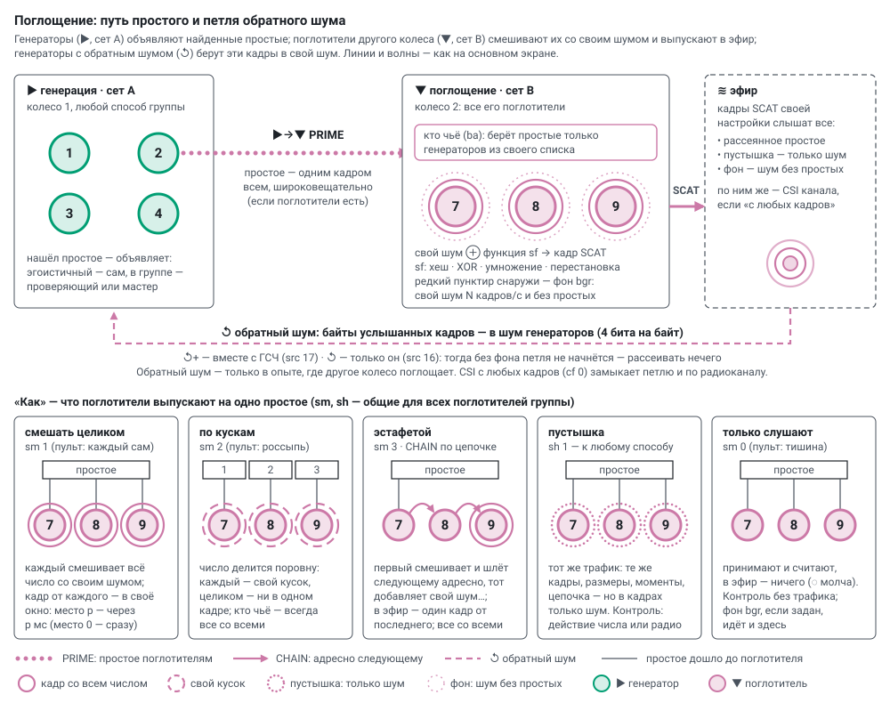

# Поглощение: поглотители (сет B) — как устроено и что мерим

Прошивка `prime_lab` одна на всех, роль меняется без перепрошивки: **▶ генерация** (сет A) или **▼ поглощение**
(сет B); модули `group.cpp` и `prime_lab.ino`. На основном экране роль колеса задаёт параметр опыта «излучение /
поглощение» (К1 ▶ · К2 ▼ — колесо 2 поглощает простые колеса 1, [modes.md](modes.md)), способ — карточка
**«поглощение»**, строки «кто чьё» и «как». Поглотители другого колеса входят в группу генераторов (у колеса с
подгруппами — в первую по букве) и слышат только простые своей группы: чужой номер настройки не принимается.

## 1. Путь простого

1. Генератор, найдя простое, объявляет его одним широковещательным кадром PRIME: эгоистичный — сам, в группе —
   проверяющий (одно число на всех — мастер). Объявляют, только если в группе есть поглотители; очередь занята —
   простое не объявляется (`adrop`).
2. Поглотитель берёт простое, если генератор в его списке «кто чьё» (`ba`), и смешивает его со своим шумом своей
   функцией (`sf`).
3. Выпускает результат в эфир кадрами SCAT — по способу «как».
4. Генераторы с источником ↺ «обратный шум» берут байты этих кадров в свой шум — петля через эфир (§ 4).

## 2. Кто чьё (`ba` — свой у каждого поглотителя)

`ba` — номера генераторов по реестру (генератор подписывает PRIME своим номером); пусто — всех. Список у каждого
поглотителя считает основной экран по варианту строки «кто чьё» (генераторы и поглотители — по номерам):

| вариант | `ba` у j-го поглотителя | зачем |
|---|---|---|
| все со всеми | пусто — все | основной режим |
| пары 1:1 | j-й генератор (по кругу, если поглотителей больше) | своя пара; генераторы без пары — контроль внутри опыта |
| все — одного | первый генератор | все поглощают одного, остальные генераторы — без поглощения |
| каждое — одному | генераторы i, где i mod N = j | каждое простое поглощается ровно один раз |
| половина колеса | первая половина генераторов | одна половина колеса поглощается, другая — нет |

Поглотителю, которому по варианту не достался никто, ставится `ba=63` (такого номера нет): он слушает, но ничего
не берёт. По кускам и эстафетой — всегда все со всеми: число делится между всеми поглотителями. Простое не своего
генератора поглотитель не считает и в «получено» (`prx`) не учитывает.

## 3. Как (`sm`, `sh` — общие для группы)

| на основном экране | `sm` (пульт) | что делает каждый поглотитель | что выходит в эфир | волны на схеме |
|---|---|---|---|---|
| смешать целиком | 1 (каждый сам) | смешивает **всё** число со своим шумом | по кадру от каждого на каждое простое | сплошные |
| по кускам | 2 (россыпь) | берёт **свой кусок** (число делится поровну) и смешивает его | от каждого — свой кусок; число целиком — ни в одном кадре | длинный пунктир |
| эстафетой | 3 | первый смешивает и передаёт следующему адресно (CHAIN), тот добавляет свой шум, … | один кадр от последнего | цепочка, волны у последнего |
| пустышка | 1 + `sh` 1 | тот же трафик (кадры, размеры, моменты, цепочка), но в кадрах только шум | как у способа | точки |
| только слушают | 0 (тишина) | только принимает и считает | ничего | нет, «◌ молча» |

* **Окна.** При «смешать целиком» и «по кускам» все поглотители получают объявление одновременно; кадр
  поглотителя на месте p уходит не раньше чем через p мс (место 0 — сразу), иначе широковещательные кадры без
  повтора сталкиваются. Задержка рассеяния считается до своего окна.
* **Контроль.** Пустышка (галочка `sh` к любому способу; на основном экране — к «смешать целиком») — одинаковый
  трафик без числа, «только слушают» — вовсе без трафика. Сравнение «способ» ↔ «он же, пустышка» ↔ «только
  слушают» отделяет действие самого числа от действия радиотрафика.
* **Фон** (`bgr`, кадров в секунду, пульт) — поглотители сами выпускают свой шум с этой частотой, независимо от
  простых (простые — в первую очередь). Нужен петле: без фона в начале рассеивать нечего. На схеме — внешний
  редкий пунктир вокруг поглотителя, и у «только слушают» тоже.

**Функции смешивания** (`sf` — своя у каждого поглотителя):

| функция | что делает | обратимо ли |
|---|---|---|
| хеш | SHA-256 от (шум, номер блока, число), блоками по 32 байта | нет |
| XOR | число XOR шум | только зная шум, а он тут же забывается |
| умножение | число × случайное нечётное из шума по модулю 2^длина | только зная множитель (он тоже забывается) |
| перестановка | биты числа переставлены в порядке, заданном шумом | только зная порядок |

Шум — из **своих** источников поглотителя (галочки источников — тоже свои). Набирается заранее блоками: на каждое
простое — один блок размером с число (не меньше 32 байт), до 8 блоков в запасе. С медленным источником (CSI,
АЦП, дрожание) поглотитель может не успевать: простые ждут шум («ждали шум»), а больше четырёх ждущих не
держится — следующие пропускаются («пропущено»).

### Своё рассеяние: генератор сам себе поглотитель (`ss`)

Без поглотителей: генератор сам выпускает свои простые. Ядро счёта ищет простые, как обычно; ядро связи
каждое найденное (или каждое `ss`-е: 1, 2, 4, 8 … 16) смешивает со своим шумом своей функцией `sf` и сразу
выпускает широковещательным кадром SCAT. Окна места нет (генераторы находят простые не одновременно), задержка —
до своего кадра (`slat` / `sn`). Число рождается и уходит в эфир с того же чипа — петля в одной точке. Пустышка —
`sh 1`: тот же кадр в тот же момент, но только шум. Работает в любом способе: «каждый сам» (одно и два ядра),
каскад, эстафета, одно число на всех — рассеивает тот, кто нашёл простое.

Шум на рассеяние набирает тот же, кто набирает шум счёта (шум берёт одно ядро — [randomness.md](randomness.md)):
ядро счёта между кандидатами или производитель на ядре связи при двух ядрах. Блок размером с число (не меньше
32 байт), до 8 в запасе, своими источниками; статистика источников счёта от него не меняется. С быстрым ГСЧ это
незаметно, с медленным источником (CSI, АЦП, дрожание) счёт теряет примерно столько же, сколько тратит на шум
рассеяния. Счётчики — как у поглотителя: `stx`, `sdrop`, `swait`, `slat` / `sn`; в итогах опыта — `stx_s`.

Цена: кадр на каждое простое (~40 в секунду на плату, на двенадцать плат ~500 кадров/с — порядка «тушения») и
1–3 °C тепла от передатчика. Прошивка без `ss` настройку не знает — сервер такой отказывает («обновите по Wi‑Fi»),
чтобы опыт не шёл молча без рассеяния. В окне эксперимента — слой **◈ своё рассеяние**: нет / сами рассеивают /
пустышка. Пустышка у группы одна (`sh`): со своим рассеянием поглощение другого колеса — того же вида (настоящее с
настоящим, пустышка с пустышкой), иначе опыт не входит в список.

## 4. Петля через эфир: обратный шум

Два пути, оба переключаются.

**Содержимое кадров — источник ↺ «обратный шум»** (бит `src` 16; на пульте — «Эфир сета B», группа «Петля»).
Генератор берёт байты услышанных кадров SCAT и фона своей настройки, засчитывая 4 бита на байт, и смешивает их
через SHA-256, как любой источник. На основном экране в «шуме»: **↺+** — подмешать к ГСЧ (`src` 17), **↺** —
только он (`src` 16): числа строятся только из того, что выпустили поглотители, A → B → эфир → A. Так петля без
фона не запустится — пока генератор не нашёл простое, рассеивать нечего (экран пишет «нужен фон»). Обратный шум —
только в опыте, где другое колесо поглощает, иначе опыт пропускается. Подробно об источниках —
[randomness.md](randomness.md).

**Радиоканал — «CSI у агентов»** (`cf`, общий, пульт):

* с любых кадров (по умолчанию) — замеры канала и по кадрам поглотителей: петля через физику канала замкнута;
* только с ответов роутера — рассеянное через CSI в шум генераторов не попадает;
* только с кадров сета B — шум канала только от передач поглотителей (нужна связь группы 24 или 6 Мбит/с:
  на 1 Мбит/с замеров канала нет).

Энергию радио так не убрать: кадры поглотителей поднимают шум приёмника генератора (он подмешивается в ГСЧ чипа)
и занимают эфир. Это убирает только частота (свой канал для поглотителей — нужна вторая точка доступа),
расстояние и мощность передатчика поглотителей.

## 5. Что мерим

* **генераторы:** сколько простых объявлено (`ann`), сколько не объявлено — очередь занята (`adrop`), сколько
  кадров поглощения услышано (`heard`); при обратном шуме — сколько бит в секунду из эфира ушло в шум и сколько
  байт не влезло в запас (`bclost`);
* **поглотители:** сколько простых получено (`prx`), сколько своих кадров выпущено (`stx`) и отдельно — кадров
  фона (`sbg`), сколько пропущено (`sdrop`) и сколько ждали шум (`swait`); в эстафете — начато (`chs`, первым, он
  же передаёт второму), передано дальше (`chf`, средними звеньями: при двух поглотителях их нет), выпущено в эфир
  (`chd`, последним); задержка от получения простого до своего кадра (`slat` / `sn`);
* **у всех:** `rxdrop` — принятых кадров ESP-NOW не влезло в очередь событий; `etx` — свои кадры: в очередь,
  выброшено (очередь полна), не принято радио, без подтверждения;
* темп всего этого в секунду; итоги — в итогах сессии («рассеяние»); на основном экране — подписи мостов
  «▶→▼» и «↺» между колёсами и у каждого поглотителя.

## 6. Замеры (четыре платы, `tools/multi_test.py`)

Составы 3 A + 1 B, 2 + 2, 1 + 3, эгоистично и группой, все способы и функции, тишина с фоном, петля, две пары
A + B сразу.

* Объявления доходят до каждого поглотителя на 98–100 %; каждый выпускает ровно столько, сколько получил;
  эстафета через трёх — 761 начато, 761 передано, 761 выпущено; тишина — ноль кадров; фон — ровно 20,0 и
  50,0 кадров/с.
* Окна: у трёх поглотителей задержка до своего кадра — 0,55 / 1,0 / 2,0 мс.
* Петля (генераторы берут шум только из эфира поглотителей, фон 50/с) запускается сама: по 0,6 простых/с на
  генератор.
* Две пары A + B, работающие одновременно, друг друга не слышат: объявления и кадры принимаются только своей
  настройки; кадры поглотителей, каждый в своё окно, слышно на 97–98 %.

## 7. Кадры ESP-NOW (метка `W5`)

| тип | от кого | кому | содержимое |
|---|---|---|---|
| PRIME (7) | генератор | всем | длина в битах, простое; номер простого у автора |
| SCAT (8) | поглотитель | всем | вид (1 — смешать целиком, 2 — по кускам, 3 — эстафета, 4 — пустышка, 5 — фон), функция, номер куска и их число, автор простого, данные |
| CHAIN (9) | поглотитель | следующему поглотителю | шаг эстафеты, автор простого, промежуточное значение |
