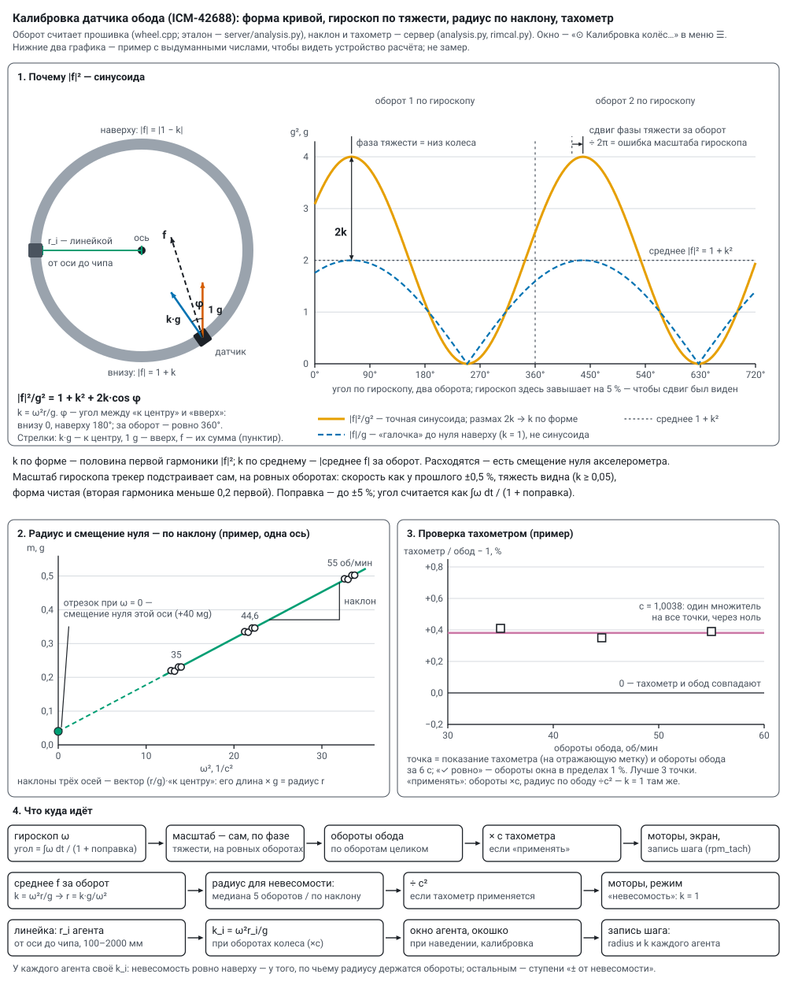

# Датчики, телефон, моторы и катушки

Код для датчиков — общий, в библиотеке `firmware/libraries/agent_sensors`. Алгоритм колеса (обороты,
невесомость, форма кривой) работает в прошивке (`wheel.cpp`) и строка в строку на Python
(`server/analysis.py`), где его проверяют на синтетических данных (`python tools/test_analysis.py`); менять —
в обоих местах. Статические акселерометры ничего не считают сами: шлют оси, считает сервер —
[static_watch.md](static_watch.md). Подключение датчиков, колёс, катушек и моторов — [wiring.md](wiring.md).

Все датчики — на I²C агента: **D4 — SDA, D5 — SCL**, питание 3V3 и GND. Прошивка при старте сама ищет, что
подключено, и сообщает в телеметрии адрес датчика, его код (ICM-42688 отвечает 0x47) и режимы, **прочитанные
обратно из регистров**, а не те, что хотели записать.

## Датчик обода: ICM-42688

Ищется на адресах 0x68 и 0x69. Настройки: ±16 g (на 2 об/с внизу 8,25 g), ±2000 °/с (2 об/с = 720 °/с),
выдача 200 Гц, полоса 40 Гц, режим малого шума. Читает своя задача на ядре связи с низким приоритетом — ядро
счёта и протокол группы не задерживаются.

**Что считается за оборот** (`WheelTracker`):

| величина | как |
|---|---|
| ось колеса | направление сглаженного вектора гироскопа в осях датчика: как плата лежит в трубке, знать не нужно |
| обороты | угол вокруг оси, ∫ω dt / (1 + поправка масштаба гироскопа); полный оборот — 2π |
| k = ω²r/g | модуль среднего ускорения за оборот: тяжесть за оборот усредняется в ноль, остаётся центростремительное. **k = 1 — невесомость в верхней точке** |
| \|f\| вверху и внизу | наименьшее и наибольшее за оборот; при k = 1 — около 0 и около 2 g |
| радиус | r = k·g/ω² по измерению; радиус из настроек («радиус датчика вращения», 450 мм) — для сверки и пока замера нет |
| форма кривой | k по форме, фаза тяжести, поправка гироскопа, вторая гармоника, среднее по осям — «Калибровка» ниже |
| оси колеса | «к центру», «по ходу», «вдоль оси»; вдоль оси должно быть около нуля, остальное — биение и вибрация |

Невесомость при r = 450 мм — 44,6 об/мин; «окрестность» на экране — k в пределах ±5 % (43,5–45,7 об/мин).

**Пакеты** — раз в период телеметрии, из одного снимка:

* `imu` — обороты с прошлого раза (до 6), скорость сейчас, оси колеса, 20 показаний в осях колеса (20 Гц);
* `imr` — те же 20 моментов сырыми отсчётами датчика (ускорение и гироскоп), для записи;
* `imc` — форма кривой тех же оборотов: k по форме, постоянная часть |f|², фаза тяжести, остаток ошибки
  гироскопа, поправка масштаба, вторая гармоника, среднее ускорение по осям датчика, ровный ли оборот.
  Сервер сводит его с оборотами `imu` по времени агента.

## Калибровка датчика обода

Окно «⊙ Калибровка колёс…» — в меню ☰ (кнопка есть и в «⟳ Моторы вручную…», а «📏 задать…» — в окне агента).
По каждому колесу в нём три части и радиусы агентов. Прошивка без пакета `imc` — «◐ прошивка без формы
кривой — обновить по воздуху».

**1. Форма кривой и масштаб гироскопа.** |f| за оборот — не синусоида (при k = 1 — «галочка» до нуля наверху),
но квадрат — точная синусоида по углу тяжести φ в осях датчика: **|f|²/g² = 1 + k² + 2k·cos φ**.
За оборот |f|² раскладывается по углу гироскопа (вес — пройденный угол, поэтому разгон внутри оборота не мешает):

* **k по форме** — половина первой гармоники; постоянная часть должна быть 1 + k² (масштаб акселерометра).
  k по форме и k по среднему не обязаны совпасть: смещение нуля акселерометра входит в них по-разному.
* **Вторая гармоника к первой** — у ровного колеса около 0, растёт от биения, рывков, смещения датчика:
  меньше 0,05 — «✓ форма чистая», до 0,2 — «◐ колесо бьёт», больше — «✗ форма грязная».
* **Фаза тяжести.** Тяжесть делает ровно один оборот за оборот колеса, поэтому её сдвиг от оборота к обороту,
  делённый на 2π, — ошибка масштаба гироскопа. Трекер подстраивает масштаб сам, на **ровных оборотах**:
  скорость как у прошлого ±0,5 %, тяжесть видна (k ≥ 0,05), вторая гармоника меньше 0,2. За ровный оборот
  берётся 0,2 найденной ошибки; поправка — не больше ±5 %. С верной поправкой обороты верны и тяжесть за оборот
  усредняется в ноль (при ошибке 1,5 % в среднем осталось бы около 15 мg — радиус и смещение нуля не найти).
  Окно показывает поправку и что осталось — медиану и разброс по последним 30 ровным оборотам (нужно хотя бы 5).

**2. Радиус и смещение нуля — по наклону.** Среднее ускорение за оборот в осях датчика
m = (ω²r/g)·«к центру» + b. По каждой оси — прямая по ω²: наклоны трёх осей — вектор (r/g)·«к центру», его
длина × g — радиус; отрезки — смещение нуля b, мg; разброс около прямой — тоже мg. Берутся обороты последних
30 мин — ровные, с сошедшейся подстройкой (остаток меньше 0,2 %), не меньше 6, на 2–3 скоростях с разбросом
хотя бы ±15 % (например 35 · 44,6 · 55 об/мин). Окно сравнивает этот радиус с радиусом линейкой.

Переключатель **«радиус для невесомости»**: «медиана оборотов» — медиана r = k·g/ω² последних 5 оборотов (не
старше 15 с; смещение нуля входит в радиус) или «по наклону — без смещения нуля» — радиус по наклону, среднее по
датчикам обода колеса. Этот радиус берут моторы в режиме «невесомость»; замера нет — радиус из настроек.

**3. Тахометр** — независимая проверка: оптический, на отражающую метку. Колесо — на ровных оборотах, тахометр —
на метку, показание — в поле «тахометр» → «записать точку». К нему сервер берёт средние обороты обода за
последние 6 с — по оборотам целиком, без поправки тахометра; «✓ ровно — можно записывать», когда обороты окна
расходятся не больше чем на 1 % и скорость сейчас та же ±0,5 %. Поправка — один множитель через ноль:
c = Σ тахометр·обод / Σ обод² (тахометр = c · обод) и разброс точек около него, %. До 40 точек, 1–300 об/мин;
лучше 3 на разных скоростях. **«Применять: моторы и показ ×c»** — обороты колеса для моторов, экрана и записи
шага умножаются на c, а радиус по ободу делится на c² (он посчитан по ω гироскопа: r = k·g/ω²), и невесомость
остаётся там же, где k = 1. Без точек «применять» не включается; «очистить точки» выключает и поправку.

**Радиусы агентов — линейкой**, от оси до чипа каждого агента колеса, 100–2000 мм («сохранить радиусы» в окне
калибровки). У каждого агента своё k_i = ω²r_i/g при оборотах колеса сейчас (с поправкой тахометра, если она
применяется): в окне калибровки, в окне агента («радиус … мм линейкой · k = …»), в окошке при наведении и в
записи каждого шага (`radius` и `k` — по средним оборотам опыта; с поправкой — ещё `rpm_tach`). k в пределах
±1 % от 1 — «✓ невесомость наверху», иначе «недобор» или «перебор». Невесомость ровно наверху — у того, по
чьему радиусу держатся обороты; остальным — ступени «± от невесомости» в эксперименте ([modes.md](modes.md)).

Где лежит: точки тахометра и переключатели — `data/rim_cal.json`; радиусы агентов (с историей изменений) —
`data/rig.json`. API: `GET /api/rimcal` — всё окно; `POST /api/rimcal` — `{wheel, tach}` (точка),
`{wheel, del: i}`, `{wheel, clear}`, `{wheel, tach_on, fit_on}`; `POST /api/rig` — `{radius: {mac: мм}}`.

**Проверка на синтетике** (`python tools/test_analysis.py`, колесо r = 450 мм):

| случай | что нашлось |
|---|---|
| разгон 30 → 60 об/мин, приборы исправны, датчик повёрнут случайно | k на невесомости 1,004 (правда 1,002), радиус 450,7 мм, \|f\| вверху 0,006 g, ось колеса — точно |
| ровно 44,6 об/мин | k по среднему 1,0006, по форме 1,0004 (правда 1,0010), вторая гармоника 0,0006 |
| гироскоп +1,5 %, смещение нуля (20, −15, 10) мg, ступени 30 · 38 · 44,6 · 52 об/мин, вперёд и назад | поправка гироскопа +1,44 и +1,47 %, остаток 0; обороты на невесомости — ошибка 0,005 %; радиус по наклону 450,6 и 450,1 мм; смещение нуля — в пределах 1,3 мg по каждой оси |
| неровное колесо: то же плюс шум 20 мg, вибрация 23 и 61 Гц по 50 мg, пульсация скорости ±0,3 %, блуждание ±0,1 % | поправка +1,51 %, обороты — ошибка 0,22 %, радиус 450,5 мм, смещение нуля — в пределах 1,4 мg, разброс около прямой 3,1 мg |

## Магнитное поле: MLX90393

Ищется на адресах 0x0C–0x13 и 0x18–0x1B. 20 измерений в секунду. Ток катушки заранее неизвестен, поэтому
**усиление подбирается само**: показание подошло к краю диапазона — усиление ниже, слишком мало — выше. Поле
всегда в микротеслах по таблице чувствительности текущего усиления (от 0,15 мкТл на отсчёт при пределе около
±5 мТл до 0,75 мкТл при пределе около ±50 мТл).

Внутри обмотки тороида поле катушки направлено вдоль трубки: у агента №20 в трубке колеса 1 — 1,20–1,26 мТл при
токе около 0,9 А ([coil_test.md](coil_test.md)). Поле Земли (около 50 мкТл) вращается в осях агента раз за оборот.
В разрывах обмотки поле слабее и разворачивается; насколько оно неоднородно внутри трубки и сколько выходит
наружу — расчёт [поле тороида](toroid_field.html).

**Пакет** `mag`: среднее за период по осям, модуль (среднее, наименьшее, наибольшее), усиление, 20 отдельных
замеров.

## Статический акселерометр (роль S той же прошивки)

Агент в роли S только меряет и шлёт оси x, y, z 500 раз в секунду; спектр, эталон шума, тревоги и вывод
«продолжать / повторить / проверить» считает сервер — [static_watch.md](static_watch.md).

* **ICM-42688** неподвижно: 1000 Гц через FIFO, среднее по 2.
* **ADXL355** (адрес 0x1D — ASEL на GND, или 0x53) — точный акселерометр, шум по паспорту 25 мкg/√Гц (у
  ICM-42688 — 65–70). Есть на шине — роль S меряет им: ищется раньше ICM-42688, узнаётся по регистрам
  0x00–0x02 = 0xAD, 0x1D, 0xED; шина 400 кГц. Предел ±2 g; выдача датчика — сразу 1000/avg Гц со своим
  фильтром (четверть частоты; avg 2 → 500 Гц); FIFO датчика на 32 тройки с меткой оси x, забирается раз в
  10 мс; оси — 20 разрядов, в пакете сдвинуты в int16 (16000 на g, ступень 62,5 мкg — ниже шума). Регистры
  читаются обратно: FILTER 03, RANGE 01, POWER_CTL 00. Сервер узнаёт датчик по отсчётам на g (16000 / 8000 /
  4000).
* Замер на одном столе: собственный шум ADXL355 15–20 мкg/√Гц против 61–80 у ICM-42688, точность среднего за
  1 с — 0,014–0,017 мg против 0,06–0,10; одиночный отсчёт у обоих одинаков — его задаёт вибрация стола.

## Телефон (приложение `phone/`, версия 1.1)

Android-телефон №9 — ещё один статический детектор. Приложение «Колесо-2 датчики» (Kotlin, без сторонних
библиотек) берёт только нужное установке:

* **акселерометр без калибровки** (система не подкручивает смещение нуля; на Galaxy A26 — ~500 Гц, ±8 g,
  ступень 0,0024 м/с² = 1/4096 g) — пакеты `acc` как у статического агента (int16, 4096 на g): на сервере
  работают «вживую», эталон шума, тревоги;
* **магнитометр без калибровки**, мкТл — пакеты `mag` со своей частотой (`hz`), множителем (`div` = 100) и
  ступенью (`step`): «🧲 поле вживую» на основном экране;
* **фон** в `tel` (`ph`): сеть 50 Гц в поле (амплитуда по Гёрцелю за 2 с — видна, если магнитометр быстрее
  105 Гц), колебания поля за 2 с, сигнал Wi-Fi и сотовой связи, батарея (заряд, температура, на зарядке ли).

Сырого радиоспектра Android приложениям не даёт — только силу сигнала, которую слышат радиомодули. На телефоне
один экран: связь, акселерометр и магнитометр (значения, разброс за 1 с, размах за 10 с полосами x / y / z), фон.

**С погашенным экраном.** Меряет и отправляет служба переднего плана (тип health — датчики быстрее 200 Гц) со
значком в шторке: процессор не засыпает (PARTIAL_WAKE_LOCK), Wi-Fi не уходит в экономный режим (WifiLock).
Убитая системой служба поднимается снова, после перезагрузки телефона — сама (если не нажато «■ стоп»). Внизу
экрана: «■ стоп / ▶ мерить», «☾ экран гаснет сам / ☀ не гаснет / ◐ притушен» (горящий экран — лишние наводки)
и, пока не разрешено, «🔋 без ограничений»: без этого неподвижный телефон без зарядки Android в глубоком сне
может отключить от сети. На Samsung ещё: Настройки → Приложения → «Колесо-2 датчики» → Батарея → «Без
ограничений». Экран погашен 40 с (проверка по USB): акселерометр 500 Гц, пакеты каждую секунду, потерь нет.

**Связь.** Пакеты строками — в `POST /api/ingest` на порт 8090 сервера, пачками 4 раза в секунду; разбор тот же,
что у UDP. Сначала телефон пробует кабель USB (сервер раз в 15 с делает `adb reverse tcp:8090`, если есть adb),
иначе — Wi-Fi на адрес из маяка сервера; сменился адрес — берёт новый из маяка. Замеры поля несут номер первого
и время по часам датчика (`i0`, `mt0`, `mt1`, `ms`): накопленное за обрыв связи сервер ставит на свои места,
повторы отбрасывает; переполнение кольца поля — `mlost` в `tel`. Для сервера телефон — агент роли S с адресом
вида `02:…` (из ANDROID_ID), `dev: "phone"`; настройки агента ему не шлются. Версия — в `fw` (`phone-1.1`); при
сборке поднимать `versionName` и `BuildInfo.VERSION` вместе. Сборка и установка:

    cd phone; .\gradlew.bat assembleDebug
    C:\Android\Sdk\platform-tools\adb.exe install -r app\build\outputs\apk\debug\app-debug.apk

## На основном экране

* **Колонка колеса** — по датчику обода: обороты сейчас, сколько нужно для невесомости, «✓ невесомость
  наверху» / «◐ недобор, k …» / «◐ перебор, k …»; на рисунке — обороты с направлением внутри колеса.
* **Окно агента** с датчиком: «∿ вживую» (акселерометр: колебания, Гаусс, спектр), «🧲 поле вживую»
  (MLX90393 или телефон: |B| и оси, спектр, ступеньки поля), «шум и точность датчика», радиус линейкой и k.
* **Статика** — карточка под рисунком: вердикт, живые Гаусс, спектр и колебания выбранного датчика; подробно —
  окно «◆ статика подробно» ([static_watch.md](static_watch.md)).

## Проверка без плат

`python tools/sim_agents.py [секунд] --port 5015` — имитация в тех же форматах, что у прошивки: агент с
ICM-42688 на колесе r = 450 мм (обороты ступенями 35 → 40 → 44,6 → 50 → 55 → 50 → 44,6 → 40 по 30 с, гироскоп
врёт на +1,2 %, у акселерометра смещение нуля (12, −8, 15) мg — есть что калибровать), агент с MLX90393, три
статических акселерометра с толчками, линией и сбоем по расписанию; `--gens N` — ещё генераторы, `--mot` —
агент моторов и агенты катушек. Запускать с отдельным сервером — данные и команды не смешаются с настоящими:

    python server/monitor.py --http 8091 --udp 5015 --data data/test/sim --no-beacon

## Моторы колёс (роль M)

Два щёточных мотора 36GP-555 (12 В, планетарный редуктор 112 об/мин, без энкодера) крутят колёса; агент моторов
№10 — плата XIAO в роли M на неподвижной раме, два моста DRV8871: колесо 1 — D0, D1, колесо 2 — D2, D3 (схема —
[wiring.md](wiring.md)). ШИМ 20 кГц, медленный спад; разгон и торможение плавные; направление меняется только
через остановку и паузу 1 с; сторож — нет команды MOT 5 с, моторы плавно встают. Сервер (`server/motors.py`) раз
в секунду шлёт `MOT a=‰ b=‰ r=разгон w=сторож`.

Окно «⟳ Моторы вручную…»: колёса по отдельности / вместе / навстречу / только 1 / только 2; режим колеса —
стоит / ШИМ / обороты / **невесомость** (обороты, при которых k = ω²r/g = 1; радиус — по датчику обода, см.
«Калибровка», замера нет — из настроек); смена направления по таймеру. В режимах «обороты» и «невесомость»
ШИМ = прямая подача + ПИ по оборотам обода (с поправкой тахометра, если она применяется). «■ Всё стоп»
останавливает и моторы. Назначить плату: окно агента → «→ в моторы». В эксперименте вращение задаётся на каждом
опыте ([modes.md](modes.md), [program.md](program.md)); в конце программы моторы останавливаются.

* Обратная связь по оборотам включается, только когда обод показывает не меньше 60 % цели: на разгоне и при
  торможении перед сменой направления интегратор не копит ошибку (перерегулирование на синтетике 1–6 %);
  упёршись в предел ШИМ — тоже не копит.
* «✓ невесомость наверху» у моторов — по измеренному k (за оборот; с радиусом «по наклону» — по нему), а не по
  радиусу из настроек.
* Таймер смены направления («через N мин») отсчитывается от начала движения: заданный стоящему колесу, первую
  смену даст через N минут хода.
* Агенты моторов и катушек в «молчании» телеметрии не участвуют: сервер шлёт команды только тем, кого слышит, и
  разрыв связи дольше 10 с вывел бы их из управления.
* «Вперёд ▶» — **по часовой стрелке, если смотреть на вал спереди**; зеркальный мотор — поменять у него OUT1 /
  OUT2 ([wiring.md](wiring.md)).

## Катушки колёс (роль M, место «катушка»)

Агент катушки — та же прошивка в роли M, назначенная на место «катушка» своего колеса (окно агента →
«катушка колеса 1 / 2»); колесо 1 — №13. Мост DRV8871 от 5,1 В, D0 → IN1, D1 → IN2, катушка на OUT1 / OUT2 —
[wiring.md](wiring.md). Сервер (`server/coils.py`) раз в секунду шлёт `MOT a=±уровень b=0 r=5000 w=5`: знак —
направление поля, уровень 1000 — постоянный ток; смена знака — через остановку и паузу 1 с; нет команды 5 с —
агент снимает ток. Агентов катушки на колесе может быть несколько — команда уходит каждому.

Поле задаёт опыт эксперимента (параметр «поле катушек», [modes.md](modes.md)), вручную — кнопки «выкл / + / −»
под колесом на схеме; на отдыхе, в конце программы, по «■ Всё стоп» и после перезапуска сервера — выкл. Агент
катушки не входит в группы колеса, шаги и подгруппы: сервер и экран узнают его по месту, даже когда он молчит.

**Поле по датчику.** Магнитометр колеса раз в секунду присылает среднее поле. Секунды, когда катушка заведомо
выключена и показания ровные, дают фон (Земля, железо рядом), секунды с «+» — направление поля катушки на месте
датчика. Показания минус фон, спроецированные на «+», — поле со знаком: видно, есть ли поле, куда оно и совпадает
ли с командой; в записи шага — `coil_sense`. Датчик сдвинули — фон и направление переучиваются за несколько секунд.
