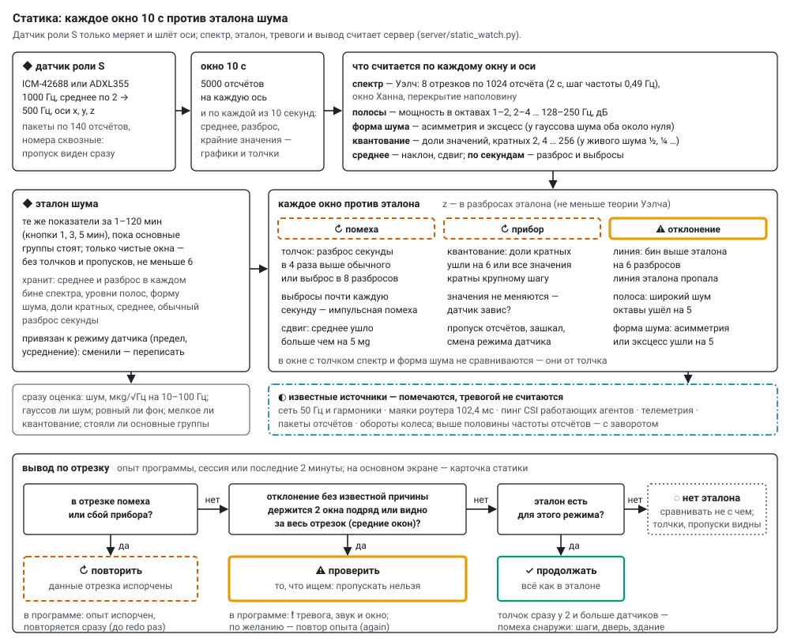

# Статика: эталон шума и слежение

Статический датчик — агент с ролью **S** в общей прошивке: только меряет и шлёт оси, ничего не
генерирует, в группах не участвует, по ESP-NOW не говорит, CSI не пингует. Спектр, эталон, тревоги и
вывод «продолжать / повторить / проверить» считает сервер (`server/static_watch.py`, нужен numpy — без
него сервер работает, но статику не считает). Статических датчиков может быть сколько угодно; телефон
шлёт такие же пакеты и для сервера тоже статический датчик. Датчики — [sensors.md](sensors.md),
подключение — [wiring.md](wiring.md).

## Что приходит с датчика

* **500 отсчётов в секунду** по трём осям: ICM-42688 — 1000 Гц, режим малого шума, только ускорение,
  среднее по `avg` отсчётам (1, 2, 4, 8; по умолчанию 2), фильтр датчика ниже половины выходной
  частоты, чтобы спектр не заворачивался; ADXL355 — сразу 1000/avg Гц со своим фильтром. Предел ±2 g
  (можно 4, 8, 16): у ICM-42688 единица 61 мкg при шуме около 1,1 мg — квантование далеко ниже шума.
* **Без потерь:** FIFO датчика держит 256 отсчётов, агент забирает их каждые 10 мс; переполнение
  считается и видно. Пакеты `acc` по 140 отсчётов (x y z, int16, base64) с номером первого отсчёта и
  меткой времени; номера сквозные — пропуск сервер видит сразу.
* **Молчание** (`tl` = 2): отсчёты копятся в кольце (около 25 с при 500 Гц) и потом уходят; дольше —
  старое затирается, сервер видит пропуск. В опытах с молчанием статика не молчит — молчат генераторы.
* Регистры датчика (режим, FIFO, фильтр) читаются обратно и идут в телеметрию.
* **Роль S** — в окне агента на основном экране («→ в измерители (статика)»); агент запоминает её (NVS),
  перезапускается и сразу меряет, даже без сервера. Обратно — «→ в генераторы». Агент стартовал
  статическим, а на сервере роль не задана — сервер принимает роль S.

Отсчёты хранятся как есть: `data/accel/<дата>/<mac>.bin` (int16 x y z подряд) и `<mac>.idx.jsonl`
(строка на пакет: номер первого отсчёта, сколько, частота, метка времени); в общий журнал не пишутся.

## Оси: по тяжести — положение датчика неважно

Сервер считает не по осям датчика, а по тяжести: **вертикаль** — вдоль среднего ускорения, **горизонталь** —
две оси поперёк неё вместе (мощность — средняя по двум, форма шума — по обеим). Поэтому датчик можно класть
как угодно: эталон годится при любом положении, вибрация пола остаётся на вертикали, где бы ни была ось z.
Положение задаётся по первому окну. Тяжесть повернулась больше чем на **2°** (`PLACE_DEG`) — датчик положили
иначе: одно окно «⤾ новое положение» (помеха, опыт повторится), дальше — новые оси и тот же эталон. Как
лежит датчик (какая его ось смотрит вверх и наклон) — на карточке в «◆ статика подробно». Квантование,
зашкал и зависание — по осям самого датчика x, y, z: это свойства прибора. «Вживую» — в, г1, г2 и |a|.

## Окно: что считается

Окно — **10 с** (`WIN_S`). По каждому окну, по вертикали и горизонтали:

| показатель | как |
|---|---|
| спектр | Уэлч: отрезки 1024 отсчёта (2 с, шаг частоты 0,49 Гц), окно Ханна, перекрытие наполовину — 8 отрезков на окно |
| полосы | мощность в октавах 1–2, 2–4 … 128–250 Гц (до половины частоты отсчётов), дБ |
| форма шума | асимметрия и эксцесс после вычитания среднего каждой секунды; у гауссова шума оба около нуля |
| квантование | по осям датчика: доли значений, кратных 2, 4 … 256: у живого шума ½, ¼ …; «гребёнка» — все значения кратны одному шагу |
| среднее | по вертикали и двум горизонтальным осям (горизонталь — это наклон); зашкал; пропуски |
| по каждой секунде | среднее, разброс, крайние значения — графики и толчки |

## Эталон

**Эталон** — те же показатели за 1–120 минут, **пока основные группы стоят**. Запись — «◆ эталон
1 / 3 / 5 мин» на карточке статики основного экрана, в окне «◆ статика подробно» или в
начале программы (`baseline_min`). Берутся только чистые окна, без толчков и пропусков, не меньше 6
(минута). Запись идёт на одно окно (10 с) дольше заказанной: окна идут по сетке, первое после старта
неполное — так и «1 мин» набирает 6 целых окон. Хранится: среднее и разброс по окнам **в каждом бине** спектра (и разброс, сглаженный по
соседним бинам), линии эталона (бины на 6 дБ выше соседей), уровни и разброс полос, форма шума, доли
кратных, среднее, обычный разброс секунды.

Сервер сразу оценивает эталон: шум в мкg/√Гц на 10–100 Гц (по паспорту ICM-42688 — 70, ADXL355 — 25);
гауссов ли шум (|эксцесс| < 0,2, |асимметрия| < 0,1); ровный ли фон (полосы от 4 Гц у двух половин
записи расходятся не больше чем на 1 дБ или 4 своих разброса — что больше); мелкое ли квантование;
стояли ли основные группы — если кто-то считал, эталон «не чистый».

Эталон привязан к режиму датчика (предел, усреднение): сменили режим — эталон надо переписать,
карточка об этом скажет. От положения датчика эталон не зависит. Эталоны, записанные по осям датчика
(до осей по тяжести), не подходят — карточка просит переписать один раз. Хранится в `data/static/baselines/<mac>.json` (и копия с датой).

## Слежение: каждое окно против эталона

| вид | когда | класс |
|---|---|---|
| ⚠ **линия** | бин спектра выше эталона больше чем на **6** разбросов (`Z_LINE`); ниже 1 Гц не ищем | отклонение |
| ◐ линия пропала | линия эталона ниже себя на 6 разбросов | отклонение |
| ⚠ **полоса** | широкий шум октавы ушёл на **5** разбросов (`Z_BAND`); частоты известных и найденных линий (±2 бина) не считаются — одна линия не тревожит дважды | отклонение |
| ⚠ **форма шума** | эксцесс или асимметрия ушли на **5** (`Z_GAUSS`) | отклонение |
| ⚠ квантование | доли кратных ушли на 6 (`Z_QUANT`), все значения кратны крупному шагу или не меняются | прибор |
| ⚠ пропуск, зашкал, смена режима датчика | — | прибор |
| ↻ **толчок** | разброс секунды в **4** раза выше обычного (`KNOCK_X`) или выброс в 8 обычных разбросов (`KNOCK_PEAK`) | помеха |
| ↻ выбросы | толчки почти каждую секунду — импульсная помеха (наводка, искра, мотор) | помеха |
| ↻ **сдвиг** | среднее ушло от медианы трёх прошлых окон больше чем на **5 мg** (`MOVED_UG`; тепло даёт меньше); дальше — от нового среднего | помеха |
| ↻ новое положение | тяжесть повернулась больше чем на 2° — датчик положили иначе; одно окно | помеха |

Разброс каждой частоты берётся из эталона, сглаживается по соседним частотам и не бывает меньше 0,9
теоретического для Уэлча (4,34/√8 дБ): по немногим окнам у отдельной частоты он бывает мал случайно. В
окне с толчком спектр и форма шума не сравниваются — они от толчка.

**Известные источники.** Линия рядом с известной частотой помечается и тревогой не считается: сеть
50 Гц и гармоники, маяки роутера (102,4 мс), пинг CSI работающих агентов, телеметрия, пакеты отсчётов,
обороты колеса. Частоты выше половины частоты отсчётов учитываются с заворотом.

**За весь отрезок.** Кроме окон, весь отрезок (опыт, сессия) сравнивается с эталоном по средним окон:
слабая линия, невидимая в одном окне, за n окон видна в √n раз лучше. На синтетике линия 120 мкg
(+1,3 дБ над шумом) в отдельных окнах почти не видна, за 3 минуты — z 8,6.

## Вывод: продолжать, повторить, проверить

По отрезку — опыту программы, сессии или последним 2 минутам:

* **↻ повторить** — в отрезке помеха или сбой прибора: данные испорчены. В программе опыт помечается
  испорченным, не идёт в сравнение и сразу повторяется (до `redo` раз).
* **⚠ проверить** — отклонение без известной причины держится **2 окна подряд** (`PERSIST`) или видно
  за весь отрезок. В программе — ❗ тревога и по желанию повтор опыта ([program.md](program.md)).
* **✓ продолжать** — всё как в эталоне.
* **◌ нет эталона** — сравнивать не с чем; толчки, пропуски и квантование видны и без эталона.

Толчок сразу у двух и больше датчиков (в пределах 1,5 с) — помеха снаружи: шаги, дверь, здание; это
пишется в примечание вывода. Самое большое отклонение без известной причины за отрезок — `zmax`.

**Состояние датчика вживую:** ✓ как эталон · ◐ разовое отклонение — смотрим следующее окно · ◐ как
эталон, кроме известных источников · ⚠ отклонение (держится) · ↻ помеха · ↻ прибор · ◌ нет эталона или
эталон для другого режима · ✗ датчик молчит. Отклонения пишутся в `data/static/events.jsonl`.

## Где смотреть

* **Карточка статики** на основном экране: вердикт крупно и за какой отрезок, каждый датчик с причинами;
  живые Гаусс, спектр и колебания выбранного датчика и оси за 10 с (раз в 3 с, `/api/static/live`) —
  гистограмма отклонений против гаусса того же разброса, форма словами (гаусс / хвосты — толчки,
  выбросы / ступенчатый), СКО, асимметрия, эксцесс; запись эталона. Нажатие на графики — окно
  «∿ вживую»: все оси и модуль, окна 10 с, 1, 5, 15 мин, «⟲ сброс», колебания по секундам.
* **«◆ статика подробно»** (`/acc`): эталон и его качество; по каждому датчику спектр последней минуты
  на фоне коридора эталона (±3 разброса), найденные линии, разброс, среднее, форма, квантование,
  полоса дальше всех от эталона, регистры датчика; графики по времени; журнал отклонений.
* **Наблюдение** (`/watch`) — статика крупно, читается издалека.

## Проверка без плат

* `python tools/test_static_watch.py` — синтетика: эталон, чистый шум (ни одной тревоги), линия 37 Гц,
  слабая линия 23 Гц, сеть 50 Гц (известная), толчок, значения кратны 256, выбросы, пропуск, датчик без
  эталона.
* `python tools/sim_agents.py 900 --port 5015` с отдельным сервером
  `python server/monitor.py --http 8091 --udp 5015 --data data/test/sim --no-beacon` — три статических
  по расписанию: первые 3 минуты чистые (записать эталон), с 180-й секунды каждые 75 с толчок у всех,
  300–420 с линия 37 Гц у первого, 480–540 с у третьего значения кратны 256; у второго всегда сеть 50 Гц.
