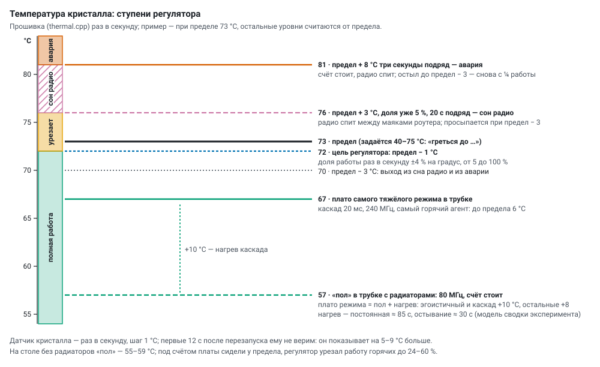
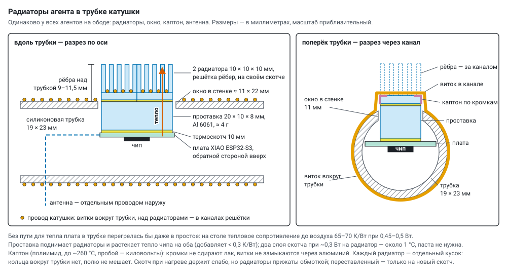

# Температура агентов: регулятор, отдых, радиаторы

Цель — **наибольшая суммарная когерентная работа** группы: больше простых из шума всех без перегрева
(предел кристалла 73 °C, задаётся до 75) и без сбоев, которые ломают группу. Агенты стоят в трубке под
обмоткой катушки, у каждого — радиаторы (§ 4.2).

## 1. Как работает

* **Датчик кристалла** — раз в секунду, шаг 1 °C. Первые 12 с после перезапуска ему не верим: он
  показывает на 5–9 °C больше.
* **Регулятор доли работы** (`thermal.cpp`): раз в секунду доля работы меняется на 4 % на каждый
  градус отклонения от цели (предел − 1 °C), от 5 до 100 %. Остальное время вычисления спят кусками
  от 2 мс. Тормозятся оба вычисления: проверка на ядре счёта и шум с отсевом на ядре связи (в режиме
  «два ядра»), у каждого ядра свой долг сна.
* **Сон радио** — только когда доля уже 5 %, а кристалл 20 с подряд на 3 °C выше предела: радио спит
  между маяками роутера, просыпается при пределе − 3 °C.
* **Авария** — выше предела на 8 °C три секунды подряд: счёт стоит, радио спит, пока кристалл не
  остынет до предела − 3 °C; потом работа снова с ¼.
* **Частота процессора** — только вручную (80 / 160 / 240 МГц, обычно 240), регулятор её не трогает;
  «Стоп» ставит 80 МГц. **Мощность передатчика** — вручную (`txp`, 2–20 дБм, обычно 20). Пинг роутера
  идёт только при шуме CSI с пинга.

## 2. Замеры

**В трубке с радиаторами** (колесо 1, 240 МГц, самый горячий агент): «пол» на 80 МГц без счёта ≈ 57 °C;
под счётом — плато «пол + нагрев режима»: самый тяжёлый режим (каскад 20 мс, два ядра) — 67 °C, до
предела 6 °C, регулятор не вмешивается. Нагрев к плато — с постоянной ≈ 85 с, остывание — ≈ 30 с. По этим
числам сводка эксперимента оценивает тепло опытов (эгоистичный и каскад +10 °C, остальные +8;
`THERM` в `server/static/plan.html`, [program.md](program.md)).

**На столе без радиаторов** (четыре платы, 15 мин и дольше в одном состоянии, медиана, °C):

| стоят | №3 | №4 | №5 | №6 |
|---|---|---|---|---|
| 80 МГц, светодиод выкл («Стоп») | 56,3 | 54,8 | 58,5 | 57,7 |
| 240 МГц | 59,3 | 59,8 | 61,5 | 56,7 ¹ |
| холодный старт, первые секунды | 44,3 | 41,8 | 44,5 | 44,7 |

¹ другое время суток — в комнате было прохладнее.

Под счётом (240 МГц, предел 70 °C) платы сидели у предела: каждый сам, два ядра — 141–170 простых/с на
четверых при доле работы 48–100 %; каскад — 63 при 24–89 %; эстафета (33–37) и одно число на всех (8) — при
100 %; даже медленный шум (АЦП, CSI, дрожание: 1–3 простых/с) — 62–69 °C. Нагрев из простоя: +4…5 °C за
10 с, +7…9 °C за минуту, у предела — через 3–5 минут. Остывание в «Стоп»: −2…3 °C за 30 с, −4 за минуту,
«пол» — через ~5 минут. Две постоянные времени: кристалл (секунды) и плата (минуты).

**Главное:** между «полом» простоя и пределом всего 10–14 °C, и бо́льшую часть тепла даёт не счёт, а то,
что работает всегда.

## 3. Откуда тепло

1. **Радио всегда на приёме** — без сна, иначе ESP-NOW теряет кадры, а CSI и шум радио пропадают. Это
   основной «пол».
2. **Частота 240 МГц** — +3…5 °C даже в простое (тактовая сеть, холостые циклы).
3. **Шум ГСЧ крутит ядро вхолостую.** `esp_random()` ждёт ~22 мкс на слово активно, циклом
   ([randomness.md](randomness.md)); в режиме «два ядра» это ~70 % времени ядра шума — тепло без счёта.
4. **Передатчик на 20 дБм.** В каскаде — сотни кадров в секунду, каждый — полная мощность усилителя.
   Платы рядом (сигнал −45 дБм): четверо «все на одном числе» на 2 дБм дали 7,5 простых/с против 7,7
   на 20 дБм.
5. **Сам счёт**: Миллер — Рабин (ускоритель) и отсев.
6. **Стабилизатор 5 → 3,3 В** на плате рядом с кристаллом.
7. **Датчики разные**: №4 показывает примерно на 3 °C меньше остальных (холодный старт 41,8 против
   44,3–44,7); один предел на всех режет сильнее тех, у кого датчик «горячее».

## 4. Что с ним делать

### 4.1 Частота процессора — польза меньше, чем кажется

Флеш работает на 80 МГц, и тогда ядро питается **одинаковым** напряжением 1,25 В на 80, 160 и 240 МГц
(`soc/rtc.h` в ESP-IDF: `DIG_DBIAS_80M_160M` = `DIG_DBIAS_240M` при `CONFIG_ESPTOOLPY_FLASHFREQ_80M`).
Работа за градус на 160 МГц почти та же, что на 240 с паузами регулятора. Выигрыш — только на холостых
тактах (+3…5 °C простоя) и на активном ожидании шума (§ 3, п. 3). Больше дал бы шум ГСЧ без активного
ожидания: читать регистр, когда слово готово, а в промежутке отсеивать кандидатов.

### 4.2 Радиаторы и «пол»

Агенты стоят внутри силиконовой трубки (19 × 23 мм) под обмоткой катушки (тороид по ободу Ø900 мм). Без
пути для тепла плата в трубке перегрелась бы даже в простое (на столе тепловое сопротивление до воздуха
65–70 К/Вт при 0,45–0,5 Вт), поэтому у каждого агента одинаково:

* на обратной стороне платы — алюминиевая **проставка** 20 × 10 × 8 мм (срез с полосы 6061 сечением
  8 × 20 мм, ≈ 4 г) на термоскотче 10 мм, на ней в ряд **два радиатора** 10 × 10 × 10 мм с решёткой
  рёбер на их заводском скотче; проставка растекает тепло чипа на оба (< 0,3 К/Вт), два слоя скотча —
  около 1 °C, термопаста не нужна. Рёбра выходят сквозь **окно** ≈ 11 × 22 мм на 9–11,5 мм над трубкой;
* **провод катушки** ложится в каналы решётки (намотка не рвётся, медь сама уносит тепло); по кромкам
  рёбер под проводом — **каптон**: кромки не сдирают лак, витки не замыкаются через алюминий. Каждый
  радиатор — отдельный кусочек, кольца вокруг трубки нет, полю он не мешает. Скотч при нагреве держит
  слабо, но радиаторы прижаты обмоткой; переставленный — только на новый скотч. **Антенна** — отдельным
  проводом наружу.

Ещё ниже «пол» опустили бы: **передатчик по запасу сигнала** (начать с 11 дБм вместо 20, проверить потери
по парам `fail_to`, дальше — по худшей паре) и **калибровка датчиков** (сдвиг каждой платы по холодному
старту, предел — по исправленной температуре). Ни то, ни другое пока не сделано.

### 4.3 Отдых по очереди

Плата, которую регулятор урезал, в эстафете и каскаде тормозит всю группу: её кусочки и ходы ждут, круги
собираются без неё. Объявленный отдых группу не тормозит — отдыхающего сразу не ждут. Диспетчер на
сервере (`rest_tick()` в `server/monitor.py`, настройки `REST_ROT` и `REST_GROUP`) раз в 2 с смотрит
температуры всех; кнопка на прежней панели переключает **выкл → по очереди → вся группа** (по
умолчанию выкл).

* **По очереди:** кандидат — у предела (≥ предел − 2 °C) и урезан (работа < 85 %); отдыхает самый
  горячий, одновременно — не больше четверти группы (из четырёх — один), группа — от трёх. Отдых — пока
  не остынет на 5 °C, от 60 до 150 с; между отдыхами одного агента — не меньше 3 мин.
* **Вся группа:** все работают на полной мощности, пока регулятор не начнёт резать самого горячего
  (≥ предел − 2 °C, работа < 95 %); тогда отдыхают все, пока он не остынет на 6 °C (40–90 с), и вместе
  возвращаются — пока работают, круги собираются из кусочков всех.
* Команда отдыха **не меняет настройку** (номер `cid` тот же): агент перестаёт считать и передавать,
  ставит 80 МГц и говорит группе «отдыхаю» (`REST s=…` / `BACK`, кадр `M_REST` —
  [group_protocol.md](group_protocol.md)); вернулся — «снова в деле». Сам вернётся через `s` секунд
  (180), даже если сервер пропадёт. Каждый отдых — строка в истории агента («отдых по очереди: 68,5 →
  63,5 °C за 75 с»); молчание отдыхающего ошибкой не считается. Одно число на всех — без отдыха (базы
  поделены между всеми: отдыхающего пришлось бы подменять).

**Что показал опыт** (каскад 10 минут из отдыха, четыре платы без радиаторов, предел 70 °C,
`tools/rest_ab.py`):

| отдых | простых/с | вторая половина | кругов из кусочков всех | когерентных простых/с |
|---|---|---|---|---|
| нет | 85,7 | 82,3 | 42,5 % | ~36 |
| по очереди (7 отдыхов по 60 с) | 89,6 | 82,5 | 26,2 % | ~23 |
| вся группа (отдых 40 с) | ~47 за первые 6 мин | — | — | — |

Без отдыха регулятор держал платы от 24–28 % работы (самая горячая) до 100 % (самая холодная): группа в
среднем работала на ~62 % мощности (82–86 простых/с вместо 124 в спринте). По очереди механика работает (отдыхает
ровно один, за минуту остывает на 6–11 °C, группа не встаёт), но в установившемся режиме выигрыша нет:
через 40–60 с работы кристалл снова у предела, а кусочки отдыхающего остальные заменяют своим шумом.
Вся группа — после 40 с отдыха самая горячая снова у предела через 20–30 с. **Отдых тепло не отменяет, а
перераспределяет:** предел — средняя мощность, которую плата отводит. Сумму поднимают меньшее тепло на
простое и лучший отвод — радиаторы, шум ГСЧ без активного ожидания, передатчик потише.

### 4.4 Спринт: полная производительность

Всем отдых до «пола» → режим на полной мощности 60–90 с (из холодного состояния регулятор не успевает
урезать) → итог → снова отдых. Так видна полная производительность каждого режима, длинные прогоны
показывают устойчивую. `tools/sprint.py 75` (четыре платы без радиаторов, 256 бит, 240 МГц, предел
70 °C, замер с 15-й по 75-ю секунду):

| режим | простых/с | на агента | работа (наименьшая) |
|---|---|---|---|
| каждый сам | 103,6 | 25,9 | 100 % |
| каждый сам, два ядра | 183,6 | 45,9 | 62 % — к концу один у предела |
| все на одном числе | 10,8 | 2,7 | 100 % |
| эстафета, два ядра | 36,8 | 9,2 | 100 % |
| каскад, два ядра, срок 20 мс | **123,9** | 31,0 | 32 % — самый горячий у предела за минуту |

### 4.5 Отдых между опытами

Перед опытом программы генераторы стоят на 80 МГц, катушки выключены, пока температура не установится
(за 90 с упала не больше чем на 0,5 °C, от 60 с до 6 мин), пока не остынут до заданной или заданное
время. Каждый режим начинается из одинакового состояния, начальная температура пишется в итог опыта
как ковариата. Когда отдыхать — [program.md](program.md).

## 5. Рейтинг агентов: история ошибок

Сервер ведёт историю событий каждого агента (`data/agents/events.jsonl`, `server/agent_rating.py`) и
считает рейтинг: 100 минус веса событий за сутки, вес тает вдвое за 6 ч; одно и то же три раза за сутки —
отметка «систематически». На плитке агента — рейтинг и последние события, у номера — значок. Надёжных — в
группы и спринты; ненадёжного — проверить или снять.

| событие | откуда видно | вес |
|---|---|---|
| простое не прошло проверку сервера | журнал простых | 50 |
| самопроверка прошивки не прошла | `st` | 40 |
| сосед нашёл свидетеля: «простое» составное | `split` у соседа | 30 |
| перезапуск из-за сбоя: прошивка, сторож, просадка или сбой питания, зависание ядра | `rbt` | 25 |
| сторож радио перезапустил: радио не передавало | `rbt` | 20 |
| сторож перезапустил: не было Wi-Fi 90 с; «зомби» и после трёх переподключений | `rbt` | 15 |
| прошивка по Wi-Fi не загрузилась | OTA | 10 |
| «зомби» Wi-Fi — сторож переподключал | `wrst` | 8 |
| кадры от него теряются | `fail_to` по парам | 5 |
| самоочистка: мало памяти — перезапуск между опытами | `rbt` | 5 |
| группа его не слышала («молчащий») | `mute` у соседей | 3 |
| тепловая авария: счёт стоял | `ts` | 2 |
| штатный перезапуск (питание, USB, прошивка), отдых по очереди | — | 0 |

## 6. Что ещё проверить

* Спринт и устойчивый режим на 240 / 160 / 80 МГц в трубке; каскад на 20 / 11 / 5 дБм.
* Шум ГСЧ без активного ожидания, передатчик по запасу сигнала.
* Калибровка датчиков температуры плат (расходятся на несколько градусов).
