# Схемы подключения: колесо, датчики, моторы и сеть

На установке три контура питания, проводами между собой не связанных: агенты говорят с
сервером по Wi‑Fi, общий минус между контурами не нужен.

| контур | где | питание | кто управляет |
|---|---|---|---|
| шина агентов | на колесе | свои 2×18650 → DC‑DC 5,1 В | никто: аккумуляторы и выключатель |
| катушка | на колесе | свои 2×18650 → DC‑DC 5,1 В | агент катушки (роль M) через мост DRV8871 |
| моторы | на раме | блок 12 В; агенту — DC‑DC 5 В | агент моторов №10 (роль M) через два DRV8871 |

## Общая схема установки

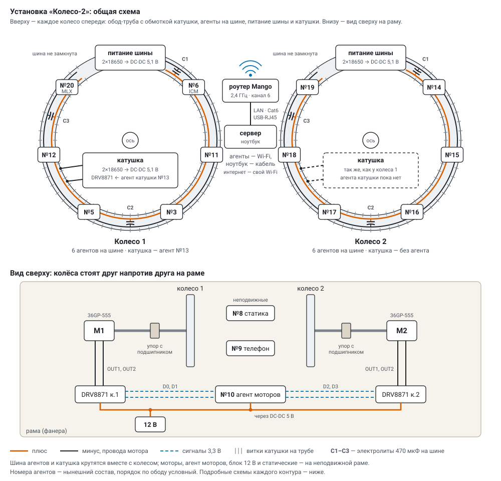

- Колёса стоят друг напротив друга, у каждого своя ось на упоре с подшипником и свой мотор
  (M1, M2). Между колёсами на неподвижной раме — статика: №8 и телефон №9.
- На каждом колесе два независимых контура: шина агентов (6 плат) и катушка со своим питанием.
  Шина вдоль обода не замкнута в кольцо.
- Колесо 1: №3, №5, №6 (датчик обода ICM-42688), №11, №12, №20 (магнитометр MLX90393), агент
  катушки №13. Колесо 2: №14–№19, агента катушки нет.
- Моторы управляются с рамы: агент №10, два моста DRV8871, блок 12 В.
- Проводов между колёсами, рамой и сервером нет: агенты — по Wi‑Fi через роутер опыта, ноутбук-сервер —
  к роутеру кабелем ([«Сеть опыта»](#сеть-опыта-wi-fi)).

**Обозначения на схемах.** Оранжевая толстая линия — плюс, тёмная — минус, синий пунктир —
сигналы 3,3 В от агента, точка — провода соединены (без точки линии просто пересекаются).
Подписи + и − стоят у каждого вывода питания.

**Полярность деталей.**

- **Диод 1N5819**: черта на символе = **полоска на корпусе** = катод. Полоской — к выводу 5V агента,
  другим концом — к плюсу питания. Наоборот — агент не включится (диод закрыт), но и не сгорит.
- **Электролит 470 мкФ**: полоса с минусами на банке — **минус**, длинная нога — плюс. Плюсом — к
  плюсу питания. Наоборот электролит греется и может вздуться.
- **Керамика 104** (0,1 мкФ) полярности не имеет.

Диод перед агентом нужен, чтобы питание с USB при прошивке по кабелю не уходило в шину, а
перепутанный плюс не сжёг плату. Падение на 1N5819 около 0,3 В: на 5V агента приходит около 4,8 В,
XIAO ESP32‑S3 этого хватает.

## Колесо: питание агентов по шине

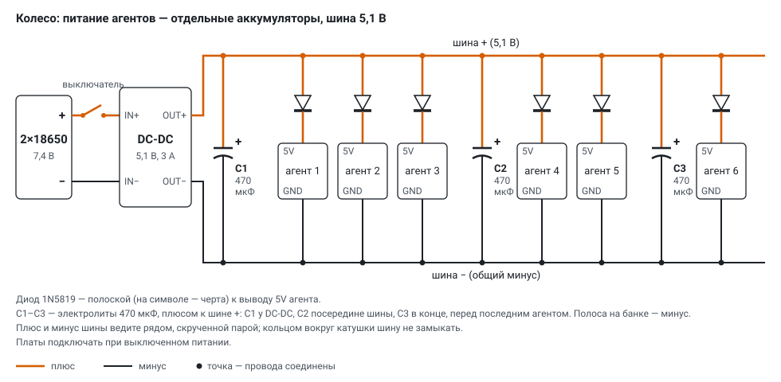

- Два 18650 последовательно (7,4 В, заряженные — 8,4 В) → выключатель → понижающий DC‑DC на
  5,1 В → шина вдоль обода: плюс и минус.
- Каждый агент: плюс шины → 1N5819 (полоской к агенту) → вывод 5V; GND агента — прямо на минус шины.
- Ток: агент в работе берёт до 0,3 А, при включении Wi‑Fi — короткие броски. Шесть агентов —
  1,5–2 А, DC‑DC на 3 А идёт с запасом.
- Электролиты — три по 470 мкФ, плюсом к шине +: **C1** у выхода DC‑DC, **C2** посередине шины
  (после третьего агента), **C3** в конце, перед последним агентом. Бросок тока платы берётся из
  ближнего конденсатора, и напряжение у дальних плат проседает меньше.
- Плюс и минус шины ведите рядом, скрученной парой. **Кольцом вокруг катушки шину не замыкать**:
  замкнутый виток вдоль тороида ловит поле катушки.
- Порядок: DC‑DC выставить на 5,1 В без нагрузки (мультиметр на OUT+ / OUT−) → выключить →
  подключить шину → включить.

> **Замыкание шины выжигает USB — прошивайте плату сразу, до шины.** 31.10 при подключении датчиков
> (контакты в самозажимных клеммах, без диодов) шину колеса 2 на миг замкнуло. После этого платы
> шины по USB не подключаются: компьютер не видит устройство вообще (проверено на №14, №17, №18).
> Но питание от USB и от шины они берут, прошивка работает, датчики и Wi‑Fi в порядке — обновлять
> их можно только по Wi‑Fi. Поэтому новую плату **сразу** прошить по USB (prime_lab, «прошить
> по USB» на планшетке) и убедиться, что она вышла на связь по Wi‑Fi, — и только потом ставить на
> шину: плату с выгоревшим USB, на которой ещё нет prime_lab, уже не прошить. Перед первым
> включением шины прозвонить 5 В–GND и 3V3–GND (долгий звон — замыкание); USB и шину вместе — только
> через 1N5819.

## Колесо: катушка

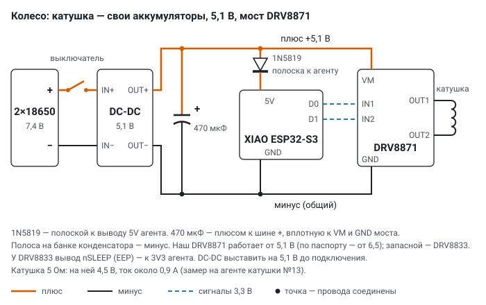

- Свой блок 2×18650 и свой DC‑DC 5,1 В, отдельно от шины агентов: броски тока катушки не
  попадают в питание датчиков на ободе.
- С одного DC‑DC — и мост (вывод VM), и агент катушки (через 1N5819, полоской к агенту). Минус
  общий: DC‑DC, электролит, GND моста, GND агента. Электролит 470 мкФ — вплотную к VM и GND моста.
- Агент: D0 → IN1, D1 → IN2; выходы моста OUT1 / OUT2 — на концы катушки. Других выводов
  управления у DRV8871 нет.
- **DRV8871** по паспорту TI работает от 6,5 В (ниже 6,1–6,4 В отключает ключи); наши модули работают
  и от 5,1 В — это вне паспорта. Если поле начнёт пропадать при севших аккумуляторах — ставить
  **DRV8833** (2,7–10,8 В, до 1,5 А на канал): входы и таблица те же, прошивка не меняется; его вывод
  nSLEEP (на некоторых модулях EEP) — к 3V3 агента, если модуль не подтянул его сам, иначе мост молчит.
- Тороид в один слой (около 5 Ом): на катушке ±4,5 В, ток около 0,9 А, поле у магнитометра в трубке
  1,20–1,26 мТл ([coil_test.md](coil_test.md)). В два слоя (около 11 Ом) — около 0,45 А. Как неровная
  трубка и намотка искажают поле — расчёт [поле тороида](toroid_field.html).
- Как сервер включает поле — [sensors.md](sensors.md), раздел «Катушки колёс»; на сколько хватает пары
  18650 — [coil_test.md](coil_test.md).

## Аккумуляторы: INA219

У каждого контура на колесе (шина агентов и катушка) свой INA219: напряжение пары 18650 и ток раз в
секунду. По ним сервер показывает заряд и сколько осталось, а программа встаёт на паузу, если пара
села (`server/battery.py`, прошивка `battery.h`).

**Колесо 1: оба модуля читает агент катушки №13**, каждый на своей шине I²C: модуль катушки — D4/D5,
модуль шины — D8/D9 (у ESP32‑S3 две шины I²C). Адрес у обоих 0x40, перемычки не паять; 3V3 и GND
агента — к обоим модулям. Шину №13 только меряет, не включает и не выключает. GND модуля шины — на
минус шины: это единственная связь минусов двух контуров. Отдельные выводы — без перемычки адреса,
провода не идут цепочкой, а сбой одного модуля или его проводов (замыкание, наводка от катушки) не
глушит второй.

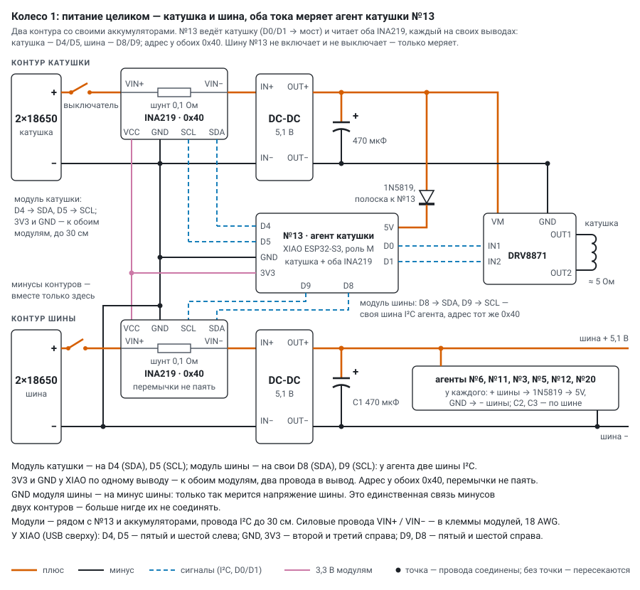

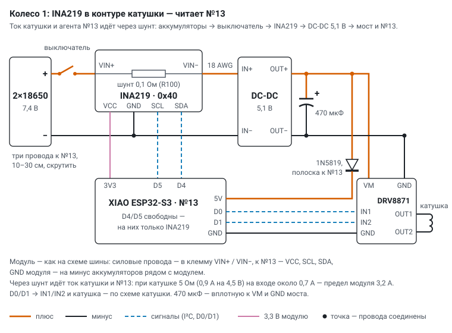

**Колесо 2** (агента катушки нет): INA219 шины читает любой агент на шине (№14–№19) на своих D4/D5, как на
схеме ниже. На колесе 1 так же может читать №6 — запасной вариант: на его D4/D5 уже стоит ICM-42688
(0x68), INA219 (0x40) — на те же выводы.

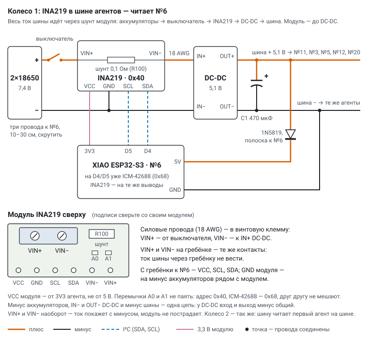

| вывод INA219 | куда |
|---|---|
| VIN+ | от выключателя — плюс аккумуляторов |
| VIN− | на IN+ DC‑DC |
| GND | общий минус (минус аккумуляторов = IN− DC‑DC: у LM2596 вход и выход минус общий) |
| VCC | 3V3 агента (не 5 В: подтяжки I²C на модуле — к VCC, ESP32 — 3,3 В) |
| SDA / SCL | D4 / D5 агента (модуль шины у №13 — D8 / D9) |

- Весь ток контура идёт через шунт (0,1 Ом на модуле): VIN+ и VIN− — проводом того же сечения, что
  основной (18 AWG). На шунте при 1,4 А — около 0,14 В. Предел модуля — 3,2 А и 26 В.
- Ставить до DC‑DC, а не после: заряд показывает напряжение аккумуляторов, а не 5,1 В шины.
- Агент ищет INA219 сначала на D4/D5, потом на D8/D9, до двух: второй — в пакете `bat2`, модуль с D8/D9 —
  с меткой `"w":1`. У агента катушки шиной колеса считается модуль на D8/D9 или с адресом 0x41 (оба
  модуля на D4/D5, у модуля шины запаяна A0), остальные — катушкой; у агента на шине — шиной.
- На основном экране, в заголовке колеса: 🔋 шина 7,62 В · 64 % · ≈ 52 мин; 🪫 «пора менять» — 6,8 В
  или меньше 15 мин; «сели» — 6,5 В (3,25 В на ячейку под нагрузкой): программа встаёт на паузу перед
  следующим шагом, «▶ Продолжить» — после замены. Ёмкость пары — заданная (2500 мА·ч) или измеренная:
  пара разрядилась от полной до «пора менять» — израсходованное записывается как её ёмкость.

**Сборка по шагам** (одинаково для шины и катушки):

1. Аккумуляторы вынуть. Плюсовой провод между выключателем и IN+ DC‑DC перерезать: конец от
   выключателя — в винтовую клемму **VIN+**, конец к DC‑DC — в **VIN−**.
2. **GND** модуля — коротким проводом на минус аккумуляторов рядом с модулем (тот же минус, что у
   IN− и OUT− DC‑DC и у шины). У модуля шины, который читает №13, через этот GND соединяются минусы двух
   контуров — других связей между ними нет.
3. Провода к агенту, 10–30 см, скрутить вместе: **VCC ← 3V3**, **SCL ← D5**, **SDA ← D4**. У XIAO
   (разъём USB сверху) D4 и D5 — пятый и шестой выводы слева, 3V3 — третий справа (под 5V и GND).
   Модуль шины у №13 — **SCL ← D9**, **SDA ← D8** (пятый и шестой справа, под 3V3 и D10), VCC и GND — на
   те же 3V3 и GND, что у модуля катушки (два провода в один вывод).
4. Перемычки адреса A0 и A1 не паять (0x40).
5. Прозвонка без аккумуляторов: VIN+ — VIN− звенит (шунт 0,1 Ом); VCC — GND модуля, 3V3 — GND и
   5V — GND агента **не звенят** (короткий писк на 5V — заряжается конденсатор шины, это нормально);
   SDA и SCL не звенят ни между собой, ни с GND. Паять флюсом, не пастой; после пайки отмыть спиртом.
6. Вставить аккумуляторы, включить: на выходе DC‑DC по-прежнему 5,1 В.
7. При старте агент пишет в журнал `BAT INA219 at 0x40` (и `BAT INA219 at 0x40 (D8/D9)`); на основном
   экране в заголовке колеса — 🔋 «шина К1 … В», под колесом — «катушка К1 … В». Прошивку обновить по
   Wi‑Fi: `python tools/ota.py all`.

## Датчики: акселерометры и магнитометр

Все датчики — на I²C агента: **D4 (GPIO5) — SDA, D5 (GPIO6) — SCL**, 400 кГц, питание 3V3 и GND агента (не 5V).
Прошивка при старте сама ищет, что подключено, и сообщает адрес, код датчика и режимы, прочитанные обратно из
регистров ([sensors.md](sensors.md)). Выводы выбора режима и адреса (CS, SCLK, AD0, ASEL, A0/A1) **не оставлять
висеть**: висящий вывод адреса даёт прыгающий адрес и «no sensors». На схемах — выводы с обеих сторон,
провода, что уже есть на модуле (конденсаторы у выводов микросхемы, подтяжки), что добавить, неиспользуемые
выводы и проверка по шагам. Номиналы и подписи на ваших платах могут отличаться — паять по надписям.

### Датчик обода: ICM-42688

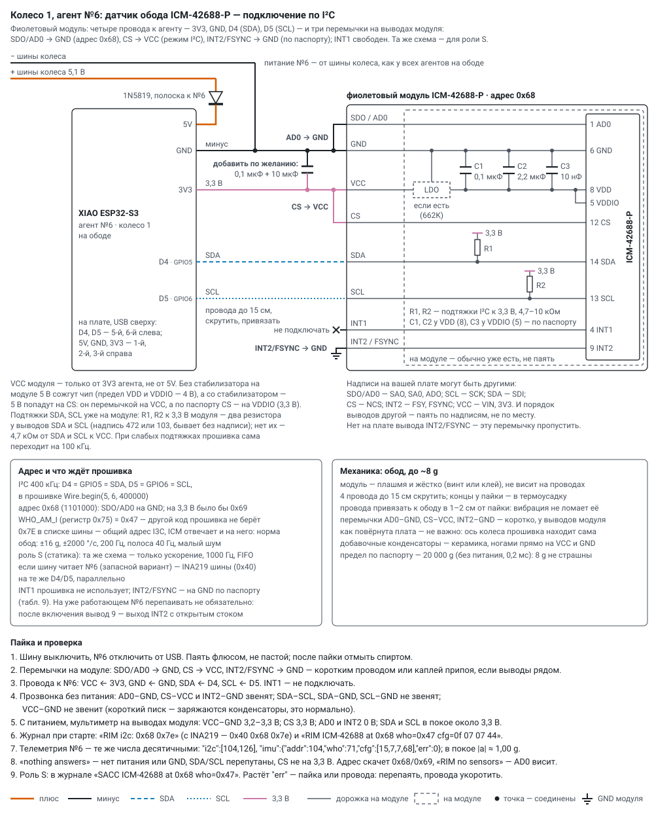

Агент №6 колеса 1 — на ободе, питание от шины колеса через свой 1N5819. Фиолетовый модуль ICM-42688-P:
адрес **0x68**, код WHO_AM_I **0x47**; на ободе ±16 g, ±2000 °/с, 200 Гц. Тот же модуль по той же схеме
служит статическим акселерометром (роль S: только ускорение, 1000 Гц, FIFO).

| вывод модуля | куда | зачем |
|---|---|---|
| VCC (бывает VIN, 3V3) | 3V3 агента | только 3,3 В, не 5V: без стабилизатора на модуле 5 В сожгут чип (предел VDD, VDDIO — 4 В), а со стабилизатором 5 В попадут на CS — он перемычкой на VCC, а по паспорту CS — на VDDIO |
| GND | GND агента | общий минус (он же минус шины колеса) |
| SDA (бывает SDI) | D4 агента (GPIO5) | данные I²C |
| SCL (бывает SCK) | D5 агента (GPIO6) | такт I²C, 400 кГц |
| SDO / AD0 (бывает SAO, SA0, ADO) | перемычкой на GND модуля | адрес 0x68 (вывод 1 чипа). Висящий AD0 — адрес скачет 0x68/0x69 и «no sensors» |
| CS (бывает NCS) | перемычкой на VCC модуля | режим I²C: по паспорту вывод 12 — на VDDIO. Висящий CS — чип может не ответить по I²C |
| INT1 | не подключать | прошивка не использует |
| INT2 / FSYNC (бывает FSY) | перемычкой на GND модуля | по паспорту (вывод 9): FSYNC не используется — на GND. После включения это выход INT2 с открытым стоком, прошивка его не трогает; на работающем №6 перепаивать не обязательно. Нет такого вывода на плате — пропустить |

На модуле обычно уже есть (паять не надо): C1 0,1 мкФ и C2 2,2 мкФ у VDD (вывод 8), C3 10 нФ у VDDIO (вывод 5),
подтяжки SDA и SCL 4,7–10 кОм к 3,3 В модуля, иногда стабилизатор 3,3 В (662K). Подтяжки видно на плате — два
резистора у выводов SDA и SCL (надпись 472 или 103, бывает без надписи); нет их — 4,7 кОм от SDA и от SCL к VCC.
По желанию — керамика 0,1 мкФ + 10 мкФ прямо на VCC и GND модуля.

Механика: модуль — плашмя и жёстко (винт или клей), не висит на проводах; 4 провода до 15 см скрутить и привязать
к ободу в 1–2 см от пайки (на ободе до ~8 g). Как повёрнута плата — не важно: ось колеса прошивка находит по
гироскопу. Радиус от оси до чипа — линейкой, в окно «⊙ Калибровка колёс…» ([sensors.md](sensors.md)).

**Пайка и проверка:**

1. Шину выключить, №6 отключить от USB. Паять флюсом, не пастой; после пайки отмыть спиртом.
2. Перемычки на модуле: SDO/AD0 → GND, CS → VCC, INT2/FSYNC → GND — коротким проводом или каплей припоя,
   если выводы рядом.
3. Провода к №6: VCC ← 3V3, GND ← GND, SDA ← D4, SCL ← D5. INT1 — не подключать. У XIAO (USB сверху)
   D4, D5 — пятый и шестой слева; 5V, GND, 3V3 — первый, второй, третий справа.
4. Прозвонка без питания: AD0–GND, CS–VCC и INT2–GND звенят; SDA–SCL, SDA–GND, SCL–GND не звенят;
   VCC–GND не звенит (короткий писк — заряжаются конденсаторы, это нормально).
5. С питанием, мультиметр на выводах модуля: VCC–GND 3,2–3,3 В; CS 3,3 В; AD0 и INT2 0 В; SDA и SCL в покое
   около 3,3 В.
6. Журнал при старте: `RIM i2c: 0x68 0x7e` (с INA219 — `0x40 0x68 0x7e`), затем
   `RIM ICM-42688 at 0x68 who=0x47 cfg=0f 07 07 44`. Отклик на 0x7e — общий адрес I3C, это нормально.
7. Телеметрия №6 — те же числа десятичными: `"i2c":[104,126]`,
   `"imu":{"addr":104,"who":71,"cfg":[15,7,7,68],"err":0}`; в покое модуль ускорения ≈ 1,00 g.
8. `nothing answers` — нет питания или GND, SDA/SCL перепутаны, CS не на 3,3 В. Адрес скачет 0x68/0x69 или
   `RIM no sensors` — AD0 висит, запаять на GND. При слабых подтяжках прошивка сама переходит на 100 кГц
   (`RIM bus 100 kHz`).
9. Роль S: в журнале `SACC ICM-42688 at 0x68 who=0x47`. Растёт `err` — пайка или провода: перепаять,
   провода укоротить.

### Магнитометр: MLX90393

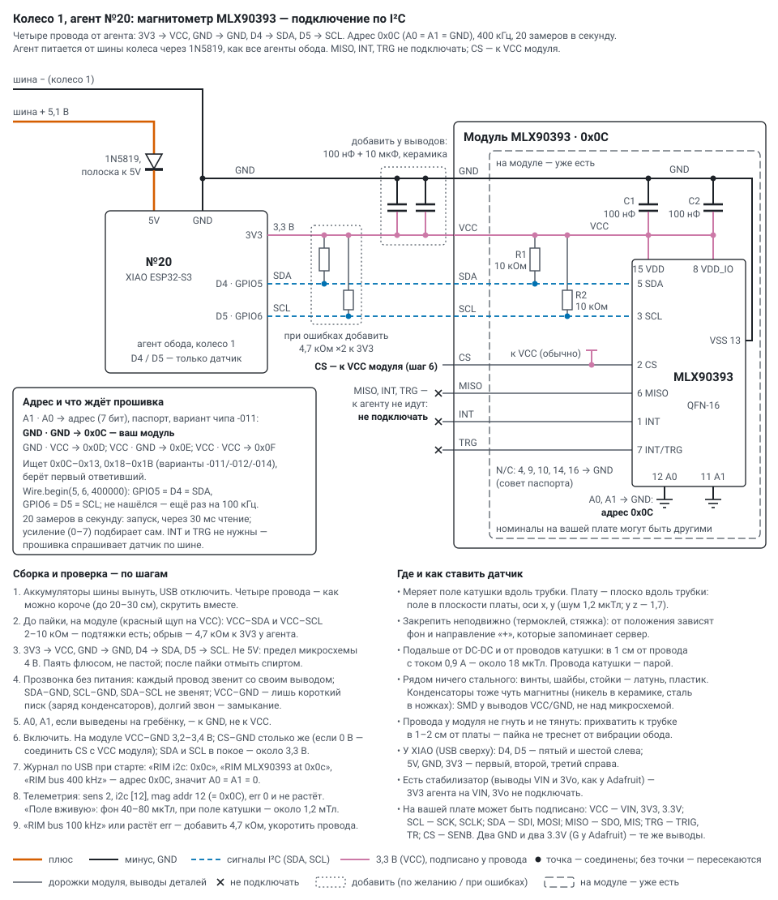

Агент №20 колеса 1 стоит в трубке катушки и меряет поле катушки вдоль трубки; питается от шины колеса через
1N5819, как все агенты обода. К датчику — четыре провода. Адрес 0x0C (A0 = A1 = GND), 400 кГц, 20 замеров в
секунду, усиление подбирается само. Номера выводов микросхемы (QFN-16) — по паспорту Melexis (ред. 012,
табл. 3), схема модуля — типовая (паспорт, рис. 24).

| вывод модуля | куда | зачем |
|---|---|---|
| VCC (бывает VIN, 3V3, 3.3V) | 3V3 агента №20 | питание VDD (выв. 15) и VDD_IO (выв. 8), 2,2–3,6 В. **Не 5V**: предел микросхемы 4 В |
| GND | GND агента | минус, VSS (выв. 13); тот же вывод GND, куда пришёл минус шины |
| SDA (бывает SDI, MOSI) | D4 · GPIO5 | данные I²C (выв. 5) |
| SCL (бывает SCK, SCLK) | D5 · GPIO6 | такт I²C (выв. 3), 400 кГц |
| CS (бывает SENB) | к VCC модуля; обычно уже соединён на плате, к агенту не идёт | высокий уровень на CS (выв. 2) включает I²C; при питании на нём ≈ 3,3 В, если 0 В — перемычка CS→VCC |
| MISO (бывает SDO, MIS) | не подключать | выход SPI (выв. 6), в I²C по паспорту свободен |
| INT | не подключать | «замер готов» (выв. 1); прошивка сама спрашивает датчик по шине |
| TRG (бывает TRIG, TR) | не подключать | внешний запуск или второе прерывание (выв. 7); внешний запуск в прошивке выключен |
| A0, A1 | на модуле обычно уже к GND; если выведены на гребёнку — к GND, **не к VCC** | младшие биты адреса (выв. 12, 11): оба 0 → 0x0C |

На плате бывает по два вывода GND и 3.3V (у Adafruit лишний GND подписан G) — это одни и те же выводы.

- **Уже на модуле:** C1 и C2 по 100 нФ — у VDD и у VDD_IO, подтяжки SDA и SCL к VCC (обычно 2,2–10 кОм), CS к VCC,
  A0 и A1 к GND. Выводы N/C микросхемы (4, 9, 10, 14, 16) паспорт советует соединить с GND — это дело платы.
- **Добавить по желанию:** керамику 100 нФ + 10 мкФ между VCC и GND прямо у выводов модуля (провода длинные, обод
  трясётся). SMD-керамика у выводов VCC/GND, не над микросхемой: конденсаторы тоже чуть магнитны (никель), а
  неподвижное железо сервер вычтет как фон.
- **Добавить при ошибках:** 4,7 кОм от SDA и от SCL к 3V3 у агента — если в журнале `RIM bus 100 kHz` или в
  телеметрии растёт `err`.
- Модуль со стабилизатором (выводы VIN и 3Vo, как у Adafruit) — 3V3 агента на VIN, 3Vo не подключать.
- Прошивка ищет датчик на 0x0C–0x13 и 0x18–0x1B (варианты чипа -011, -012, -014 по паспорту, табл. 14).

**Где ставить.** Плату — плоско вдоль трубки: поле катушки ляжет в плоскость платы, на оси x, y (шум 1,2 мкТл, у z —
1,7). Закрепить неподвижно (термоклей, стяжка): от положения зависят фон и направление «+», которые запоминает сервер.
Подальше от DC-DC и от проводов катушки: в 1 см от провода с 0,9 А — около 18 мкТл; провода катушки — парой. Рядом
ничего стального: винты, шайбы, стойки — латунь или пластик. Провода у модуля не гнуть и не тянуть: прихватить к трубке
в 1–2 см от платы, чтобы пайка не трескалась от вибрации.

**Сборка и проверка по шагам:**

1. Аккумуляторы шины вынуть, USB отключить. Четыре провода — как можно короче (до 20–30 см), скрутить вместе.
2. До пайки, на модуле (красный щуп на VCC): VCC–SDA и VCC–SCL 2–10 кОм — подтяжки есть. Обрыв — добавить
   4,7 кОм от SDA и от SCL к 3V3 у агента. После пайки так не мерить: мешают диоды на выводах агента.
3. Пайка: **3V3 → VCC, GND → GND, D4 → SDA, D5 → SCL** (у XIAO, USB сверху: D4, D5 — пятый и шестой слева;
   GND, 3V3 — второй и третий справа). Паять флюсом, не пастой; после пайки отмыть спиртом.
4. Прозвонка без питания: каждый провод звенит со своим выводом; SDA–GND, SCL–GND и SDA–SCL **не звенят**;
   VCC–GND — лишь короткий писк (заряжаются конденсаторы), долгий звон — замыкание.
5. A0, A1, если выведены на гребёнку, — к GND, не к VCC.
6. Включить. На модуле VCC–GND 3,2–3,4 В; CS–GND столько же (если 0 В — соединить CS с VCC модуля); SDA и SCL в покое
   около 3,3 В.
7. Журнал по USB при старте: `RIM i2c: 0x0c`, `RIM MLX90393 at 0x0c`, `RIM bus 400 kHz` — адрес 0x0C, значит
   A0 = A1 = 0.
8. Телеметрия агента: `sens` 2, `i2c` [12], `mag` с `addr` 12 (= 0x0C), `err` 0 и не растёт. На основном экране —
   «поле вживую»: фон 40–80 мкТл (Земля и железо рядом), при поле катушки — 1,20–1,26 мТл
   ([coil_test.md](coil_test.md)), знак меняется вместе с полем.
9. `RIM bus 100 kHz` или растёт `err` — добавить подтяжки 4,7 кОм и укоротить провода.

### Статика: ADXL355

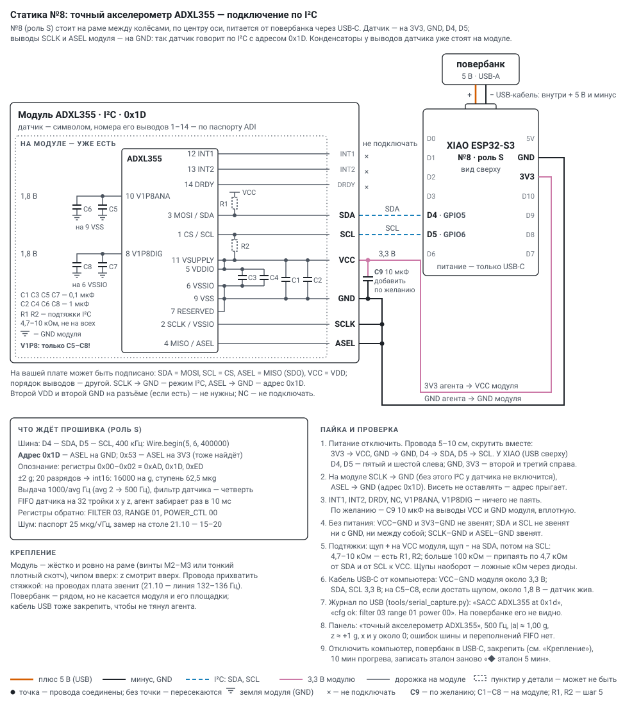

Агент №8 (роль S) стоит на раме между колёсами, по центру оси, и работает от повербанка кабелем USB-A → USB-C;
вывод 5V агента свободен. Проверяют его до установки от кабеля USB компьютера: журнал платы виден только по USB.

Датчик говорит по I²C с адресом 0x1D: вывод SCLK модуля — на GND (вывод 2 датчика SCLK/VSSIO, по паспорту ADI
«на VSSIO для I2C»), вывод ASEL — тоже на GND. Конденсаторы у датчика уже стоят на модуле (паспорт ADI, рис. 59),
пары 0,1 мкФ + 1 мкФ: у 11 VSUPPLY — C1, C2 на 9 VSS; у 5 VDDIO — C3, C4 на 6 VSSIO; у 10 V1P8ANA — C5, C6 на
9 VSS; у 8 V1P8DIG — C7, C8 на 6 VSSIO. Подписи на вашей плате могут отличаться: SDA = MOSI, SCL = CS,
ASEL = MISO (SDO), VCC = VDD.

| вывод модуля | куда | зачем |
|---|---|---|
| VCC (VDD) | 3V3 агента | питание 3,3 В; на модуле — на выводы 11 VSUPPLY и 5 VDDIO. Не 5 В: предел датчика 3,6 В |
| GND | GND агента | минус; на модуле — 9 VSS, 6 VSSIO (и 7 RESERVED — по паспорту можно и не подключать) |
| SDA (MOSI) | D4 · GPIO5 | данные I²C — вывод 3 MOSI/SDA |
| SCL (CS) | D5 · GPIO6 | такт I²C — вывод 1 CS/SCL |
| SCLK | GND модуля | вывод 2 SCLK/VSSIO на землю — включает I²C |
| ASEL (MISO, SDO) | GND модуля | вывод 4: адрес 0x1D (на 3V3 — 0x53, прошивка найдёт и так); висеть не оставлять |
| INT1, INT2, DRDY | никуда | выводы 12, 13, 14 — прошивка их не использует |
| NC; второй VDD и второй GND (если есть) | никуда | NC ни с чем не соединён; вторые VDD и GND уже соединены на плате с первыми |
| V1P8ANA, V1P8DIG (если выведены) | никуда | выводы 10, 8 — выходы стабилизаторов 1,8 В внутри датчика, на них только свои конденсаторы; на 3V3 — сгорит |
| C9 10 мкФ, керамика (106) — по желанию | между VCC и GND вплотную к модулю | гасит броски тока Wi‑Fi агента на 3V3; полезен, если провода длиннее 10 см |

Как прошивка настраивает датчик (предел, частота, FIFO) — [sensors.md](sensors.md).

1. Питание отключить. Провода 5–10 см, скрутить вместе: 3V3 → VCC, GND → GND, D4 → SDA, D5 → SCL. У XIAO (USB
   сверху) D4, D5 — пятый и шестой выводы слева; GND, 3V3 — второй и третий справа.
2. На модуле SCLK → GND (без этого I²C у датчика не включится), ASEL → GND (адрес 0x1D). Не оставлять висеть —
   адрес будет прыгать.
3. INT1, INT2, DRDY, NC, V1P8ANA, V1P8DIG — ничего не паять. По желанию — C9 10 мкФ прямо на выводы VCC и GND модуля.
4. Прозвонка без питания: VCC–GND модуля и 3V3–GND агента не звенят; SDA и SCL не звенят ни с GND, ни между собой;
   SCLK–GND и ASEL–GND звенят. Паять флюсом, не пастой; после пайки отмыть спиртом.
5. Подтяжки, мультиметр на сопротивление: щуп + (красный) на VCC модуля, щуп − на SDA, потом на SCL.
   4,7–10 кОм — подтяжки на модуле есть; больше 100 кОм — припаять по 4,7 кОм от SDA и от SCL к VCC модуля.
   Щупы наоборот не ставить: ток пойдёт через защитные диоды датчика и ESP32 к VCC, и мультиметр покажет ложные
   килоомы.
6. Кабель USB-C от компьютера: VCC–GND модуля около 3,3 В; SDA и SCL в покое около 3,3 В; на конденсаторах
   V1P8ANA / V1P8DIG (если достать щупом) около 1,8 В — стабилизаторы датчика живы.
7. Журнал по USB (`tools/serial_capture.py`): `SACC ADXL355 at 0x1d` и
   `SACC ADXL355 cfg ok: filter 03 range 01 power 00 …, ±2 g, 500 Hz`. На повербанке журнал не виден.
8. На основном экране: у №8 — «точный акселерометр ADXL355», 500 Гц, |a| ≈ 1,00 g; модуль лежит чипом вверх —
   z ≈ +1 g, x и y около 0; ошибок шины и переполнений FIFO нет.
9. Отключить компьютер, повербанк в USB-C. Закрепить жёстко и ровно на раме (винты М2–М3 или тонкий плотный
   скотч, не вспененный), z — вверх. Провода прихватить стяжкой: плата на проводах звенит (линия 132–136 Гц в
   спектре). Повербанк — рядом, но не касается модуля и его площадки; кабель USB закрепить, чтобы не тянул агента.
10. Дать прогреться 10 мин и записать эталон заново («◆ эталон 5 мин», [static_watch.md](static_watch.md)).

Источники:
- [ADXL354/ADXL355 datasheet Rev. A (DESY copy), Figure 59, p. 21](https://www.zeuthen.desy.de/~sulanke/Projects/ICECUBE/mDOM/mainboard/datasheets/sensor_inclino_accelero_adxl354_355.pdf)
- [ADI wiki, EVAL-ADXL355-PMDZ (P1 pinout)](https://wiki.analog.com/resources/eval/user-guides/eval-adicup360/hardware/adxl355)

## Рама: моторы колёс

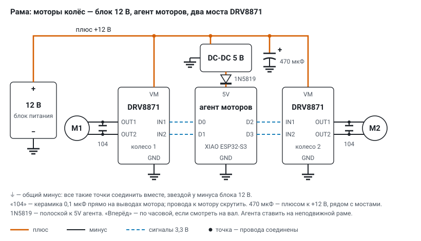

- Блок 12 В: плюс — на VM обоих мостов DRV8871 (6,5–45 В, до 3,6 А, предел тока задаёт резистор на
  модуле) и на вход DC‑DC 5 В агента моторов. Электролит 470 мкФ на +12 В рядом с мостами.
- Агент моторов №10 стоит **на неподвижной раме**: D0 → IN1, D1 → IN2 моста колеса 1; D2 → IN1,
  D3 → IN2 моста колеса 2. Питание агента — DC‑DC 5 В → 1N5819 (полоской к агенту) → 5V.
- Моторы 36GP‑555 (12 В, редуктор 112 об/мин) — на OUT1 / OUT2 своих мостов. Керамика 104 прямо
  на выводах мотора гасит помехи щёток; провода к мотору скрутить.
- Все минусы (⏚ на схеме) — блок, мосты, DC‑DC, агент — соединить **звездой у минуса блока 12 В**,
  а не цепочкой от моста к мосту.
- «Вперёд ▶» — по часовой стрелке, если смотреть на вал спереди. Если моторы стоят зеркально и
  «вместе» крутит колёса в разные стороны — у второго поменять провода OUT1 / OUT2.
- Неисправный модуль DRV8871 узнаётся так: на IN 3,2 / 2,7 В, на VM 12 В, на OUT — ноль.
- Режимы, разгон, сторож и обратная связь по оборотам — [sensors.md](sensors.md), раздел «Моторы колёс».

## Сеть опыта (Wi‑Fi)

Своя сеть только для установки: в ней агенты, телефон и ноутбук-сервер, чужих устройств нет. Эфир — тоже
часть опыта (CSI, кадры соседей, обратный шум), поэтому сеть настроена так, чтобы он был ровным и
предсказуемым.

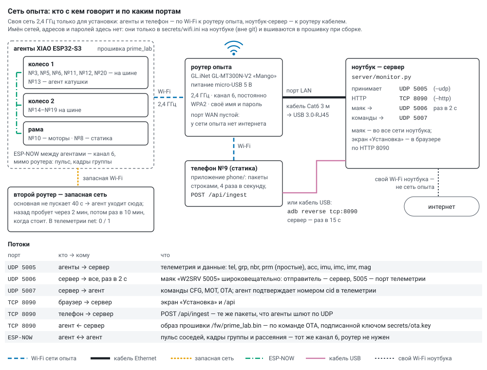

| что | как настроено | зачем |
|---|---|---|
| роутер | GL.iNet **GL‑MT300N‑V2 «Mango»**, питание micro‑USB 5 В | маленький, только 2,4 ГГц — то, что умеет ESP32 |
| имя и пароль сети | **свои**, не заводские (заводской пароль у всех Mango одинаковый); WPA2‑PSK | чужие платы и телефоны в сеть опыта не попадают |
| где хранятся | только в `secrets/wifi.ini` на ноутбуке (вне git) → `tools/gen_secrets.py` → прошивка | в репозитории, документах и на GitHub их нет |
| канал | **6, постоянный** (не «авто») | соседние сети стоят на 1 и 9–11 — шестой между ними; роутер не прыгает по каналам посреди опыта |
| стандарт у агентов | только **802.11 b/g**, сон радио выключен | CSI приходит на каждый пакет; шум приёмника идёт в генератор непрерывно |
| ноутбук | порт **LAN** роутера ↔ кабель Cat6 3 м ↔ адаптер UGREEN USB 3.0 → RJ45 (AX88179) | сервер не занимает эфир агентов; кабель не рвётся, когда в эфире много кадров |
| порт WAN | пустой | у сети опыта нет интернета; ноутбук ходит в интернет по своему Wi‑Fi |
| запасная сеть | второй роутер; её имя и пароль — в том же `wifi.ini` | основная 40 с не пускает — агент уходит на запасную; на основную пробует через 2 мин, потом раз в 10 мин, когда стоит; в телеметрии `net` 0 / 1 |

**Порты** (сервер `server/monitor.py`): UDP 5005 — приём телеметрии (`--udp`), UDP 5006 — маяк, UDP 5007 —
команды агентам, TCP 8090 — HTTP (`--http`): экран, `/api`, приём от телефона, образ прошивки для OTA.

**Как агент находит сервер.** Адреса в прошивке нет: сервер раз в 2 с рассылает во все свои сети маяк
`W2SRV 5005` на UDP 5006, агент берёт адрес отправителя. Поэтому агент на запасной сети тоже находит сервер,
если ноутбук в ней. Команды (`CFG`, `MOT`, роли) приходят на UDP 5007, агент подтверждает их номером `cid` в
телеметрии; команда `OTA` подписана ключом `secrets/ota.key`, образ агент скачивает по HTTP с порта 8090.

**Один эфир на всех.** ESP‑NOW (пульс соседей, кадры группового режима и рассеяния) идёт на том же канале 6,
что и Wi‑Fi: агенты не перестраивают радио. Поэтому CSI берут с пульса соседей, а пинг роутера — только как
отдельный шум и короткими опытами ([how_it_works.md](how_it_works.md), «Температура и сторожа»). Сервер и
телефон эфир сверх нужного не занимают: ноутбук — кабелем, телефон шлёт пачками, 4 раза в секунду.

**Телефон** — в той же сети: служба приложения находит сервер по маяку и шлёт пакеты по HTTP на порт 8090
(`POST /api/ingest`). Без Wi‑Fi — кабелем USB: сервер раз в 15 с делает `adb reverse tcp:8090`, и пакеты идут
по кабелю ([sensors.md](sensors.md), «Телефон»).

**Если сеть меняется.** Новое имя или пароль — в `secrets/wifi.ini`, затем `python tools/gen_secrets.py` и
прошивка по воздуху (`python tools/ota.py all`): платы, которые новую сеть ещё не знают, держатся за запасную,
поэтому опечатка в пароле не требует перешивки по USB. Канал на роутере менять вместе с проверкой соседей
(анализатор Wi‑Fi на телефоне): шестой выбран по замеру.
