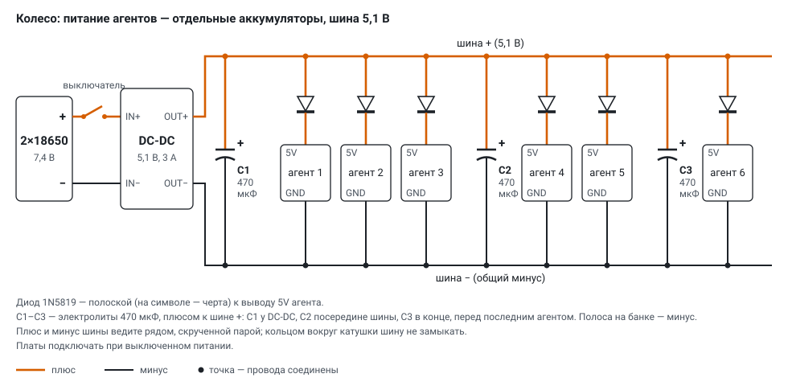
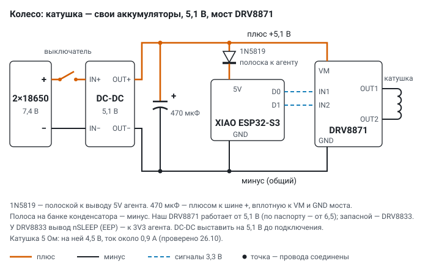
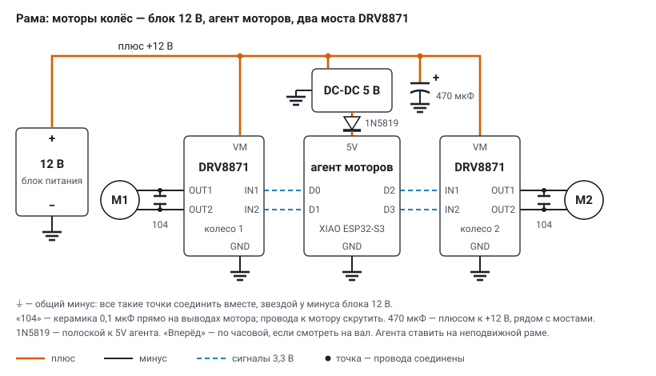

# Схемы подключения: колесо и моторы

На установке три контура питания, проводами между собой не связанных: агенты говорят с
сервером по Wi‑Fi, общий минус между контурами не нужен.

| контур | где | питание | что управляет |
|---|---|---|---|
| шина агентов | на колесе | свои 2×18650 → DC‑DC 5,1 В | ничего: аккумуляторы и выключатель |
| катушка | на колесе | свои 2×18650 → DC‑DC 5,1 В | агент катушки (роль M) через мост DRV8833 |
| моторы | на раме | блок 12 В; агенту — DC‑DC 5 В | агент моторов №10 (роль M) через два DRV8871 |

**Обозначения на схемах.** Оранжевая толстая линия — плюс, тёмная — минус, синий пунктир —
сигналы 3,3 В от агента к мосту, точка — провода соединены (без точки линии просто
пересекаются). Подписи + и − стоят у каждого вывода питания.

**Полярность деталей.**

- **Диод 1N5819**: черта на символе = **полоска на корпусе** = катод. Полоской — к выводу 5V агента,
  другим концом — к плюсу питания. Наоборот — агент не включится (диод закрыт), но и не сгорит.
- **Электролит 470 мкФ**: полоса с минусами на банке — **минус**, длинная нога — плюс. Плюсом — к
  плюсу питания. Наоборот электролит греется и может вздуться.
- **Керамика 104** (0,1 мкФ) полярности не имеет.

Зачем диод перед агентом: питание с USB при прошивке по кабелю не уходит обратно в шину, а
перепутанный плюс не сожжёт плату. Падение на 1N5819 около 0,3 В — на 5V агента приходит
около 4,8 В, этого XIAO ESP32‑S3 хватает.

## Колесо: питание агентов по шине

- Два 18650 последовательно (7,4 В, заряженные — 8,4 В) → выключатель → понижающий DC‑DC на
  5,1 В → шина вдоль обода: плюс и минус.
- Каждый агент: плюс шины → 1N5819 (полоской к агенту) → вывод 5V; GND агента — прямо на минус
  шины.
- Ток: агент в работе берёт до 0,3 А, при включении Wi‑Fi — короткие броски. Шесть агентов —
  1,5–2 А, DC‑DC на 3 А идёт с запасом. Электролит 470 мкФ у выхода DC‑DC сглаживает броски;
  при длинной шине можно поставить ещё 220–470 мкФ у дальних плат, после диода.
- Плюс и минус шины ведите рядом, скрученной парой. **Кольцом вокруг катушки шину не замыкать**:
  замкнутый виток вдоль тороида ловит поле катушки и сам становится витком.
- Порядок: DC‑DC выставить на 5,1 В без нагрузки (мультиметр на OUT+ / OUT−) → выключить →
  подключить шину → включить.

## Колесо: управление катушкой

- Свой блок 2×18650 и свой DC‑DC 5,1 В, отдельно от шины агентов: броски тока катушки не
  попадают в питание датчиков на ободе.
- С одного DC‑DC — и мост (вывод VM), и агент катушки (через 1N5819, полоской к агенту). Минус
  общий: DC‑DC, электролит, GND моста, GND агента.
- Мост — **DRV8833** (питание 2,7–10,8 В, до 1,5 А на канал). DRV8871 от 5 В не включится: ему
  нужно не меньше 6,5 В. Таблица входов у них одинаковая, прошивка не меняется.
- Агент: D0 → IN1, D1 → IN2; выходы моста OUT1 / OUT2 — на концы катушки. Вывод nSLEEP (на
  некоторых модулях EEP) — к 3V3 агента, если модуль не подтянул его сам; без этого мост молчит.
- Электролит 470 мкФ — вплотную к VM и GND моста.
- Ток: тороид в один слой (около 5 Ом) — около 1 А, поле внутри около 1,7 мТл; в два слоя
  (около 11 Ом) — около 0,45 А.
- Управление: агент в роли M, место «катушка» своего колеса. Сервер (`server/coils.py`) раз в
  секунду шлёт `MOT a=±доля b=0 r=5000 w=5`: знак — направление поля (+ / −), 1000 — постоянный
  ток; нет команды 5 с — агент снимает ток. На планшетке — слой «поле катушки» (выкл / + / −).
- Проверено на агенте катушки №13 с мостом без катушки: мультиметр на OUT1 / OUT2 показывает смену
  знака при переключении + / − (30 % и 100 %, по 10 с). Под нагрузкой (катушка, около 1 А) —
  проверить, что агент не перезагружается при включении и смене направления.

## Рама: моторы колёс

- Блок 12 В: плюс — на VM обоих мостов DRV8871 (6,5–45 В, до 3,6 А, предел тока задаёт резистор на
  модуле) и на вход DC‑DC 5 В агента моторов. Электролит 470 мкФ на +12 В рядом с мостами.
- Агент моторов №10 стоит **на неподвижной раме**: D0 → IN1, D1 → IN2 моста колеса 1; D2 → IN1,
  D3 → IN2 моста колеса 2. Питание агента — DC‑DC 5 В → 1N5819 (полоской к агенту) → 5V.
- Моторы 36GP‑555 (12 В, редуктор 112 об/мин) — на OUT1 / OUT2 своих мостов. Керамика 104 прямо
  на выводах мотора гасит помехи щёток; провода к мотору скрутить.
- Все минусы (⏚ на схеме) — блок, мосты, DC‑DC, агент — соединить **звездой у минуса блока 12 В**,
  а не цепочкой от моста к мосту.
- «Вперёд ▶» — по часовой стрелке, если смотреть на вал спереди. Если моторы стоят зеркально и
  «вместе» крутит колёса в разные стороны — у второго поменять провода OUT1 / OUT2.
- Режимы, разгон, сторож и обратная связь по оборотам — в [sensors.md](sensors.md), раздел
  «Моторы колёс».
